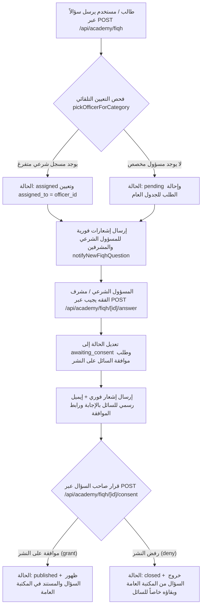
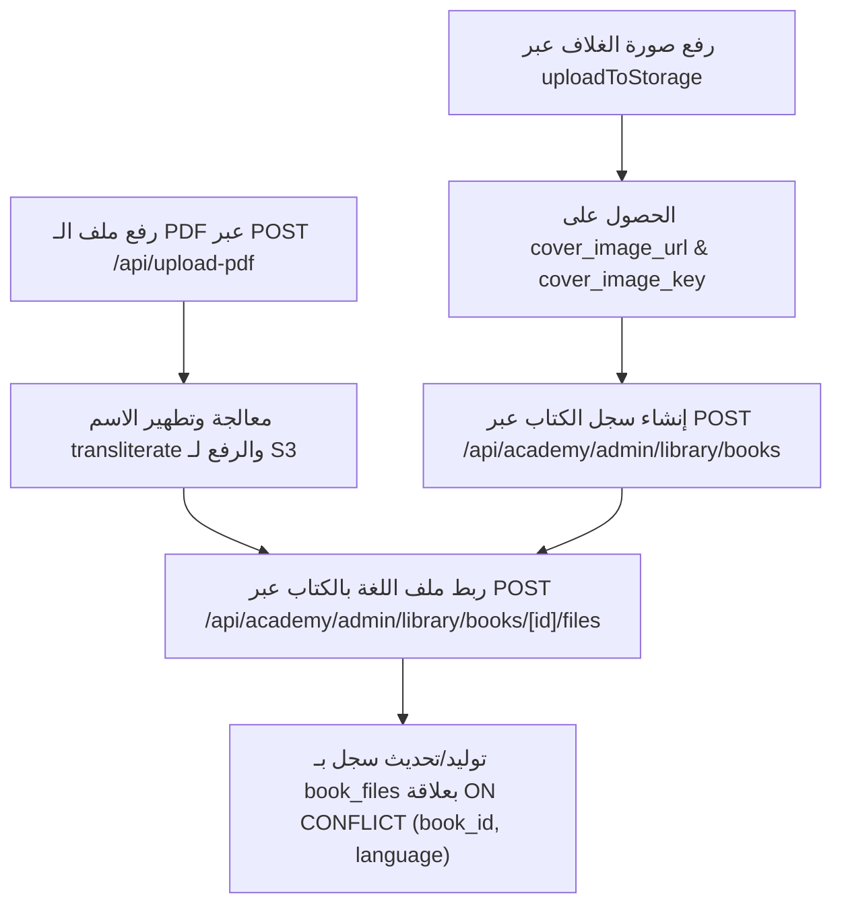
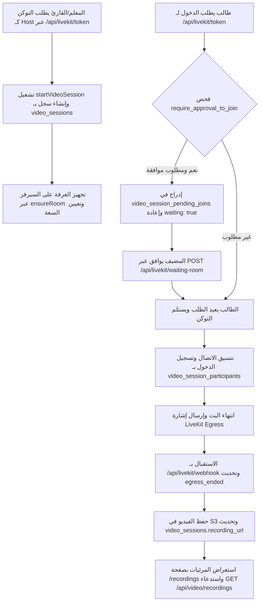
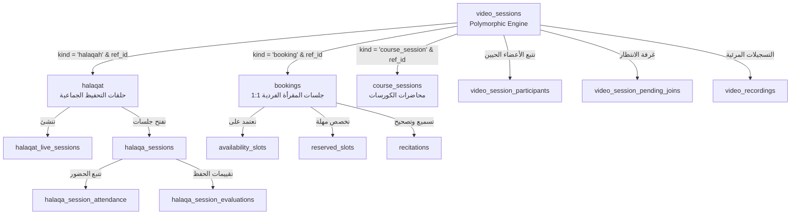
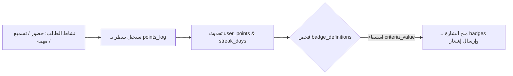
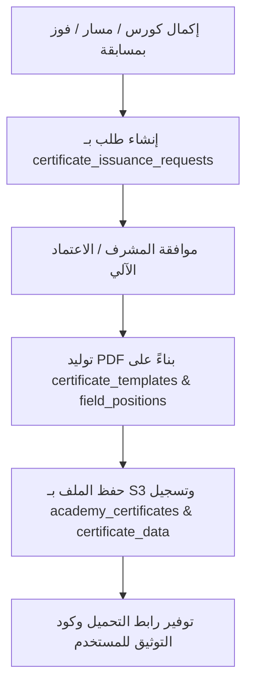

# توثيق منصة إتقان (Itqan Platform Documentation)

---

## جدول المحتويات (Table of Contents)

1. [نظام المصادقة والتصريح (Authentication)](#authentication)
2. [الصفحات العامة للمقرأة والأكاديمية (Public Pages)](#public-pages)
3. [لوحة إدارة الأكاديمية (Academy Admin)](#academy-admin)
4. [لوحة المعلم (Teacher Dashboard)](#teacher-dashboard)
5. [لوحة الطالب (Student Dashboard)](#student-dashboard)
6. [لوحة ولي الأمر (Parent Dashboard)](#parent-dashboard)
7. [لوحات المشرفين (Supervisors)](#supervisors)
8. [منظومة الفقه والفتوى (Fiqh System)](#fiqh-system)
9. [المكتبة الرقمية (Digital Library)](#digital-library)
10. [قسم المجتمع والمنتدى (Community)](#community)
11. [الجلسات الحية و LiveKit (Live Sessions & LiveKit)](#live-sessions--livekit)
12. [لوحة إدارة المنصة العليا (Platform Admin)](#platform-admin)
13. [المهام المجدولة (Cron Jobs)](#cron-jobs)
14. [قاعدة البيانات — المستخدمين والصلاحيات (Database — Users & Permissions)](#database--users--permissions)
15. [قاعدة البيانات — النظام التعليمي والحلقات (Database — Learning Core)](#database--learning-core)
16. [قاعدة البيانات — النقاط والشهادات (Database — Gamification & Certificates)](#database--gamification--certificates)
17. [قاعدة البيانات — الرسائل والفقه والنظام (Database — Communication, Fiqh & System)](#database--communication-fiqh--system)

---

# Authentication

يتناول هذا القسم التوثيق الشامل والتفصيلي لنظام المصادقة والتحقق (Authentication & Authorization System) الخاص بـ **منصة إتقان**، شاملاً جميع مسارات واجهة المستخدم (Frontend Routes) ونقاط الاتصال البرمجية (API Endpoints)، بما يتضمنه ذلك من أغراض، أدوار مسموح بها، حقول الطلب والاستجابة، حالات الخطأ، والمنطق البرمجي الخاص بكل مسار.

---

## أولاً: مسارات واجهة المستخدم (Frontend Routes)

### 1. `/login` (صفحة تسجيل الدخول)
- **الغرض منه**: 
  تمكين المستخدمين المسجلين مسبقاً بكافة أدوارهم (طلاب، أولياء أمور، معلمين، مقرئين، ومشرفين/مدراء) من تسجيل الدخول إلى المنصة عبر البريد الإلكتروني وكلمة المرور.
- **الأدوار المسموح لها بالوصول**: 
  الزوار غير المسجلين (Unauthenticated / Guest). عند زيارة الصفحة من قبل مستخدم مسجل دخوله بالفعل، يتم فحص جلسة المستخدم تلقائياً عبر `/api/auth/me` وتوجيهه فوراً إلى لوحة التحكم الخاصة بدوره لتجنب التكرار.
- **حقول المدخلات والـ Request State**:
  - `email`: البريد الإلكتروني (string, required, format: email, dir: ltr).
  - `password`: كلمة المرور (string, required, minLength: 1, dir: ltr).
  - إمكانية تبديل رؤية كلمة المرور (Show/Hide Password).
- **المخرجات والتوجيه (Response & Navigation Logic)**:
  عند النجاح في الاتصال مع `/api/auth/login` والحصول على بيانات الجلسة، يتم توجيه المستخدم تلقائياً بناءً على دوره وحالة اعتماده (`approval_status`) كالتالي:
  - إذا كان الدور `teacher` والحالة `pending_approval` أو `rejected` -> التوجيه إلى `/academy/pending`.
  - إذا كان الدور `reader` والحالة `pending_approval` أو `rejected` -> التوجيه إلى `/reader/pending`.
  - إذا كان الدور `admin` أو `super_admin` أو `maqraa_admin` -> التوجيه إلى `/admin`.
  - إذا كان الدور `academy_admin` -> التوجيه إلى `/academy/admin`.
  - إذا كان الدور `student_supervisor` أو `reciter_supervisor` -> التوجيه إلى `/admin`.
  - إذا كان الدور `fiqh_supervisor` -> التوجيه إلى `/academy/fiqh-supervisor`.
  - إذا كان الدور `content_supervisor` -> التوجيه إلى `/academy/content-supervisor`.
  - إذا كان الدور `supervisor` -> التوجيه إلى `/academy/supervisor`.
  - إذا كان الدور `reader` (معتمد) -> التوجيه إلى `/reader`.
  - إذا كان الدور `teacher` (معتمد) -> التوجيه إلى `/academy/teacher`.
  - إذا كان الدور `parent` -> التوجيه إلى `/academy/parent`.
  - إذا كان الدور `student`:
    - إذا كان لديه صلاحية الأكاديمية فقط (`has_academy_access: true`, `has_quran_access: false`) -> التوجيه إلى `/academy/student`.
    - إذا كان لديه صلاحية المقرأة فقط (`has_quran_access: true`, `has_academy_access: false`) -> التوجيه إلى `/student`.
    - إذا كان يملك الصلاحيتين معاً -> التوجيه الافتراضي إلى `/academy/student`.
- **حالات الخطأ والرسائل**:
  - بيانات دخول خاطئة: إرجاع رسالة خطأ تُظهر عدد المحاولات المتبقية قبل قفل الحساب.
  - حساب مقفل (`is_locked = true`): إظهار الرسالة: `"تم قفل الحساب بسبب كثرة المحاولات الفاشلة. يرجى استخدام 'نسيت كلمة المرور' لإعادة تنشيط حسابك."`
  - حساب معطل (`is_active = false`): إظهار الرسالة: `"الحساب معطل. تواصل مع الدعم."`
  - حساب المقرئ غير معتمد: إظهار رسالة تفيد بأن الطلب قيد المراجعة أو تم رفضه.
  - خطأ في الاتصال بالأجهزة أو الشبكة: إظهار رسالة خطأ الاتصال.

---

### 2. `/register` (صفحة إنشاء حساب جديد واختيار الدور)
- **الغرض منه**: 
  الصفحة الرئيسية لإنشاء الحسابات الجديدة وتحديد نوع المستخدم (طالب، ولي أمر، معلم أكاديمية، مقرئ قرآن).
- **الأدوار المسموح لها بالوصول**: 
  جميع الزوار غير المسجلين (Guest).
- **مكون اختيار الدور (`RoleSelection.tsx`)**:
  يعرض 4 بطاقات تفاعلية لاختيار نوع الحساب:
  1. `student`: التسجيل كطالب لحفظ القرآن أو الدراسة الأكاديمية.
  2. `parent`: التسجيل كولي أمر لمتابعة أداء الأبناء وإدارة حساباتهم.
  3. `teacher`: التسجيل كمعلم لتدريس المواد الأكاديمية (فقه، عقيدة، إلخ).
  4. `reader`: التسجيل كمقرئ لتسميع القرآن الكريم وتصحيح التلاوة.
- **النماذج الفرعية حسب الدور المختار**:
  - **نموذج الطالب وولي الأمر (`StudentForm.tsx`)**:
    - الحقول: `name` (الاسم الكامل)، `email` (البريد)، `password` (كلمة المرور)، `gender` (الجنس)، `platform` (المنصة: المقرأة / الأكاديمية / كلاهما - للطلاب فقط).
    - عند النجاح: يتم التوجيه إلى صفحة التحقق من البريد `/verify?email=...` وإرسال كود التفعيل المكون من 6 أرقام.
  - **نموذج المعلم (`TeacherForm.tsx`)**:
    - الحقول: `full_name_triple` (الاسم الثلاثي)، `email` (البريد)، `password` (كلمة المرور)، `phone` (رقم الجوال)، `gender` (الجنس)، `nationality` (الجنسية - قائمة منسدلة قابلة للبحث)، `qualification` (المؤهل العلمي)، `years_of_experience` (سنوات الخبرة)، `teaching_subjects` (المواد التي يدرسها).
    - عند النجاح: يعرض شاشة نجاح استلام الطلب وتوضيح أن الحساب يحتاج إلى مراجعة واعتماد من إدارة الأكاديمية.
  - **نموذج المقرئ (`ReaderForm.tsx`)**:
    - الحقول: `full_name_triple` (الاسم الثلاثي)، `email` (البريد)، `password` (كلمة المرور)، `phone` (رقم الجوال)، `gender` (الجنس)، `nationality` (الجنسية)، `qualification` (المؤهل العلمي)، `memorized_parts` (عدد الأجزاء المحفوظة: 0 - 30)، `years_of_experience` (سنوات الخبرة)، وإمكانية إرفاق ملفات الشهادات.
    - عند النجاح: إظهار رسالة تفيد باستلام الطلب وإحالته للإدارة للمراجعة والاعتماد.

---

### 3. `/forgot-password` (صفحة نسيت كلمة المرور)
- **الغرض منه**: 
  تمكين المستخدمين الذين نسوا كلمة المرور أو تم قفل حساباتهم بسبب محاولات الدخول الخاطئة من طلب رمز استعادة كلمة المرور عبر بريدهم الإلكتروني.
- **الأدوار المسموح لها بالوصول**: 
  جميع الزوار وغير المسجلين (Guest).
- **حقول المدخلات**:
  - `email`: البريد الإلكتروني الخاص بالمستخدم (string, required, format: email).
- **المخرجات والتوجيه**:
  - في حال كان البريد مسجلاً بالمنصة: يتم توليد رمز استعادة مكون من 6 أرقام ينتهي بعد ساعة واحدة، وحفظه في جدول `users` بالحقليين (`reset_code`, `reset_expires_at`)، وإرسال بريد إلكتروني رسمي يحتوي الكود، ثم توجيه المستخدم بعد ثانيتين إلى صفحة إعادة تعيين كلمة المرور `/reset-password?email=...`.
- **حالات الخطأ والرسائل**:
  - `not_found`: البريد غير مسجل بالمنصة -> عرض تنبيه بلون تنبيهي يُفهم المستخدم بعدم وجود البريد مع توفير زر مباشر للانتقال إلى صفحة إنشاء حساب جديد `/register`.

---

### 4. `/reset-password` (صفحة إعادة تعيين كلمة المرور)
- **الغرض منه**: 
  استقبال رمز الاستعادة المكون من 6 أرقام وتعيين كلمة مرور جديدة للحساب.
- **الأدوار المسموح لها بالوصول**: 
  جميع الزوار (Guest).
- **حقول المدخلات**:
  - `email`: البريد الإلكتروني (يسترد تلقائياً من روابط الصفحات أو يكتب يدوياً في حال عدم وجوده).
  - `code`: رمز التحقق المكون من 6 خانات منفصلة (يدعم اللصق والتنقل التلقائي بين المربعات).
  - `newPassword`: كلمة المرور الجديدة (string, minLength: 6).
- **المخرجات والتوجيه**:
  - عند نجاح المطابقة والتحقق: يتم التحديث في قاعدة البيانات (تحديث `password_hash` بـ bcrypt hash جديد، تفريغ `reset_code` و `reset_expires_at` إلى `NULL`، فك قفل الحساب `is_locked = false` وإعادة صفر لـ `failed_login_count`)، ثم توجيه المستخدم تلقائياً إلى `/login` بعد ثانيتين.
- **حالات الخطأ والرسائل**:
  - عدم إدخال الرمز بالكامل (أقل من 6 أرقام).
  - رمز تحقق خاطئ أو منتهي الصلاحية.
  - كلمة المرور أقل من 6 أحرف.

---

### 5. `/change-password` (صفحة تغيير كلمة المرور للمستخدم المسجل)
- **الغرض منه**: 
  تمكين المستخدمين المسجلين دخولهم حالياً من تغيير كلمة المرور الخاصة بحساباتهم لدواعي الأمان أو عند الرغبة الشخصية.
- **الأدوار المسموح لها بالوصول**: 
  جميع المستخدمين المسجلين دخولهم (Authenticated Users).
- **حقول المدخلات**:
  - `currentPassword`: كلمة المرور الحالية (string, required).
  - `newPassword`: كلمة المرور الجديدة (string, required, minLength: 8).
  - `confirmPassword`: تأكيد كلمة المرور الجديدة (string, required).
- **المخرجات والتوجيه**:
  - عند النجاح: يتم إبطال جميع جلسات المستخدم الحالية وحذف التوكنات من الكوكيز وجداول الجلسات `user_sessions` و `refresh_tokens` لحماية الحساب، وتوجيهه إلى صفحة وتسجيل الدخول `/login` مجدداً.
- **حالات الخطأ والرسائل**:
  - كلمة المرور الحالية غير صحيحة.
  - كلمة المرور الجديدة تماثل كلمة المرور الحالية.
  - عدم تطابق كلمتي المرور الجديدة والتأكيد.
  - طول كلمة المرور الجديدة أقل من 8 أحرف.

---

### 6. `/verify` (صفحة تفعيل البريد الإلكتروني)
- **الغرض منه**: 
  تأكيد وتفعيل البريد الإلكتروني للحسابات الجديدة (الطلاب وأولياء الأمور) عن طريق إدخال كود التحقق المكون من 6 أرقام الذي تم إرساله عند التسجيل.
- **الأدوار المسموح لها بالوصول**: 
  المستخدمون المسجلون حديثاً ولم يفعلوا حساباتهم بعد.
- **حقول المدخلات**:
  - `email`: البريد الإلكتروني المستهدف بالتحقق (من رابط الصفحة).
  - `code`: رمز التفعيل المكون من 6 أرقام (يدعم اللصق والتنقل بين الخانات).
- **المخرجات والتوجيه**:
  - عند نجاح التفعيل: تحويل `email_verified = true` في قاعدة البيانات، إرسال رسالة ترحيبية عبر البريد الإلكتروني، إنشاء توكن وتعيين كوكي الجلسة `auth-token` بمدة 30 يوماً، وتوجيه المستخدم مباشرة إلى لوحة التحكم الخاصة بدور منصته (الأكاديمية أو المقرأة أو ولي الأمر).
  - إمكانية طلب كود جديد بعد انقضاء عداد التنازلي (60 ثانية).
- **حالات الخطأ والرسائل**:
  - كود غير صحيح أو منتهي الصلاحية.
  - بريد إلكتروني غير موجود أو الحساب مفعل بالفعل.

---

## ثانياً: نقاط الاتصال البرمجية (API Endpoints - `app/api/auth/`)

### 1. `POST /api/auth/login`
- **الغرض منه**:
  مصادقة المستخدم بواسطة البريد الإلكتروني وكلمة المرور، فحص حالة الحساب (قفل، تفعيل، اعتماد)، إنشاء توكن الجلسة (JWT)، حفظ الجلسة وسجلات الأنشطة، وتثبيت كوكي الجلسة `auth-token`.
- **الأدوار المسموح لها بالوصول**:
  الجميع (Public / Unauthenticated).
- **تفاصيل الـ Request Body**:
  ```json
  {
    "email": "string (required, format: email)",
    "password": "string (required)",
    "loginType": "string (optional, e.g. 'admin' for validating admin portal permissions)"
  }
  ```
- **تفاصيل الـ Response Body (حالة النجاح - HTTP 200 OK)**:
  ```json
  {
    "user": {
      "id": "string (UUID)",
      "name": "string",
      "email": "string",
      "role": "string (student | reader | admin | super_admin | maqraa_admin | student_supervisor | reciter_supervisor | parent | teacher | academy_admin | fiqh_supervisor | supervisor)",
      "has_academy_access": "boolean",
      "has_quran_access": "boolean",
      "approval_status": "string | null ('pending_approval' | 'approved' | 'rejected')"
    }
  }
  ```
  *تأثيرات جانبية (Side Effects)*:
  - تعيين Cookie باسم `auth-token` تحتوي JWT signed token بصلاحية 30 يوماً (`httpOnly: true`, `sameSite: 'lax'`, `maxAge: 30 days`, `path: '/'`).
  - صفير محاولات الفشل (`failed_login_count = 0`) وتحديث `last_login_at`.
  - إدراج سجل في `user_sessions` و `activity_logs` (شاملاً بيانات الـ IP والـ User Agent والتفاصيل الجغرافية).
  - إرسال إشعار للمدراء عند تسجيل دخول حساب إداري.
- **حالات الخطأ (Error Cases)**:
  - `400 Bad Request`: البريد الإلكتروني وكلمة المرور مطلوبان.
  - `401 Unauthorized`: 
    - عدم وجود حساب بهذا البريد.
    - كلمة المرور غير صحيحة (زيادة `failed_login_count` بمقدار 1، وعند الوصول لـ 5 محاولات يتم قفل الحساب `is_locked = true` وإرجاع تنبيه القفل).
  - `403 Forbidden`:
    - الحساب مقفل (`is_locked = true`).
    - الحساب معطل (`is_active = false`).
    - حساب المقرئ لا يزال قيد الاعتماد (`pending_approval`) أو مرفوض (`rejected`).
    - تسجيل دخول من واجهة المدراء (`loginType = 'admin'`) لحساب لا يملك صلاحيات إدارية.
  - `500 Internal Server Error`: حدث خطأ في الخادم (يرجع حقل `debug` في بيئات التطوير).

---

### 2. `POST /api/auth/register`
- **الغرض منه**:
  إنشاء حساب جديد للطلاب وأولياء الأمور ذاتياً مع توليد رمز تفعيل وإرساله بالبريد الإلكتروني.
- **الأدوار المسموح لها بالوصول**:
  الجميع (Public).
- **تفاصيل الـ Request Body**:
  ```json
  {
    "name": "string (required)",
    "email": "string (required, format: email)",
    "password": "string (required, minLength: 6)",
    "gender": "string ('male' | 'female', optional)",
    "platform_choice": "string ('both' | 'quran' | 'academy', default: 'both')",
    "register_role": "string ('student' | 'parent', default: 'student')"
  }
  ```
- **تفاصيل الـ Response Body (حالة النجاح - HTTP 201 Created)**:
  ```json
  {
    "user": {
      "id": "string (UUID)",
      "name": "string",
      "email": "string",
      "role": "student | parent"
    },
    "requiresVerification": true,
    "message": "تم إنشاء الحساب، يرجى تفعيل بريدك الإلكتروني"
  }
  ```
- **حالات الخطأ (Error Cases)**:
  - `400 Bad Request`: بيانات مفقودة، كلمة المرور أقل من 6 أحرف، أو قيمة الجنس غير صحيحة.
  - `409 Conflict`: 
    - البريد الإلكتروني مسجل ومفعل مسبقاً (`"البريد الإلكتروني مسجل ومفعل مسبقاً، يرجى تسجيل الدخول"`).
    - البريد مسجل ولكنه غير مفعل (`requiresVerification: true`).
  - `500 Internal Server Error`: فشل إنشاء الحساب في قاعدة البيانات.
- **المنطق الخاص (Special Logic)**:
  - يقتصر هذا المسار على أدوار `student` و `parent` فقط.
  - أولياء الأمور يتم إعطاؤهم الوصول التلقائي لـ `academy` فقط (`has_academy_access = true`, `has_quran_access = false`).
  - توليد رمز كود تحقق مكون من 6 أرقام عشوائية بصلاحية 24 ساعة وحفظه في `verification_code` و `verification_expires_at`.

---

### 3. `POST /api/auth/logout`
- **الغرض منه**:
  إنهاء جلسة المستخدم الحالية، حذف سجل الجلسة من قاعدة البيانات، وتفريغ كوكي المصادقة.
- **الأدوار المسموح لها بالوصول**:
  جميع المستخدمين.
- **تفاصيل الـ Request Body**:
  لا يوجد Request Body. يتم استخراج التوكن من كوكي `auth-token`.
- **تفاصيل الـ Response Body (حالة النجاح - HTTP 200 OK)**:
  ```json
  {
    "success": true
  }
  ```
  *تأثيرات جانبية*: 
  - مسح سجل الجلسة من جدول `user_sessions` المستند على التوكن الحالية.
  - تفريغ Cookie الـ `auth-token` وتعيين `maxAge: 0`.

---

### 4. `GET` & `PATCH /api/auth/me`
- **الغرض منه**:
  - `GET`: جلب بيانات الملف الشخصي الكاملة للمستخدم الحاضر بجلسته (بما في ذلك حالة الطلاب، وتفاصيل المقرئين إن وجدوا).
  - `PATCH`: تحديث بيانات الملف الشخصي (الاسم، الصورة، الجوال، المدينة، التفضيلات، وإعدادات الجاهزية للمقرئين).
- **الأدوار المسموح لها بالوصول**:
  المستخدمون المسجلون دخولهم (Authenticated Users).
- **تفاصيل الـ Response Body لـ GET (حالة النجاح - HTTP 200 OK)**:
  ```json
  {
    "user": {
      "id": "string (UUID)",
      "name": "string",
      "email": "string",
      "role": "string",
      "avatar_url": "string | null",
      "gender": "string | null",
      "phone": "string | null",
      "city": "string | null",
      "is_accepting_recitations": "boolean",
      "student_status": "string",
      "has_quran_access": "boolean",
      "has_academy_access": "boolean",
      "platform_preference": "string",
      "preferred_language": "string | null",
      "notification_preferences": "object | null",
      "approval_status": "string | null",
      "availability_mode": "string (فقط للمقرئين)",
      "availability_expires_at": "string | null (فقط للمقرئين)",
      "current_reserved_slots": "number (فقط للمقرئين)",
      "max_total_slots": "number (فقط للمقرئين)"
    }
  }
  ```
- **تفاصيل الـ Request Body لـ PATCH**:
  ```json
  {
    "name": "string (optional)",
    "avatar_url": "string (optional)",
    "phone": "string (optional)",
    "gender": "string (optional)",
    "city": "string (optional)",
    "is_accepting_recitations": "boolean (optional)",
    "platform_preference": "string (optional)",
    "preferred_language": "string (optional)",
    "notification_preferences": "object (optional)",
    "availability_mode": "string (optional, reader only)",
    "max_total_slots": "number (optional, reader only)",
    "availability_expires_at": "string (optional, reader only)"
  }
  ```
- **تفاصيل الـ Response Body لـ PATCH (حالة النجاح - HTTP 200 OK)**:
  ```json
  {
    "user": {
      "id": "string",
      "name": "string",
      "email": "string",
      "avatar_url": "string | null",
      "role": "string",
      "city": "string | null"
    }
  }
  ```
- **حالات الخطأ (Error Cases)**:
  - `401 Unauthorized`: غير مسجل دخول أو التوكن غير صالحة.
  - `404 Not Found`: المستخدم غير موجود بقاعدة البيانات.
  - `400 Bad Request`: عدم إرسال أي حقل للتحديث في طلب PATCH.
  - `500 Internal Server Error`: خطأ في الخادم.

---

### 5. `GET /api/auth/status`
- **الغرض منه**:
  نقطة استعلام خفيفة وسريعة للتحقق مما إذا كان المستخدم مسجلاً دخوله أم لا، وإرجاع الرابط والنص المناسبين لأزرار الهيدر بالصفحة الرئيسية.
- **الأدوار المسموح لها بالوصول**:
  الجميع (Public).
- **تفاصيل الـ Response Body (في حال عدم تسجيل الدخول)**:
  ```json
  {
    "authenticated": false
  }
  ```
- **تفاصيل الـ Response Body (في حال تسجيل الدخول - HTTP 200 OK)**:
  ```json
  {
    "authenticated": true,
    "user": {
      "role": "string",
      "name": "string"
    },
    "dashboardLink": "string (مثلاً '/admin' للمدراء أو '/academy/student' للطلاب)",
    "dashboardText": "string ('لوحة التحكم' | 'حسابي')"
  }
  ```

---

### 6. `POST /api/auth/verify`
- **الغرض منه**:
  التثبت من رمز تفعيل البريد المكون من 6 أرقام، تحويل الحساب لـ `email_verified = true` وتصفير الكود، إرسال بريد ترحيبي، إنشاء توكن المصادقة وتثبيت كوكي `auth-token`.
- **الأدوار المسموح لها بالوصول**:
  الجميع (Public).
- **تفاصيل الـ Request Body**:
  ```json
  {
    "email": "string (required)",
    "code": "string (required, 6 digits)"
  }
  ```
- **تفاصيل الـ Response Body (حالة النجاح - HTTP 200 OK)**:
  ```json
  {
    "message": "تم تفعيل الحساب بنجاح",
    "user": {
      "id": "string (UUID)",
      "name": "string",
      "email": "string",
      "role": "string",
      "has_academy_access": "boolean",
      "has_quran_access": "boolean"
    }
  }
  ```
- **حالات الخطأ (Error Cases)**:
  - `400 Bad Request`: 
    - البريد الإلكتروني أو كود التحقق مفقود.
    - الحساب مفعل بالفعل.
    - كود التحقق غير صحيح.
    - كود التحقق منتهي الصلاحية.
  - `404 Not Found`: المستخدم غير موجود.
- **المنطق الخاص (Special Logic - QA Bypass)**:
  - يتضمن المسار دعم كود تجاوز مخصص للاختبارات التلقائية (QA Bypass Code) عبر الدالة `isQaBypassCode(user.email, code)`، مما يتيح للأدوات مثل (Playwright و TestSprite) إكمال التفعيل في بيئات الاختبار بدون انتظار الرسائل الفعلية.

---

### 7. `POST /api/auth/forgot-password`
- **الغرض منه**:
  توليد رمز استعادة كلمة المرور مكون من 6 أرقام عشوائية (صالح لمدة ساعة واحدة)، حفظه بالـ Database، وإرساله في رسالة بريد إلكتروني منسقة.
- **الأدوار المسموح لها بالوصول**:
  الجميع (Public).
- **تفاصيل الـ Request Body**:
  ```json
  {
    "email": "string (required, format: email)"
  }
  ```
- **تفاصيل الـ Response Body (حالة النجاح - HTTP 200 OK)**:
  ```json
  {
    "message": "إذا كان البريد مسجلاً، فسيتم إرسال كود الاستعادة"
  }
  ```
- **حالات الخطأ (Error Cases)**:
  - `400 Bad Request`: البريد الإلكتروني مطلوب.
  - `404 Not Found`: 
    ```json
    {
      "error": "not_found",
      "message": "هذا البريد الإلكتروني غير مسجل لدينا."
    }
    ```

---

### 8. `POST /api/auth/reset-password`
- **الغرض منه**:
  التحقق من صحة كود استعادة كلمة المرور وتغيير كلمة مرور المستخدم وفك قفل الحساب وتصفير محاولات الدخول الخاطئة.
- **الأدوار المسموح لها بالوصول**:
  الجميع (Public).
- **تفاصيل الـ Request Body**:
  ```json
  {
    "email": "string (required)",
    "code": "string (required, 6 digits)",
    "newPassword": "string (required, minLength: 6)"
  }
  ```
- **تفاصيل الـ Response Body (حالة النجاح - HTTP 200 OK)**:
  ```json
  {
    "message": "تم تغيير كلمة المرور بنجاح"
  }
  ```
- **حالات الخطأ (Error Cases)**:
  - `400 Bad Request`:
    - جميع الحقول مطلوبة.
    - كلمة المرور أقل من 6 أحرف.
    - كود التحقق غير صحيح أو غير صالح.
    - كود التحقق منتهي الصلاحية.
  - `404 Not Found`: المستخدم غير موجود.

---

### 9. `POST /api/auth/reader-register`
- **الغرض منه**:
  تسجيل طلب انضمام جديد بمسمى "مقرئ قرآن" (Reader Profile)، وإنشاء حساب بانتظار موافقة الإدارة.
- **الأدوار المسموح لها بالوصول**:
  الجميع (Public).
- **تفاصيل الـ Request Body**:
  ```json
  {
    "full_name_triple": "string (required)",
    "email": "string (required, format: email)",
    "password": "string (required, minLength: 6)",
    "phone": "string (required)",
    "gender": "string ('male' | 'female', required)",
    "nationality": "string (required)",
    "city": "string (optional)",
    "qualification": "string (optional)",
    "memorized_parts": "number (optional, default: 0)",
    "years_of_experience": "number (optional, default: 0)"
  }
  ```
- **تفاصيل الـ Response Body (حالة النجاح - HTTP 201 Created)**:
  ```json
  {
    "message": "تم استلام طلبك، وسيتم مراجعته من قبل الإدارة. سيتم إشعارك عند اعتماد الحساب."
  }
  ```
- **حالات الخطأ (Error Cases)**:
  - `400 Bad Request`: حقول إجبارية مفقودة، كلمة المرور أقل من 6 أحرف، أو قيمة الجنس خاطئة.
  - `409 Conflict`: البريد الإلكتروني مسجل مسبقاً (`"البريد الإلكتروني مسجل مسبقاً"`).
  - `500 Internal Server Error`: حدث خطأ أثناء إنشاء الحساب أو الملف الشخصي.
- **المنطق الخاص والاختلاف عن التسجيل العادي (Special Logic)**:
  - **عدم تسجيل الدخول التلقائي**: لا يتم إنشاء JWT Token ولا يتم تثبيت أي كوكيز مصادقة.
  - إنشاء المستخدم في جدول `users` بحيث يكون الدور `role = 'reader'` وحالة الاعتماد `approval_status = 'pending_approval'`.
  - إنشاء سجل موازٍ في جدول `reader_profiles` لحفظ البيانات المهنية (الاسم الثلاثي، رقم الهاتف، المدينة، الجنسية، المؤهل العلمي، عدد الأجزاء المحفوظة وسنوات الخبرة).
  - إرسال إشعار فوري لجميع المدراء والأدمن عبر النظام (`createNotificationForAdmins`) يتضمن رابط مراجعة طلبات المقرئين (`/admin/reader-applications`).

---

### 10. `POST /api/auth/teacher-register`
- **الغرض منه**:
  تسجيل طلب انضمام جديد لمنصب "معلم أكاديمية" (Teacher Application)، وإنشاء سجل معلم بانتظار مراجعة واعتماد إدارة الأكاديمية.
- **الأدوار المسموح لها بالوصول**:
  الجميع (Public).
- **تفاصيل الـ Request Body**:
  ```json
  {
    "full_name_triple": "string (required)",
    "email": "string (required, format: email)",
    "password": "string (required, minLength: 6)",
    "phone": "string (required)",
    "gender": "string ('male' | 'female', required)",
    "nationality": "string (optional)",
    "city": "string (optional)",
    "qualification": "string (optional)",
    "teaching_subjects": "string (optional)",
    "years_of_experience": "number (optional)"
  }
  ```
- **تفاصيل الـ Response Body (حالة النجاح - HTTP 201 Created)**:
  ```json
  {
    "message": "تم استلام طلبك، وسيتم مراجعته من قبل إدارة الأكاديمية. سيتم إشعارك عند اعتماد الحساب."
  }
  ```
- **حالات الخطأ (Error Cases)**:
  - `400 Bad Request`: جميع الحقول الإلزامية مطلوبة، كلمة المرور أقل من 6 أحرف، أو الجنس غير صحيح.
  - `409 Conflict`: البريد الإلكتروني مسجل مسبقاً بصفة نشطة أو قيد المراجعة (`"البريد الإلكتروني مسجل مسبقاً"`).
  - `500 Internal Server Error`: حدث خطأ أثناء إنشاء الحساب بالخادم.
- **المنطق الخاص والاختلاف عن التسجيل العادي (Special Logic)**:
  - **معالجة طلبات المعلمين المرفوضة مسبقاً (Re-submission for Rejected Teachers)**: في حال كان البريد مسجلاً مسبقاً والحساب حالته مرفوضة (`approval_status === 'rejected'`)، يتعامل المسار معها كطلب جديد، حيث يتم تحديث بيانات المستخدم وكلمة المرور وتغيير حالته إلى `pending_approval` وزيادة عداد الرفض `rejection_count` وتحديث بيانات الطلب بجدول `teacher_applications`.
  - للمعلمين الجدد: يتم إنشاء الحساب بدور `teacher` مع `approval_status = 'pending_approval'`, صلاحية أوتوماتيكية للأكاديمية (`has_academy_access = true`), وإنشاء سجل في جدول `teacher_applications` يحتوي على المؤهلات بصيغة JSON.
  - إرسال إشعار فوري لإدارة الأكاديمية (`createNotificationForAdmins`) يتضمن رابط مراجعة طلبات المعلمين (`/academy/admin/teacher-applications`).

---

### 11. `POST /api/auth/reapply`
- **الغرض منه**:
  تمكين المستخدم المرفوض طلب انضمامه (معلم أو مقرئ) من إعادة تقديم طلبه من جديد ليتحول حسابه من حالة `rejected` إلى `pending_approval` لمراجعته مجدداً من قِبل الإدارة.
- **الأدوار المسموح لها بالوصول**:
  المستخدمون المسجلون دخولهم حالياً والذين تمت رفض طلباتهم (`approval_status === 'rejected'`).
- **تفاصيل الـ Request Body**:
  لا يوجد Request Body. يعتمد الطلب على هويّة الجلسة الحالية (`session.sub`).
- **تفاصيل الـ Response Body (حالة النجاح - HTTP 200 OK)**:
  ```json
  {
    "success": true,
    "message": "تم إعادة تقديم طلبك بنجاح. سيتم مراجعته من قبل الإدارة."
  }
  ```
- **حالات الخطأ والمنطق الخاص (Error Cases & Special Logic)**:
  - `401 Unauthorized`: غير مسجل دخول.
  - `404 Not Found`: المستخدم غير موجود.
  - `400 Bad Request`: لا يمكن إعادة التقديم لأن حالة الحساب ليست مرفوضة (`approval_status !== 'rejected'`).
  - `403 Forbidden` (حظر الإدارة من إعادة التقديم): إذا قام الأدمن بضبط حقل `reapply_blocked = TRUE` في جدول المستخدمين، يمنع المستخدم تماماً من إعادة التقديم مع إرجاع الرسالة:
    ```json
    {
      "error": "تم إيقاف إمكانية إعادة التقديم على هذا الحساب من قبل الإدارة. يرجى التواصل مع الإدارة مباشرة.",
      "blocked": true
    }
    ```
  - عند نجاح الطلب: يتم تحديث `approval_status` إلى `pending_approval` في جدول `users` وإعادة ضبط حالة الطلب بجدول `teacher_applications` إن كان معلماً إلى `status = 'pending'`.

---

### 12. `POST /api/auth/change-password`
- **الغرض منه**:
  تغيير كلمة المرور للمستخدم الحالي المسجل دخوله وإبطال كافة الجلسات والتوكنات القديمة للحفاظ على أمان الحساب.
- **الأدوار المسموح لها بالوصول**:
  جميع المستخدمين المسجلين دخولهم (Authenticated Users).
- **تفاصيل الـ Request Body**:
  ```json
  {
    "currentPassword": "string (required)",
    "newPassword": "string (required, minLength: 8)"
  }
  ```
- **تفاصيل الـ Response Body (حالة النجاح - HTTP 200 OK)**:
  ```json
  {
    "success": true,
    "message": "تم تغيير كلمة المرور بنجاح"
  }
  ```
  *تأثيرات جانبية*:
  - تحديث `password_hash` بـ bcrypt hash جديد في جدول `users`.
  - تعيين `must_change_password = false` وتحديث `password_changed_at = NOW()`.
  - **إبطال الجلسات**: حذف كافة الجلسات السابقة للمستخدم من جدولي `user_sessions` و `refresh_tokens`.
  - حذف الكوكيز الخاصة بالجلسة (`auth-token` و `better-auth.session_token`).
- **حالات الخطأ (Error Cases)**:
  - `401 Unauthorized`: غير مسجل دخول.
  - `400 Bad Request`: 
    - حقول مفقودة (`currentPassword` أو `newPassword`).
    - كلمة المرور الجديدة أقل من 8 أحرف.
    - كلمة المرور الحالية غير صحيحة.
  - `404 Not Found`: المستخدم غير موجود.

---

# Public Pages

يغطي هذا القسم التوثيق التفصيلي الشامل للصفحات العامة بالمنصة والتي يستطيع أي زائر أو مستخدم الوصول إليها مباشرة دون الحاجة لتسجيل الدخول، موضحاً الغرض من كل صفحة، المحتوى الذي تعرضه بالتفصيل، والنماذج (Forms) ونقاط الاتصال البرمجية (API Endpoints) التي تتفاعل معها.

---

## 1. `/` (الصفحة الرئيسية / Landing Page)

- **الغرض منها**:
  الصفحة التعريفية الرئيسية والمدخل الهيكلي لمنصة **إتقان**، حيث تهدف لإبراز مبادرة إتقان الفاتحة والعلوم الشرعية، واستعراض ركيزتي المنصة (الأكاديمية العلمية والمقرأة القرآنية)، وجذب الطلاب والقراء الجدد للتسجيل في المنصة.

- **المحتوى الذي تعرضه**:
  - **الهيدر التفاعلي الموحد (`HomepageHeader`)**:
    - شعار المنصة، روابط التصفح السريع، زر تبديل اللغة (عربي / إنجليزي)، زر التبديل بين الوضع المظلم والمضيء (Dark/Light Mode)، ورابط التوجيه الذكي إلى لوحة التحكم أو صفحة تسجيل الدخول حسب حالة الجلسة.
  - **قسم الترحيب والهبوط الرئيسي (Hero Section)**:
    - البسملة الشريفة والآية القرآنية الكريمة، العنوان الرئيسي والفرعي للمبادرة، ونصوص وصفية جذابة.
    - أزرار الدعوة للعمل (CTA): زر "ابدأ الآن" الموجه لصفحة التسجيل `/register` وزر "كيف نعمل" الذي ينقل الزائر بسلاسة لقسم شرح خطوات التعلم.
    - عناصر زخرفية إسلامية تفاعلية تتضمن النجوم الثمانية والأقواس والأشكال الهندسية المتكيفة مع المظهر المظلم والمضيء.
  - **ركيزتا المنصة (The Two Pillars)**:
    1. **الأكاديمية العلمية**: تستعرض المسارات العلمية الأكاديمية (الفقه، العقيدة، الحديث، التجويد) وتتيح الانتقال المباشر لصفحة الأكاديمية.
    2. **المقرأة القرآنية**: تستعرض خدمات تسميع وتصحيح قراءة سورة الفاتحة والقرآن الكريم مع المقرئين والمعلمين المعتمدين.
  - **قسم مميزات المنصة (Features Section)**:
    - بطاقات تفاعلية وشبكية (Bento Grid) تشرح مميزات التعلم (معلمون معتمدون، مرونة المواعيد، متابعة الأبناء، شهادات الإتقان، وتقارير الأداء).
  - **عداد الإحصائيات (Live Stats Counter)**:
    - عداد حي يعرض أرقام الإنجازات (عدد الطلاب المتقنين، الجلسات المنفذة، الكورسات والختمات).
  - **شريط آراء الطلاب والمستفيدين (Testimonials Marquee)**:
    - شريط متصل ومتحرك يعرض آراء وتقييمات الطلاب وأولياء الأمور بالمنصة مع عدد النجوم والتقييم.
  - **تذييل الصفحة (`HomepageFooter`)**:
    - روابط سريعة لجميع الصفحات العامة وسياسات المنصة ومعلومات التواصل الرسمية.

- **الـ Forms والـ API Endpoints المستدعاة**:
  - **Forms**: لا توجد مدخلات نماذج مباشرة في الصفحة الرئيسية سوى أزرار التوجيه والروابط.
  - **API Endpoints**:
    - `GET /api/homepage`: جلب إعدادات ومحتويات الصفحة الرئيسية الديناميكية المحددة من قبل الإدارة (العناوين، النصوص، الألوان، حالة ونصوص وضع الصيانة الصريحة أو الشريطية).
    - `GET /api/public/stats`: جلب الإحصائيات الحية للمنصة (مثل عدد الطلاب المتقنين `masteredStudents`).
    - `GET /api/auth/status`: فحص حالة جلسة المستخدم لتعديل زر الدخول بالهيدر إلى رابط لوحة التحكم المناسبة بدور المستخدم.

---

## 2. `/about` (صفحة من نحن)

- **الغرض منها**:
  عرض التعريف الرسمي بمنصة **إتقان الفاتحة والعلوم الشرعية**، وشرح رؤيتها ورسالتها وأهدافها السامية والقيم التعليمية والشرعية التي تأسست عليها.

- **المحتوى الذي تعرضه**:
  - تعتمد الصفحات الاستاتيكية الديناميكية في المنصة على المكون Reusable `<StaticPage slug="about" />`.
  - **هيدر الصفحة**: يعرض أيقونة كتاب مفتوح مع عنوان الصفحة الرئيسي ومؤشر تاريخ آخر تحديث للنص.
  - **جسم الصفحة (Content Body)**:
    - نصوص محصورة داخل بطاقة مصممة بنمط إسلامي أنيق، ويتم رندر المحتوى بصيغة **Markdown / GitHub Flavored Markdown (GFM)**.
    - تتضمن محاور من نحن: نبذة عن المبادرة، الرسالة، الرؤية المستقبيلية، الأهداف التعليمية، والنهج الشرعي في تحفيظ القرآن وتدريس العلوم الإسلامية.

- **الـ Forms والـ API Endpoints المستدعاة**:
  - **Forms**: لا توجد نماذج مدخلات في هذه الصفحة.
  - **API Endpoints**:
    - `GET /api/content-pages/about`: جلب عنوان ومحتوى الصفحة وميتا داتا الوصف باللغتين العربية والإنجليزية وتاريخ التحديث من جدول `content_pages` في قاعدة البيانات عبر مكتبة SWR.

---

## 3. `/contact` (صفحة تواصل معنا)

- **الغرض منها**:
  تمكين الزوار والطلاب وأولياء الأمور من التواصل المباشر مع إدارة منصة إتقان، إرسال الاستفسارات، تقديم المقترحات، أو طلب الدعم الفني والتقني.

- **المحتوى الذي تعرضه**:
  - **قسم معلومات الاتصال المباشرة**:
    - بطاقات تفاعلية تعرض: البريد الإلكتروني الرسمي (`email`)، رقم الجوال/الواتساب المباشر (`phone`)، والعنوان الجغرافي (`address`).
  - **نموذج إرسال الرسائل (`Contact Form`)**:
    - نموذج يحتوي حقول إدخال الاسم، البريد، موضوع الرسالة، ونص الرسالة بالتفصيل.
  - **واجهة التأكيد والنجاح**:
    - عند النجاح في إرسال النموذج، تتغير الواجهة لإظهار علامة صح ورسالة تأكيد استلام الرسالة، مع خيار إرسال رسالة أخرى، ورابط خاص بمدراء المنصة (`Admin`) للانتقال المباشر إلى لوحة إدارة الإشعارات والرسائل (`/admin/notifications`).

- **الـ Forms والـ API Endpoints المستدعاة**:
  - **Form التواصل (`handleSubmit`)**:
    - `name`: اسم مرسل الرسالة (string, required).
    - `email`: البريد الإلكتروني للمراسل (string, required, format: email, dir: ltr).
    - `subject`: موضوع الاستفسار أو الرسالة (string, required).
    - `message`: نص الرسالة بالتفصيل (string/textarea, required).
  - **API Endpoints**:
    - `POST /api/contact`: إرسال بيانات الرسالة للخادم، حفظها في جدول `contact_messages` بقاعدة البيانات، وإشعارات الإدارة.
    - `GET /api/public-settings`: جلب معلومات الاتصال الرسمية للمنصة (البريد الإلكتروني، الجوال، العنوان) المعتمدة من الإدارة.
    - `GET /api/auth/me`: فحص دور المستخدم الحالي لإظهار زر الوصول إلى لوحة الإشعارات الإدارية للمدراء.

---

## 4. `/faq` (صفحة الأسئلة الشائعة)

- **الغرض منها**:
  توفير مرجع شامل وتفاعلي يفي بجميع التساؤلات والاستفسارات الشائعة والمتكررة لدى الزوار والطلاب الجدد حول كيفية التسجيل، حجز الجلسات، الدراسة بالأكاديمية، نظام النقاط، وتصحيح الفاتحة.

- **المحتوى الذي تعرضه**:
  - تعتمد الصفحة على المكون الديناميكي `<StaticPage slug="faq" />`.
  - هيدر الصفحة وعنوانها وتاريخ التحديث.
  - قائمة الأسئلة والإجابات المنسقة بعناية بترميز Markdown (تتضمن عناوين فرعية، نقاط مفسرة، وروابط توجيهية لصفحات التسجيل والدخول).

- **الـ Forms والـ API Endpoints المستدعاة**:
  - **Forms**: لا توجد نماذج مدخلات في هذه الصفحة.
  - **API Endpoints**:
    - `GET /api/content-pages/faq`: جلب الأسئلة الشائعة والإجابات المعرفّة باللغتين العربية والإنجليزية وتاريخ تحديثها من جدول `content_pages`.

---

## 5. `/privacy` (صفحة سياسة الخصوصية)

- **الغرض منها**:
  بيان وتوضيح القواعد والسياسات الرسمية لمنصة إتقان فيما يتعلق بجمع البيانات الشخصية للمستخدمين، كيفية معالجتها وحفظها، حماية التسجيلات الصوتية للجلسات، وضمان عدم مشاركتها مع أي أطراف خارجية.

- **المحتوى الذي تعرضه**:
  - تستخدم المكون الديناميكي `<StaticPage slug="privacy" />`.
  - تعرض وثيقة الخصوصية المنسقة بـ Markdown شاملاً البنود التالية:
    - أنواع البيانات المعالجة (الاسم، البريد، التسجيلات الصوتية، الكوكيز، وعناوين IP).
    - أغراض استخدام البيانات (تحسين الجودة، تقييم القراءة، وإصدار الشهادات).
    - سرية وحماية تسجيلات التلاوات القرآنية وتأمين حسابات الأبناء وأولياء الأمور.
    - حقوق المستخدم في تعديل أو طلب حذف بياناته الشخصية.

- **الـ Forms والـ API Endpoints المستدعاة**:
  - **Forms**: لا توجد نماذج مدخلات في هذه الصفحة.
  - **API Endpoints**:
    - `GET /api/content-pages/privacy`: استرجاع نص وتحديثات وثيقة سياسة الخصوصية باللغة المحددة من جدول `content_pages`.

---

## 6. `/terms` (صفحة الشروط والأحكام)

- **الغرض منها**:
  تحديد الاتفاقية القانونية والشرعية والتنظيمية وشروط الاستخدام التي تحكم العلاقة بين منصة إتقان والطلاب والمعلمين والمقرئين وأولياء الأمور.

- **المحتوى الذي تعرضه**:
  - تستخدم المكون الديناميكي `<StaticPage slug="terms" />`.
  - تعرض بنود الاتفاقية المنسقة بـ Markdown شاملاً:
    - شروط وأخلاقيات الحضور والانضباط في الجلسات القرآنية والأكاديمية.
    - التزامات المعلمين والمقرئين والطلاب.
    - حقوق الملكية الفكرية للمحتوى التعليمي والمناهج والمواد المسجلة.
    - سياسات إلغاء الحسابات والتصرف في حالات مخالفة قواعد وشروط المنصة.

- **الـ Forms والـ API Endpoints المستدعاة**:
  - **Forms**: لا توجد نماذج مدخلات في هذه الصفحة.
  - **API Endpoints**:
    - `GET /api/content-pages/terms`: استرجاع نصوص الشروط والأحكام وتاريخ التعديل من جدول `content_pages` بقاعدة البيانات.

---

## 7. `/sitemap-page` (صفحة خريطة الموقع)

- **الغرض منها**:
  توفير دليل مرئي وشجرة مسارات تنظيمية شاملة لكافة صفحات ومسارات منصة إتقان لتسهيل الوصول إليها وتصفحها من قبل الزوار والطلاب والمدراء.

- **المحتوى الذي تعرضه**:
  - **أقسام الخريطة المنظمة (Sitemap Sections)**:
    1. **الصفحات العامة (Globe)**: تضم روابط (`/`, `/about`, `/contact`).
    2. **صفحات المصادقة (Shield)**: تضم روابط (`/login`, `/register`, `/reset-password`).
    3. **لوحة الطالب (Users)**: تضم روابط (`/student`, `/student/submit`, `/student/recitations`, `/student/booking`, `/student/sessions`, `/student/notifications`, `/student/profile`).
    4. **لوحة القارئ (BookOpen)**: تضم روابط (`/reader`, `/reader/recitations`, `/reader/schedule`, `/reader/sessions`, `/reader/chat`, `/reader/profile`).
    5. **لوحة المدير (Shield)**: تضم روابط (`/admin`, `/admin/users`, `/admin/recitations`, `/admin/settings`, `/admin/reports`).
  - كل عنصر في القائمة يحتوي على: اسم الصفحة، وصف مختصر لدورها، المسار البرمجي المباشر (`href`)، وأيقونة تعبيرية.
  - **ملخص الخريطة الإحصائي (Summary Card)**: يعرض إجمالي عدد الأقسام بالمنصة، إجمالي عدد الصفحات المتاحة، وعدد الأدوار الرئيسية.

- **الـ Forms والـ API Endpoints المستدعاة**:
  - **Forms**: لا توجد نماذج مدخلات في هذه الصفحة.
  - **API Endpoints**: لا تستدعي APIs خارجية بل تتفاعل محلياً مع سياق التدويل واللغات `useI18n`.

---

# Academy Admin

يقدم هذا القسم التوثيق الفني الشامل والتفصيلي للوحة التحكم الإدارية للأكاديمية التعليمية (`/academy/admin`) ونقاط الاتصال البرمجية التابعة لها (`app/api/academy/admin/`).

---

## أولاً: المسار الرئيسي للواجهة (Frontend Route)

### `/academy/admin`
- **الغرض منه**: لوحة التحكم المركزية الرئيسية لإدارة كافة الشؤون الأكاديمية (الدورات، المعلمين، الطلاب، المسارات، الحلقات، المنتديات، المسابقات، النقاط والشهادات، وإعدادات النظام).
- **الأدوار المسموح لها بالوصول**: `academy_admin`, `admin` (مع صلاحيات جزئية للمشرفين مثل `student_supervisor`, `fiqh_supervisor`, `content_supervisor` حسب القسم).
- **المحتوى والتفاعل**:
  - عرض المؤشرات الحيوية الرئيسية والإحصائيات والتحليلات الجغرافية والترتيب (Leaderboard).
  - التبويب بين الأقسام الفرعية (إدارة الدورات، المسارات التعليمية، المكتبة، الفقه، المعلمون، طلبات التقديم، الجلسات، المسابقات، والإعدادات).

---

## ثانياً: نقاط الاتصال البرمجية (API Endpoints - `app/api/academy/admin/`)

### 1. `GET /api/academy/admin/analytics`
- **الغرض ومن يقدر على استخدامه**: جلب التحليلات والإحصائيات الأكاديمية الشاملة (أعداد الطلاب، المدرسين، أولياء الأمور، المقرئين، الدورات، الجلسات، المهام، الشهادات الصادرة، ونسب الحضور والتقدم والنشاط الجغرافي). يقتصر الاستخدام على أدوار `academy_admin` و `admin`.
- **Request Fields**: لا يوجد (Query Params غير مطلوبة).
- **Response Fields (HTTP 200 OK)**:
  - `stats`: كائن يحتوي على: `totalStudents`, `totalTeachers`, `totalParents`, `totalReaders`, `totalAdmins`, `activeCourses`, `draftCourses`, `archivedCourses`, `totalEnrollments`, `activeEnrollments`, `completedEnrollments`, `totalLessons`, `totalSessions`, `upcomingSessions`, `completedSessions`, `totalTasks`, `completedTasks`, `overdueTasks`, `taskCompletionRate`, `attendancePresent`, `attendanceTotal`, `attendanceRate`, `completionRate`, `totalCertificates`, `weeklyEnrollments`, `monthlyEnrollments`, `dailyActiveStudents`, `weeklyActiveStudents`, `monthlyActiveStudents`, `dailyActivityRate`, `learningPaths`, `memorizationPaths`, `tajweedPaths`, `totalRecitations`, `totalBookings`, `totalBooks`, `totalBookFiles`, `forumPosts`, `communityMembers`.
  - `enrollmentTrend`: اتجاهات التسجيل الشهرية لآخر 6 أشهر (`month`, `count`).
  - `genderDistribution`: توزيع الطلاب حسب الجنس (`gender`, `count`).
  - `topCourses`: أعلى 10 دورات تسجيلات (`title`, `enrollments`, `avg_progress`).
  - `topTeachers`: أعلى 10 معلمين إنجازاً (`teacher_id`, `name`, `courses_count`, `students_count`).
  - `topStudents`: أعلى 10 طلاب نقاطاً وإنجازاً.
  - `studentsByCountry` & `geoHeatmap`: التوزيع الجغرافي للطلاب حسب الدول والمدن والمناطق.
  - `dailyActivity`: النشاط اليومي لآخر 30 يوماً (`day`, `active_students`, `points`).
  - `topSurahs`: السور الأكثر تسميعاً بالمقرأة للأكاديميين.
  - `lastSignups`: أحدث 10 مستخدمين مسجلين بالمنصة.
- **Error Cases**:
  - `401 Unauthorized`: غير مسجل دخول أو ليس أدمن.
  - `500 Internal Server Error`: خطأ في قاعدة البيانات.

---

### 2. `GET /api/academy/admin/analytics/export`
- **الغرض ومن يقدر على استخدامه**: تصدير كافة بيانات وتحليلات الأكاديمية في ملف Excel تفاعلي (`.xlsx`) يحتوي على 7 صفحات عمل (ملخص، الطلاب، المدرسون، الدورات، الجلسات، التسجيلات، الدول) داعم للاتجاه من اليمين لليسار (RTL). المسموح: `academy_admin`, `admin`.
- **Request Fields**: لا يوجد.
- **Response Fields (HTTP 200 OK)**:
  - Buffer لملف Excel مسمى بـ `academy-analytics-YYYY-MM-DD.xlsx` مع Headers لتنزيل الملف (`Content-Type: application/vnd.openxmlformats-officedocument.spreadsheetml.sheet`).
- **Side Effects**: تجميع كميات ضخمة من البيانات وإنشاء ملف Excel ديناميكياً.
- **Error Cases**:
  - `401 Unauthorized`: غير مصرح.
  - `500 Internal Server Error`: خطأ في توليد الملف.

---

### 3. `GET` & `POST /api/academy/admin/announcements`
- **الغرض ومن يقدر على استخدامه**:
  - `GET`: جلب قائمة الإعلانات والتنبيهات الأكاديمية مرتبة من الأحدث للأقدم.
  - `POST`: إنشاء إعلان أكاديمي جديد وتحديد الجمهور المستهدف والأولوية والنشر.
  - المسموح: `academy_admin`, `admin`.
- **POST Request Body Fields**:
  ```json
  {
    "title_ar": "string (required)",
    "content_ar": "string (required)",
    "target_audience": "string (optional: 'all' | 'students' | 'teachers', default: 'all')",
    "priority": "string (optional: 'low' | 'normal' | 'high' | 'urgent', default: 'normal')",
    "is_published": "boolean (optional, default: false)"
  }
  ```
- **POST Response Body Fields (HTTP 201 Created)**:
  - `data`: السجل المنشأ مع ملء الحقول الإنجليزية بالقيم العربية تلقائياً لتجنب قيود NOT NULL بالقواعد القديمة.
- **Error Cases**:
  - `401 Unauthorized`: غير مصرح.
  - `400 Bad Request`: العنوان أو النص مفقود (`Title and content required`).
  - `500 Internal Server Error`: خطأ بالخادم.

---

### 4. `GET /api/academy/admin/archive`
- **الغرض ومن يقدر على استخدامه**: عرض وتصفية كافة عناصر الأرشيف للأكاديمية (الدورات والحلقات المؤرشفة) مع أسباب الأرشفة واسم المدرس الأصلي ومن قام بالأرشفة. المسموح: `academy_admin`, `admin`.
- **Request Query Params**:
  - `type`: `all` | `courses` | `halaqat` (default: `all`).
  - `search`: نص للبحث في العناوين أو الوصف.
  - `reason`: تصفية حسب سبب الأرشفة (مثلاً: `teacher_deleted`).
- **Response Fields (HTTP 200 OK)**:
  - `data`: مصفوفة دمج الدورة/الحلقة مرتبة حسب تاريخ الأرشفة، بالإضافة إلى `counts` (`total`, `courses`, `halaqat`).
- **Error Cases**:
  - `401 Unauthorized`: غير مصرح.
  - `500 Internal Server Error`: خطأ بالخادم.

---

### 5. `GET` & `POST /api/academy/admin/badges`
- **الغرض ومن يقدر على استخدامه**: إدارة تعريفات الأوسمة والشارات الأكاديمية (Badges Definitions). المسموح: `academy_admin`, `admin`.
- **POST Request Body Fields**:
  ```json
  {
    "badge_type": "string (required, unique primary key)",
    "name": "string (required)",
    "description": "string (optional)",
    "category": "string (optional, default: 'عام')",
    "icon": "string (optional, default: '🏆')",
    "criteria_type": "string (optional, default: 'custom')",
    "criteria_value": "number (optional, default: 0)",
    "points_reward": "number (optional, default: 0)",
    "display_order": "number (optional, default: 0)"
  }
  ```
- **Error Cases**:
  - `401 Unauthorized`: غير مصرح.
  - `400 Bad Request`: الاسم أو `badge_type` مفقود، أو `badge_type` مكرر موجود مسبقاً (`Badge type already exists`).
  - `500 Internal Server Error`: خطأ بالخادم.

---

### 6. `GET` & `POST /api/academy/admin/categories`
- **الغرض ومن يقدر على استخدامه**:
  - `GET`: جلب شجرة التصنيفات الأكاديمية مع إحصائيات الاستخدام الحية (عدد الدورات، الدروس، والدروس العامة) والتصنيف الأب. *استثناء*: يسمح لجميع المستخدمين المسجلين بقراءة القائمة الأساسية لاستخدامها في نماذج الكورسات، ولكن لا تُضاف الأعداد والإحصائيات الكثيفة إلا للأدمن.
  - `POST`: إنشاء تصنيف أكاديمي جديد. المسموح: `academy_admin`, `admin`.
- **POST Request Body Fields**:
  ```json
  {
    "name": "string (required)",
    "slug": "string (optional)",
    "description": "string (optional)",
    "short_description": "string (optional)",
    "parent_id": "UUID (optional)",
    "color": "string (optional)",
    "icon": "string (optional)",
    "icon_url": "string (optional)",
    "display_order": "number (optional, default: 0)",
    "is_active": "boolean (optional, default: true)"
  }
  ```
- **Error Cases**:
  - `401 Unauthorized`: غير مصرح.
  - `400 Bad Request`: الاسم مفقود (`الاسم مطلوب`).
  - `409 Conflict`: يوجد تصنيف آخر بنفس الاسم أو الـ slug (`يوجد تصنيف آخر بنفس الاسم/الرابط`).

---

### 7. `GET /api/academy/admin/certificates`
- **الغرض ومن يقدر على استخدامه**: عرض وإدارة شهادات الأكاديمية الصادرة والطلبات عبر المسارين الفرعيين:
  - `GET /api/academy/admin/certificates/issued`: عرض الشهادات الصادرة مع بيانات الطالب، الدورة، كود التحقق وتاريخ الإصدار.
  - `GET /api/academy/admin/certificates/requests`: جلب طلبات إصدار الشهادات المعلقة من الطلاب للمراجعة والاعتماد.
  - المسموح: `academy_admin`, `admin`.
- **Error Cases**:
  - `401 Unauthorized`: غير مصرح.

---

### 8. `GET` & `POST /api/academy/admin/competitions`
- **الغرض ومن يقدر على استخدامه**: جلب وإنشاء المسابقات الأكاديمية. المسموح: `academy_admin`, `admin`, بالإضافة إلى مشرف الطلاب (`student_supervisor`).
- **POST Request Body Fields**:
  ```json
  {
    "title": "string (required)",
    "start_date": "string (required)",
    "end_date": "string (required)",
    "description": "string (optional)",
    "type": "string ('monthly' | 'ramadan' | 'tajweed' | 'memorization', default: 'monthly')",
    "max_participants": "number (default: 100)",
    "prizes_description": "string (optional)",
    "rules": "string (optional)",
    "tajweed_rules": "array | string (optional)",
    "badge_key": "string (optional)",
    "points_multiplier": "number (optional)",
    "halqa_id": "UUID (optional)",
    "min_verses": "number (optional)",
    "is_featured": "boolean (optional)",
    "certificate_enabled": "boolean (optional)",
    "award_top_n": "number (optional)",
    "certificate_template_id": "UUID (optional)",
    "points_first": "number (default: 500)",
    "points_second": "number (default: 300)",
    "points_third": "number (default: 150)",
    "stages": "array of stage inputs (optional)"
  }
  ```
- **Side Effects**: إنشاء جولات المسابقة التلقائية (`competition_stages`) في قاعدة البيانات.
- **Error Cases**:
  - `401 Unauthorized`: غير مصرح.
  - `400 Bad Request`: العنوان أو تواريخ البداية والنهاية مفقودة.

---

### 9. `GET` & `POST /api/academy/admin/competitions/[id]/advance`
- **الغرض ومن يقدر على استخدامه**:
  - `GET`: المعاينة المسبقة لنتائج الجولة الحالية وتصنيف الطلاب والقطع التأهيلي بدون التعديل على البيانات.
  - `POST`: تنفيذ إجراءات المسابقة والجولات:
    - `action = 'advance'`: تصعید الطلاب الأوائل للجولة التالية (أو الاعتماد إن كانت الجولة الأخيرة).
    - `action = 'finalize_now'`: إنهاء المسابقة فوراً واعتماد الجولة الحالية كنتيجة نهائية وتوزيع الجوائز.
    - `action = 'cancel'`: إلغاء المسابقة (بدون فائزين) وإشعار كافة المشاركين.
  - المسموح: `academy_admin`, `admin`, `student_supervisor`.
- **Side Effects**: تحديث الجولات، إرسال إشعارات وتنبيهات للطلاب، وتوزيع النقاط والأوسمة للفائزين المعتمدين.
- **Error Cases**:
  - `401 Unauthorized`: غير مصرح.
  - `404 Not Found`: المسابقة غير موجودة.
  - `400 Bad Request`: فشل العملية لأسباب تتعلق بـ Tie الحسم أو حالة المسابقة.

---

### 10. `GET`, `POST` & `DELETE /api/academy/admin/competitions/[id]/judges`
- **الغرض ومن يقدر على استخدامه**: عرض، تعيين، وإلغاء تعيين المحكمين والقضاة لمسابقة أكاديمية محددة. المسموح: `academy_admin`, `admin`, `student_supervisor`.
- **POST Request Body**: `{"judge_id": "UUID (required)"}`.
- **DELETE Query Param**: `?judge_id=UUID`.
- **Error Cases**:
  - `401 Unauthorized`: غير مصرح.
  - `404 Not Found`: المسابقة الأكاديمية غير موجودة (`scope = 'academy'`).
  - `400 Bad Request`: `judge_id` مفقود.

---

### 11. `GET` & `POST /api/academy/admin/courses`
- **الغرض ومن يقدر على استخدامه**: عرض كافة دورات الأكاديمية وإنشاء دورة تعليمية جديدة وتعيين معلم لها. المسموح: `academy_admin`, `admin`.
- **POST Request Body Fields**:
  ```json
  {
    "title": "string (required)",
    "teacher_id": "UUID (required)",
    "description": "string (optional)",
    "thumbnail_url": "string (optional)",
    "category_id": "UUID (optional)",
    "status": "draft | pending_review | published | archived | rejected (default: 'draft')",
    "level": "beginner | intermediate | advanced (default: 'beginner')"
  }
  ```
- **Side Effects & Special Logic**:
  - يفحص المعلم المسند عبر `assertTeacherAssignable(teacher_id)` ويرفض إسناد الكورس لأي معلم حالته `pending` أو `rejected` أو معطل.
  - يستعلم عن التخصص الأساسي للمعلم في `user_specializations` ويسجله في حقل `specialization` بالدورة تلقائياً.
- **Error Cases**:
  - `401 Unauthorized`: غير مصرح.
  - `400 Bad Request`: العنوان أو المعلم مفقود، أو المعلم غير مؤهل للإسناد.

---

### 12. `GET` & `POST /api/academy/admin/fiqh`
- **الغرض ومن يقدر على استخدامه**: إدارة وإجابة ونشر أسئلة الفقه والفتوى بالأكاديمية.
  - **استثناء في الأدوار**: يسمح بالوصول لـ `academy_admin`, `admin`, بالإضافة لمشرف الفقه `fiqh_supervisor` والمشرف العام `supervisor`.
- **GET Query Params**:
  - `status`: `pending` | `answered` | `published` | `unpublished` | `awaiting_consent` | `closed` | `all`
  - `category`: تصفية حسب قسم الفقه.
  - `search`: بحث في نص السؤال أو الإجابة.
- **POST Request Body Fields**:
  ```json
  {
    "question": "string (required)",
    "answer": "string (optional)",
    "category": "string (optional, default: 'general')",
    "is_published": "boolean (optional, default: false)"
  }
  ```
- **Response Extra**: يُرجع الـ GET تجميعة أعداد `counts` لكل تبويب بحسم استعلام واحد.
- **Error Cases**:
  - `401 Unauthorized`: غير مصرح.
  - `400 Bad Request`: السؤال مفقود.

---

### 13. `GET /api/academy/admin/forum`
- **الغرض ومن يقدر على استخدامه**: تصفح ومراقبة جميع منشورات المنتدى الأكاديمي والردود والكاتب والتثبيت. المسموح: `academy_admin`, `admin`.
- **Query Params**: `?category=all|general|quran|fiqh|...`
- **Error Cases**:
  - `401 Unauthorized`: غير مصرح.
  - `400 Bad Request`: التصنيف غير صحيح (`Invalid category`).

---

### 14. `GET` & `POST /api/academy/admin/halaqat`
- **الغرض ومن يقدر على استخدامه**: إدارة وتأسيس الحلقات التعليمية التابعة للأكاديمية (`platform = 'academy'`). المسموح: `academy_admin`, `admin`.
- **POST Request Body Fields**:
  ```json
  {
    "name": "string (required)",
    "teacher_id": "UUID (optional)",
    "description": "string (optional)",
    "gender": "male | female | both (default: 'both')",
    "max_students": "number (default: 20)",
    "meeting_link": "string (optional)"
  }
  ```
- **Side Effects**: فحص جاهزية المعلم عبر `assertTeacherAssignable` إذا تم تمرير `teacher_id`.
- **Error Cases**:
  - `401 Unauthorized`: غير مصرح.
  - `400 Bad Request`: الاسم مفقود أو المعلم غير مؤهل.

---

### 15. `GET` & `POST /api/academy/admin/invitations`
- **الغرض ومن يقدر على استخدامه**: إدارة وإرسال الدعوات الرسمية للانضمام للأكاديمية عبر البريد الإلكتروني. المسموح: `academy_admin`, `admin`.
- **GET Response**: قائمة الدعوات مقسمة للصفحات مع تصفية الحالة والبحث وتحديث أوتوماتيكي للدعوات المنتهية الصلاحية (`status = 'EXPIRED'`).
- **POST Request Body**:
  - دعوة فردية: `{"email": "...", "role": "...", "plan_id": "...", "invited_name": "..."}`
  - دعوة جماعية (Batch): `{"entries": [{...}, {...}]}`
- **Side Effects**: إرسال إيميلات رسمية بـ Nodemailer متضمنة توكنات الرابط الفريد ورابط قبول الدعوة `academy/invite/[token]` وتأريخ انتهائها (7 أيام).
- **Error Cases**:
  - `401 Unauthorized`: غير مصرح.
  - `400 Bad Request`: الإيميل غير صالح أو توجد دعوة معلقة سابقة لنفس البريد.

---

### 16. `GET /api/academy/admin/leaderboard`
- **الغرض ومن يقدر على استخدامه**: جلب لوحة المتصدرين والترتيب العام للأكاديمية أو حسب حلقة معينة ونطاق زمني (أسبوعي/شهري/الكل). المسموح: `academy_admin`, `admin`.
- **Query Params**: `scope=platform|halaqa`, `period=all_time|weekly|monthly`, `halqa_id=UUID`, `limit=100`.
- **Error Cases**:
  - `401 Unauthorized`: غير مصرح.

---

### 17. `GET` & `POST /api/academy/admin/library/books`
- **الغرض ومن يقدر على استخدامه**: إدارة مكتبة الكتب الرقمية الخاصة بالأكاديمية (`library_domain = 'academy'`). المسموح: `academy_admin`, `admin`.
- **POST Request Body Fields**:
  ```json
  {
    "title": "string (required)",
    "author": "string (optional)",
    "description": "string (optional)",
    "cover_image_url": "string (optional)",
    "cover_image_key": "string (optional)",
    "pages_count": "number (optional)",
    "publish_date": "string (optional)",
    "category": "string (optional)",
    "category_id": "UUID (optional)",
    "is_published": "boolean (optional, default: true)",
    "display_order": "number (optional, default: 0)"
  }
  ```
- **Error Cases**:
  - `401 Unauthorized`: غير مصرح.
  - `400 Bad Request`: العنوان مفقود.

---

### 18. `GET` & `POST /api/academy/admin/paths`
- **الغرض ومن يقدر على استخدامه**: إدارة واستحداث المسارات التعليمية الأكاديمية (Learning Paths). المسموح: `academy_admin`, `admin`.
- **POST Request Body Fields**:
  ```json
  {
    "title": "string (required)",
    "description": "string (optional)",
    "subject": "string (optional, default: 'quran')",
    "level": "string (optional, default: 'beginner')",
    "estimated_hours": "number (optional, default: 0)"
  }
  ```
- **Error Cases**:
  - `401 Unauthorized`: غير مصرح.
  - `400 Bad Request`: العنوان مفقود.

---

### 19. `GET` & `POST /api/academy/admin/points`
- **الغرض ومن يقدر على استخدامه**: إدارة نظام النقاط الأكاديمي، تصفح سجلات الطلاب، وتعديل النقاط والستريك والمستويات. المسموح: `academy_admin`, `admin`.
- **POST Actions Supported**:
  - `update_config`: تحديث إعدادات نظام النقاط الموحدة بجدول `system_settings` ومسح كاش `points_config`.
  - `reset_streak`: إعادة تعيين الـ Streak لـ 0.
  - `set_level`: تعيين المستوى الأكاديمي للطالب (`beginner`, `intermediate`, `advanced`, `hafiz`, `master`).
  - `reset_points`: تصفير كافة نقاط الطالب وتسجيل الإجراء في `points_log`.
  - التعديل اليدوي للنقاط إضافة أو خصماً عبر `adminAdjustPoints`.
- **Side Effects**: إدخال سجلات بجدول `points_log` وتحديث جدول `user_points` وإعادة حساب المستوى الأكاديمي.
- **Error Cases**:
  - `401 Unauthorized`: غير مصرح.
  - `400 Bad Request`: بيانات غير كاملة أو حقول مفقودة.

---

### 20. `GET /api/academy/admin/public-lessons`
- **الغرض ومن يقدر على استخدامه**: عرض وطابور مراجعة الدروس العامة المفتوحة المرفوعة من المعلمين مع حالات المراجعة والملاحظات.
  - **استثناء في الأدوار**: المسموح: `admin`, `academy_admin`, `supervisor`, `content_supervisor`.
- **Query Params**: `?review_status=pending_review|approved|rejected`

---

### 21. `GET` & `POST /api/academy/admin/series`
- **الغرض ومن يقدر على استخدامه**: إدارة واستحداث السلاسل التعليمية المتتابعة (Series). المسموح: `academy_admin`, `admin`.
- **POST Request Body Fields**:
  ```json
  {
    "title": "string (required)",
    "description": "string (optional)",
    "subject": "string (optional)",
    "teacher_id": "UUID (optional)",
    "thumbnail_url": "string (optional)"
  }
  ```
- **Side Effects**: فحص المعلم المسند عبر `assertTeacherAssignable`.

---

### 22. `GET`, `PUT`, `POST` /api/academy/admin/settings/*
- **النقاط الفرعية والخصائص**:
  1. `GET` & `PUT /api/academy/admin/settings`:
     - **الغرض**: قراءة وتحديث كافة إعدادات الأكاديمية ذات البادئة `academy_*` حصرياً (مثل `academy_courses_`, `academy_sessions_`, `academy_gamification_`).
     - **المسموح**: `academy_admin`.
     - **Side Effects**: تحديث جدول `system_settings` واستدعاء `clearSettingCache(key)` وتجاهل أو إرجاع الحقول غير التابعة لنطاق الأكاديمية.
  2. `GET /api/academy/admin/settings/backup`:
     - **الغرض**: استخراج وإنشاء نسخة احتياطية كاملة (JSON Snapshot) لجميع إعدادات الأكاديمية وتنزيل الملف مع قناع حماية لكلمة مرور SMTP (`********`).
     - **المسموح**: `admin`, `academy_admin`.
  3. `POST /api/academy/admin/settings/clear-cache`:
     - **الغرض**: تنظيف وتفريغ الكاش بالذاكرة وزمر الـ Tags والتصميم `revalidatePath("/", "layout")`.
     - **المسموح**: `admin`, `academy_admin`.
  4. `GET /api/academy/admin/settings/storage-status`:
     - **الغرض**: كشف حالة وتوفر المزودات التخزينية (S3 / Cloudinary / Vercel Blob) بقيم منطقية (`true/false`) دون كشف الأسرار.
     - **المسموح**: `admin`, `super_admin`, `academy_admin`.
  5. `POST /api/academy/admin/settings/test-email`:
     - **الغرض**: اختبار الاتصال بخادم SMTP المرفق في الإعدادات وإرسال بريد تجريبي لعنوان الأدمن الحالي.
     - **المسموح**: `admin`, `academy_admin`.

---

### 23. `GET /api/academy/admin/stats`
- **الغرض ومن يقدر على استخدامه**: جلب ملخص سريع للإحصائيات الحيوية للوحة القيادة والأعداد وطلبات التقديم وتوجهات التسجيل. المسموح: `academy_admin`, `admin`.

---

### 24. `GET /api/academy/admin/students`
- **الغرض ومن يقدر على استخدامه**: عرض واسترجاع كافة طلاب الأكاديمية المسجلين (`student`, `academy_student`, `dual_student`) مع أعداد كورساتهم النشطة والتاريخ. المسموح: `academy_admin`, `admin`.

---

### 25. `GET`, `POST` & `DELETE /api/academy/admin/supervisors`
- **الغرض ومن يقدر على استخدامه**: إدارة وإنشاء وتعطيل حسابات المشرفين بالمنصة (`supervisor`, `fiqh_supervisor`, `content_supervisor`). المسموح: `academy_admin`, `admin`.
- **POST Body**: `{ "name": "...", "email": "...", "password": "...", "gender": "male|female", "type": "fiqh|content|supervisor" }`.
- **DELETE Body**: `{ "supervisorId": "UUID" }` (يقوم بتعطيل حساب المشرف `is_active = false`).

---

### 26. `GET` & `POST /api/academy/admin/teachers`
- **الغرض ومن يقدر على استخدامه**: عرض وإضافة معلمي الأكاديمية مع إحصائيات طلابهم وكورساتهم وتاريخ رفض الطلبات السابقة إن وجدت. المسموح: `academy_admin`, `admin`.
- **Query Param**: `?assignable=true` لتصفية المعلمين المعتمدين والمفعلين فقط لإسنادهم بالواجهات الأخرى.
- **POST Body**: `{ name, email, password, gender, specialization }`.
- **Side Effects**: إنشاء حساب المعلم مع اعتماد حالة حسابه أوتوماتيكياً `approval_status = 'approved'` وتخزين التخصص في `user_specializations`.

---

### 27. `GET` & `POST /api/academy/admin/teacher-applications`
- **الغرض ومن يقدر على استخدامه**: جلب كافة طلبات التقديم الخاصة بالمعلمين ومراجعة المؤهلات والسيرة الذاتية. المسموح: `academy_admin`, `admin`.

---

### 28. `GET /api/academy/admin/users/[id]`
- **الغرض ومن يقدر على استخدامه**: جلب الملف الأكاديمي الشامل والتفصيلي لحساب مستخدم محدد مخصص للأكاديمية (يختلف عن ملف المقرأة العامة) للتكيف مع دور الحساب (الطالب: تسجيلاته والدروس والمهام والحضور / المعلم: دوراته وحلقاته وجلساته وطلابه / ولي الأمر: أبناؤه وحالاتهم). المسموح: `academy_admin`, `admin`.
- **Error Cases**:
  - `401 Unauthorized`: غير مصرح.
  - `404 Not Found`: المستخدم غير موجود.

---

# Teacher Dashboard

يقدم هذا القسم التوثيق الفني الشامل والتفصيلي للوحة تحكم المعلم (`/academy/teacher`) ونقاط الاتصال البرمجية التابعة لها (`app/api/academy/teacher/`).

---

## أولاً: المسار الرئيسي للواجهة (Frontend Route)

### `/academy/teacher`
- **الغرض منه**: لوحة التحكم المركزية للمعلمين لإدارة الدورات التدريبية، الحلقات، الجلسات المباشرة، متابعة وقبول طلبات التسجيل، تقييم الطلاب، إضافة الواجبات والمسابقات، وإدارة الملف الشخصي والجدول الزمني.
- **الأدوار المسموح لها بالوصول**: `teacher`, `admin`, `academy_admin`.
- **المحتوى والتفاعل**:
  - نظرة عامة على إحصائيات المعلم (إجمالي الطلاب، الدورات المنشورة، الجلسات القادمة، والمهام بانتظار التصحيح).
  - التبويب بين الأقسام الفرعية (إدارة الدورات، طلبات الانضمام، تقويم الجلسات، الجلسات الحية المباشرة، الطلاب ومتابعة تقدمهم، الواجبات والاختبارات، المسارات التعليمية، المسابقات، والملف الشخصي).

---

## ثانياً: نقاط الاتصال البرمجية (API Endpoints - `app/api/academy/teacher/`)

### 1. `GET /api/academy/teacher/calendar`
- **الغرض منها**: جلب كافة الفعاليات والمواعيد الخاصة بالمعلم في جدول زمني موحد (الجلسات المباشرة المجدولة للدورات، ومواعيد تسليم الواجبات والاختبارات).
- **Request Fields**: `?from=YYYY-MM-DD&to=YYYY-MM-DD` (اختياري للتصفية الزمنية).
- **Response Fields (HTTP 200 OK)**:
  - `data`: مصفوفة الأحداث المعروضة بتنسيق: `id`, `title`, `date`, `time`, `type ('live_session' | 'assignment_deadline')`, `course`, `link`, `meta`.
- **Error Cases**:
  - `401 Unauthorized`: غير مسجل دخول كـ معلم أو أدمن.
  - `500 Internal Server Error`: خطأ بالخادم.

---

### 2. `GET` & `PATCH /api/academy/teacher/certificates/requests`
- **الغرض منها**:
  - `GET`: جلب طلبات إصدار الشهادات المرفوعة من الطلاب للدورات المسندة للمعلم أو المسارات التي يديرها (`r.scope = 'academy'`).
  - `PATCH`: اعتماد وتوليد الشهادة أوتوماتيكياً (`action = 'approve'`) أو رفض الطلب مع توضيح السبب (`action = 'reject'`).
- **GET Response Fields**:
  - `requests`: مصفوفة الطلبات متضمنة بيانات الطالب (`student_name`, `student_email`)، اسم الدورة/المسار، تاريخ الطلب، والحالة (`submitted`, `approved`, `issued`, `rejected`).
  - `counts`: تجميعة أعداد الطلبات حسب كل حالة.
- **PATCH Request Body Fields**:
  - `action`: `'approve' | 'reject'` (required).
  - `reason`: سبب الرفض (string, optional - عند الرفض).
- **Error Cases**:
  - `401 Unauthorized`: غير مصرح.
  - `404 Not Found`: الطلب غير موجود أو المعلم لا يملك الدورة/المسار.
  - `400 Bad Request`: إجراء غير صالح أو حالة الطلب لا تسمح بالتعديل.
  - `500 Internal Server Error`: فشل توليد ملف الشهادة الـ PDF لعدم وجود قالب افتراضي.

---

### 3. `GET /api/academy/teacher/competitions`
- **الغرض منها**: جلب قائمة المسابقات الأكاديمية التي تم تعيين المعلم فيها كـ "محكّم أو قاضٍ" (`getJudgeAssignments`).
- **Response Fields (HTTP 200 OK)**:
  - `data`: مصفوفة المسابقات المعين فيها المعلم شاملاً: عنوان المسابقة، النوع، التاريخ، وحالة الجولات والتقييمات.
- **Error Cases**:
  - `401 Unauthorized`: غير مصرح.

---

### 4. `GET` & `POST /api/academy/teacher/courses`
- **الغرض منها**:
  - `GET`: جلب كافة الدورات التدريبية الخاصة بالمعلم الحالي مع إحصائيات التسجيل والدروس الحالية وطلبات الانضمام المعلقة.
  - `POST`: إنشاء مسودة دورة جديدة (`status = 'draft'`).
- **POST Request Body Fields**:
  ```json
  {
    "title": "string (required)",
    "level": "string ('beginner' | 'intermediate' | 'advanced', required)",
    "description": "string (optional)",
    "thumbnail_url": "string (optional)",
    "category_id": "UUID (optional)",
    "scope": "string ('public' | 'private', default: 'public')"
  }
  ```
- **Side Effects**: يتم تعيين التخصص الأساسي للمعلم تلقائياً من `user_specializations`.
- **Error Cases**:
  - `401 Unauthorized`: غير مصرح.
  - `400 Bad Request`: العنوان أو المستوى مفقود.

---

### 5. `GET /api/academy/teacher/enrollment-requests`
- **الغرض منها**: جلب كافة طلبات الانضمام المعلقة والنشطة من الطلاب للدورات التي يدرسها المعلم أو مسارات التجويد التي يديرها.
- **Response Fields (HTTP 200 OK)**:
  - `data`: مصفوفة دمج طلبات تسجيل الدورات ومسارات التجويد متضمنة: `id`, `status`, `enrolled_at`, `student_name`, `student_email`, `course_title`, `course_id`, `kind`.
- **Error Cases**:
  - `401 Unauthorized`: غير مصرح.

---

### 6. `GET`, `POST` & `PATCH /api/academy/teacher/live-session`
- **الغرض منها**: إدارة البث المباشر والجلسة الفورية الحية للمعلم:
  - `GET`: جلب الجلسة الحية النشطة حالياً أو القادمة خلال ساعتين مع الحضور الحيين.
  - `POST`: إنشاء وبدء جلسة حية فورية للدورة (`status = 'in_progress'`).
  - `PATCH`: تغيير حالة الجلسة الحية (`action = 'start'` لتصبح `in_progress` أو `action = 'end'` لتصبح `completed`).
- **POST Request Body Fields**:
  ```json
  {
    "course_id": "UUID (required)",
    "title": "string (optional, default: 'جلسة حية')",
    "duration_minutes": "number (default: 60)",
    "meeting_url": "string (optional)"
  }
  ```
- **Error Cases**:
  - `401 Unauthorized`: غير مصرح.
  - `403 Forbidden`: الدورة ليست ملكاً للمعلم الحالي.
  - `400 Bad Request`: الحقول المطلوبة مفقودة.

---

### 7. `GET` & `POST /api/academy/teacher/paths`
- **الغرض منها**: إدارة مسارات التجويد والتعلم التي أنشأها المعلم أو يتولى إدارتها (`manager_id`).
- **POST Request Body Fields**:
  ```json
  {
    "title": "string (required)",
    "description": "string (optional)",
    "subject": "string (optional, default: 'tajweed')",
    "level": "string (optional, default: 'beginner')",
    "estimated_hours": "number (optional, default: 0)",
    "thumbnail_url": "string (optional)",
    "require_audio": "boolean (optional, default: false)",
    "is_published": "boolean (optional, default: false)"
  }
  ```
- **Error Cases**:
  - `401 Unauthorized`: غير مصرح.
  - `400 Bad Request`: العنوان مفقود.

---

### 8. `GET` & `PATCH /api/academy/teacher/profile`
- **الغرض منها**:
  - `GET`: جلب بيانات الملف الأكاديمي الشامل للمعلم (السيرة الذاتية، التخصص، سنوات الخبرة، الشهادات، المواد، إجمالي الدورات والطلاب المسجلين).
  - `PATCH`: تحديث أو إنشاء سجل المعلم الأكاديمي بجدول `academy_teachers`.
- **PATCH Request Body Fields**:
  ```json
  {
    "bio": "string (optional)",
    "specialization": "string (optional)",
    "years_of_experience": "number (optional)",
    "certifications": "array of strings (optional)",
    "subjects": "array of strings (optional)",
    "is_accepting_students": "boolean (optional)"
  }
  ```
- **Error Cases**:
  - `401 Unauthorized`: غير مصرح.
  - `404 Not Found`: الملف غير موجود.

---

### 9. `GET` & `POST /api/academy/teacher/public-lessons`
- **الغرض منها**: عرض وإنشاء الدروس العامة المفتوحة الموجهة للجمهور والطلاب.
- **POST Request Body Fields**:
  ```json
  {
    "title": "string (required)",
    "scheduled_at": "string (required)",
    "description": "string (optional)",
    "duration_minutes": "number (default: 60)",
    "cover_image_url": "string (optional)",
    "meeting_link": "string (optional)",
    "meeting_provider": "'zoom' | 'google_meet' | 'other' (optional)",
    "meeting_password": "string (optional)",
    "category_id": "UUID (optional)"
  }
  ```
- **Side Effects & Logic**:
  - توليد `public_slug` فريد ديناميكياً للدرس.
  - للمعلمين: يتم إنشاء الدرس بحالة `review_status = 'pending_review'` وإرسال إشعار للمدراء والمشرفين لمراجعته.
  - للأدمن: يُنشر الدرس فوراً ويتم إرسال إشعارات لجميع المتابعين وتنبيه المشتركين عبر القائمة البريدية (`sendNewLessonNotificationEmail`).
- **Error Cases**:
  - `401 Unauthorized`: غير مصرح.
  - `400 Bad Request`: العنوان أو الموعد مفقود.

---

### 10. `GET` & `POST /api/academy/teacher/sessions`
- **الغرض منها**: جلب جدول الجلسات المسجلة والمباشرة التابعة لدورات المعلم، وإنشاء أو جدولة جلسة جديدة (أو بدء جلسة فورية عبر `start_now`).
- **POST Request Body Fields**:
  ```json
  {
    "course_id": "UUID (required)",
    "title": "string (required)",
    "scheduled_at": "string (required إلا إذا تم تفعيل start_now)",
    "description": "string (optional)",
    "duration_minutes": "number (default: 60)",
    "max_students": "number (default: 20)",
    "is_public": "boolean (optional)",
    "series_title": "string (optional - لإنشاء سلسلة دروس جديدة)",
    "announce_to_students": "boolean (optional - ينشئ إعلاناً تلقائياً في جدول announcements)",
    "start_now": "boolean (optional - يضبط الحالة إلى in_progress فوراً)"
  }
  ```
- **Error Cases**:
  - `401 Unauthorized`: غير مصرح.
  - `403 Forbidden`: الدورة ليست ملكاً للمعلم.
  - `400 Bad Request`: البيانات الأساسية مفقودة.

---

### 11. `GET /api/academy/teacher/students`
- **الغرض منها**: استرجاع قائمة جميع الطلاب المسجلين في دورات المعلم أو الحلقات التي ينشئها مع ملخص إحصائي شامل لكل طالب (عدد الدورات، المهام المكتملة والإجمالية، إجمالي النقاط، تاريخ آخر نشاط، أعداد الأوسمة، ونسبة التقدم الأكاديمي `progress_percentage`).
- **Error Cases**:
  - `401 Unauthorized`: غير مصرح.

---

### 12. `GET` & `POST /api/academy/teacher/tasks`
- **الغرض منها**: عرض الواجبات والاختبارات المنشأة من المعلم وإنشاء واجبات أو اختبارات تفاعلية جديدة (Quizzes).
- **POST Request Body Fields**:
  ```json
  {
    "course_id": "UUID (required)",
    "title": "string (required)",
    "task_type": "string ('assignment' | 'quiz' | 'recitation', required)",
    "due_date": "string (required)",
    "description": "string (optional)",
    "submission_instructions": "string (optional)",
    "max_score": "number (default: 100)",
    "quiz_questions": "array of objects (مطلوب عند تفعيل quiz_questions: يضم الأسئلة، الدرجات، الخيارات، والإجابة الصحيحة)"
  }
  ```
- **Special Logic**: في اختبارات `quiz` يتم حساب `max_score` تلقائياً كمجموع درجات الأسئلة المعرفة ضماناً لعدم تعارض النسب.
- **Error Cases**:
  - `401 Unauthorized`: غير مصرح.
  - `403 Forbidden`: الدورة ليست ملكاً للمعلم.
  - `400 Bad Request`: حقول مفقودة أو اختبار بدون أسئلة.

---

### 13. `POST` & `DELETE /api/teachers/[id]/follow`
- **الغرض منها**: تمكين الطلاب والمستخدمين من متابعة معلم محدد (`POST`) أو إلغاء المتابعة (`DELETE`).
- **Side Effects & Inter-relationship**:
  - تخزين العلاقات في جدول `teacher_followers`.
  - عند قيام المعلم بنشر درس عام جديد عبر `public-lessons` واقتناع المشرفين باعتمااده، يُرسل النظام تنبيهات وإشعارات فورية أوتوماتيكية لكل متابعيه المسجلين في هذا الجدول.
- **Error Cases**:
  - `401 Unauthorized`: غير مسجل دخول.
  - `404 Not Found`: المعلم غير موجود.

---

## ثالثاً: العلاقات بين نقاط الاتصال البرمجية (Endpoint Relationships)

1. **علاقة `enrollment-requests` بـ `students` و `courses`**:
   - يتم رفع طلبات التسجيل من الطلاب للدورات فتظهر للمعلم في `enrollment-requests` بحالة `pending`.
   - عند قبول الطلب، تتحول حالة التسجيل إلى `active` ويتم إدراج الطالب تلقائياً في قائمة الطلاب المعتمدين التي يسترجعها `GET /api/academy/teacher/students`.
   - تنعكس التغييرات في `GET /api/academy/teacher/courses` من خلال زيادة عداد الطلاب المسجلين `total_enrolled` وانخفاض الطلبات المعلقة `pending_requests`.

2. **علاقة `courses` بـ `sessions` و `live-session` و `calendar`**:
   - يتم إنشاء الدورة التدريبية أولاً عبر `/courses`.
   - يقوم المعلم بجدولة الجلسات التابعة للدورة عبر `/sessions` أو فتح بث مباشر سريع عبر `/live-session`.
   - تظهر جميع هذه الجلسات المجدولة تلقائياً في تقويم المعلم والطلاب عبر `/calendar`.
   - تظهر الجلسة الحية النشطة حالياً في `/live-session` وتتيح متابعة الحضور والانصراف لحظياً.

3. **علاقة `courses` بـ `tasks` و `students`**:
   - يضيف المعلم المهام والاختبارات المسندة للدورة عبر `/tasks`.
   - إجابات وإنجازات الطلاب في هذه المهام تحسب وتُراكم لتقوم بتحديث نسبة التقدم `progress_percentage` وإجمالي المهام المكتملة `tasks_completed` التي تظهر في قائمة `students`.

4. **علاقة `courses` و `paths` بـ `certificates/requests`**:
   - عند إكمال الطالب للدورة أو المسار، يتم رفع طلب شهادة، فيظهر للمعلم في `/certificates/requests`.
   - بمجرد اعتماد الطلب، يقوم الخادم بتوليد ملف الشهادة وإرسال إشعار للطالب.

5. **علاقة `public-lessons` بـ `teachers/[id]/follow`**:
   - تتيح `teachers/[id]/follow` للطلاب متابعة المعلم.
   - عند اعتماد ونشر درس عام جديد للمعلم عبر `public-lessons` يُرسل النظام إشعارات فورية وإيميلات لكافة المتابعين في `teacher_followers`.

---

# Student Dashboard

يقدم هذا القسم التوثيق الفني الشامل والتفصيلي للوحة تحكم الطالب (`/academy/student`) ونقاط الاتصال البرمجية التابعة لها (`app/api/academy/student/`).

---

## أولاً: المسار الرئيسي للواجهة (Frontend Route)

### `/academy/student`
- **الغرض منه**: الواجهة المركزية للطالب لمتابعة خطته التعليمية، الدورات المسجل فيها، التقدم الأكاديمي، الحضور والجلسات المباشرة، حل الواجبات والاختبارات، استعراض الشارات والنقاط، وطلب الشهادات.
- **الأدوار المسموح لها بالوصول**: `student`, `academy_student`, `dual_student`, `admin`, `academy_admin`.
- **المحتوى والتفاعل**:
  - بطاقات الإحصائيات السريعة (عدد الكورسات، المسارات المنتهية، النقاط المكتسبة، الـ Streak الحالي، والواجبات المعلقة).
  - التبويب بين الأقسام الفرعية (دوراتي، التقويم الأكاديمي، المسارات التعليمية، المسابقات، الأسئلة الفقهية، الواجبات، الشارات والنقاط، والشهادات).

---

## ثانياً: نقاط الاتصال البرمجية (API Endpoints - `app/api/academy/student/`)

### 1. `GET /api/academy/student/badges`
- **الغرض منها**: جلب كتالوج ومصفوفة الشارات والأوسمة الأكاديمية كاملة مقسمة حسب الفئات، موضحة حالة كل شارة للطالب الحالي (هل تم الحصول عليها أم لا `is_earned` وتاريخ الحصول عليها).
- **Response Fields (HTTP 200 OK)**:
  - `categories`: مصفوفة الفئات، كل فئة تحتوي على قائمة الشارات (`id`, `name`, `description`, `criteria_type`, `criteria_value`, `points_required`, `icon`, `is_earned`).
  - `stats`: كائن الإحصائيات (`total`, `earned`).
- **Error Cases**:
  - `401 Unauthorized`: غير مسجل دخول.
  - `500 Internal Server Error`: خطأ بالخادم.

---

### 2. `GET /api/academy/student/calendar`
- **الغرض منها**: جلب التقويم الأكاديمي الموحد للطالب، مجمعاً الفعاليات من الجلسات المباشرة المجدولة للدورات المسجل بها ومواعيد تسليم الواجبات والاختبارات.
- **Request Query Params**: `?from=YYYY-MM-DD&to=YYYY-MM-DD` (اختياري).
- **Response Fields (HTTP 200 OK)**:
  - `data`: مصفوفة الأحداث (`id`, `title`, `date`, `time`, `type`, `course`, `link`, `meta`).
- **Error Cases**:
  - `401 Unauthorized`: غير مسجل دخول.

---

### 3. `GET /api/academy/student/certificates`
- **الغرض منها**: جلب قائمة الشهادات الأكاديمية الخاصة بالطالب الحالي الصادرة والمتاحة للتنزيل بـ scope الأكاديمية (`makeStudentCertificatesGet`).
- **Response Fields (HTTP 200 OK)**:
  - `data`: مصفوفة الشهادات الصادرة شاملاً كود الشهادة الفريد، اسم الدورة، تاريخ الإصدار ورابط التحميل.
- **Error Cases**:
  - `401 Unauthorized`: غير مسجل دخول.

---

### 4. `GET /api/academy/student/competitions`
- **الغرض منها**: عرض واستكشاف المسابقات الأكاديمية المتاحة للطالب أو عرض المسابقات التي اشترك فيها الطالب مسبقاً.
- **Request Query Params**:
  - `view`: `'browse' | 'my_entries'` (default: `'browse'`).
  - `status`: تصفية حسب حالة المسابقة (`active`, `upcoming`, `completed`).
  - `type`: تصفية حسب النوع (`monthly`, `ramadan`, `tajweed`, `memorization`).
- **Response Fields (HTTP 200 OK)**:
  - `data`: مصفوفة المسابقات مع حالة اشتراك الطالب والترتيب والجولات.
- **Error Cases**:
  - `401 Unauthorized`: غير مسجل دخول.

---

### 5. `GET`, `POST` & `DELETE /api/academy/student/courses/*`
- **النقاط الفرعية والخصائص**:
  1. `GET /api/academy/student/courses`:
     - **الغرض**: جلب جميع الدورات المسجل فيها الطالب مع نسبة التقدم وعدد الدروس المكتملة والحالة.
  2. `GET /api/academy/student/courses/archive`:
     - **الغرض**: جلب أرشيف الدورات التي أكملها الطالب (`status = 'completed'` أو `progress_percentage >= 100`) مع إمكانية البحث (`?search=...`).
  3. `GET /api/academy/student/courses/[id]`:
     - **الغرض**: جلب تفاصيل دورة محددة، قائمة الدروس المكتملة وغير المكتملة، وحالة التسجيل الحالية (`none`, `pending`, `active`, `rejected`).
  4. `POST /api/academy/student/courses/[id]/enroll`:
     - **الغرض**: تقديم طلب انضمام للدورة (`status = 'pending'`).
     - **Side Effects**: يفحص قيود ولي الأمر عبر `isTargetAllowedForStudent` ويقوم بإرسال إشعار فوري للمعلم بوجود طلب جديد.
  5. `DELETE /api/academy/student/courses/[id]/enroll`:
     - **الغرض**: إلغاء التسجيل أو الانسحاب من الدورة.
     - **Side Effects**: حذف سجلات التقدم `lesson_progress` وحذف سجل التسجيل `enrollments` وإرسال إشعار انسحاب للمعلم.
- **Error Cases**:
  - `401 Unauthorized`: غير مسجل دخول.
  - `403 Forbidden`: الدورة محظورة بواسطة ولي الأمر.
  - `409 Conflict`: يوجد طلب تسجيل مسبق لنفس الدورة.
  - `404 Not Found`: الدورة غير موجودة.

---

### 6. `GET` & `POST /api/academy/student/fiqh`
- **الغرض منها**:
  - `GET`: جلب قائمة الأسئلة الفقهية التي طرحها الطالب وإجابات المشرفين عليها والكاتب وتاريخ الإجابة.
  - `POST`: طرح سؤال فقهي جديد في تصنيف محدد (`question`, `category`).
- **Side Effects**: عند طرح سؤال جديد، يتم إرسال إشعارات فورية لمشرفي الفقه المعنيين بالمنصة.
- **Error Cases**:
  - `401 Unauthorized`: غير مسجل دخول كـ طالب أو قارئ.
  - `400 Bad Request`: السؤال أو الفئة مفقودة.

---

### 7. `POST /api/academy/student/lessons/[lessonId]/complete`
- **الغرض منها**: تحديد الدرس كمكتمل من قبل الطالب وحساب وتحديث نسبة تقدم الطالب في الدورة وتوليد الشهادات والنقاط أوتوماتيكياً.
- **Response Fields (HTTP 200 OK)**:
  - `{ "success": true, "message": "تم تحديد الدرس كمكتمل", "courseCompleted": boolean, "progress": number }`.
- **Side Effects & Inter-relationship**:
  - تحديث جدول `lesson_progress` وتعيين `is_completed = true`.
  - إعادة حساب `progress_percentage` بالدورة؛ وإذا وصلت 100% تتحول الحالة لـ `completed` ويُنشأ طلب إصدار شهادة أوتوماتيكي في `academy_certificates` و `certificate_issuance_requests`.
  - يمنح الطالب نقاط الدرس (`awardLessonPoints`) ونقاط إكمال الدورة (`awardCourseCompletePoints`)، ويفحص استحقاق الشارات الجديدة ويفعل تنبيهات الأوسمة.
- **Error Cases**:
  - `401 Unauthorized`: غير مصرح.
  - `403 Forbidden`: المعلم/الأدمن لا يستطيع إكمال الدرس نيابة عن الطالب هنا، أو الطالب غير مسجل بالدورة.
  - `404 Not Found`: الدرس غير موجود.

---

### 8. `GET /api/academy/student/paths`
- **الغرض منها**: جلب مسارات التجويد والتعلم المسجل فيها الطالب ومتابعة الإنجاز بالمراحل.
- **Error Cases**:
  - `401 Unauthorized`: غير مسجل دخول.

---

### 9. `GET /api/academy/student/points`
- **الغرض منها**: استرجاع ملخص نظام النقاط والمستوى والـ Streak والشارات المحصلة وآخر 20 عملية بـ `points_log`.
- **Response Fields (HTTP 200 OK)**:
  - `total_points`, `level`, `level_label`, `streak_days`, `longest_streak`, `next_level`, `points_to_next_level`, `total_verses_memorized`, `log`, `badges`.
- **Error Cases**:
  - `401 Unauthorized`: غير مسجل دخول.

---

### 10. `GET /api/academy/student/progress`
- **الغرض منها**: جلب التحليلات الأكاديمية المجمعة لصفحة التقدم للطالب (الدورات المسجلة والمكتملة، المهام المكتملة والإجمالية، الدروس المنفذة، نسبة الحضور للجلسات الحية، والمستوى الرقمي).
- **Side Effects**: تمنح الطالب نقاط تسجيل الدخول اليومي (`awardDailyLoginIfNew`) عند فتح الصفحة.
- **Error Cases**:
  - `401 Unauthorized`: غير مسجل دخول.

---

### 11. `GET /api/academy/student/series`
- **الغرض منها**: استعراض السلاسل التعليمية المنشورة والمتاحة للطلاب.
- **Error Cases**:
  - `401 Unauthorized`: غير مسجل دخول.

---

### 12. `GET /api/academy/student/sessions`
- **الغرض منها**: جلب جميع الجلسات المباشرة والمجدولة التابعة للدورات المسجل فيها الطالب، مع إتاحة رابط التسجيل إن سمح المعلم بذلك.
- **Error Cases**:
  - `401 Unauthorized`: غير مسجل دخول.

---

### 13. `GET /api/academy/student/stats`
- **الغرض منها**: جلب الإحصائيات السريعة للوحة تحكم الطالب (الدورات المسجلة، الدورات المكتملة، المهام المعلقة، إجمالي النقاط، المستوى الحالي، الـ Streak، متوسط الدرجات `avg_grade` للشارات والأنشطة).
- **Side Effects**: تمنح نقاط الدخول اليومي التلقائي `awardDailyLoginIfNew`.
- **Error Cases**:
  - `401 Unauthorized`: غير مسجل دخول.

---

### 14. `GET /api/academy/student/tasks`
- **الغرض منها**: جلب كافة الواجبات والاختبارات المسندة للطالب (سواء الواجبات الفردية أو واجبات الكورس العامة) مدمجة مع آخر تسليم للطالب لمعرفة الحالة والدرجة والملاحظات.
- **Request Query Params**: `?pending=true` (لإرجاع الواجبات المعلقة ومتأخرة التسليم فقط)، `?limit=N`.
- **Response Fields (HTTP 200 OK)**:
  - `data`: مصفوفة المهام (`id`, `title`, `description`, `course_title`, `type`, `due_date`, `points_value`, `submission_status`, `grade`, `feedback`, `status ('pending' | 'submitted' | 'graded' | 'late')`).
- **Error Cases**:
  - `401 Unauthorized`: غير مسجل دخول.

---

## ثالثاً: ترابط واقتران النقاط والشارات والإحصائيات (Gamification & Stats Interconnection)

تتفاعل النقاط والشارات والإحصائيات بالأكاديمية عبر شلال متكامل من الأحداث البرمجية:

1. **المُحفز (Trigger Event)**:
   - عندما يقوم الطالب بإنهاء درس عبر `/lessons/[lessonId]/complete` أو إكمال دورة 100%، أو تسليم واجب عبر `/tasks` وتصحيحه، أو تسجيل الدخول اليومي عبر `/stats` أو `/progress`.

2. **احتساب النقاط والـ Streak**:
   - تُستدعى دوال التحفيز (`awardLessonPoints`, `awardCourseCompletePoints`, `awardDailyLoginIfNew`).
   - يتم تسجيل العملية في جدول `points_log` بقيم النقاط المكتسبة وسبب المكافأة.
   - يُحدث جدول `user_points` لزيادة `total_points` وتعديل الـ `streak_days` و `longest_streak`.

3. **حساب المستوى الأكاديمي (Level Progression)**:
   - يُقارن إجمالي النقاط `total_points` بجداول مستويات الأكاديمية (`beginner: 0`, `intermediate: 500`, `advanced: 2000`, `hafiz: 5000`, `master`).
   - يتغير المستوى تلقائياً وتُحسب النقاط المتبقية للوصول للمستوى التالي `points_to_next_level`.

4. **فتح الشارات والأوسمة (Badges Unlocking)**:
   - تتم مقارنة الإنجازات الأكاديمية الصريحة (عدد الكورسات المكتملة من `enrollments` + عدد المهام المصححة من `task_submissions` + إجمالي النقاط من `user_points`) مع شروط الكتالوج الموحد `BADGE_CATALOGUE`.
   - عند استيفاء الشرط (`criteria_type: 'courses' | 'tasks' | 'points'`)، يتم منح الشارة وتخزينها في جدول `badges` وإرسال إشعار فوري للطالب.

5. **التجميع في الإحصائيات (Stats Aggregation)**:
   - عند استدعاء `/stats` أو `/progress` أو `/points` يقوم الخادم بتجميع نتائج الجدولين `user_points` و `badges` ومقارنتها بسجلات التعلم `enrollments` و `task_submissions` لإرجاع صورة موحدة وشاملة لمستوى وتألق الطالب.

---

# Parent Dashboard

يقدم هذا القسم التوثيق الفني الشامل والتفصيلي للوحة تحكم ولي الأمر (`/academy/parent`) ونقاط الاتصال البرمجية التابعة لها (`app/api/academy/parent/`).

---

## أولاً: المسار الرئيسي للواجهة (Frontend Route)

### `/academy/parent`
- **الغرض منه**: لوحة التحكم المخصصة لأولياء الأمور لمتابعة المستوى التعليمي للأبناء المربوطين بالحساب، استعراض تقارير الحضور والتلاوات والواجبات، إرسال طلبات ربط أبناء جُدد، والتواصل المباشر مع معلمي الدورات الحالية لأبنائهم.
- **الأدوار المسموح لها بالوصول**: `parent` (أولياء الأمور حصراً).
- **المحتوى والتفاعل**:
  - قائمة الأبناء المربوطين ملحقة بنسبة تقدم كل ابن والشارات والمؤشرات الأكاديمية.
  - تقويم الفعاليات والأحداث الموحد لكافة الأبناء.
  - نماذج إضافة وربط الأبناء عبر البريد الإلكتروني.
  - مركز الرسائل والتواصل مع معلمي الأبناء.

---

## ثانياً: آلية ربط الابن بولي الأمر (Child Linking Mechanism - `link-child`)

يتبع النظام آلية حماية ثنائية الخطوات للربط بين ولي الأمر والطالب، تضمن الخصوصية والموافقة الصريحة:

1. **الخطوة الأولى (البحث - Search Phase)**:
   - يرسل ولي الأمر طلب بحث بالبريد الإلكتروني للابن (`action: 'search', email`).
   - يفحص النظام وجود حساب برول `student` بهذا البريد، ويتأكد من عدم وجود طلب ربط سابق أو علاقة قائمة.

2. **الخطوة الثانية (إرسال الطلب - Link Request Phase)**:
   - يحدد ولي الأمر صلة القرابة (`father`, `mother`, `guardian`, `other`) ويرسل الطلب (`action: 'link', child_id, relation`).
   - يُنشئ الخادم سجلاً بجدول `parent_children` بحالة معلقة `status = 'pending'`.

3. **الموافقة الصريحة من الطالب (Explicit Student Approval)**:
   - يصل إشعار فوري لحساب الطالب بوجود طلب ربط جديد.
   - يراجع الطالب الطلب من لوحته الخاصة (`/academy/student/parent-requests`) ويرفض أو يوافق.
   - عند موافقة الطالب تحول الحالة إلى `active` / `approved` لتصبح بيانات وتقارير الطالب مرئية لولي الأمر.

---

## ثالثاً: الصلاحيات وتنقية البيانات (Permissions & Strict Scoping)

- **هل ولي الأمر يقدر يشوف أبناءه بس؟**: **نعم، بكل صرامة وقيد برمجي قاطع**.
- لا يتم استرجاع أي بيانات أكاديمية أو تقارير أو مواعيد إلا بعد التحقق من وجود سجل نشط ومكتمل بجدول `parent_children` يربط `session.sub` (مُعرّف ولي الأمر) بـ `child_id` (معرف الابن المطلوبة بياناته):
  - في `calendar/events`: يتم جلب الأحداث فقط لـ `child_id IN (SELECT child_id FROM parent_children WHERE parent_id = session.sub AND status = 'active')`.
  - في `children/[id]/activity`: تُستدعى `getActiveParentChildLink(session.sub, childId)`، وإذا لم يكن الابن مربوطاً بولي الأمر يرفض الخادم الطلب فوراً بكود `403 Forbidden`.
  - في `children/[id]/reports`: تفحص الاستعلامات اقتران الابن بولي الأمر مع مطابقة `pc.status IN ('active', 'approved')` وُترجع `403 Forbidden` في حال عدم الاقتران.
  - في `conversations`: يُحظر على ولي الأمر مراسلة أي معلم إلا إذا كان المعلم يُدرّس فعلياً دورة مسجل فيها أحد أبنائه المربوطين بالحساب.

---

## رابعاً: نقاط الاتصال البرمجية (API Endpoints - `app/api/academy/parent/`)

### 1. `GET /api/academy/parent/calendar/events`
- **الغرض منها**: جلب تقويم موحد يجمع فعاليات جميع الأبناء المربوطين بولي الأمر (الجلسات الحية للدورات، مواعيد تسليم الواجبات والاختبارات، وحجوزات التلاوة مع القراء).
- **Request Query Params**:
  - `month`: تصفية بالشهر والسنة بتنسيق `YYYY-MM` (optional).
  - `child`: تصفية الأحداث لابن محدد باستخدام UUID الخاص به (optional).
- **Response Fields (HTTP 200 OK)**:
  - `events`: مصفوفة الأحداث (`id`, `title`, `date`, `time`, `type ('live_session' | 'assignment_deadline' | 'booking')`, `course`, `course_id`, `child_id`, `child_name`, `link`, `status`, `scheduled_at`).
  - `children`: قائمة الأبناء المربوطين المشمولين بالتقويم (`id`, `name`).
- **Error Cases**:
  - `401 Unauthorized`: غير مسجل دخول كـ ولي أمر.
  - `500 Internal Server Error`: خطأ بالنظام.

---

### 2. `GET /api/academy/parent/children/[id]/activity`
- **الغرض منها**: جلب السجل التفصيلي اليومي لنشاط ابن محدد (التلاوات المرفوعة وتقييمات القراء، الجلسات والحجوزات، والأوسمة والشارات المكتسبة).
- **Permissions**: يفحص الخادم اقتران الابن بولي الأمر عبر `getActiveParentChildLink(session.sub, childId)`.
- **Response Fields (HTTP 200 OK)**:
  - `recitations`: قائمة التلاوات (`surah_name`, `ayah_from`, `ayah_to`, `status`, `overall_score`, `verdict`, `detailed_feedback`, `reader_name`).
  - `sessions`: قائمة الحجوزات والجلسات (`status`, `scheduled_at`, `duration_minutes`, `session_summary`, `reader_notes`, `teacher_name`).
  - `badges`: الأوسمة المحصلة (`badge_name`, `badge_description`, `badge_icon_url`, `points_awarded`, `earned_at`).
- **Error Cases**:
  - `401 Unauthorized`: غير مسجل دخول كـ ولي أمر.
  - `403 Forbidden`: الابن غير مربوط بحساب ولي الأمر.
  - `500 Internal Server Error`: خطأ غير متوقع.

---

### 3. `GET /api/academy/parent/children/[id]/reports`
- **الغرض منها**: جلب تقرير أكاديمي أسبوعي وشامل لأداء الابن، متضمناً الدورات المسجل بها، نسبة إنجاز الدروس، الواجبات المسلمة ودرجاتها وتعليقات المعلم، متوسط الدرجات `avg_grade` والإحصائيات التجميعية.
- **Request Query Params**: `?weekStart=YYYY-MM-DD&weekEnd=YYYY-MM-DD` (optional).
- **Response Fields (HTTP 200 OK)**:
  - `courses`: قائمة الدورات المسجل بها الابن مع عدد الدروس الإجمالية والمكتملة والمعلم.
  - `submissions`: قائمة آخر 20 واجب مسلّم من الابن مع الدرجة وتعليق المعلم `teacher_comment`.
  - `stats`: كائن الإحصائيات (`total_courses`, `total_submissions`, `graded_tasks`, `avg_grade`, `recitations_count`, `sessions_attended`, `badges_earned`, `current_level`).
  - `weekly`: ملخص التقرير الأسبوعي المنشأ عبر `buildParentWeeklyReport`.
- **Error Cases**:
  - `401 Unauthorized`: غير مسجل دخول كـ ولي أمر.
  - `403 Forbidden`: غير مصرح - الابن غير تابع لولي الأمر الحالي (`Unauthorized: Not your child`).

---

### 4. `GET` & `POST /api/academy/parent/conversations`
- **الغرض منها**:
  - `GET`: عرض قائمة المحادثات القائمة بين ولي الأمر ومعلمي أبنائه مع عداد الرسائل غير المقروءة.
  - `POST`: بدء محادثة جديدة مع معلم يدرّس أحداً من أبنائه مع إمكانية إرفاق رسالة أولى.
- **POST Request Body Fields**:
  ```json
  {
    "teacher_id": "UUID (required)",
    "child_id": "UUID (required)",
    "subject": "string (optional)",
    "content": "string (optional - الرسالة الأولى)"
  }
  ```
- **Permissions & Validation**:
  - يتأكد الخادم أولاً أن الابن مربوط بحساب ولي الأمر (`getActiveParentChild`).
  - يتأكد الخادم أن المعلم يُدرّس بالفعل في دورة مسجل فيها هذا الابن بحالة نشطة (`enrollments.status IN ('active', 'accepted', 'completed')`).
- **Side Effects**: عند إرسال رسالة يتم تحديث `unread_count_teacher` وزيادته وإرسال إشعار فوري للمعلم.
- **Error Cases**:
  - `401 Unauthorized`: غير مسجل دخول.
  - `400 Bad Request`: بيانات ناقصة (المعلم أو الابن مفقود).
  - `403 Forbidden`: الطالب غير مربوط بالحساب أو المعلم لا يدرّس لهذا الطالب.

---

### 5. `POST /api/academy/parent/link-child`
- **الغرض منها**: البحث عن حساب طالب باستخدام بريده الإلكتروني، وإرسال طلب ربط حساب كـ ولي أمر.
- **Request Body Fields**:
  - **البحث (Search Phase)**:
    ```json
    {
      "action": "search",
      "email": "student@example.com"
    }
    ```
  - **إرسال الطلب (Link Request Phase)**:
    ```json
    {
      "action": "link",
      "child_id": "UUID",
      "relation": "father | mother | guardian | other"
    }
    ```
- **Side Effects**:
  - إنشاء سجل بـ `parent_children` بحالة `pending`.
  - إرسال إشعار فوري بحالة عالية الأهمية لحساب الطالب يحتوي على رابط مباشر لمراجعة واعتماد الطلب (`/academy/student/parent-requests`).
- **Error Cases**:
  - `401 Unauthorized`: غير مصرح.
  - `400 Bad Request`: بيانات ناقصة أو نوع صلة القرابة غير صالح.
  - `404 Not Found`: لم يتم العثور على طالب بهذا البريد.
  - `409 Conflict`: الطالب مربوط بالحساب بالفعل، أو يوجد طلب ربط سابق قيد المراجعة أو مرفوض.

---

# Supervisors

يقدم هذا القسم التوثيق الفني الشامل والتفصيلي للوحات التحكم الخاصة بالمشرفين المعتمدين بـ 3 تخصصات مختلفة (`/academy/supervisor`, `/academy/content-supervisor`, `/academy/fiqh-supervisor`) ونقاط الاتصال البرمجية التابعة لها (`app/api/academy/supervisor/`).

---

## أولاً: الفروقات بين أدوار المشرفين والصلاحيات (Supervisor Roles & Permissions)

تتوزع مسؤوليات الإشراف في الأكاديمية على ثلاثة أدوار رئيسية مستقلة تضمن التخصصية والجودة:

### 1. المشرف العام (General Supervisor - `/academy/supervisor`)
- **الغرض منه**: لوحة التحكم المركزية للإشراف الإداري والأكاديمي العام على سير العملية التعليمية بالمنصة، متابعة أداء وتوثيق المعلمين، مراقبة منتديات النقاش والبلاغات، ومتابعة الإشعارات والأسئلة.
- **الأدوار المسموح لها بالوصول**: `supervisor`, `student_supervisor`, `reciter_supervisor`, `admin`, `academy_admin`.
- **الصلاحيات والوظائف**:
  - فحص وتوثيق حسابات المعلمين (`is_verified`).
  - الإشراف على منتديات الطلاب ومراجعة وحذف البلاغات وحل الشكاوى.
  - متابعة استفسارات الطلاب والرسائل الإشعارية العامة.

---

### 2. مشرف المحتوى (Content Supervisor - `/academy/content-supervisor`)
- **الغرض منه**: لوحة التحكم المتخصصة في تدقيق وفحص الجودة الأكاديمية والفنية لكافة المواد التعليمية التي يرفعها المعلمون قبل اعتمادها ونشرها للجمهور والطلاب.
- **الأدوار المسموح لها بالوصول**: `content_supervisor`, `admin`, `academy_admin`.
- **الصلاحيات والوظائف**:
  - مراجعة واعتماد/رفض مسودات الدورات التعليمية كاملة (`courses`).
  - مراجعة الدروس الفردية والملفات التوضيحية المرئية (`content`).
  - مراجعة واختبار المسارات التعليمية الأكاديمية ومسارات التجويد والحفظ (`academy-paths`, `paths`).
  - مراجعة واعتماد السلاسل الدروس المتتابعة (`series`).

---

### 3. مشرف الفقه (Fiqh Supervisor - `/academy/fiqh-supervisor`)
- **الغرض منه**: لوحة التحكم الشرعية المخصصة لاستقبال الأسئلة والاستفسارات الفقهية المقدمة من الطلاب والقراء، إعداد الإجابات المعتمدة وتدقيقها، وإدارتها قبل النشر.
- **الأدوار المسموح لها بالوصول**: `fiqh_supervisor`, `admin`, `academy_admin` (إضافة إلى `supervisor` في بعض وظائف الإجابة والاستعراض).
- **الصلاحيات والوظائف**:
  - مراجعة أسئلة الطلاب الفقهية غير المجاب عنها (`pending`).
  - كتابة وتدقيق الإجابات الشرعية ونشر المعتمد منها للعامة (`published`).
  - إرسال الإشعارات والتنبيهات الشرعية والتوجيهية للطلاب والقراء.

---

## ثانياً: نقاط الاتصال البرمجية للمشرفين (API Endpoints - `app/api/academy/supervisor/`)

### 1. `GET /api/academy/supervisor/academy-paths`
- **الغرض منها**: جلب قائمة المسارات التعليمية الأكاديمية (`learning_paths`) بانتظار مراجعة مشرف المحتوى أو المعتمدة/المرفوضة.
- **الأدوار المسموح لها**: `content_supervisor`, `academy_admin`, `admin`.
- **Request Query Params**:
  - `status`: `'pending' | 'approved' | 'rejected' | 'all'` (default: `'pending'`).
  - `search`: البحث بعنوان المسار أو اسم المنشئ (optional).
- **Response Fields (HTTP 200 OK)**:
  - `data`: مصفوفة المسارات الأكاديمية (`id`, `title`, `description`, `subject`, `level`, `estimated_hours`, `status`, `rejection_reason`, `creator_name`, `reviewer_name`, `created_at`).
  - `counts`: تجميعية الأعداد حسب كل حالة (`pending`, `approved`, `rejected`, `all`).
- **Error Cases**:
  - `401 Unauthorized`: غير مصرح.
  - `503 Service Unavailable`: عدم تشغيل سكربت التحديثات (`migration_not_applied`).
  - `500 Internal Server Error`: خطأ بالخادم.

---

### 2. `GET /api/academy/supervisor/content`
- **الغرض منها**: جلب الدروس الفردية (`lessons`) التابعة للدورات والمرفوعة بانتظار مراجعة المحتوى والتدقيق الفني قبل النشر.
- **الأدوار المسموح لها**: `content_supervisor`, `supervisor`, `academy_admin`, `admin`.
- **Request Query Params**:
  - `status`: `'pending' | 'approved' | 'rejected' | 'all'` (default: `'pending'`).
  - `search`: تصفية بحسب اسم الدرس أو اسم الدورة أو المعلم (optional).
- **Response Fields (HTTP 200 OK)**:
  - `data`: مصفوفة الدروس (`id`, `title`, `description`, `video_url`, `duration_minutes`, `status`, `review_notes`, `course_title`, `teacher_name`, `reviewer_name`).
  - `counts`: إحصائيات الحالات (`pending`, `approved`, `rejected`, `all`).
- **Error Cases**:
  - `401 Unauthorized`: غير مصرح.
  - `500 Internal Server Error`: خطأ بالخادم.

---

### 3. `GET /api/academy/supervisor/courses`
- **الغرض منها**: جلب قائمة الدورات التدريبية كاملة بانتظار مراجعة واعتماد مشرف المحتوى، غير مقيدة بتخصص محدد لمعاينة الهيكل والأهداف العامة.
- **الأدوار المسموح لها**: `content_supervisor`, `supervisor`, `academy_admin`, `admin`.
- **Request Query Params**: `?status=pending|approved|rejected|all&search=`.
- **Response Fields (HTTP 200 OK)**:
  - `data`: مصفوفة الدورات (`id`, `title`, `description`, `thumbnail_url`, `status`, `level`, `rejection_reason`, `teacher_name`, `reviewer_name`, `total_lessons`).
  - `counts`: تجميعة أعداد الحالات.
- **Error Cases**:
  - `401 Unauthorized`: غير مصرح.
  - `500 Internal Server Error`: خطأ بالخادم.

---

### 4. `GET /api/academy/supervisor/fiqh`
- **الغرض منها**: جلب الأسئلة الفقهية المرفوعة من المستخدمين مقسمة حسب تبويبات المراجعة (`pending`: معلقة، `answered`: مجاب عنها، `published`: منشورة).
- **الأدوار المسموح لها**: `supervisor`, `student_supervisor`, `reciter_supervisor`, `fiqh_supervisor`, `admin`.
- **Request Query Params**:
  - `tab`: `'all' | 'pending' | 'answered' | 'published'` (default: `'all'`).
  - `search`: بحث في نص السؤال أو الفئة (optional).
- **Response Fields (HTTP 200 OK)**:
  - `questions`: قائمة الأسئلة (`id`, `question`, `category`, `answer`, `answered_by`, `is_published`, `asker_name`, `created_at`).
  - `counts`: أعداد الأسئلة بكل حالة (`pending`, `answered`, `published`).
- **Error Cases**:
  - `401 Unauthorized`: غير مصرح.
  - `500 Internal Server Error`: خطأ بالخادم.

---

### 5. `GET` & `PATCH /api/academy/supervisor/forum`
- **الغرض منها**:
  - `GET`: جلب منشورات منتدى الأكاديمية مع إمكانية عرض المنشورات المبلغ عنها (`tab = 'reported'`) أو المنتهية (`resolved`).
  - `PATCH`: إدارة منشورات المنتدى (حل البلاغ `action = 'resolve'`، إضافة بلاغ جديد `action = 'report'`، أو حذف المنشور المخالف `action = 'delete'`).
- **PATCH Request Body Fields**: `{ "postId": "UUID", "action": "resolve | report | delete", "reason": "string (optional)" }`.
- **Error Cases**:
  - `401 Unauthorized`: غير مصرح.
  - `500 Internal Server Error`: خطأ بالخادم.

---

### 6. `GET` & `PATCH /api/academy/supervisor/notifications`
- **الغرض منها**:
  - `GET`: استرجاع قائمة الإشعارات الخاصة بحساب المشرف الحالي مع عداد الرسائل غير المقروءة `unreadCount`.
  - `PATCH`: قراءة إشعار محدد أو تحديد جميع الإشعارات كـ مقروءة دفعة واحدة.
- **PATCH Request Body Fields**: `{ "notificationId": "UUID (optional)", "isRead": true, "markAllAsRead": boolean (optional) }`.
- **Error Cases**:
  - `401 Unauthorized`: غير مصرح.
  - `500 Internal Server Error`: خطأ بالخادم.

---

### 7. `GET /api/academy/supervisor/paths`
- **الغرض منها**: جلب مصفوفة موحدة تدمج مسارات التجويد (`tajweed_paths`) ومسارات الحفظ (`memorization_paths`) المرفوعة بانتظار مراجعة مشرف المحتوى مع تحديد نوع المسار `path_type` بكل سجل.
- **الأدوار المسموح لها**: `content_supervisor`, `supervisor`, `academy_admin`, `admin`.
- **Request Query Params**: `?status=pending|approved|rejected|all&search=`.
- **Response Fields (HTTP 200 OK)**:
  - `data`: مصفوفة دمج المسارات (`id`, `title`, `description`, `thumbnail_url`, `level`, `status`, `path_type ('tajweed' | 'memorization')`, `creator_name`, `reviewer_name`).
  - `counts`: إحصائيات الحالات المجمعة للمسارين.
- **Error Cases**:
  - `401 Unauthorized`: غير مصرح.
  - `503 Service Unavailable`: السكربت `scripts/030-content-review-workflow.sql` غير منفذ.
  - `500 Internal Server Error`: خطأ بالنظام.

---

### 8. `GET /api/academy/supervisor/series`
- **الغرض منها**: جلب كافة السلاسل الدروس والتعلم الأكاديمية المنشأة بانتظار المراجعة والاعتماد.
- **الأدوار المسموح لها**: `content_supervisor`, `supervisor`, `academy_admin`, `admin`.
- **Request Query Params**: `?status=pending|approved|rejected|all&search=`.
- **Response Fields (HTTP 200 OK)**:
  - `data`: مصفوفة السلاسل التعليمية (`id`, `title`, `description`, `subject`, `status`, `teacher_name`, `reviewer_name`, `total_items`).
  - `counts`: أعداد السلاسل بكل حالة.
- **Error Cases**:
  - `401 Unauthorized`: غير مصرح.
  - `503 Service Unavailable`: عدم تنفيذ السكربت 030.
  - `500 Internal Server Error`: خطأ بالخادم.

---

### 9. `GET /api/academy/supervisor/teachers`
- **الغرض منها**: جلب قائمة معلمات ومعلمي الأكاديمية مع حالة التوثيق والأمان (`is_verified`) لإتاحة فحص وتوثيق المعلمين وسحب التوثيق.
- **الأدوار المسموح لها**: جميع أدوار المشرفين المعتمدين (`SUPERVISOR_ROLES`).
- **Request Query Params**: `?status=pending|verified|all` (default: `'all'`).
- **Response Fields (HTTP 200 OK)**:
  - `data`: مصفوفة المعلمين (`id`, `name`, `email`, `phone`, `bio`, `specialization`, `years_of_experience`, `rating`, `is_verified`, `is_accepting_students`, `courses_count`, `students_count`).
  - `counts`: `{ pending, verified, all }`.
- **Error Cases**:
  - `401 Unauthorized`: غير مصرح.
  - `500 Internal Server Error`: خطأ بالنظام.

---

# Fiqh System

يقدم هذا القسم التوثيق الفني المعماري والميداني الشامل لمنظومة الفقه الاستشارية والفتوى بالأكاديمية (`/academy/fiqh`)، مبيناً دورة حياة السؤال والجواب، صلاحيات المسؤولين الشرعيين والمشرفين، وآلية النشر العام في المكتبة الفقهية.

---

## أولاً: المسار الرئيسي للواجهة العامة والطلاب (`/academy/fiqh`)

- **الغرض منه**: المركز الموحد لاستعراض المكتبة الفقهية المفتوحة للجمهور، متابعة الأسئلة الخاصة بالطلاب، وطرح الاستفسارات الفقهية الجديدة.
- **الأدوار المسموح لها بالوصول**:
  - **التصفح والمكتبة العامة**: متاح لكافة الزوار والجمهور دون الحاجة لتسجيل الدخول (`Unauthenticated Users`).
  - **طرح سؤال ومتابعة الأسئلة الشخصية**: متاح لجميع المستخدمين المسجلين بالمنصة (`student`, `reader`, `parent`, `teacher`, `admin`).
- **أقسام وتبويبات الواجهة الرئيسية (`Tabs`)**:
  1. `library` (المكتبة الفقهية العامة): عرض الفتاوى والأسئلة المنشورة المعتمدة، مع إمكانية التصفية حسب الفئة الشرعية (`category`) والبحث النصي (`q`).
  2. `mine` (أسئلتي الفقهية): استعراض كافة الأسئلة الخاصة بالطالب وقراءتها بمختلف حالاتها (`pending`, `assigned`, `in_progress`, `answered`, `awaiting_consent`, `published`, `closed`).
  3. `ask` (طرح سؤال فقهي): نموذج إرسال استفسار جديد يتيح اختيار التصنيف الشرعي وتفعيل الخصوصية وإخفاء الهوية (`isAnonymous`).

---

## ثانياً: دورة حياة السؤال والجواب بالكامل (End-to-End Question & Answer Lifecycle)

تدار منظومة الأسئلة الفقهية من لحظة كتابة السؤال حتى النشر عبر 4 مراحل متلسلسلة ومحكمة:



### 1. مرحلة الإنشاء والتعيين التلقائي (Question Submission & Auto-Assignment)
- يرسل المستخدم السؤال عبر `POST /api/academy/fiqh` (أو `POST /api/academy/student/fiqh`).
- يقوم النظام بتحديد المسؤول الشرعي المناسب أوتوماتيكياً عبر `pickOfficerForCategory(categoryId)` من خلال اختيار المسؤول صاحب أقل عدد أسئلة قيد المراجعة في هذه الفئة.
- إذا وجد مسؤول شرعي تتحول الحالة إلى `assigned`؛ وإذا لم يوجد تحول الحالة إلى `pending` وتظهر في صندوق الوارد العام لمشرفي الفقه والمدراء.
- تُرسل إشعارات لحظية عبر `notifyNewFiqhQuestion` لكل من المسؤول المعين ومشرف الفقه والمدراء.

### 2. مرحلة الدراسة والإجابة الشرعية (Review & Answering)
- يدخل المسؤول الشرعي أو مشرف الفقه إلى لوحة صندوق الوارد الخاص به (`GET /api/academy/fiqh?view=inbox` أو `GET /api/academy/supervisor/fiqh`).
- يدرس المسؤول السؤال ويكتب الإجابة الشرعية المعتمدة (10 أحرف على الأقل) ويرسلها عبر `POST /api/academy/fiqh/[id]/answer`.
- يقوم النظام بتعيين `answered_by = session.sub` وتعديل حالة السؤال إلى `status = 'awaiting_consent'` وحالة طلب النشر إلى `publish_consent = 'requested'`.

### 3. مرحلة الإشعار وطلب موافقة السائل (Notification & Consent Request)
- يرسل النظام فوراً إشعاراً في المنصة ورسالة بريد إلكتروني HTML رسمية ومصممة إلى بريد السائل.
- تُتيح الرسالة للسائل قراءة الإجابة الخاصة فوراً، وتطلب منه إبداء موافقته أو رفضه لنشر السؤال والإجابة في المكتبة العامة المفتوحة للجمهور، مع خيار النشر المجهول بدون اسم.

### 4. مرحلة قرار السائل والنشر العام (Consent Response & Publishing)
- يتخذ السائل قراره عبر `POST /api/academy/fiqh/[id]/consent`:
  - **في حالة الموافقة (`decision = 'grant'`)**: يُحدث النظام السجل ليكون `status = 'published'`, `is_published = TRUE`, `published_at = NOW()`. ينزل السؤال فوراً في المكتبة العامة المفتوحة (`GET /api/academy/fiqh?view=library`) ليظهر لكافة زوار المنصة، مع مراعاة إخفاء اسم السائل إذا اختار النشر مجهولاً `is_anonymous = true`.
  - **في حالة الرفض (`decision = 'deny'`)**: يُحدث النظام السجل ليكون `status = 'closed'`, `is_published = FALSE`. يبقى السؤال والإجابة حصرياً وخاصاً بحساب السائل ولا يظهر أبداً في المكتبة العامة.

---

## ثالثاً: الربط بين نقاط الاتصال البرمجية للمنظومة (Interconnected Fiqh Endpoints)

تتكامل وتترابط كافة نقاط الاتصال البرمجية الخاصة بالفقه التي تم توثيقها سابقاً عبر مختلف الأدوار:

1. **نقاط اتصال الطالب والجمهور (Student & Public Endpoints)**:
   - `GET /api/academy/fiqh?view=library`: استرجاع المكتبة العامة المفتوحة المعتمدة فقط دون إظهار أسماء السائلين المجهولين.
   - `GET /api/academy/fiqh?view=mine` (و `GET /api/academy/student/fiqh`): استرجاع أسئلة الطالب الخاصة بكافة حالاتها وقراءة إجاباتها الخاصة.
   - `POST /api/academy/fiqh` (و `POST /api/academy/student/fiqh`): تقديم سؤال فقهي جديد وتحديد الفئة وإخفاء الهوية.
   - `POST /api/academy/fiqh/[id]/consent`: قبول أو رفض النشر العام للفتوى والموافقة على النشر المجهول.

2. **نقاط اتصال المشرفين والمسؤولين الشرعيين (Supervisor & Officer Endpoints)**:
   - `GET /api/academy/fiqh?view=inbox`: صندوق الوارد الخاص بالمسؤول الشرعي لاستعراض الأسئلة المسندة إليه.
   - `GET /api/academy/supervisor/fiqh`: لوحة مشرف الفقه لمتابعة وتصفية الأسئلة (`pending`, `answered`, `published`) وإعادة إسنادها.
   - `POST /api/academy/fiqh/[id]/answer`: تقديم وإرسال الإجابة الشرعية النهائية وطلب موافقة السائل.

3. **نقاط اتصال إدارة النظام (Admin Audit Endpoints)**:
   - `GET /api/academy/fiqh?view=admin` (و `GET /api/academy/admin/fiqh`): الرقابة الإدارية الشاملة على كافة الأسئلة (المفتوحة، بانتظار الموافقة، المنشورة، والمغلقة مع الإجابة) لتدقيق أداء المسؤولين الشرعيين حتى عند رفض السائل للنشر.

---

# Digital Library

يقدم هذا القسم التوثيق الفني المعماري والميداني الشامل لنظام المكتبة الرقمية للأكاديمية (`/academy/library`)، مبيناً آلية إضافة الكتب وتصنيفاتها، رفع وتخزين ملفات الـ PDF والأغلفة، إدارة متعدد اللغات للكتاب، والتحكم بالصلاحيات والبحث.

---

## أولاً: المسارات العامة والإدارية للواجهة (Routes & Access Permissions)

### 1. واجهة المكتبة العامة والطلاب (`/academy/library`)
- **الغرض منها**: عرض واستكشاف المراجع والكتب الرقمية المعتمدة والمنشورة، وإتاحة قراءتها وتنزيل النسخ المترجمة بلغات مختلفة.
- **الأدوار المسموح لها بالوصول**: جميع المستخدمين المسجلين بالمنصة (`student`, `reader`, `parent`, `teacher`, `admin`).
- **آلية استرجاع البيانات**: تستدعي `GET /api/library/books?domain=academy` وترجع فقط الكتب المفعلة والمحددة كمنشورة (`is_published = TRUE`).

### 2. لوحة التحكم الإدارية للمكتبة (`/academy/admin/library`)
- **الغرض منها**: الواجهة الخاصة لمدراء المنصة لإضافة مراجع جديدة، تعديل بيانات الكتب، رفع نسخ الـ PDF والترجمات، وتحديد ترتيب الظهور.
- **الأدوار المسموح لها بالوصول**: مدراء الأكاديمية والنظام حصراً (`admin`, `academy_admin`).

---

## ثانياً: آلية إضافة وتحديث وإلغاء الكتب (How Books Are Managed)

تتم إدارة الكتب بجدول `books` بـ `library_domain = 'academy'` عبر نقاط الاتصال البرمجية التالية:

### 1. إنشاء كتاب جديد (`POST /api/academy/admin/library/books`)
- **Request Body Fields**:
  ```json
  {
    "title": "string (required - عنوان الكتاب)",
    "author": "string (optional - اسم المؤلف)",
    "description": "string (optional - نبذة عن الكتاب)",
    "cover_image_url": "string (optional - رابط غلاف الكتاب)",
    "cover_image_key": "string (optional - مفتاح التخزين بـ S3)",
    "pages_count": "number (optional - عدد الصفحات)",
    "publish_date": "string (optional - تاريخ النشر الأصلي)",
    "category_id": "UUID (optional - معرف التصنيف)",
    "category": "string (optional - اسم التصنيف)",
    "is_published": "boolean (optional, default: true)",
    "display_order": "number (optional, default: 0)"
  }
  ```
- **Response (HTTP 201 Created)**: `{ "id": "UUID" }`.

### 2. تحديث بيانات الكتاب (`PATCH /api/academy/admin/library/books/[id]`)
- تتيح تعديل حقل أو أكثر من الحقول المسموح بها (`ALLOWED_FIELDS`: العنوان، المؤلف، الوصف، الغلاف، الصفحات، النشر، الترتيب).

### 3. حذف الكتاب بالتنظيف الآلي (`DELETE /api/academy/admin/library/books/[id]`)
- عند حذف كتاب، يقوم الخادم بحذف سجل الكتاب بجدول `books` وحذف كافة السجلات في `book_files`.
- **التنظيف الآلي للملفات (`Storage Cleanup`)**: يستخرج الخادم مفاتيح الـ PDF ومفتاح غلاف الكتاب من AWS S3 ويقوم بحذفها أوتوماتيكياً عبر `deleteFromStorage`.

---

## ثالثاً: آلية رفع المرفقات والنسخ المترجمة (File & Cover Upload Flow)

تتبع الأكاديمية آلية رفع متقدمة تدعم **تعدد اللغات لنفس المرجع** (Multi-Language Book Files):



1. **رفع صورة الغلاف (Cover Image Upload)**:
   - يُرفع الغلاف ليُخزن في AWS S3 ويولّد رابطاً `cover_image_url` ومفتاحاً `cover_image_key` يُمرران لنموذج الكتاب.

2. **رفع ملفات الـ PDF (`POST /api/upload-pdf`)**:
   - يستقبل ملف الـ PDF عبر `multipart/form-data`.
   - يتأكد أن نوع الملف `application/pdf` وألا يتجاوز الحجم 20 ميجابايت.
   - يطهر اسم الملف باللغة الإنجليزية عبر `transliterate` لتجنب المشاكل بالنظام، ويرفعه لـ S3 ليرجع `url` و `key`.

3. **ربط نسخ اللغات بالكتاب (`POST /api/academy/admin/library/books/[id]/files`)**:
   - **Request Body Fields**:
     ```json
     {
       "language": "string (required - كود اللغة مثل 'ar', 'en', 'fr')",
       "language_label": "string (optional - المسمى مثل 'العربية', 'English')",
       "pdf_url": "string (required - رابط ملف الـ PDF)",
       "pdf_key": "string (optional - مفتاح التخزين)",
       "file_size_bytes": "number (optional - حجم الملف)"
     }
     ```
   - **Multi-Language Upsert Logic**: يُحفظ الملف بجدول `book_files`. في حال وجود ملف مسبق لنفس الكتاب بنفس اللغة، يتم تحديث الرابط والمفتاح أوتوماتيكياً عبر `ON CONFLICT (book_id, language) DO UPDATE`.

---

## رابعاً: التصنيفات وإمكانيات البحث والتصفية (Categories & Search Features)

### 1. التصنيفات الفئوية (`Categories`)
- تُجلب قائمة تصنيفات الكتب عبر `GET /api/library/categories?domain=academy`.
- يعتمد النظام التصنيفات الفرعية المرتبطة بالفئة الجذرية الخاصة بالكتب (`root.slug = 'book'`) في جدول `categories` المخصصة للأكاديمية.

### 2. البحث والتصفية المتعددة (`Search & Filter Capabilities`)
تتيح نقطة الاتصال `GET /api/library/books` إمكانيات تصفية مرنة تشمل:
- **البحث النصي (`search`)**: بحث غير حساس لحالة الأحرف يبحث في عنوان الكتاب واسم المؤلف (`title ILIKE %q% OR author ILIKE %q%`).
- **التصفية حسب الفئة (`category`)**: تقبل إما الـ UUID الخاص بالتصنيف `category_id` أو الـ `slug`.
- **التصفية حسب اللغة (`language`)**: ترجع الكتب التي تمتلك ملف PDF مرفقاً باللغة المطلوبة عبر استعلام التواجد: `EXISTS (SELECT 1 FROM book_files bf2 WHERE bf2.book_id = b.id AND bf2.language = $language)`.

---

# Community

يقدم هذا القسم التوثيق الفني المعماري والميداني الشامل لنظام المجتمع التفاعلي بالمنصة (`/community`)، مبيناً منظومة المقالات، المنتدى التفاعلي (النقاشات والأسئلة)، البلاغات والإشراف الإداري وحظر الأعضاء، ونظام المحادثات المباشرة.

---

## أولاً: المسار الرئيسي ونطاق المجتمعات (Routes & Community Scopes)

### `/community` (`/community/academy` & `/community/maqraa`)
- ** الغرض منه**: البوابة المركزية للتفاعل المجتمعي والمعرفي بين الطلاب والمعلمين والقراء، ومشاركة المقالات والتجارب، والمناقشة الفقهية والتعليمية.
- **تعدد المجتمعات (Multi-Community System)**:
  - `academy`: مجتمع الأكاديمية (يضم الطلاب والمعلمين وأولياء الأمور والمشرفين والمدراء).
  - `maqraa`: مجتمع المقرأة (يضم القراء والطلاب ومشرفي مقرأة التلاوة والمدراء).
- **الوصول والصلاحيات**: يتم التحقق الصارم من انتماء المستخدم للمجتمع المطلوب عبر `canAccessCommunity(session, community)`.

---

## ثانياً: نظام المقالات والتعليقات والإعجابات (Articles System)

يسمح نظام المقالات للمعلمين والمشرفين وصناع المحتوى بنشر مقالات ثرية ومفيدة مع دورة مراجعة متكاملة.

### 1. `GET` & `POST /api/community/articles`
- **الغرض منها**:
  - `GET`: جلب المقالات المنشورة (`status = 'published'`) في مجتمع محدد، مع دعم التصفية بالفئة والبحث النصي والصفحات.
  - `POST`: إنشاء مسودة مقال جديد (`status = 'draft'`).
- **POST Request Body Fields**:
  ```json
  {
    "community": "'academy' | 'maqraa' (required)",
    "title": "string (required)",
    "content": "string (required)",
    "category": "string (required)",
    "excerpt": "string (optional - الملخص)",
    "tags": "array of strings (optional - الوسوم)",
    "cover_image_url": "string (optional - رابط غلاف المقال)"
  }
  ```
- **Special Logic**: توليد `slug` فريد تلقائياً وحساب وقت القراءة المقدر `reading_minutes`.
- **Error Cases**: `401 Unauthorized`, `403 Forbidden` (عدم امتلاك صلاحية تأليف مقال `canAuthorArticle`), `400 Bad Request`.

---

### 2. `GET` & `POST /api/community/articles/[id]/comments`
- **الغرض منها**:
  - `GET`: جلب تعليقات المقال المنشور غير المخفية (`is_hidden = FALSE`).
  - `POST`: إضافة تعليق جديد على المقال.
- **POST Body**: `{ "content": "string (required)" }`.
- **Error Cases**: `401 Unauthorized`, `404 Not Found` (المقال غير موجود أو غير منشور), `400 Bad Request`.

---

### 3. `POST /api/community/articles/[id]/like`
- **الغرض منها**: الإعجاب بالمقال أو إلغاء الإعجاب أوتوماتيكياً (Toggle Like) والتعديل في جدول `article_likes`.
- **Response Fields (HTTP 200 OK)**: `{ "liked": boolean }`.
- **Error Cases**: `401 Unauthorized`, `404 Not Found`.

---

## ثالثاً: نظام المنتدى والنقاشات والردود (Forum System)

يقدم المنتدى التفاعلي بيئة لطرح النقاشات (`discussion`) والأسئلة والإجابات (`qna`).

### 1. `GET` & `POST /api/community/forum`
- **الغرض منها**:
  - `GET`: جلب منشورات المنتدى مع دعم الترتيب المتقدم (`hot` الشائع، `new` الأحدث، `top` الأعلى تقييماً، `unanswered` بدون ردود)، والتصفية بحسب `post_type` و `category` والبحث.
  - `POST`: إضافة منشور جديد للمجتمع مع فحص قيد الحظر `isUserBanned`.
- **POST Request Body Fields**:
  ```json
  {
    "community": "'academy' | 'maqraa' (required)",
    "post_type": "'discussion' | 'qna' (required)",
    "title": "string (required, max 255 chars)",
    "content": "string (required)",
    "category": "string (required)",
    "tags": "array of strings (optional)"
  }
  ```
- **Error Cases**: `401 Unauthorized`, `403 Forbidden` (أنت محظور من النشر `isUserBanned`), `400 Bad Request`.

---

### 2. `POST /api/community/forum/[id]/replies`
- **الغرض منها**: إضافة رد على منشور قائم في المنتدى، مع إمكانية الرد على رد سابق (`parent_reply_id` للردود المتداخلة).
- **Request Body Fields**: `{ "content": "string (required)", "parent_reply_id": "UUID (optional)" }`.
- **Side Effects**: إرسال إشعارات فورية لصاحب المنشور وصاحب التعليق الأصلي عند الرد.
- **Error Cases**: `401 Unauthorized`, `403 Forbidden` (المنشور مغلق `is_locked` أو المستخدم محظور)، `404 Not Found`.

---

### 3. `GET` & `POST /api/community/forum/reports`
- **الغرض منها**:
  - `GET`: للمشرفين فقط (`canModerate`) لاستعراض البلاغات المرفوعة بحالة `open`.
  - `POST`: متاح لكافة الأعضاء للإبلاغ عن منشور أو رد مخالف قواعد المجتمع.
- **POST Request Body Fields**:
  ```json
  {
    "target_type": "'post' | 'reply' (required)",
    "target_id": "UUID (required)",
    "reason": "string (required - سبب البلاغ)",
    "details": "string (optional - تفاصيل إضافية)"
  }
  ```
- **Error Cases**: `401 Unauthorized`, `404 Not Found` (العنصر غير موجود), `400 Bad Request`.

---

## رابعاً: قواعد الإشراف والتعديل وحظر الأعضاء (Moderation & Bans)

يضمن النظام سلامة البيئة المجتمعية عبر أدوات إشراف صارمة ومحددة بنقطة الاتصال `app/api/community/admin/members`:

1. **حظر الأعضاء (`POST /api/community/admin/members`)**:
   - يسمح لمشرفي المجتمع (`isCommunityAdmin`) بحظر أي عضو مخالف (`action = 'ban'`) مع تحديد سبب الحظر `reason` وتاريخ الانتهاء `expires_at` (أو حظر دائم)، أو فك الحظر (`action = 'unban'`).
   - عند حظر العضو، يُمنع فوراً من إضافة مقالات أو منشورات أو ردود بجميع نقاط الاتصال التابعة للمجتمع عبر فحص `isUserBanned`.
   - **قاعدة منع الاستعلاء**: يُمنع المشرف أو الأدمن من حظر نفسه (`user_id === session.sub`).

2. **إخفاء وتثبيت وقفل المحتوى (`Moderation Actions`)**:
   - يمتلك المشرفون صلاحية تثبيت المنشورات المتميزة `is_pinned = TRUE`.
   - قفل المنشورات `is_locked = TRUE` لمنع إضافة ردود جديدة.
   - إخفاء المنشورات والتعليقات المخالفة `is_hidden = TRUE` لتعود مرئية للمشرفين والمدراء فقط.

---

## خامساً: نظام المحادثات العامة والرسائل (`app/api/conversations/[id]/messages`)

إدارة الرسائل الفردية والتفاعلية والتذاكر بين مستخدمي الأكاديمية والمقرأة:

### 1. `GET /api/conversations/[id]/messages`
- **الغرض منها**: جلب محادثة كاملة ورسائلها مرتبة زمنيًا وتحديد الرسائل كـ مقروءة أوتوماتيكياً.
- **Side Effects**:
  - تحديث `is_read = true` وتعيين `read_at = NOW()`.
  - تصفير العداد `unread_count_student` أو `unread_count_reader` بحسب دور المستخدم.
  - تصفير التنبيهات المرتبطة بنوع `new_message` لرفع الشارة عن جرس الإشعارات.
- **Error Cases**: `401 Unauthorized`, `500 Internal Server Error`.

---

### 2. `POST /api/conversations/[id]/messages`
- **الغرض منها**: إرسال رسالة نصية أو مرفق ضمن محادثة قائمة أو تذكرة دعم فني.
- **Request Body Fields**:
  ```json
  {
    "text": "string (required - نص الرسالة)",
    "type": "'text' | 'image' | 'file' | 'audio' (default: 'text')",
    "attachmentUrl": "string (optional - رابط المرفق)"
  }
  ```
- **Special Ticket & Permission Logic**:
  - في تذاكر الدعم الفني (`is_ticket = true`): إذا كانت التذكرة مغلقة `ticket_status IN ('closed', 'resolved')` يُمنع الطالب من إرسال رسائل جديدة برمز `403 Forbidden`.
  - يتم التعرف التلقائي على المستلم `recipientId` بحسب طرفي المحادثة (طالب، قارئ، أدمن).
- **Side Effects**:
  - تحديث معاينة الرسالة الأخيرة `last_message_preview` وتاريخها بجدول `conversations`.
  - زيادة عداد الرسائل غير المقروءة للمستلم.
  - إرسال إشعار فوري للمستلم من نوع `new_message`.
- **Error Cases**:
  - `401 Unauthorized`: غير مسجل دخول.
  - `404 Not Found`: المحادثة غير موجودة.
  - `403 Forbidden`: غير مصرح بالإرسال أو التذكرة مغلقة.

---

# Live Sessions & LiveKit

يقدم هذا القسم التوثيق الفني المعماري والميداني الشامل لنظام البث المباشر والحلقات التفاعلية المستند إلى منصة LiveKit Cloud/Self-Hosted، مبيناً آلية إنشاء التوكنات، إدارة غرفة الانتظار، أحداث الـ Webhook، وتخزين واسترجاع التسجيلات.

---

## أولاً: المسارات والواجهات المربوطة بالبث المباشر (Routes)

1. `/lessons`: صفحة الدروس التفاعلية للدورة التعليمية مع زر الانضمام المباشر للدرس البث المباشر.
2. `/recordings`: أرشيف التسجيلات والمرئيات المسجلة للجلسات والحلقات السابقة مع إمكانية التشغيل الفوري.
3. `/maqraah`: واجهة المقرأة الحية وجلسات التلاوة المباشرة والحجوزات الفردية 1:1.
4. `/reader`: لوحة القارئ/المعلم للتحكم بالجلسة الحية وقبول الطلاب وإدارة غرفة الانتظار.

---

## ثانياً: نقاط الاتصال البرمجية لـ LiveKit (`app/api/livekit/`)

### 1. `POST /api/livekit/token`
- **الغرض منها**: نقطة الاتصال الرئيسية لإصدار التوكن المشفر (`mintLiveKitToken`) للانضمام للبث المباشر.
- **قواعد الصلاحيات حسب نوع الجلسة (`kind`)**:
  - `halaqa`: المضيف (`host`) هو معلم الحلقة (`teacher_id`). المشارك (`participant`) هو الطالب المسجل بجدول `halaqat_students`. المدراء والمشرفون يدخلون كمضيفين أو مراقبين خفيين (`stealth`).
  - `booking`: جلسة تلاوة فردية 1:1. المضيف هو القارئ (`reader_id`). المشارك هو الطالب بجدول `bookings`.
  - `course_session`: درس دراسي. المضيف هو مدرس الدورة. المشارك هو الطالب المقيد بالدورة بجدول `enrollments`.
- **غرفة الانتظار (`Waiting Room Check`)**: إذا كان خيار `require_approval_to_join` مفعلاً للنظام، يُسجل طلب غير المضيف بجدول `video_session_pending_joins` ويرجع الخادم `HTTP 202 Accepted` بـ `{ "waiting": true }` لحين موافقة المضيف.
- **Response Fields (HTTP 200 OK)**:
  ```json
  {
    "token": "string (JWT LiveKit Token)",
    "url": "string (LiveKit Server WS URL)",
    "roomName": "string",
    "role": "'host' | 'participant' | 'stealth'",
    "identity": "string (userId)",
    "videoSessionId": "UUID",
    "settings": {
      "recording_enabled": boolean,
      "allow_chat": boolean,
      "allow_screen_share": boolean,
      "allow_student_unmute": boolean,
      "allow_student_video": boolean,
      "max_participants": number
    }
  }
  ```

---

### 2. `POST /api/livekit/public-token`
- **الغرض منها**: إصدار توكن استماع/مشاهدة فقط (`viewer` subscribe-only token) للزوار غير المسجلين بالدروس العامة المفتوحة (`is_public = TRUE` بـ `course_sessions`).
- **Request Body Fields**: `{ "token": "string (public_join_token)", "name": "string (optional - اسم الضيف)" }`.
- **الضوابط والقيود**:
  - يمنح توكن بدون صلاحيات بث فيديو أو صوت أو شاشة (`allow_screen_share: false`, `allow_student_unmute: false`).
  - يتيح الانضمام فقط قبل 15 دقيقة من الموعد أو أثناء البث الحي (`status = 'in_progress'`).
  - يزيد عداد المشاركين الإجمالي بجدول `video_sessions` بدون إنشاء سجل مستخدم في `video_session_participants`.

---

### 3. `GET` & `POST /api/livekit/waiting-room`
- **الغرض منها**: إدارة قائمة الانتظار للطلاب قبل دخول البث المباشر.
- **`GET /api/livekit/waiting-room?kind=...&id=...`**: استرجاع قائمة الطلبات المعلقة بحالة `pending` المربوطة بالجلسة (خاص بالمضيف فقط عبر `isHostOf`).
- **`POST /api/livekit/waiting-room`**:
  - **Request Body Fields**:
    ```json
    {
      "kind": "'halaqa' | 'booking' | 'course_session'",
      "id": "UUID",
      "userId": "UUID",
      "action": "'approve' | 'deny'"
    }
    ```
  - عند الموافقة (`approve`) يتم تحديث السجل إلى `status = 'approved'`. يعيد الطالب حينها الطلب على `/api/livekit/token` فيحصل على التوكن فوراً.

---

### 4. `POST /api/livekit/webhook`
- **الغرض منها**: استقبال الفعاليات والأحداث اللحظية من سيرفر LiveKit وتحديث قاعدة البيانات أوتوماتيكياً (مؤمنة عبر توقيع `Authorization` بمفتاح `LIVEKIT_API_SECRET`).
- **الأحداث المعالجة (`Handled Events`)**:
  - `participant_left`: تحديث تاريخ الخروج `left_at = NOW()` وحساب مدة التواجد بالثواني بجدول `video_session_participants`.
  - `room_finished`: غلق الجلسة المباشرة بجدول `video_sessions` بتعيين `ended_at = NOW()` وإغلاق أي اشتراكات معلقة للمشاركين.
  - `egress_ended`: عند استلام إشارة انتهاء التسجيل المباشر، تحديث حالة التسجيل `recording_status` بجدول `video_sessions` إلى `completed` أو `failed`.

---

## ثالثاً: دورة حياة الجلسة المباشرة والتسجيلات (Lifecycle & Recording Architecture)



---

## رابعاً: الربط المباشر بجداول قاعدة البيانات (Database Tables Interconnection)

تتكامل منظومة LiveKit مع جداول قاعدة البيانات المحورية التالية:

1. **`video_sessions`**: السجل المركزي لجلسة البث المباشر (يتضمن `kind`, `ref_id`, `platform`, `started_by`, `room_name`, `recording_url`, `recording_status`, `egress_id`, `duration_seconds`).
2. **`video_session_participants`**: سجل حضور وأوقات دخول وخروج كل مستخدم وتتبع مدة الاستماع بالثواني (`joined_at`, `left_at`, `duration_seconds`).
3. **`video_session_pending_joins`**: طابور طلبات الانتظار والموافقة عليها من المضيف (`status = 'pending' | 'approved' | 'denied'`).
4. **`video_recordings`**: أرشيف التسجيلات المكتملة المرتبطة بالجلسة لتشغيلها في `/recordings`.
5. **الجداول المصدرية المرجعية**: `halaqat` (حلقات التحفيظ)، `bookings` (جلسات المقرأة الفردية)، `course_sessions` (محاضرات الدورات التعليمية).

---

# Platform Admin

يقدم هذا القسم التوثيق الفني المعماري والميداني الشامل للوحة إدارة المنصة العليا والرقابة الشاملة (`/admin`)، مبيناً الفرق الجوهري بينها وبين إدارة الأكاديمية الفرعية (`/academy/admin`)، وتوثيق نقاط الاتصال الـ 26 الخاصة بالنظام مع حزم التحذيرات الأمنية والصلاحيات الحساسة.

---

## أولاً: التمييز المعماري والصلاحيات (Platform Admin vs Academy Admin)

- **لوحة إدارة الأكاديمية (`/academy/admin`)**: لوحة فرعية متخصصة محصورة بنطاق الأكاديمية التعليمية، تقتصر على الكورسات والدروس المسجلة والمسارات الأكاديمية ودرجات طلاب الأكاديمية ومحاضريها.
- **لوحة إدارة المنصة العليا (`/admin`)**: اللوحة التنفيذية الحاكمة للمشروع ككل (`Site-Wide Super Admin`). تشرف على كافة القطاعات (الأكاديمية + المقرأة العامة)، وتتحكم بالبنية التحتية، الأمان والتشفير، خوادم البث والتخزين، النسخ الاحتياطي، الشؤون المالية والسياسات العامة، ومصفوفة الأدوار الشاملة.

---

## ثانياً: نقاط الاتصال البرمجية للإدارة العليا (`app/api/admin/`)

### 1. `/api/admin/activity-logs`
- **الغرض**: استرجاع ومتابعة سجلات أنشطة وحركات المستخدمين والمدراء بالمنصة.
- **النطاق**: المنصة ككل (`Platform-Wide`).
- **Request / Response**:
  - `GET /api/admin/activity-logs?user_id=&action=&page=&limit=`: يرجع مصفوفة الأنشطة (`id`, `user_id`, `action`, `entity_type`, `description`, `ip_address`, `created_at`).
- **Error Cases**: `401 Unauthorized`, `403 Forbidden` (غير مدير منصة).

---

### 2. `/api/admin/audit-log`
- **الغرض**: سجل التدقيق الرقابي والأمني الأعلى لتتبع قرارات المدراء والتعديلات الحساسة على الصلاحيات والإعدادات.
- **النطاق**: المنصة ككل (`Platform-Wide`).
- **Request / Response**:
  - `GET /api/admin/audit-log`: يرجع قائمة عمليات التدقيق (`actor_id`, `action`, `platform`, `entity_type`, `new_value`, `created_at`).
- **Error Cases**: `401 Unauthorized`, `403 Forbidden` (تتطلب `super_admin`).

---

### 3. `/api/admin/backup`
- **الغرض**: التصدير والاستعادة الآمنة لقواعد بيانات المنصة وإجراء عمليات التنظيف الدوري للبيانات القديمة.
- **النطاق**: المنصة ككل (`Platform-Wide`).
- **Request / Response**:
  - `POST /api/admin/backup` بـ `{ "action": "export" }`: يرجع ملف JSON موقعاً يحتوي على كافة الجداول الرئيسية.
  - `POST /api/admin/backup` بـ `{ "action": "restore", "raw": "..." }`: ينفذ عملية دمج آمنة (`Safe Merge`) عبر `ON CONFLICT DO NOTHING`.
  - `POST /api/admin/backup` بـ `{ "action": "clear_old_logs" | "clear_cache" | "stats" }`.
- > [!WARNING]
  > **تحذير أمني خطير**: عملية الاستعادة (`restore`) تعدل بيانات المنصة الحية مباشرة عبر المعاملات (`Transactions`). يجب عدم تنفيذها إلا بعد أخذ نسخة احتياطية منشأة لحظياً.

---

### 4. `/api/admin/badges`
- **الغرض**: إدارة الأوسمة والشارات التكريمية المتاحة للطلاب والقراء عبر قطاعات المنصة.
- **النطاق**: المنصة ككل (`Platform-Wide`).
- **Request / Response**: `GET`, `POST`, `PATCH`, `DELETE` لإدارة الشارة (`name`, `description`, `icon`, `points_required`, `category`).

---

### 5. `/api/admin/bookings`
- **الغرض**: الرقابة الشاملة على حجوزات المقرأة والجلسات الفردية 1:1 بين الطلاب والقراء ومتابعة حالاتها (`confirmed`, `completed`, `cancelled`).
- **النطاق**: المقرأة العامة والأكاديمية.
- **Request / Response**: `GET /api/admin/bookings?status=&reader_id=&student_id=`.

---

### 6. `/api/admin/branding`
- **الغرض**: التحكم بالهوية البصرية للمنصة (الشعارات الرسمية، أيقونة Favicon، الألوان الرئيسية والأنماط).
- **النطاق**: المنصة ككل (`Platform-Wide`).
- **Request / Response**: `GET`, `PUT /api/admin/branding` بـ `{ logo_url, favicon_url, primary_color, app_title }`.

---

### 7. `/api/admin/certificates-center`
- **الغرض**: المركز الموحد لإصدار وتصديق وقوالب الشهادات الرسمية المعتمدة الصادرة للطلاب والقراء.
- **النطاق**: المنصة ككل (`Platform-Wide`).
- **Request / Response**: `GET`, `POST /api/admin/certificates-center` للتحكم بقوالب وتواقيع الشهادات.

---

### 8. `/api/admin/competitions`
- **الغرض**: إدارة وتدشين المسابقات القرآنية والفقهية العامة، وتحديد الجوائز والمحكمين ومواعيد البداية والنهاية.
- **النطاق**: المنصة ككل (`Platform-Wide`).
- **Request / Response**: `GET`, `POST`, `PATCH /api/admin/competitions`.

---

### 9. `/api/admin/content-pages`
- **الغرض**: إدارة صفحات المحتوى الثابت والتنظيمي للمنصة (سياسة الخصوصية، الشروط والأحكام، من نحن، الأسئلة الشائعة).
- **النطاق**: المنصة ككل (`Platform-Wide`).
- **Request / Response**: `GET`, `PUT /api/admin/content-pages` بـ `{ slug, title_ar, content_ar, is_published }`.

---

### 10. `/api/admin/email-templates`
- **الغرض**: إدارة وتعديل قوالب الرسائل الإلكترونية التلقائية (ترحيب، تفعيل، موافقة الفتوى، إشعار الجلسة).
- **النطاق**: المنصة ككل (`Platform-Wide`).
- **Request / Response**: `GET`, `PUT /api/admin/email-templates`.

---

### 11. `/api/admin/homepage`
- **الغرض**: إعداد وتنسيق عناصر ومكونات الصفحة الرئيسية العامة (البنرات المتحركة، الإحصائيات البارزة، الشهادات التقديرية، الأقسام الظاهرة).
- **النطاق**: الواجهة العامة للمشروع.
- **Request / Response**: `GET`, `PUT /api/admin/homepage`.

---

### 12. `/api/admin/integrations`
- **الغرض**: ضبط إعدادات ومفاتيح الربط مع الخدمات الخارجية (LiveKit Video, AWS S3 Storage, Resend Email API).
- **النطاق**: خوادم المنصة.
- > [!IMPORTANT]
  > **تحذير حساس**: الإعدادات تحتوي على مفاتيح سرية (`API Secrets`). تُحجب وتُشفر القيم السرية في استجابات `GET` تلقائياً.

---

### 13. `/api/admin/invitations`
- **الغرض**: إنتاج وإرسال دعوات انضمام رسمية بمحاور مخصصة للمدراء والمشرفين والمعلمين للانضمام لطاقم العمل.
- **النطاق**: المنصة ككل (`Platform-Wide`).
- **Request / Response**: `POST /api/admin/invitations` بـ `{ email, role, custom_note }`.

---

### 14. `/api/admin/library`
- **الغرض**: الإشراف الأعلى على المكتبة الرقمية العامة ومراجعة الكتب المرفوعة عبر الأكاديمية والمقرأة.
- **النطاق**: المنصة ككل (`Platform-Wide`).
- **Request / Response**: `GET /api/admin/library/books`.

---

### 15. `/api/admin/maintenance`
- **الغرض**: تفعيل وإدارة وضع الصيانة للنظام، وتفريغ الكاش العام للمشروع وتجديد مسارات الصفحات عبر `revalidatePath`.
- **النطاق**: المنصة ككل (`Platform-Wide`).
- **Request Body**: `{ "action": "clear-cache" | "backup" }`.

---

### 16. `/api/admin/memorization-paths`
- **الغرض**: تصميم وإدارة مسارات حفظ القرآن الكريم العامة والخطط الزمكانية المقررة بالمنصة.
- **النطاق**: المقرأة والأكاديمية.
- **Request / Response**: `GET`, `POST`, `PATCH /api/admin/memorization-paths`.

---

### 17. `/api/admin/recitations`
- **الغرض**: الرقابة الشاملة على التلاوات الصوتية المرسلة للتسميع من الطلاب، وتوزيع المراجعات على المقرئين.
- **النطاق**: المقرأة العامة.
- **Request / Response**: `GET /api/admin/recitations?status=&reader_id=`.

---

### 18. `/api/admin/roles`
- **الغرض**: استعراض مصفوفة وتوزيع الأكواد الشاملة للأدوار والصلاحيات (`ROLE_CATALOG`) وحساب عدد مستخدمي كل دور.
- **النطاق**: المنصة ككل (`Platform-Wide`).
- > [!CAUTION]
  > **تحذير أمني مرتفع**: لا يتاح الوصول لهذه النقطة إلا لمدير المنصة الأعلى (`super_admin`). تتيح الاطلاع على الهيكل التنظيمي الكامل وحسابات الإدارة.

---

### 19. `/api/admin/security`
- **الغرض**: مراقبة الهجمات الأمنية ومحاولات الدخول الفاشلة (`login_failed`) والحسابات المغلقة آلياً (`is_locked = true`)، وقفل أو فك قفل الحسابات يدويًا.
- **النطاق**: المنصة ككل (`Platform-Wide`).
- **Request / Response**:
  - `GET /api/admin/security`: يرجع `failedLogins`, `lockedAccounts`, `recentLogins`, و `stats`.
  - `PATCH /api/admin/security`: بـ `{ "userId": "UUID", "action": "unlock" | "lock" }`.

---

### 20. `/api/admin/seo`
- **الغرض**: ضبط إعدادات تحسين محركات البحث SEO، الكلمات المفتاحية، ملفات OpenGraph، وربط معرفات Google Analytics.
- **النطاق**: الواجهة العامة للمشروع.
- **Request / Response**: `GET`, `PUT /api/admin/seo`.

---

### 21. `/api/admin/settings`
- **الغرض**: التحكم بالإعدادات الهيكلية للمشروع (`system_settings`) شاملاً `app_url`, `smtp_config`, `storage_config`, وإستراتيجية توزيع المقرئين.
- **النطاق**: المنصة ككل (`Platform-Wide`).
- > [!IMPORTANT]
  > **إجراءات حماية**: كلمة مرور خادم البريد (`smtp_config.password`) تُقنع بـ `********` في ردود `GET` وتُحفظ بأمان بـ `PUT`.

---

### 22. `/api/admin/students`
- **الغرض**: الإدارة الإشرافية الشاملة على كافة الطلاب المسجلين بالمنصة ومتابعة تقدمهم عبر الأكاديمية والمقرأة.
- **النطاق**: المنصة ككل (`Platform-Wide`).
- **Request / Response**: `GET /api/admin/students?search=&platform=`.

---

### 23. `/api/admin/supervisor-tasks`
- **الغرض**: إسناد ومتابعة المهام الإشرافية والرقابية للمشرفين بمختلف تخصصاتهم (محتوى، فقه، طلاب، جودة).
- **النطاق**: المنصة ككل (`Platform-Wide`).
- **Request / Response**: `GET`, `POST`, `PATCH /api/admin/supervisor-tasks`.

---

### 24. `/api/admin/tajweed-paths`
- **الغرض**: بناء وتعديل مسارات علم التجويد، وأحكام التلاوة، والروايات القرآنية.
- **النطاق**: المقرأة والأكاديمية.
- **Request / Response**: `GET`, `POST`, `PATCH /api/admin/tajweed-paths`.

---

### 25. `/api/admin/theme`
- **الغرض**: التحكم بنظام المظهر البصري العام للمستخدمين (Theme) وإتاحة الثيمات الفاتحة، الداكنة، والأنماط المخصصة.
- **النطاق**: المنصة ككل (`Platform-Wide`).
- **Request / Response**: `GET`, `PUT /api/admin/theme`.

---

### 26. `/api/admin/users`
- **الغرض**: الإدارة المركزية الكاملة لجميع مستخدمي وحسابات النظام (إضافة، تعديل البيانات، تغيير الدور، التعطيل، والتفعيل).
- **النطاق**: المنصة ككل (`Platform-Wide`).
- **Request / Response**:
  - `GET /api/admin/users?role=&platform=&search=&page=&limit=`: جلب قائمة المستخدمين مع فلترة المنصة والحالة وسجلات النشاط.
  - `POST /api/admin/users`: إنشاء حساب مستخدم جديد وتعيين كلمة المرور المشفرة بـ `bcrypt`.
  - `PATCH /api/admin/users`: تعديل الحساب أو إيقافه (`isActive = false`).
- > [!CAUTION]
  > **تأثير جانبي حرج عند التعطيل (`A-5 Security Logic`)**: عند تعطيل الحساب (`isActive = false`)، يزامن الخادم الحقل `is_disabled = true` ويقوم **بمسح وإبطال كافة الجلسات الحية فوراً** من جدول `user_sessions` وجدول `refresh_tokens` لإخراج العضو المعطل من النظام فور تنفيذ الإجراء.

---

# Cron Jobs

يقدم هذا القسم التوثيق الفني الميداني الشامل لكافة المهام المجدولة دورياً (`Cron Jobs`) المخصصة للنظام وحماية البث المباشر، التذكيرات الذكية، والتقارير الرقابية بمسار `app/api/cron/`.

---

## أولاً: منظومة المصادقة والأمان للمهام المجدولة (Cron Authorization)

تعتمد كافة نقاط الاتصال في هذا القسم على حماية مشددة يتم التحقق منها عبر الدالة `isCronAuthorized(req)`:
- تتيح التنفيذ المباشر عبر Vercel Cron أوتوماتيكياً.
- تشترط تمرير المفتاح السري عبر الرابط `?secret=$CRON_SECRET` أو من خلال الهيدر `x-cron-secret: $CRON_SECRET`.

---

## ثانياً: توثيق المهام المجدولة بالتفصيل (Detailed Cron Jobs Catalog)

### 1. `GET` / `POST /api/cron/academy-reminders`
- **توقيت التشغيل**: دوري كل 5 إلى 15 دقيقة.
- **ما تفعله بالتفصيل**: وظيفة تذكير شاملة ومطابقة غير تكرارية (Idempotent) تعالج 5 محاور بالمنصة:
  1. `session_60min`: تذكير الطلاب ببدء الجلسة التفاعلية خلال 60 دقيقة.
  2. `session_10min`: تذكير عاجل ببدء الجلسة خلال 10 دقائق.
  3. `task_morning`: ملخص صباحي يجمع المهام المستحقة اليوم لكل طالب.
  4. `task_overdue`: تنبيه بالمهام المتأخرة التي تجاوزت الموعد النهائي دون تسليم.
  5. `streak_break_warning`: تحذير حماية السلسلة المتواصلة قبل نهاية اليوم.
- **مستقبل النتيجة**: الطلاب المقيدون بالدورات والمجالس عبر إشعارات المنصة الفورية (`notifications`).
- **الجداول المتأثرة**: `reminder_runs`, `notifications`, `course_sessions`, `courses`, `enrollments`, `tasks`, `task_submissions`, `user_points`, `points_log`.

---

### 2. `GET` / `POST /api/cron/admin-activity-reports`
- **توقيت التشغيل**: أسبوعياً أو شهرياً (حسب المعامل `period=weekly|monthly`).
- **ما تفعله بالتفصيل**: تجميع وتحليل البيانات التنفيذية وحركات المدراء والإحصائيات العامة وإرسال ملخص رقابي شامل.
- **مستقبل النتيجة**: مدراء المنصة الأعلى (`admin`, `super_admin`) عبر البريد الإلكتروني الرسمي.
- **الجداول المتأثرة**: `activity_logs`, `audit_log`, `users`, `system_settings`.

---

### 3. `GET /api/cron/auto-end-sessions`
- **توقيت التشغيل**: دوري كل 5 دقائق.
- **ما تفعله بالتفصيل**: إنهاء جلسات البث المباشر المعلقة والمتروكة أوتوماتيكياً بناءً على:
  1. تجاوز الحد الأقصى للمدة المسموحة للجلسة `max_duration_minutes`.
  2. خلو الغرفة من المشاركين بالاتصال الحي مع LiveKit Server (`listRoomParticipants`) وتجاوز مهلة الخمول `inactivity_timeout_minutes`.
- **مستقبل النتيجة**: النظام المحلي للتحكم بالجلسات وتفريغ خوادم البث.
- **الجداول المتأثرة**: `video_sessions`, `video_session_participants`.

---

### 4. `GET /api/cron/check-expirations`
- **توقيت التشغيل**: دوري كل ساعة أو يومياً.
- **ما تفعله بالتفصيل**: معالجة انتهاء مهلة اختيار الموعد للجلسات الفردية 1:1 (مهلة الـ 3 أيام):
  1. البحث عن الحجوزات المنتهية بجدول `reserved_slots` (`status = 'pending'` و `expires_at < NOW()`).
  2. تحديث حالة الحجز إلى `expired`.
  3. خفض عداد الحجوزات المعلقة لدى القارئ بجدول `reader_profiles`.
  4. **تعليق حساب الطالب آلياً**: تعديل `student_status = 'suspended'` وإدراج `suspension_reason = 'انتهت مهلة 3 أيام لاختيار موعد الجلسة'`.
  5. إرسال إشعار للطالب المعلق يوضح كيفية طلب موعد جديد.
- **مستقبل النتيجة**: الطالب المعطل حسابه والقارئ المعني (إشعار بالمنصة وتحديث حالة الحساب).
- **الجداول المتأثرة**: `reserved_slots`, `reader_profiles`, `users`, `notifications`.

---

### 5. `GET` / `POST /api/cron/parent-weekly-reports`
- **توقيت التشغيل**: أسبوعياً (مساء كل أحد/إثنين).
- **ما تفعله بالتفصيل**: حساب وتجميع تقارير الإنجاز الأسبوعية للطلاب المربوطين (الأداء التعليمي، الحضور، النقاط، المهام) وإرسالها لأولياء الأمور.
- **مستقبل النتيجة**: ولي الأمر المربوط بالحساب (`parent_children`) عبر البريد الإلكتروني وإشعارات المنصة.
- **الجداول المتأثرة**: `parent_children`, `student_reports`, `enrollments`, `task_submissions`, `user_points`.

---

### 6. `GET /api/cron/recover-multipart`
- **توقيت التشغيل**: دوري كل 10 إلى 15 دقيقة.
- **ما تفعله بالتفصيل**: الإنقاذ التلقائي لتسجيلات الفيديو والصوت المقطوعة نتيجة إغلاق المتصفح (`Crash Recovery`):
  1. البحث عن التسجيلات المعلقة بجدول `video_recordings` (`status = 'uploading'`).
  2. إعادة استعلام الأجزاء المرفوعة فعلياً لـ AWS S3 عبر `listMultipartParts`.
  3. تجميع الأجزاء وإكمال الملف (`completeMultipart`) وتحديث الحالة إلى `completed` وتعيين `recording_url`.
  4. في حال عدم وجود أي أجزاء مرفوعة، يتم إلغاء العملية (`abortMultipart`) لتحرير المساحة التخزينية.
- **مستقبل النتيجة**: أرشيف التسجيلات التابع للنظام (`video_recordings` & `video_sessions`).
- **الجداول المتأثرة**: `video_recordings`, `video_sessions`.

---

### 7. `GET /api/cron/reminders`
- **توقيت التشغيل**: كل ساعة (`0 * * * *`).
- **ما تفعله بالتفصيل**: التذكير بجلسات المقرأة الفردية 1:1 قبل 24 ساعة من موعدها:
  1. جلب الحجوزات المعتمدة `confirmed` التي تبدأ خلال 24 ساعة ولم يرسل لها تذكير (`reminder_sent_at IS NULL`).
  2. إرسال بريد إلكتروني تفصيلي للطالب يتضمن موعد الجلسة ورابط الاجتماع `meeting_link`.
  3. إضافة إشعار تفاعلي بجدول `notifications` وتعيين `reminder_sent_at = NOW()`.
- **مستقبل النتيجة**: الطالب المعني بالحجز (إيميل رسمي + إشعار بالمنصة).
- **الجداول المتأثرة**: `bookings`, `users`, `notifications`.

---

### 8. `GET /api/cron/session-reminders`
- **توقيت التشغيل**: دوري كل 10 إلى 15 دقيقة.
- **ما تفعله بالتفصيل**: التذكيرات المرحلية لمجالس ودروس الأكاديمية:
  1. **تذكير الساعة**: إرسال إشعار للطلاب المقيدين بالدورة قبل الدرس بساعة.
  2. **تذكير الـ 10 دقائق**: إرسال إشعار عاجل للطلاب الانضمام الفوري للدرس.
- **مستقبل النتيجة**: الطلاب المسجلين بالدورة التعليمية (`enrollments`).
- **الجداول المتأثرة**: `course_sessions`, `courses`, `enrollments`, `session_meeting_invites`, `notifications`.

---

### 9. `GET /api/cron/streak-reminders`
- **توقيت التشغيل**: يومياً قبل نهاية اليوم (الساعة 11 مساءً).
- **ما تفعله بالتفصيل**: حماية السلسلة المتواصلة للطالب (`Streak Protection`):
  - تتبع الطلاب أصحاب السلسلة المتواصلة (`streak_days >= 1`) الذين لم ينجزوا أي تسميع أو نشاط تعليمي اليوم، وإرسال تنبيه عاجل لحثهم على التسجيل لتجنب تصفير السلسلة.
- **مستقبل النتيجة**: الطلاب المعرضون لكسر السلسلة اليومية.
- **الجداول المتأثرة**: `user_points`, `users`, `notifications`.

---

# Database — Users & Permissions

يقدم هذا القسم التوثيق الفني الشامل والمفصل لجداول قاعدة البيانات المخصصة لإدارة المستخدمين، المصادقة، التوكنات، الأدوار والصلاحيات، طلبات التقديم، والإشراف في مشروع الأكاديمية والمقرأة (`Supabase Postgres Database`).

---

## 1. `account`
- **الغرض منه**: تخزين بيانات الحسابات المربوطة بمزودي المصادقة الخارجيين (NextAuth / OAuth Providers مثل Google و GitHub).
- **أهم الأعمدة ونوعها**:
  - `id` (`varchar`, Primary Key): المعرف الفريد لسجل الحساب.
  - `userId` (`uuid`, Foreign Key): معرف المستخدم المربوط بجدول `users`.
  - `type` (`varchar`): نوع الحساب (`oauth`, `credentials`).
  - `provider` (`varchar`): اسم المزود (`google`, `github`).
  - `providerAccountId` (`varchar`): المعرف الفريد لدى مزود الخدمة الخارجي.
  - `refreshToken` (`text`): توكن التحديث الخاص بالمزود.
  - `accessToken` (`text`): توكن الوصول الخاص بالمزود.
  - `expiresAt` (`bigint`): تاريخ انتهاء التوكن.
- **العلاقات (Foreign Keys)**:
  - `userId` -> [users.id](file:///c:/Users/ASUS/Desktop/Motqn-academy/Codebase/Motqn-academy-codebase/DOCS.md#2-users)
- **نقاط الاتصال المربوطة (API Endpoints)**: `/api/auth/login`, `/api/auth/me`.

---

## 2. `users`
- **الغرض منه**: السجل المركزي والرئيسي لجميع مستخدمي المنصة بمختلف أدوارهم (طلاب، معلمين، قراء، أولياء أمور، مشرفين، مدراء).
- **أهم الأعمدة ونوعها**:
  - `id` (`uuid`, Primary Key): المعرف الفريد الفريد للمستخدم.
  - `name` (`varchar`): الاسم الكامل للمستخدم.
  - `email` (`varchar`, Unique): البريد الإلكتروني.
  - `password_hash` (`varchar`): كلمة المرور المشفرة بخوارزمية `bcrypt`.
  - `role` (`varchar`): الدور الأساسي (`student`, `teacher`, `reader`, `parent`, `supervisor`, `admin`, `academy_admin`, `super_admin`).
  - `academy_roles` (`ARRAY`): قائمة الأدوار الثانوية المسندة بالمنصة.
  - `is_active` (`boolean`): حالة تفعيل الحساب بالمنصة.
  - `is_disabled` (`boolean`): حظر الحساب الفوري ومزامنته مع الـ Middleware.
  - `is_locked` (`boolean`): قفل الحساب آلياً بعد محاولات الدخول الخاطئة.
  - `failed_login_count` (`integer`): عداد محاولات الدخول الخاطئة (حد أقصى 5).
  - `student_status` (`text`): حالة الطالب (`active`, `suspended`).
  - `notification_preferences` (`jsonb`): تفضيلات الإشعارات الشخصية.
- **العلاقات (Foreign Keys)**:
  - يرتبط بـ `reader_profiles`, `user_sessions`, `refresh_tokens`, `enrollments`, `bookings`, `messages`.
- **نقاط الاتصال المربوطة (API Endpoints)**: `/api/auth/*`, `/api/admin/users`, `/api/admin/security`, `/api/academy/admin/users`.

---

## 3. `session`
- **الغرض منه**: إدارة جلسات NextAuth المؤقتة المسجلة بالنظام.
- **أهم الأعمدة ونوعها**:
  - `id` (`varchar`, Primary Key): معرف الجلسة.
  - `userId` (`uuid`, Foreign Key): معرف المستخدم صاحب الجلسة.
  - `token` (`varchar`): رمز الجلسة المشفر.
  - `expiresAt` (`timestamp`): تاريخ انتهاء الجلسة.
- **العلاقات (Foreign Keys)**:
  - `userId` -> [users.id](file:///c:/Users/ASUS/Desktop/Motqn-academy/Codebase/Motqn-academy-codebase/DOCS.md#2-users)
- **نقاط الاتصال المربوطة (API Endpoints)**: `/api/auth/*`.

---

## 4. `user_sessions`
- **الغرض منه**: السجل الحي للجلسات النشطة لتتبع عنوان الـ IP ونوع المتصفح وتأمين خروج الحسابات المعطلة لحظياً (`Security A-5`).
- **أهم الأعمدة ونوعها**:
  - `id` (`uuid`, Primary Key): معرف سجل الجلسة.
  - `user_id` (`uuid`, Foreign Key): معرف المستخدم.
  - `token` (`text`): توكن الجلسة المحلي المشفر.
  - `ip_address` (`inet`): عنوان الـ IP الخاص بالجهاز.
  - `user_agent` (`text`): معرف متصفح وجهاز المستخدم.
  - `last_active_at` (`timestamp`): آخر تواجد وحركة على المنصة.
- **العلاقات (Foreign Keys)**:
  - `user_id` -> [users.id](file:///c:/Users/ASUS/Desktop/Motqn-academy/Codebase/Motqn-academy-codebase/DOCS.md#2-users)
- **نقاط الاتصال المربوطة (API Endpoints)**: `/api/auth/login`, `/api/auth/logout`, `/api/admin/users`.

---

## 5. `refresh_tokens`
- **الغرض منه**: تخزين توكنات التحديث لتجديد الجلسات وإصدار توكنات جديدة عند انتهاء الصلاحية.
- **أهم الأعمدة ونوعها**:
  - `id` (`uuid`/`bigint`, Primary Key): معرف التوكن.
  - `user_id` (`uuid`, Foreign Key): معرف المستخدم.
  - `token` (`text`): رمز التحديث.
  - `expires_at` (`timestamp`): تاريخ الانتهاء.
  - `revoked` (`boolean`): حظر التوكن وإلغاء صلاحيته.
- **العلاقات (Foreign Keys)**:
  - `user_id` -> [users.id](file:///c:/Users/ASUS/Desktop/Motqn-academy/Codebase/Motqn-academy-codebase/DOCS.md#2-users)
- **نقاط الاتصال المربوطة (API Endpoints)**: `/api/auth/login`, `/api/auth/logout`, `/api/admin/users`.

---

## 6. `verificationToken`
- **الغرض منه**: رموز وتوكنات تفعيل وحسابات البريد الإلكتروني والتحقق من الهوية.
- **أهم الأعمدة ونوعها**:
  - `token` (`varchar`, Primary Key): رمز التحقق.
  - `email` (`varchar`): البريد الإلكتروني المستهدف.
  - `expiresAt` (`timestamp`): تاريخ انقضاء الرمز.
- **العلاقات (Foreign Keys)**: مرجعي بـ `users.email`.
- **نقاط الاتصال المربوطة (API Endpoints)**: `/api/auth/verify`, `/api/auth/register`.

---

## 7. `role_permissions`
- **الغرض منه**: حصر وتعريف الأدوار القيادية والتنفيذية المتاحة بالمنصة.
- **أهم الأعمدة ونوعها**:
  - `id` (`uuid`, Primary Key): معرف سجل الدور.
  - `role` (`varchar`, Unique): اسم الدور التنسيقي.
  - `description` (`text`): الوصف والتفاصيل التنظيمية للدور.
- **العلاقات (Foreign Keys)**: يرتبط بـ `permission_mappings.role`.
- **نقاط الاتصال المربوطة (API Endpoints)**: `/api/admin/roles`.

---

## 8. `permission_mappings`
- **الغرض منه**: تعيين الأذونات الدقيقة لكل دور على مستوى الموارد والإجراءات بالنظام (`resource`, `action`, `can_access`).
- **أهم الأعمدة ونوعها**:
  - `id` (`uuid`, Primary Key): معرف الأذن.
  - `role` (`varchar`): كود الدور.
  - `resource` (`varchar`): اسم المورد (مثل `courses`, `users`, `fiqh`).
  - `action` (`varchar`): الإجراء المسموح (`create`, `read`, `update`, `delete`).
  - `can_access` (`boolean`): السماح أو المنع.
- **العلاقات (Foreign Keys)**: `role` -> `role_permissions.role`.
- **نقاط الاتصال المربوطة (API Endpoints)**: `/api/admin/roles`.

---

## 9. `permission_invalidations`
- **الغرض منه**: سجل إبطال الصلاحيات الفوري لتنبيه الـ Middleware بتحديث أذونات العضو فور تغيير دوره بالمنصة.
- **أهم الأعمدة ونوعها**:
  - `id` (`bigint`, Primary Key): التسلسل الزمني.
  - `user_id` (`uuid`, Foreign Key): العضو المستهدف بالإبطال.
  - `invalidated_at` (`timestamp`): تاريخ الإبطال.
  - `admin_id` (`uuid`, Foreign Key): المدير منفذ الإجراء.
- **العلاقات (Foreign Keys)**:
  - `user_id` -> [users.id](file:///c:/Users/ASUS/Desktop/Motqn-academy/Codebase/Motqn-academy-codebase/DOCS.md#2-users)
  - `admin_id` -> [users.id](file:///c:/Users/ASUS/Desktop/Motqn-academy/Codebase/Motqn-academy-codebase/DOCS.md#2-users)
- **نقاط الاتصال المربوطة (API Endpoints)**: `/api/admin/roles`, `/api/admin/users`.

---

## 10. `supervisor_assignments`
- **الغرض منه**: تحدد ونطاق إشراف المشرفين على قطاعات الطلاب أو المعلمين أو المواد بالمنصة.
- **أهم الأعمدة ونوعها**:
  - `id` (`uuid`, Primary Key): معرف التعيين.
  - `supervisor_id` (`uuid`, Foreign Key): معرف المشرف.
  - `scope_type` (`text`): نوع النطاق (`student`, `reader`, `course`, `all`).
  - `scope_value` (`text`): قيمة النطاق أو المعرفات.
  - `is_active` (`boolean`): تفعيل التكليف.
- **العلاقات (Foreign Keys)**:
  - `supervisor_id` -> [users.id](file:///c:/Users/ASUS/Desktop/Motqn-academy/Codebase/Motqn-academy-codebase/DOCS.md#2-users)
- **نقاط الاتصال المربوطة (API Endpoints)**: `/api/academy/admin/supervisors`, `/api/admin/supervisor-tasks`.

---

## 11. `user_specializations`
- **الغرض منه**: توثيق التخصصات العلمية والشرعية المسندة للمدرسين والقراء والمشرفين.
- **أهم الأعمدة ونوعها**:
  - `id` (`uuid`, Primary Key): معرف التخصص.
  - `user_id` (`uuid`, Foreign Key): العضو صاحب التخصص.
  - `specialization` (`text`): مسار التخصص.
  - `set_by` (`text`): طريقة التعيين.
- **العلاقات (Foreign Keys)**:
  - `user_id` -> [users.id](file:///c:/Users/ASUS/Desktop/Motqn-academy/Codebase/Motqn-academy-codebase/DOCS.md#2-users)
- **نقاط الاتصال المربوطة (API Endpoints)**: `/api/academy/admin/teachers`, `/api/admin/users`.

---

## 12. `teacher_applications`
- **الغرض منه**: طلبات التقديم والانضمام المقدمة من المعلمين للأكاديمية مع السيرة الذاتية والمرفقات الصوتية.
- **أهم الأعمدة ونوعها**:
  - `id` (`uuid`, Primary Key): معرف الطلب.
  - `user_id` (`uuid`, Foreign Key): حساب المتقدم بـ `users`.
  - `full_name`, `email`, `phone`: بيانات المتقدم.
  - `qualification` (`text`), `specialization` (`text`): المؤهل والتخصص.
  - `years_of_experience` (`integer`), `memorized_parts` (`integer`).
  - `cv_url` (`text`), `certificate_file_url` (`text`), `audio_url` (`text`).
  - `status` (`varchar`): حالة الطلب (`pending`, `approved`, `rejected`).
  - `rejection_reason` (`text`): سبب الرفض إن وجد.
- **العلاقات (Foreign Keys)**:
  - `user_id` -> [users.id](file:///c:/Users/ASUS/Desktop/Motqn-academy/Codebase/Motqn-academy-codebase/DOCS.md#2-users)
  - `reviewed_by` -> [users.id](file:///c:/Users/ASUS/Desktop/Motqn-academy/Codebase/Motqn-academy-codebase/DOCS.md#2-users)
- **نقاط الاتصال المربوطة (API Endpoints)**: `/api/auth/teacher-register`, `/api/academy/admin/teacher-applications`, `/api/auth/reapply`.

---

## 13. `teacher_verifications`
- **الغرض منه**: سجل الاعتماد والتوثيق لمعلمي الأكاديمية ودرجات الثقة (`trust_score`).
- **أهم الأعمدة ونوعها**:
  - `id` (`uuid`, Primary Key): معرف الاعتماد.
  - `teacher_id` (`uuid`, Foreign Key): المعلم المستهدف.
  - `supervisor_id` (`uuid`, Foreign Key): المشرف المعتمد.
  - `trust_score` (`integer`): درجة الثقة والمصداقية.
  - `notes` (`text`): ملاحظات التوثيق.
- **العلاقات (Foreign Keys)**:
  - `teacher_id` -> [users.id](file:///c:/Users/ASUS/Desktop/Motqn-academy/Codebase/Motqn-academy-codebase/DOCS.md#2-users)
  - `supervisor_id` -> [users.id](file:///c:/Users/ASUS/Desktop/Motqn-academy/Codebase/Motqn-academy-codebase/DOCS.md#2-users)
- **نقاط الاتصال المربوطة (API Endpoints)**: `/api/academy/admin/teachers`, `/api/academy/supervisor/teachers`.

---

## 14. `teacher_followers`
- **الغرض منه**: تتبع الطلاب المتابعين لمعلمي الأكاديمية لإرسال إشعارات الدروس العامة.
- **أهم الأعمدة ونوعها**:
  - `id` (`uuid`, Primary Key): معرف المتابعة.
  - `user_id` (`uuid`, Foreign Key): الطالب المتابع.
  - `teacher_id` (`uuid`, Foreign Key): المعلم المتبع.
  - `followed_at` (`timestamp`): تاريخ بدء المتابعة.
- **العلاقات (Foreign Keys)**:
  - `user_id` -> [users.id](file:///c:/Users/ASUS/Desktop/Motqn-academy/Codebase/Motqn-academy-codebase/DOCS.md#2-users)
  - `teacher_id` -> [users.id](file:///c:/Users/ASUS/Desktop/Motqn-academy/Codebase/Motqn-academy-codebase/DOCS.md#2-users)
- **نقاط الاتصال المربوطة (API Endpoints)**: `/api/academy/teacher/teachers/[id]/follow`.

---

## 15. `reader_applications`
- **الغرض منه**: طلبات التقديم لصفة "قارئ/مقريء" بالمقرأة العامة متضمنة تسجيل التلاوة وتقييمات المراجعة.
- **أهم الأعمدة ونوعها**:
  - `id` (`uuid`, Primary Key): معرف الطلب.
  - `user_id` (`uuid`, Foreign Key): المتقدم بجدول `users`.
  - `audio_url` (`text`): رابط عينة التلاوة الصوتية.
  - `status` (`varchar`): حالة الطلب (`pending`, `approved`, `rejected`).
  - `reviewer_notes` (`text`), `review_scores` (`jsonb`): تقييم لجنة الاختبار.
- **العلاقات (Foreign Keys)**:
  - `user_id` -> [users.id](file:///c:/Users/ASUS/Desktop/Motqn-academy/Codebase/Motqn-academy-codebase/DOCS.md#2-users)
  - `reviewer_id` -> [users.id](file:///c:/Users/ASUS/Desktop/Motqn-academy/Codebase/Motqn-academy-codebase/DOCS.md#2-users)
- **نقاط الاتصال المربوطة (API Endpoints)**: `/api/auth/reader-register`, `/api/admin/reader-applications`, `/api/auth/reapply`.

---

## 16. `reader_profiles`
- **الغرض منه**: الملف الشخصي والمهني للقارئ المعلم بالمقرأة (الإجازات، الطاقة الاستيعابية، المواعيد).
- **أهم الأعمدة ونوعها**:
  - `id` (`uuid`, Primary Key): معرف الملف.
  - `user_id` (`uuid`, Foreign Key): القارئ بجدول `users`.
  - `full_name_triple` (`varchar`): الاسم الثلاثي الرسمي.
  - `specialization` (`varchar`), `ijazah_details` (`text`): الروايات والإجازات.
  - `rating` (`numeric`), `total_reviews` (`integer`): متوسط التقييمات.
  - `is_accepting_students` (`boolean`): استقبال طلاب جدد.
  - `current_reserved_slots` (`integer`), `max_total_slots` (`integer`).
- **العلاقات (Foreign Keys)**:
  - `user_id` -> [users.id](file:///c:/Users/ASUS/Desktop/Motqn-academy/Codebase/Motqn-academy-codebase/DOCS.md#2-users)
- **نقاط الاتصال المربوطة (API Endpoints)**: `/api/academy/teacher/profile`, `/api/admin/readers`, `/api/cron/check-expirations`.

---

## 17. `reader_stats`
- **الغرض منه**: الإحصائيات التراكمية والأداء الميداني للقارئ بالمنصة.
- **أهم الأعمدة ونوعها**:
  - `id` (`uuid`, Primary Key): معرف السجل.
  - `reader_id` (`uuid`, Foreign Key): القارئ.
  - `total_reviews_completed` (`integer`), `total_sessions_completed` (`integer`).
  - `average_review_time_minutes` (`numeric`), `approval_rate` (`numeric`).
- **العلاقات (Foreign Keys)**:
  - `reader_id` -> [users.id](file:///c:/Users/ASUS/Desktop/Motqn-academy/Codebase/Motqn-academy-codebase/DOCS.md#2-users)
- **نقاط الاتصال المربوطة (API Endpoints)**: `/api/admin/readers`, `/api/academy/teacher/profile`.

---

## 18. `reader_ratings`
- **الغرض منه**: التقييمات والملاحظات الواردة من الطلاب عقب انتهاء جلسات الإقراء والتسميع الفردية.
- **أهم الأعمدة ونوعها**:
  - `id` (`uuid`, Primary Key): معرف التقييم.
  - `booking_id` (`uuid`, Foreign Key): الجلسة المربوطة بـ `bookings`.
  - `student_id` (`uuid`, Foreign Key): الطالب المقيّم.
  - `reader_id` (`uuid`, Foreign Key): القارئ المقيّم.
  - `rating` (`integer`): التقييم الإجمالي (1-5).
  - `feedback_text` (`text`): نص التقييم والملاحظات.
- **العلاقات (Foreign Keys)**:
  - `booking_id` -> `bookings.id`
  - `student_id` -> [users.id](file:///c:/Users/ASUS/Desktop/Motqn-academy/Codebase/Motqn-academy-codebase/DOCS.md#2-users)
  - `reader_id` -> [users.id](file:///c:/Users/ASUS/Desktop/Motqn-academy/Codebase/Motqn-academy-codebase/DOCS.md#2-users)
- **نقاط الاتصال المربوطة (API Endpoints)**: `/api/academy/student/sessions`, `/api/admin/readers`.

---

## 19. `reader_time_off`
- **الغرض منه**: سجل إجازات القارئ واستقطاع المواعيد لحجب الحجز بالمقرأة.
- **أهم الأعمدة ونوعها**:
  - `id` (`uuid`, Primary Key): معرف الإجازة.
  - `reader_id` (`uuid`, Foreign Key): القارئ.
  - `start_date` (`date`), `end_date` (`date`): الفترة الزمنية.
  - `reason` (`varchar`): سبب الاستقطاع.
- **العلاقات (Foreign Keys)**:
  - `reader_id` -> [users.id](file:///c:/Users/ASUS/Desktop/Motqn-academy/Codebase/Motqn-academy-codebase/DOCS.md#2-users)
- **نقاط الاتصال المربوطة (API Endpoints)**: `/api/academy/teacher/calendar`, `/api/admin/readers`.

---

## 20. `universities`
- **الغرض منه**: حصر وسجل الجامعات والمؤسسات الأكاديمية الشرعية المعتمدة لاختيار المؤهلات.
- **أهم الأعمدة ونوعها**:
  - `id` (`uuid`, Primary Key): معرف الجامعة.
  - `name` (`varchar`): اسم الجامعة الرسمي.
- **العلاقات (Foreign Keys)**: مرجعي لـ `teacher_applications.qualification`.
- **نقاط الاتصال المربوطة (API Endpoints)**: `/api/auth/teacher-register`, `/api/admin/settings`.

---

## 21. `invitation_codes`
- **الغرض منه**: الرموز الأكاديمية والترويجية لتسجيل الطلاب بالدورات والكورسات.
- **أهم الأعمدة ونوعها**:
  - `id` (`uuid`, Primary Key): معرف الكود.
  - `code` (`varchar`, Unique): الرمز السري للاستخدام.
  - `created_by` (`uuid`, Foreign Key): منشئ الكود.
  - `course_id` (`uuid`, Foreign Key): الدورة التعليمية المربوطة.
  - `max_uses` (`integer`), `used_count` (`integer`): عداد وحظر الاستخدامات.
- **العلاقات (Foreign Keys)**:
  - `created_by` -> [users.id](file:///c:/Users/ASUS/Desktop/Motqn-academy/Codebase/Motqn-academy-codebase/DOCS.md#2-users)
  - `course_id` -> `courses.id`
- **نقاط الاتصال المربوطة (API Endpoints)**: `/api/academy/admin/invitations`, `/api/academy/student/courses/enroll`.

---

## 22. `invitation_history`
- **الغرض منه**: تتبع تغييرات حالات الدعوات الرسمية ومراجعة إجراءات القبول والإلغاء.
- **أهم الأعمدة ونوعها**:
  - `id` (`uuid`, Primary Key): معرف السجل.
  - `invitation_id` (`uuid`, Foreign Key): الدعوة الأصلية.
  - `previous_status` (`varchar`), `new_status` (`varchar`).
  - `changed_by` (`uuid`, Foreign Key): منسق التعديل.
- **العلاقات (Foreign Keys)**:
  - `invitation_id` -> `invitations.id`
  - `changed_by` -> [users.id](file:///c:/Users/ASUS/Desktop/Motqn-academy/Codebase/Motqn-academy-codebase/DOCS.md#2-users)
- **نقاط الاتصال المربوطة (API Endpoints)**: `/api/admin/invitations`, `/api/academy/admin/invitations`.

---

## 23. `invitations`
- **الغرض منه**: الدعوات الرسمية المرسلة عبر البريد الإلكتروني لتسكين الوظائف والمدراء والأعضاء بالمنصة.
- **أهم الأعمدة ونوعها**:
  - `id` (`uuid`, Primary Key): معرف الدعوة.
  - `email` (`varchar`): البريد المستهدف.
  - `token` (`varchar`): توكن الدعوة الفريد.
  - `role_to_assign` (`varchar`), `roles_to_assign` (`ARRAY`): الأدوار المسندة عند القبول.
  - `status` (`varchar`): حالة الدعوة (`pending`, `accepted`, `cancelled`, `expired`).
  - `invited_by` (`uuid`, Foreign Key): منشئ الدعوة.
  - `accepted_by_user_id` (`uuid`, Foreign Key): الحساب المقترن بالقبول.
- **العلاقات (Foreign Keys)**:
  - `invited_by` -> [users.id](file:///c:/Users/ASUS/Desktop/Motqn-academy/Codebase/Motqn-academy-codebase/DOCS.md#2-users)
  - `accepted_by_user_id` -> [users.id](file:///c:/Users/ASUS/Desktop/Motqn-academy/Codebase/Motqn-academy-codebase/DOCS.md#2-users)
- **نقاط الاتصال المربوطة (API Endpoints)**: `/api/admin/invitations`, `/api/academy/admin/invitations`, `/api/auth/register`.

---

## 24. `application_questions`
- **الغرض منه**: الأسئلة والحقول الديناميكية لنماذج تقديم المعلمين والقراء بالمنصة.
- **أهم الأعمدة ونوعها**:
  - `id` (`uuid`, Primary Key): معرف السؤال.
  - `role_target` (`varchar`): الدور المستهدف (`teacher`, `reader`).
  - `label` (`text`): نص السؤال الظاهر.
  - `type` (`varchar`): نوع الإدخال (`text`, `select`, `file`, `audio`).
  - `options` (`jsonb`): خيارات الاختيار المتعدد.
  - `is_required` (`boolean`): الحقل إجباري.
- **العلاقات (Foreign Keys)**: مرجعي بالدور الاستهدافي `users.role`.
- **نقاط الاتصال المربوطة (API Endpoints)**: `/api/admin/application-questions`, `/api/auth/teacher-register`, `/api/auth/reader-register`.

---

## 25. `authorized_entities`
- **الغرض منه**: الجمعيات والجهات والمؤسسات المصرح لها بتصديق وإصدار الشهادات والأختام بالمنصة.
- **أهم الأعمدة ونوعها**:
  - `id` (`uuid`, Primary Key): معرف الجهة.
  - `name` (`varchar`): اسم المؤسسة أو الجمعية.
  - `seal_url` (`text`): رابط الختم المعتمد.
- **العلاقات (Foreign Keys)**: مرجعي بجدول `certificate_templates` و `academy_certificates`.
- **نقاط الاتصال المربوطة (API Endpoints)**: `/api/admin/certificates-center`, `/api/academy/admin/certificates`.

---


- **العلاقات (Foreign Keys)**: مرجعي بجدول `certificate_templates` و `academy_certificates`.
- **نقاط الاتصال المربوطة (API Endpoints)**: `/api/admin/certificates-center`, `/api/academy/admin/certificates`.

---

# Database — Learning Core

يقدم هذا القسم التوثيق الفني المعماري والميداني المكتمل لمظلة الجداول التعليمية والتفاعلية بالنظام (`Supabase Postgres Database`)، وتحديداً الدورات التعليمية، المسارات والأوراق العلمية، التكليفات والواجبات، مسارات الحفظ والتجويد، الحلقات القرآنية الجماعية، جلسات المقرأة الفردية، ومحرك غرف البث المباشر والتسجيلات (`LiveKit Video Engine`).

---

## أولاً: التداخل المعماري والميداني بين `halaqat` و `video_sessions` و `bookings`

تعتمد البنية التحتية للبث المباشر والدروس الصوتية/المرئية في المنصة على تصميم متعدد الأشكال (`Polymorphic Session Architecture`) يربط ثلاثة أركان رئيسية:



1. **`video_sessions` (المحرك الرئيسي للبث المباشر)**:
   - يعمل كالمحرك الموحد لكافة غرف LiveKit بالمنصة.
   - يستقبل حقلين محوريين: `kind` (`'halaqah'`, `'booking'`, `'course_session'`) و `ref_id` (المعرف الفريد بجدول `halaqat` أو `bookings` أو `course_sessions`).
   - يدير حالة البث الفعلي (`started_at`, `ended_at`, `peak_participants`) ويربط التسجيل بـ `video_recordings`.

2. **`halaqat` (الحلقات التفاعلية الجماعية)**:
   - تمثل الحلقات القرآنية الجماعية المقررة برابط جدول زمني معلم وطالب.
   - عند بدء الحلقة المباشرة، يُنشئ الخادم سطرًا في `video_sessions` بـ `kind = 'halaqah'` و `ref_id = halaqat.id` وتوليد غرف LiveKit باسم `livekit_room_name`.
   - ترتبط تفصيلياً بـ `halaqa_sessions` (الجلسات الفردية للحلقة) و `halaqat_live_sessions` و `halaqa_session_evaluations` لتقييم الحفظ والتجويد لكل طالب.

3. **`bookings` (جلسات المقرأة الفردية 1:1)**:
   - تمثل المواعيد المحجوزة فردياً بين طالب وقارئ محدد لتسميع القرآن وتصحيح التلاوة.
   - عند الانطلاق، يُنشئ الخادم سطرًا بـ `video_sessions` بـ `kind = 'booking'` و `ref_id = bookings.id` مع حظر الدخول إلا للطالب والقارئ المعنيين عبر حقل `livekit_room_name`.
   - ترتبط بجدول الحجز المبدئي `reserved_slots` والأوقات المتاحة `availability_slots` والتسميع الصوتي المرفق `recitations`.

---

## ثانياً: توثيق الجداول البرمجية بالتفصيل (Complete Database Tables Reference)

### 1. `categories`
- **الغرض**: تصنيف الدورات، الكتب، والمواد التعليمية حسب المجالات (فقه، تجويد، تفسير، حديث).
- **أهم الأعمدة ونوعها**: `id` (`uuid`, PK), `name` (`varchar`), `slug` (`varchar`), `library_domain` (`varchar`), `parent_id` (`uuid`), `is_active` (`boolean`).
- **العلاقات (Foreign Keys)**: `parent_id` -> `categories.id`. ترتبط بـ `courses.category_id` و `books.category_id`.
- **نقاط الاتصال المربوطة (API Endpoints)**: `/api/academy/admin/categories`, `/api/library/categories`.

---

### 2. `courses`
- **الغرض**: الدورات والبرامج التعليمية بالأكاديمية.
- **أهم الأعمدة ونوعها**: `id` (`uuid`, PK), `title` (`varchar`), `slug` (`varchar`), `teacher_id` (`uuid`), `category_id` (`uuid`), `status` (`varchar`), `is_published` (`boolean`), `certificate_enabled` (`boolean`).
- **العلاقات (Foreign Keys)**: `teacher_id` -> `users.id`, `category_id` -> `categories.id`.
- **نقاط الاتصال المربوطة (API Endpoints)**: `/api/academy/admin/courses`, `/api/academy/student/courses`, `/api/academy/teacher/courses`.

---

### 3. `course_sessions`
- **الغرض**: المحاضرات والجلسات التفاعلية التابعة لدورة تعليمية معينة.
- **أهم الأعمدة ونوعها**: `id` (`uuid`, PK), `course_id` (`uuid`), `title` (`varchar`), `scheduled_at` (`timestamp`), `duration_minutes` (`integer`), `meeting_link` (`text`), `livekit_room_name` (`varchar`), `status` (`varchar`).
- **العلاقات (Foreign Keys)**: `course_id` -> `courses.id`, `teacher_id` -> `users.id`.
- **نقاط الاتصال المربوطة (API Endpoints)**: `/api/academy/teacher/sessions`, `/api/academy/student/sessions`, `/api/cron/session-reminders`.

---

### 4. `lessons`
- **الغرض**: الدروس المسجلة أو النصية المقررة داخل الكورس.
- **أهم الأعمدة ونوعها**: `id` (`uuid`, PK), `course_id` (`uuid`), `title` (`varchar`), `video_url` (`varchar`), `audio_url` (`varchar`), `lesson_order` (`integer`), `is_published` (`boolean`).
- **العلاقات (Foreign Keys)**: `course_id` -> `courses.id`.
- **نقاط الاتصال المربوطة (API Endpoints)**: `/api/academy/student/lessons`, `/api/academy/teacher/courses`.

---

### 5. `lesson_attachments`
- **الغرض**: المرفقات والملفات الإضافية (PDF، صور، ملخصات) التابعة لدرس محدد.
- **أهم الأعمدة ونوعها**: `id` (`uuid`, PK), `lesson_id` (`uuid`), `file_url` (`varchar`), `file_type` (`varchar`), `file_name` (`varchar`), `file_size_bytes` (`bigint`).
- **العلاقات (Foreign Keys)**: `lesson_id` -> `lessons.id`.
- **نقاط الاتصال المربوطة (API Endpoints)**: `/api/academy/student/lessons`.

---

### 6. `lesson_progress`
- **الغرض**: تتبع نسب إنجاز الطالب ومدى مشاهدته لكل درس بالدورة.
- **أهم الأعمدة ونوعها**: `id` (`uuid`, PK), `enrollment_id` (`uuid`), `lesson_id` (`uuid`), `is_completed` (`boolean`), `watched_duration_seconds` (`integer`), `completed_at` (`timestamp`).
- **العلاقات (Foreign Keys)**: `enrollment_id` -> `enrollments.id`, `lesson_id` -> `lessons.id`.
- **نقاط الاتصال المربوطة (API Endpoints)**: `/api/academy/student/progress`, `/api/academy/student/lessons`.

---

### 7. `enrollments`
- **الغرض**: سجل تسجيل وقيد الطلاب بالدورات التعليمية بالأكاديمية.
- **أهم الأعمدة ونوعها**: `id` (`uuid`, PK), `student_id` (`uuid`), `course_id` (`uuid`), `status` (`varchar` - `'active'`, `'completed'`, `'rejected'`), `progress_percentage` (`numeric`), `enrolled_at` (`timestamp`).
- **العلاقات (Foreign Keys)**: `student_id` -> `users.id`, `course_id` -> `courses.id`.
- **نقاط الاتصال المربوطة (API Endpoints)**: `/api/academy/student/courses/enroll`, `/api/academy/teacher/enrollment-requests`.

---

### 8. `series`
- **الغرض**: السلاسل والدروس المتتابعة (مثل سلسلة تفسير سورة البقرة).
- **أهم الأعمدة ونوعها**: `id` (`uuid`, PK), `title` (`varchar`), `teacher_id` (`uuid`), `is_published` (`boolean`), `certificate_enabled` (`boolean`).
- **العلاقات (Foreign Keys)**: `teacher_id` -> `users.id`.
- **نقاط الاتصال المربوطة (API Endpoints)**: `/api/academy/admin/series`, `/api/academy/student/series`.

---

### 9. `series_items`
- **الغرض**: ربط المواد والكورسات والدروس المكونة للسلسلة بترتيب محدد.
- **أهم الأعمدة ونوعها**: `id` (`uuid`, PK), `series_id` (`uuid`), `item_type` (`varchar`), `course_id` (`uuid`), `path_id` (`uuid`), `order_index` (`integer`).
- **العلاقات (Foreign Keys)**: `series_id` -> `series.id`, `course_id` -> `courses.id`.
- **نقاط الاتصال المربوطة (API Endpoints)**: `/api/academy/admin/series`.

---

### 10. `lesson_series`
- **الغرض**: سلاسل الدروس العامة المستقلة المفتوحة المخصصة للمعلمين.
- **أهم الأعمدة ونوعها**: `id` (`uuid`, PK), `teacher_id` (`uuid`), `title` (`varchar`), `is_public` (`boolean`), `public_slug` (`varchar`).
- **العلاقات (Foreign Keys)**: `teacher_id` -> `users.id`.
- **نقاط الاتصال المربوطة (API Endpoints)**: `/api/academy/teacher/public-lessons`.

---

### 11. `learning_paths`
- **الغرض**: المسارات التعليمية والأكاديمية التي تجمع عدة دورات متعاقبة.
- **أهم الأعمدة ونوعها**: `id` (`uuid`, PK), `title` (`varchar`), `subject` (`varchar`), `level` (`varchar`), `total_courses` (`integer`), `is_published` (`boolean`).
- **العلاقات (Foreign Keys)**: `created_by` -> `users.id`.
- **نقاط الاتصال المربوطة (API Endpoints)**: `/api/academy/admin/paths`, `/api/academy/student/paths`.

---

### 12. `learning_path_courses`
- **الغرض**: تحديد الكورسات المقررة داخل كل مسار تعليمي بترتيبها.
- **أهم الأعمدة ونوعها**: `id` (`uuid`, PK), `path_id` (`uuid`), `course_id` (`uuid`), `order_index` (`integer`), `is_required` (`boolean`).
- **العلاقات (Foreign Keys)**: `path_id` -> `learning_paths.id`, `course_id` -> `courses.id`.
- **نقاط الاتصال المربوطة (API Endpoints)**: `/api/academy/admin/paths`.

---

### 13. `student_path_progress`
- **الغرض**: متابعة تقدم الطالب الميداني عبر المسار التعليمي والكورسات المكتملة.
- **أهم الأعمدة ونوعها**: `id` (`uuid`, PK), `student_id` (`uuid`), `path_id` (`uuid`), `current_course_id` (`uuid`), `progress_percentage` (`numeric`), `completed_courses` (`ARRAY`).
- **العلاقات (Foreign Keys)**: `student_id` -> `users.id`, `path_id` -> `learning_paths.id`.
- **نقاط الاتصال المربوطة (API Endpoints)**: `/api/academy/student/paths`.

---

### 14. `tasks`
- **الغرض**: المهام والتكليفات والأبحاث المسندة للطلاب من قبل المعلمين.
- **أهم الأعمدة ونوعها**: `id` (`uuid`, PK), `assigned_by` (`uuid`), `assigned_to` (`uuid`), `course_id` (`uuid`), `title` (`varchar`), `due_date` (`timestamp`), `max_score` (`integer`), `points_reward` (`integer`).
- **العلاقات (Foreign Keys)**: `assigned_by` -> `users.id`, `assigned_to` -> `users.id`, `course_id` -> `courses.id`.
- **نقاط الاتصال المربوطة (API Endpoints)**: `/api/academy/teacher/tasks`, `/api/academy/student/tasks`, `/api/cron/academy-reminders`.

---

### 15. `task_submissions`
- **الغرض**: إجابات وتسليمات الطلاب للمهام مرفقة بالملفات أو الصوتيات والدرجات المسجلة.
- **أهم الأعمدة ونوعها**: `id` (`uuid`, PK), `task_id` (`uuid`), `student_id` (`uuid`), `content` (`text`), `file_url` (`text`), `audio_url` (`text`), `score` (`integer`), `status` (`varchar`).
- **العلاقات (Foreign Keys)**: `task_id` -> `tasks.id`, `student_id` -> `users.id`.
- **نقاط الاتصال المربوطة (API Endpoints)**: `/api/academy/student/tasks`, `/api/academy/teacher/tasks`.

---

### 16. `memorization_paths`
- **الغرض**: خطط ومسارات حفظ القرآن الكريم (بالأجزاء أو الأحزاب أو الصفحات).
- **أهم الأعمدة ونوعها**: `id` (`uuid`, PK), `title` (`varchar`), `unit_type` (`varchar`), `total_units` (`integer`), `require_audio` (`boolean`), `is_published` (`boolean`).
- **العلاقات (Foreign Keys)**: `created_by` -> `users.id`.
- **نقاط الاتصال المربوطة (API Endpoints)**: `/api/admin/memorization-paths`, `/api/academy/student/paths`.

---

### 17. `memorization_path_units`
- **الغرض**: تقسيم خطة الحفظ إلى وحدات تفصيلية (سورة، جزء، صفحة من إلى).
- **أهم الأعمدة ونوعها**: `id` (`uuid`, PK), `path_id` (`uuid`), `position` (`integer`), `unit_type` (`varchar`), `juz_number` (`integer`), `surah_number` (`integer`), `page_from` (`integer`), `page_to` (`integer`).
- **العلاقات (Foreign Keys)**: `path_id` -> `memorization_paths.id`.
- **نقاط الاتصال المربوطة (API Endpoints)**: `/api/admin/memorization-paths`.

---

### 18. `memorization_path_enrollments`
- **الغرض**: تسجيل الطلاب في مسارات الحفظ القرآنية.
- **أهم الأعمدة ونوعها**: `id` (`uuid`, PK), `path_id` (`uuid`), `student_id` (`uuid`), `status` (`varchar`), `current_unit_id` (`uuid`), `units_completed` (`integer`).
- **العلاقات (Foreign Keys)**: `path_id` -> `memorization_paths.id`, `student_id` -> `users.id`.
- **نقاط الاتصال المربوطة (API Endpoints)**: `/api/academy/student/paths`.

---

### 19. `memorization_path_progress`
- **الغرض**: تسجيل التلاوة والتسميع الصوتي المرفق من الطالب لكل وحدة حفظ ومراجعتها.
- **أهم الأعمدة ونوعها**: `id` (`uuid`, PK), `enrollment_id` (`uuid`), `unit_id` (`uuid`), `status` (`varchar`), `recitation_id` (`uuid`), `audio_url` (`text`).
- **العلاقات (Foreign Keys)**: `enrollment_id` -> `memorization_path_enrollments.id`, `unit_id` -> `memorization_path_units.id`.
- **نقاط الاتصال المربوطة (API Endpoints)**: `/api/academy/student/paths`.

---

### 20. `memorization_goals`
- **الغرض**: الأهداف الأسبوعية والشخصية المحددة للطالب لحفظ الآيات والتحقق منها.
- **أهم الأعمدة ونوعها**: `id` (`uuid`, PK), `student_id` (`uuid`), `week_start` (`date`), `target_verses` (`integer`), `status` (`varchar`).
- **العلاقات (Foreign Keys)**: `student_id` -> `users.id`.
- **نقاط الاتصال المربوطة (API Endpoints)**: `/api/academy/student/stats`.

---

### 21. `memorization_log`
- **الغرض**: سجل تتبع الحفظ والمراجعة اليومي المقيد من الطالب وساعات التسميع.
- **أهم الأعمدة ونوعها**: `id` (`uuid`, PK), `student_id` (`uuid`), `log_date` (`date`), `new_verses` (`integer`), `revised_verses` (`integer`), `quality_rating` (`integer`).
- **العلاقات (Foreign Keys)**: `student_id` -> `users.id`.
- **نقاط الاتصال المربوطة (API Endpoints)**: `/api/academy/student/stats`.

---

### 22. `tajweed_paths`
- **الغرض**: مسارات دراسة أحكام التجويد والروايات.
- **أهم الأعمدة ونوعها**: `id` (`uuid`, PK), `title` (`varchar`), `total_stages` (`integer`), `subject` (`varchar`), `is_published` (`boolean`).
- **العلاقات (Foreign Keys)**: `created_by` -> `users.id`.
- **نقاط الاتصال المربوطة (API Endpoints)**: `/api/admin/tajweed-paths`, `/api/academy/student/paths`.

---

### 23. `tajweed_path_stages`
- **الغرض**: مراحل ودروس مسار التجويد والأحكام المشروحة.
- **أهم الأعمدة ونوعها**: `id` (`uuid`, PK), `path_id` (`uuid`), `position` (`integer`), `title` (`varchar`), `video_url` (`text`), `passage_text` (`text`), `require_audio` (`boolean`).
- **العلاقات (Foreign Keys)**: `path_id` -> `tajweed_paths.id`.
- **نقاط الاتصال المربوطة (API Endpoints)**: `/api/admin/tajweed-paths`.

---

### 24. `tajweed_path_enrollments`
- **الغرض**: اشتراك وتسجيل الطالب بمسار التجويد.
- **أهم الأعمدة ونوعها**: `id` (`uuid`, PK), `path_id` (`uuid`), `student_id` (`uuid`), `status` (`varchar`), `stages_completed` (`integer`).
- **العلاقات (Foreign Keys)**: `path_id` -> `tajweed_paths.id`, `student_id` -> `users.id`.
- **نقاط الاتصال المربوطة (API Endpoints)**: `/api/academy/student/paths`.

---

### 25. `tajweed_path_progress`
- **الغرض**: تتبع أداء وتسميع الطالب الصوتي أو الكتابي لكل مرحلة تجويدية.
- **أهم الأعمدة ونوعها**: `id` (`uuid`, PK), `enrollment_id` (`uuid`), `stage_id` (`uuid`), `status` (`varchar`), `audio_url` (`text`), `reviewer_feedback` (`text`).
- **العلاقات (Foreign Keys)**: `enrollment_id` -> `tajweed_path_enrollments.id`, `stage_id` -> `tajweed_path_stages.id`.
- **نقاط الاتصال المربوطة (API Endpoints)**: `/api/academy/student/paths`.

---

### 26. `student_werd_settings`
- **الغرض**: إعدادات الورد القرآني التلقائي وتنبيهات الفجر والمغرب للطالب.
- **أهم الأعمدة ونوعها**: `id` (`uuid`, PK), `student_id` (`uuid`), `fajr_reminder_enabled` (`boolean`), `maghrib_reminder_enabled` (`boolean`), `wird_items` (`jsonb`).
- **العلاقات (Foreign Keys)**: `student_id` -> `users.id`.
- **نقاط الاتصال المربوطة (API Endpoints)**: `/api/academy/student/calendar`.

---

### 27. `halaqat`
- **الغرض**: حلقات التحفيظ القرآنية التفاعلية الجماعية.
- **أهم الأعمدة ونوعها**: `id` (`uuid`, PK), `name` (`varchar`), `teacher_id` (`uuid`), `gender` (`varchar`), `max_students` (`integer`), `current_students` (`integer`), `livekit_room_name` (`varchar`), `is_active` (`boolean`).
- **العلاقات (Foreign Keys)**: `teacher_id` -> `users.id`. يرتبط مباشرة مع `video_sessions` عبر `ref_id` عندما يكون `kind = 'halaqah'`.
- **نقاط الاتصال المربوطة (API Endpoints)**: `/api/academy/admin/halaqat`, `/api/academy/teacher/sessions`, `/api/livekit/token`.

---

### 28. `halaqat_students`
- **الغرض**: قيد الطلاب المقيدين بكل حلقة قرأنية.
- **أهم الأعمدة ونوعها**: `id` (`uuid`, PK), `halaqah_id` (`uuid`), `student_id` (`uuid`), `joined_at` (`timestamp`), `is_active` (`boolean`).
- **العلاقات (Foreign Keys)**: `halaqah_id` -> `halaqat.id`, `student_id` -> `users.id`.
- **نقاط الاتصال المربوطة (API Endpoints)**: `/api/academy/admin/halaqat`, `/api/academy/teacher/students`.

---

### 29. `halaqat_attendance`
- **الغرض**: سجل حضور وغياب الطلاب بالحلقات الجماعية.
- **أهم الأعمدة ونوعها**: `id` (`uuid`, PK), `halaqah_id` (`uuid`), `student_id` (`uuid`), `session_date` (`date`), `status` (`varchar` - `'present'`, `'absent'`, `'late'`).
- **العلاقات (Foreign Keys)**: `halaqah_id` -> `halaqat.id`, `student_id` -> `users.id`.
- **نقاط الاتصال المربوطة (API Endpoints)**: `/api/academy/teacher/sessions`.

---

### 30. `halaqat_live_sessions`
- **الغرض**: تتبع حركات فتح وإغلاق البث المباشر الحي للحلقة.
- **أهم الأعمدة ونوعها**: `id` (`uuid`, PK), `halaqah_id` (`uuid`), `started_by` (`uuid`), `livekit_room_name` (`varchar`), `started_at` (`timestamp`), `ended_at` (`timestamp`), `participants_count` (`integer`).
- **العلاقات (Foreign Keys)**: `halaqah_id` -> `halaqat.id`, `started_by` -> `users.id`.
- **نقاط الاتصال المربوطة (API Endpoints)**: `/api/livekit/token`, `/api/livekit/webhook`.

---

### 31. `halaqa_sessions`
- **الغرض**: الجلسات والمواعيد الدورية المقررة للحلقة القرآنية ومتابعة الورد المقرر.
- **أهم الأعمدة ونوعها**: `id` (`uuid`, PK), `halaqah_id` (`uuid`), `title` (`varchar`), `surah_number` (`integer`), `ayah_from` (`integer`), `ayah_to` (`integer`), `scheduled_at` (`timestamp`), `video_session_id` (`uuid`), `recording_url` (`text`).
- **العلاقات (Foreign Keys)**: `halaqah_id` -> `halaqat.id`, `video_session_id` -> `video_sessions.id`.
- **نقاط الاتصال المربوطة (API Endpoints)**: `/api/academy/teacher/sessions`, `/api/academy/student/sessions`.

---

### 32. `halaqa_session_attendance`
- **الغرض**: تتبع وقت دخول وخروج الطالب الدقيق بالجلسة الحية للحلقة وحساب الدقائق المفتوحة.
- **أهم الأعمدة ونوعها**: `id` (`uuid`, PK), `session_id` (`uuid`), `student_id` (`uuid`), `status` (`varchar`), `joined_at` (`timestamp`), `left_at` (`timestamp`), `duration_minutes` (`integer`).
- **العلاقات (Foreign Keys)**: `session_id` -> `halaqa_sessions.id`, `student_id` -> `users.id`.
- **نقاط الاتصال المربوطة (API Endpoints)**: `/api/livekit/webhook`.

---

### 33. `halaqa_session_evaluations`
- **الغرض**: التقييم العلمي التفصيلي للطالب في نهاية جلسة الحلقة (درجات الحفظ، التجويد، الطلاقة، والورد الجديد المقرر).
- **أهم الأعمدة ونوعها**: `id` (`uuid`, PK), `session_id` (`uuid`), `student_id` (`uuid`), `memorization_score` (`integer`), `tajweed_score` (`integer`), `fluency_score` (`integer`), `verdict` (`varchar`), `next_surah_name` (`varchar`).
- **العلاقات (Foreign Keys)**: `session_id` -> `halaqa_sessions.id`, `student_id` -> `users.id`, `evaluated_by` -> `users.id`.
- **نقاط الاتصال المربوطة (API Endpoints)**: `/api/academy/teacher/sessions`.

---

### 34. `session_attendance`
- **الغرض**: سجل حضور الطلاب بمحاضرات ودروس الدورات التعليمية.
- **أهم الأعمدة ونوعها**: `id` (`uuid`, PK), `session_id` (`uuid`), `student_id` (`uuid`), `joined_at` (`timestamp`), `left_at` (`timestamp`), `attendance_status` (`varchar`).
- **العلاقات (Foreign Keys)**: `session_id` -> `course_sessions.id`, `student_id` -> `users.id`.
- **نقاط الاتصال المربوطة (API Endpoints)**: `/api/livekit/webhook`.

---

### 35. `session_meeting_invites`
- **الغرض**: الدعوات المخصصة بروابط اجتماعات مخصصة لطلاب محددين بالدرس.
- **أهم الأعمدة ونوعها**: `id` (`uuid`, PK), `session_id` (`uuid`), `student_id` (`uuid`), `meeting_link` (`text`), `meeting_password` (`varchar`).
- **العلاقات (Foreign Keys)**: `session_id` -> `course_sessions.id`, `student_id` -> `users.id`.
- **نقاط الاتصال المربوطة (API Endpoints)**: `/api/cron/session-reminders`.

---

### 36. `video_sessions`
- **الغرض**: السجل التجمعي الفريد والموحد لكافة غرف البث الحي المباشر بالمنصة (`Polymorphic Live Engine`).
- **أهم الأعمدة ونوعها**: `id` (`uuid`, PK), `kind` (`varchar` - `'halaqah'`, `'booking'`, `'course_session'`), `ref_id` (`uuid`), `platform` (`varchar`), `room_name` (`varchar`), `started_at` (`timestamp`), `ended_at` (`timestamp`), `peak_participants` (`integer`), `recording_status` (`varchar`), `recording_url` (`text`).
- **العلاقات (Foreign Keys)**: `started_by` -> `users.id`. ترتبط بشرط المعرف `ref_id` بالجداول `halaqat`, `bookings`, `course_sessions`.
- **نقاط الاتصال المربوطة (API Endpoints)**: `/api/livekit/token`, `/api/livekit/webhook`, `/api/cron/auto-end-sessions`.

---

### 37. `video_session_participants`
- **الغرض**: تتبع تسلسلي حي لدخول وخروج كل مشارك بغرفة البث وحساب زمني تفصيلي.
- **أهم الأعمدة ونوعها**: `id` (`uuid`, PK), `session_id` (`uuid`), `user_id` (`uuid`), `role` (`varchar`), `joined_at` (`timestamp`), `left_at` (`timestamp`), `duration_seconds` (`integer`), `device_info` (`jsonb`).
- **العلاقات (Foreign Keys)**: `session_id` -> `video_sessions.id`, `user_id` -> `users.id`.
- **نقاط الاتصال المربوطة (API Endpoints)**: `/api/livekit/webhook`, `/api/cron/auto-end-sessions`.

---

### 38. `video_session_pending_joins`
- **الغرض**: إدارة غرف الانتظار (`Waiting Room`) والموافقة اليدوية من المحاضر لدخول المنضمين.
- **أهم الأعمدة ونوعها**: `id` (`uuid`, PK), `kind` (`varchar`), `ref_id` (`uuid`), `user_id` (`uuid`), `status` (`varchar` - `'pending'`, `'approved'`, `'rejected'`), `approved_by` (`uuid`).
- **العلاقات (Foreign Keys)**: `user_id` -> `users.id`, `approved_by` -> `users.id`.
- **نقاط الاتصال المربوطة (API Endpoints)**: `/api/livekit/waiting-room`.

---

### 39. `video_session_ratings`
- **الغرض**: تقييمات جودة الصوت والصورة والمحاضر عقب خروج المشارك من جلسة البث.
- **أهم الأعمدة ونوعها**: `id` (`uuid`, PK), `session_id` (`uuid`), `user_id` (`uuid`), `rating` (`integer`), `audio_quality` (`integer`), `video_quality` (`integer`), `comment` (`text`).
- **العلاقات (Foreign Keys)**: `session_id` -> `video_sessions.id`, `user_id` -> `users.id`.
- **نقاط الاتصال المربوطة (API Endpoints)**: `/api/livekit/webhook`.

---

### 40. `video_settings`
- **الغرض**: ضبط إعدادات وسياسات البث المباشر لكل قطاع (`academy` أو `maqraa`).
- **أهم الأعمدة ونوعها**: `platform` (`varchar`, PK), `max_participants` (`integer`), `recording_enabled` (`boolean`), `require_approval_to_join` (`boolean`), `max_duration_minutes` (`integer`), `inactivity_timeout_minutes` (`integer`).
- **العلاقات (Foreign Keys)**: `updated_by` -> `users.id`.
- **نقاط الاتصال المربوطة (API Endpoints)**: `/api/admin/integrations`, `/api/cron/auto-end-sessions`.

---

### 41. `video_recordings`
- **الغرض**: تتبع وحفظ ملفات فيديو البث المباشر المرفوعة بخوادم AWS S3 عبر الرفع المتقطع (`Multipart Upload`).
- **أهم الأعمدة ونوعها**: `id` (`uuid`, PK), `session_id` (`uuid`), `s3_key` (`text`), `upload_id` (`text`), `status` (`varchar` - `'uploading'`, `'completed'`, `'failed'`, `'aborted'`), `recording_url` (`text`), `bytes_uploaded` (`bigint`), `duration_seconds` (`integer`).
- **العلاقات (Foreign Keys)**: `session_id` -> `video_sessions.id`, `uploader_id` -> `users.id`.
- **نقاط الاتصال المربوطة (API Endpoints)**: `/api/livekit/webhook`, `/api/cron/recover-multipart`, `/api/video/recordings`.

---

### 42. `video_recording_parts`
- **الغرض**: تتبع أجزاء رفوف الفيديو المتقطعة المسجلة بالمتصفح لإعادة استبدال وتجميع الأجزاء المقطوعة.
- **أهم الأعمدة ونوعها**: `id` (`bigint`, PK), `recording_id` (`uuid`), `part_number` (`integer`), `etag` (`text`), `size_bytes` (`bigint`).
- **العلاقات (Foreign Keys)**: `recording_id` -> `video_recordings.id`.
- **نقاط الاتصال المربوطة (API Endpoints)**: `/api/cron/recover-multipart`.

---

### 43. `bookings`
- **الغرض**: جلسات المقرأة الفردية المخصصة للتسميع 1:1 بين الطالب والقارئ.
- **أهم الأعمدة ونوعها**: `id` (`uuid`, PK), `student_id` (`uuid`), `reader_id` (`uuid`), `recitation_id` (`uuid`), `scheduled_at` (`timestamp`), `duration_minutes` (`integer`), `status` (`varchar` - `'confirmed'`, `'completed'`, `'cancelled'`), `meeting_link` (`text`), `livekit_room_name` (`varchar`).
- **العلاقات (Foreign Keys)**: `student_id` -> `users.id`, `reader_id` -> `users.id`, `recitation_id` -> `recitations.id`. ترتبط مباشرة بـ `video_sessions` عبر `ref_id` عند `kind = 'booking'`.
- **نقاط الاتصال المربوطة (API Endpoints)**: `/api/admin/bookings`, `/api/cron/reminders`, `/api/livekit/token`.

---

### 44. `booking_comments`
- **الغرض**: التعليقات والملاحظات المتبادلة بين الطالب والقارئ حول موعد الحجز.
- **أهم الأعمدة ونوعها**: `id` (`uuid`, PK), `booking_id` (`uuid`), `user_id` (`uuid`), `comment_text` (`text`).
- **العلاقات (Foreign Keys)**: `booking_id` -> `bookings.id`, `user_id` -> `users.id`.
- **نقاط الاتصال المربوطة (API Endpoints)**: `/api/admin/bookings`.

---

### 45. `booking_reschedule_requests`
- **الغرض**: طلبات تغيير وتأجيل موعد الجلسة الفردية المقدمة من الطالب أو المقرئ.
- **أهم الأعمدة ونوعها**: `id` (`uuid`, PK), `booking_id` (`uuid`), `requested_by` (`uuid`), `requested_by_role` (`varchar`), `proposed_slot_start` (`timestamp`), `status` (`varchar`).
- **العلاقات (Foreign Keys)**: `booking_id` -> `bookings.id`, `requested_by` -> `users.id`.
- **نقاط الاتصال المربوطة (API Endpoints)**: `/api/admin/bookings`.

---

### 46. `reserved_slots`
- **الغرض**: حجز المواعيد المبدئية المعلقة لمدة 3 أيام لانتظار اختيار وقت الجلسة.
- **أهم الأعمدة ونوعها**: `id` (`uuid`, PK), `student_id` (`uuid`), `reader_id` (`uuid`), `recitation_id` (`uuid`), `expires_at` (`timestamp`), `status` (`text` - `'pending'`, `'expired'`, `'confirmed'`).
- **العلاقات (Foreign Keys)**: `student_id` -> `users.id`, `reader_id` -> `users.id`, `recitation_id` -> `recitations.id`.
- **نقاط الاتصال المربوطة (API Endpoints)**: `/api/cron/check-expirations`.

---

### 47. `availability_slots`
- **الغرض**: جدول الأوقات والأنصبة المتاحة المحددة من المقرئين لاستقبال الحجوزات الفردية.
- **أهم الأعمدة ونوعها**: `id` (`uuid`, PK), `reader_id` (`uuid`), `day_of_week` (`integer`), `start_time` (`time`), `end_time` (`time`), `is_recurring` (`boolean`), `is_available` (`boolean`).
- **العلاقات (Foreign Keys)**: `reader_id` -> `users.id`.
- **نقاط الاتصال المربوطة (API Endpoints)**: `/api/academy/teacher/calendar`, `/api/admin/bookings`.

---

### 48. `recitations`
- **الغرض**: التلاوات الصوتية المرسلة للتسميع من الطلاب بالمقرأة.
- **أهم الأعمدة ونوعها**: `id` (`uuid`, PK), `student_id` (`uuid`), `assigned_reader_id` (`uuid`), `surah_name` (`varchar`), `surah_number` (`integer`), `ayah_from` (`integer`), `ayah_to` (`integer`), `audio_url` (`text`), `status` (`varchar` - `'pending'`, `'assigned'`, `'reviewed'`).
- **العلاقات (Foreign Keys)**: `student_id` -> `users.id`, `assigned_reader_id` -> `users.id`.
- **نقاط الاتصال المربوطة (API Endpoints)**: `/api/admin/recitations`, `/api/academy/student/progress`.

---

### 49. `recitation_feedback`
- **الغرض**: تقييم وملاحظات المقرئ على التلاوة الصوتية وتحديد الأخطاء والتوجيهات.
- **أهم الأعمدة ونوعها**: `id` (`uuid`, PK), `recitation_id` (`uuid`), `reader_id` (`uuid`), `verdict` (`varchar`), `feedback` (`text`), `mistake_words` (`jsonb`).
- **العلاقات (Foreign Keys)**: `recitation_id` -> `recitations.id`, `reader_id` -> `users.id`.
- **نقاط الاتصال المربوطة (API Endpoints)**: `/api/admin/recitations`.

---

### 50. `word_mistakes`
- **الغرض**: توثيق الكلمات المحددة التي أخطأ بها الطالب أثناء التسميع الصوتي لمراجعتها.
- **أهم الأعمدة ونوعها**: `id` (`uuid`, PK), `recitation_id` (`uuid`), `student_id` (`uuid`), `reader_id` (`uuid`), `word` (`varchar`).
- **العلاقات (Foreign Keys)**: `recitation_id` -> `recitations.id`, `student_id` -> `users.id`, `reader_id` -> `users.id`.
- **نقاط الاتصال المربوطة (API Endpoints)**: `/api/admin/recitations`.

---

# Database — Gamification & Certificates

يقدم هذا القسم التوثيق الفني الشامل لجداول المسابقات القرآنية، نظام التحفيز والنقاط، الأوسمة والشارات، إحصائيات الطلاب التراكمية، ومحرك إنشاء وتصديق الشهادات الرقمية بالمنصة (`Supabase Postgres Database`).

---

## أولاً: آلية عمل نظام النقاط والشارات وإصدار الشهادات (Core Engines)

### 1. تحول النقاط والأنشطة إلى شارات تذكارية (`Points & Badges Engine`)
1. **اكتساب النقاط**: يحصل الطالب على نقاط تفاعلية تُسجل بجدول `user_points` ويُسجل لها سطر تفصيلي بجدول `points_log` عند كل حركة (إنجاز ورد يومي، تسليم مهمة، الحضور الحي بالجلسة، الحفاظ على السلسلة اليومية `streak_days`، أو الفوز بالمسابقات عبر `points_first` و `points_second`).
2. **فحص شروط الشارة**: يقدم النظام مراقباً أوتوماتيكياً يفحص الجدول المرجعي `badge_definitions` مقارناً قيم الطالب بـ `criteria_type` (`'points'`, `'streak'`, `'recitations'`, `'tasks'`) والحد المطلوب بـ `criteria_value` أو `points_required`.
3. **منح الشارة**: عند استيفاء الشرط، يُنشئ النظام سطر تملّك بجدول `badges` يربط `user_id` بـ `badge_definition_id` مع تعيين تاريخ الاستحقاق `awarded_at` وإرسال إشعار احتفالي للطالب.



---

### 2. دورة حياة وإصدار الشهادات الرقمية (`Certificates Issuance Flow`)
1. **إعداد القالب**: يحدد المدير الإعدادات بـ `certificate_settings` ويصمم قالب الشهادة بـ `certificate_templates` شاملاً أبعاد النصوص `field_positions` والختم الرسمي بـ `authorized_entities`.
2. **طلب الإصدار**: عند إنهاء الكورس (`enrollments.status = 'completed'`) أو المسار أو الفوز بمسابقة، يُنشأ طلب بـ `certificate_issuance_requests` بحالة `pending`.
3. **الموافقة والتصدير**: عقب اعتماد الطلب من المشرف (`approved_by`)، يولد الخادم رقم الشهادة الفريد `certificate_number` والرمز السري `serial_code` ويقوم بطباعة وحفظ ملف الـ PDF بـ AWS S3 وثبيته بجدول `academy_certificates` و `certificate_data`.
4. **التحقق والتنزيل**: يستلم الطالب رابط تحميل الـ PDF المباشر ويُتاح لأي جهة خارجية استعلام التوثيق الرسمي عبر الرقم التسلسلي.



---

## ثانياً: توثيق الجداول البرمجية بالتفصيل (Detailed Database Tables Reference)

### 1. `competitions`
- **الغرض**: إدارة المسابقات القرآنية والفقهية العامة وتحديد المواعيد، الجوائز، واللجان.
- **أهم الأعمدة ونوعها**: `id` (`uuid`, PK), `title` (`varchar`), `type` (`varchar`), `start_date` (`timestamp`), `end_date` (`timestamp`), `points_first` (`integer`), `points_second` (`integer`), `points_third` (`integer`), `badge_key` (`varchar`), `certificate_enabled` (`boolean`), `certificate_template_id` (`uuid`).
- **العلاقات (Foreign Keys)**: `created_by` -> `users.id`, `winner_id` -> `users.id`, `certificate_template_id` -> `certificate_templates.id`.
- **نقاط الاتصال المربوطة (API Endpoints)**: `/api/admin/competitions`, `/api/academy/admin/competitions`, `/api/academy/student/competitions`.

---

### 2. `competition_entries`
- **الغرض**: مشاركات وتسليمات الطلاب بالمسابقات وتوثيق التلاوات المرسلة والدرجات.
- **أهم الأعمدة ونوعها**: `id` (`uuid`, PK), `competition_id` (`uuid`), `student_id` (`uuid`), `recitation_id` (`uuid`), `submission_url` (`text`), `score` (`numeric`), `rank` (`integer`), `status` (`varchar`).
- **العلاقات (Foreign Keys)**: `competition_id` -> `competitions.id`, `student_id` -> `users.id`, `recitation_id` -> `recitations.id`.
- **نقاط الاتصال المربوطة (API Endpoints)**: `/api/academy/student/competitions`, `/api/academy/admin/competitions`.

---

### 3. `competition_judges`
- **الغرض**: حصر وتكليف أعضاء لجنة التحكيم بالمسابقة.
- **أهم الأعمدة ونوعها**: `id` (`uuid`, PK), `competition_id` (`uuid`), `judge_id` (`uuid`), `assigned_at` (`timestamp`).
- **العلاقات (Foreign Keys)**: `competition_id` -> `competitions.id`, `judge_id` -> `users.id`.
- **نقاط الاتصال المربوطة (API Endpoints)**: `/api/academy/admin/competitions/[id]/judges`.

---

### 4. `competition_judge_scores`
- **الغرض**: التقييمات والدرجات الفردية الصادرة من كل محكّم لمشاركات الطلاب بالمسابقة.
- **أهم الأعمدة ونوعها**: `id` (`uuid`, PK), `entry_id` (`uuid`), `judge_id` (`uuid`), `score` (`numeric`), `tajweed_scores` (`jsonb`), `feedback` (`text`).
- **العلاقات (Foreign Keys)**: `entry_id` -> `competition_entries.id`, `judge_id` -> `users.id`.
- **نقاط الاتصال المربوطة (API Endpoints)**: `/api/academy/admin/competitions`.

---

### 5. `competition_stages`
- **الغرض**: مراحل التصفيات بالمسابقات متعددة المراحل (`is_multi_stage = true`).
- **أهم الأعمدة ونوعها**: `id` (`uuid`, PK), `competition_id` (`uuid`), `order_index` (`integer`), `name` (`text`), `advance_count` (`integer`), `status` (`text`).
- **العلاقات (Foreign Keys)**: `competition_id` -> `competitions.id`.
- **نقاط الاتصال المربوطة (API Endpoints)**: `/api/academy/admin/competitions/[id]/advance`.

---

### 6. `badge_definitions`
- **الغرض**: الدليل المرجعي والشروط المحددة لاستحقاق كل شارة وأوسمة النظام.
- **أهم الأعمدة ونوعها**: `id` (`uuid`, PK), `badge_key` (`varchar`), `name` (`varchar`), `description` (`text`), `badge_icon` (`varchar`), `criteria_type` (`varchar`), `criteria_value` (`integer`), `points_required` (`integer`), `points_awarded` (`integer`).
- **العلاقات (Foreign Keys)**: ترتبط بـ `badges.badge_definition_id`.
- **نقاط الاتصال المربوطة (API Endpoints)**: `/api/admin/badges`, `/api/academy/admin/badges`.

---

### 7. `badges`
- **الغرض**: الشارات والأوسمة المملوكة فعلياً والمكتسبة من المستخدمين بالمنصة.
- **أهم الأعمدة ونوعها**: `id` (`uuid`, PK), `user_id` (`uuid`), `badge_definition_id` (`uuid`), `badge_name` (`varchar`), `points_awarded` (`integer`), `awarded_at` (`timestamp`).
- **العلاقات (Foreign Keys)**: `user_id` -> `users.id`, `badge_definition_id` -> `badge_definitions.id`.
- **نقاط الاتصال المربوطة (API Endpoints)**: `/api/academy/student/badges`, `/api/admin/badges`.

---

### 8. `points_log`
- **الغرض**: سجل التدقيق التفصيلي لكافة الأنشطة والحركات التي منحت نقاطاً للمستخدم.
- **أهم الأعمدة ونوعها**: `id` (`uuid`, PK), `user_id` (`uuid`), `points` (`integer`), `reason` (`varchar`), `description` (`text`), `related_entity_type` (`varchar`), `related_entity_id` (`uuid`).
- **العلاقات (Foreign Keys)**: `user_id` -> `users.id`.
- **نقاط الاتصال المربوطة (API Endpoints)**: `/api/academy/student/points`, `/api/academy/admin/points`.

---

### 9. `user_points`
- **الغرض**: الرصيد التراكمي الإجمالي لنقاط المستخدم وسلسلة التواجد اليومي (`streak_days`).
- **أهم الأعمدة ونوعها**: `id` (`uuid`, PK), `user_id` (`uuid`), `total_points` (`integer`), `level` (`varchar`), `streak_days` (`integer`), `longest_streak` (`integer`), `last_activity_date` (`date`).
- **العلاقات (Foreign Keys)**: `user_id` -> `users.id`.
- **نقاط الاتصال المربوطة (API Endpoints)**: `/api/academy/student/points`, `/api/cron/streak-reminders`.

---

### 10. `student_stats`
- **الغرض**: الإحصائيات التراكمية الدقيقة لأداء الطالب الميداني (عدد التلاوات، الجلسات المكتملة، متوسط درجات التجويد، ساعات الدراسة).
- **أهم الأعمدة ونوعها**: `id` (`uuid`, PK), `student_id` (`uuid`), `total_recitations` (`integer`), `approved_recitations` (`integer`), `completed_sessions` (`integer`), `total_hours_studied` (`numeric`), `average_tajweed_score` (`numeric`).
- **العلاقات (Foreign Keys)**: `student_id` -> `users.id`.
- **نقاط الاتصال المربوطة (API Endpoints)**: `/api/academy/student/stats`, `/api/academy/admin/stats`.

---

### 11. `academy_certificates` / `certificates`
- **الغرض**: السجل النهائي المعتمد للشهادات الصادرة للطلاب بعد اجتياز الدورات أو المسارات.
- **أهم الأعمدة ونوعها**: `id` (`uuid`, PK), `student_id` (`uuid`), `course_id` (`uuid`), `certificate_number` (`varchar`), `pdf_url` (`text`), `issued_at` (`timestamp`), `template_id` (`uuid`).
- **العلاقات (Foreign Keys)**: `student_id` -> `users.id`, `course_id` -> `courses.id`, `template_id` -> `certificate_templates.id`.
- **نقاط الاتصال المربوطة (API Endpoints)**: `/api/academy/student/certificates`, `/api/admin/certificates-center`.

---

### 12. `certificate_data`
- **الغرض**: البيانات الرسمية الديموغرافية والجامعية المطبوعة داخل الشهادة (الاسم بالإنجليزية، الكلية، الرقم التسلسلي، الختم).
- **أهم الأعمدة ونوعها**: `id` (`uuid`, PK), `student_id` (`uuid`), `name_en` (`varchar`), `university` (`varchar`), `college` (`varchar`), `serial_code` (`varchar`), `pdf_file_url` (`text`).
- **العلاقات (Foreign Keys)**: `student_id` -> `users.id`, `entity_id` -> `authorized_entities.id`.
- **نقاط الاتصال المربوطة (API Endpoints)**: `/api/admin/certificates-center`.

---

### 13. `certificate_issuance_requests`
- **الغرض**: إدارة ومتابعة طلبات استصدار الشهادات (المعلقة، المقبولة، أو المرفوضة).
- **أهم الأعمدة ونوعها**: `id` (`uuid`, PK), `student_id` (`uuid`), `scope` (`varchar`), `kind` (`varchar`), `status` (`varchar` - `'pending'`, `'approved'`, `'rejected'`), `certificate_number` (`varchar`), `serial_code` (`varchar`), `pdf_url` (`text`).
- **العلاقات (Foreign Keys)**: `student_id` -> `users.id`, `approved_by` -> `users.id`, `template_id` -> `certificate_templates.id`.
- **نقاط الاتصال المربوطة (API Endpoints)**: `/api/academy/teacher/certificates/requests`, `/api/admin/certificates-center`.

---

### 14. `certificate_settings`
- **الغرض**: الإعدادات والسياسات التنظيمية الخاصة بشروط وأبعاد إصدار الشهادات بالمنصة.
- **أهم الأعمدة ونوعها**: `id` (`uuid`, PK), `scope` (`varchar`), `key` (`varchar`), `value` (`jsonb`).
- **العلاقات (Foreign Keys)**: `updated_by` -> `users.id`.
- **نقاط الاتصال المربوطة (API Endpoints)**: `/api/admin/certificates-center`.

---

### 15. `certificate_templates`
- **الغرض**: تصميم وقوالب الشهادات الرسمية وتعين مواقع النصوص والأختام (`field_positions`).
- **أهم الأعمدة ونوعها**: `id` (`uuid`, PK), `scope` (`varchar`), `kind` (`varchar`), `language` (`varchar`), `name` (`varchar`), `template_url` (`text`), `field_positions` (`jsonb`), `is_active` (`boolean`).
- **العلاقات (Foreign Keys)**: `created_by` -> `users.id`.
- **نقاط الاتصال المربوطة (API Endpoints)**: `/api/admin/certificates-center`.

---

# Database — Communication, Fiqh & System

يقدم هذا القسم التوثيق الفني الشامل والمفصل لجداول الرسائل والمحادثات المباشرة، منظومة أولياء الأمور، قسم الفتوى والفقه، منتديات ومقالات المجتمع، المكتبة الرقمية، وسجلات الإدارة والتحكم بالنظام بالكامل (`Supabase Postgres Database`).

---

## أولاً: التوثيق البرمجي التفصيلي للجداول (Detailed Database Tables Catalog)

### 1. `conversations`
- **الغرض**: محادثات وتذاكر الدعم والرسائل المباشرة بقطاع المقرأة العامة.
- **أهم الأعمدة ونوعها**: `id` (`uuid`, PK), `student_id` (`uuid`), `reader_id` (`uuid`), `recitation_id` (`uuid`), `booking_id` (`uuid`), `last_message_preview` (`text`), `unread_count_student` (`integer`), `unread_count_reader` (`integer`), `is_ticket` (`boolean`), `ticket_status` (`text`), `assigned_supervisor_id` (`uuid`).
- **العلاقات (Foreign Keys)**: `student_id` -> `users.id`, `reader_id` -> `users.id`, `recitation_id` -> `recitations.id`, `booking_id` -> `bookings.id`, `assigned_supervisor_id` -> `users.id`.
- **نقاط الاتصال المربوطة (API Endpoints)**: `/api/conversations/[id]/messages`, `/api/academy/parent/conversations`.

---

### 2. `messages`
- **الغرض**: الرسائل الفردية المسجلة داخل محادثات وتذاكر المقرأة.
- **أهم الأعمدة ونوعها**: `id` (`uuid`, PK), `conversation_id` (`uuid`), `sender_id` (`uuid`), `recipient_id` (`uuid`), `message_text` (`text`), `attachment_url` (`text`), `is_read` (`boolean`), `inserted_at` (`timestamp`).
- **العلاقات (Foreign Keys)**: `conversation_id` -> `conversations.id`, `sender_id` -> `users.id`, `recipient_id` -> `users.id`.
- **نقاط الاتصال المربوطة (API Endpoints)**: `/api/conversations/[id]/messages`.

---

### 3. `academy_conversations`
- **الغرض**: المحادثات والتذاكر المباشرة التابعة لقطاع الأكاديمية بين الطلاب والمعلمين والمشرفين.
- **أهم الأعمدة ونوعها**: `id` (`uuid`, PK), `student_id` (`uuid`), `teacher_id` (`uuid`), `admin_id` (`uuid`), `parent_id` (`uuid`), `last_message` (`text`), `is_ticket` (`boolean`), `ticket_status` (`text`), `unread_count_student` (`integer`), `unread_count_teacher` (`integer`).
- **العلاقات (Foreign Keys)**: `student_id` -> `users.id`, `teacher_id` -> `users.id`, `parent_id` -> `users.id`, `assigned_supervisor_id` -> `users.id`.
- **نقاط الاتصال المربوطة (API Endpoints)**: `/api/conversations/[id]/messages`, `/api/academy/teacher/profile`.

---

### 4. `academy_messages`
- **الغرض**: الرسائل والردود المسجلة داخل محادثات الأكاديمية.
- **أهم الأعمدة ونوعها**: `id` (`uuid`, PK), `conversation_id` (`uuid`), `sender_id` (`uuid`), `content` (`text`), `is_read` (`boolean`), `created_at` (`timestamp`).
- **العلاقات (Foreign Keys)**: `conversation_id` -> `academy_conversations.id`, `sender_id` -> `users.id`.
- **نقاط الاتصال المربوطة (API Endpoints)**: `/api/conversations/[id]/messages`.

---

### 5. `parent_reader_conversations`
- **الغرض**: المحادثات التنسيقية بين أولياء الأمور وقراء المقرأة لمتابعة أبنائهم.
- **أهم الأعمدة ونوعها**: `id` (`uuid`, PK), `parent_id` (`uuid`), `reader_id` (`uuid`), `child_id` (`uuid`), `subject` (`varchar`), `last_message` (`text`), `unread_count_parent` (`integer`).
- **العلاقات (Foreign Keys)**: `parent_id` -> `users.id`, `reader_id` -> `users.id`, `child_id` -> `users.id`.
- **نقاط الاتصال المربوطة (API Endpoints)**: `/api/academy/parent/conversations`.

---

### 6. `parent_reader_messages`
- **الغرض**: الرسائل الفردية المتبادلة بمحادثات ولي الأمر والقارئ.
- **أهم الأعمدة ونوعها**: `id` (`uuid`, PK), `conversation_id` (`uuid`), `sender_id` (`uuid`), `content` (`text`), `is_read` (`boolean`).
- **العلاقات (Foreign Keys)**: `conversation_id` -> `parent_reader_conversations.id`, `sender_id` -> `users.id`.
- **نقاط الاتصال المربوطة (API Endpoints)**: `/api/academy/parent/conversations`.

---

### 7. `parent_teacher_conversations`
- **الغرض**: المحادثات المباشرة بين أولياء الأمور ومعلمي الأكاديمية.
- **أهم الأعمدة ونوعها**: `id` (`uuid`, PK), `parent_id` (`uuid`), `teacher_id` (`uuid`), `child_id` (`uuid`), `subject` (`varchar`), `last_message` (`text`), `unread_count_parent` (`integer`).
- **العلاقات (Foreign Keys)**: `parent_id` -> `users.id`, `teacher_id` -> `users.id`, `child_id` -> `users.id`.
- **نقاط الاتصال المربوطة (API Endpoints)**: `/api/academy/parent/conversations`.

---

### 8. `parent_teacher_messages`
- **الغرض**: الرسائل المسجلة بـ محادثات ولي الأمر والمعلم.
- **أهم الأعمدة ونوعها**: `id` (`uuid`, PK), `conversation_id` (`uuid`), `sender_id` (`uuid`), `content` (`text`), `is_read` (`boolean`).
- **العلاقات (Foreign Keys)**: `conversation_id` -> `parent_teacher_conversations.id`, `sender_id` -> `users.id`.
- **نقاط الاتصال المربوطة (API Endpoints)**: `/api/academy/parent/conversations`.

---

### 9. `parent_child_links`
- **الغرض**: الجدول المرجعي لروابط الامتداد والتأكيد الأبوي القديم.
- **أهم الأعمدة ونوعها**: `id` (`uuid`, PK), `parent_id` (`uuid`), `child_id` (`uuid`), `relation` (`text`), `status` (`text`).
- **العلاقات (Foreign Keys)**: `parent_id` -> `users.id`, `child_id` -> `users.id`.
- **نقاط الاتصال المربوطة (API Endpoints)**: `/api/academy/parent/link-child`.

---

### 10. `parent_children`
- **الغرض**: السجل النشط المعتمد لربط ولي الأمر بأبنائه الطلاب عبر أكواد الربط وتحديد الحالة (`pending`, `confirmed`, `rejected`).
- **أهم الأعمدة ونوعها**: `id` (`uuid`, PK), `parent_id` (`uuid`), `child_id` (`uuid`), `relation` (`text`), `status` (`text`), `link_code` (`varchar`), `link_code_expires_at` (`timestamp`), `confirmed_at` (`timestamp`).
- **العلاقات (Foreign Keys)**: `parent_id` -> `users.id`, `child_id` -> `users.id`.
- **نقاط الاتصال المربوطة (API Endpoints)**: `/api/academy/parent/link-child`, `/api/academy/parent/children/[id]/activity`.

---

### 11. `parent_content_restrictions`
- **الغرض**: القيود والضوابط الأبوية المفروضة من ولي الأمر على الأبناء بالحساب.
- **أهم الأعمدة ونوعها**: `id` (`uuid`, PK), `parent_id` (`uuid`), `child_id` (`uuid`), `restriction_type` (`varchar`), `target_id` (`varchar`).
- **العلاقات (Foreign Keys)**: `parent_id` -> `users.id`, `child_id` -> `users.id`.
- **نقاط الاتصال المربوطة (API Endpoints)**: `/api/academy/parent/children/[id]/reports`.

---

### 12. `parent_weekly_reports`
- **الغرض**: أرشيف تقارير الإنجاز الأسبوعية المولدة والمحيطة بأداء الأبناء والمراسلة لأولياء الأمور.
- **أهم الأعمدة ونوعها**: `id` (`uuid`, PK), `parent_id` (`uuid`), `child_id` (`uuid`), `week_start` (`date`), `week_end` (`date`), `recitations_count` (`integer`), `sessions_attended` (`integer`), `badges_earned` (`integer`), `summary` (`jsonb`), `email_sent` (`boolean`).
- **العلاقات (Foreign Keys)**: `parent_id` -> `users.id`, `child_id` -> `users.id`.
- **نقاط الاتصال المربوطة (API Endpoints)**: `/api/cron/parent-weekly-reports`, `/api/academy/parent/children/[id]/reports`.

---

### 13. `notifications`
- **الغرض**: الإشعارات والتنبيهات الفورية والتفاعلية الصادرة لجميع المستخدمين بالمنصة.
- **أهم الأعمدة ونوعها**: `id` (`uuid`, PK), `user_id` (`uuid`), `type` (`varchar`), `title` (`varchar`), `message` (`text`), `link` (`text`), `category` (`varchar`), `is_read` (`boolean`), `dedup_key` (`varchar`).
- **العلاقات (Foreign Keys)**: `user_id` -> `users.id`.
- **نقاط الاتصال المربوطة (API Endpoints)**: `/api/academy/supervisor/notifications`, `lib/notifications.ts`.

---

### 14. `contact_messages`
- **الغرض**: رسائل نموذج تواصل معنا المرسلة من زوار الواجهة العامة.
- **أهم الأعمدة ونوعها**: `id` (`uuid`, PK), `name` (`varchar`), `email` (`varchar`), `subject` (`varchar`), `message` (`text`), `status` (`varchar`).
- **العلاقات (Foreign Keys)**: مستشعر عام غير مقترن مفتاحياً.
- **نقاط الاتصال المربوطة (API Endpoints)**: `app/contact/page.tsx`, `/api/admin/content-pages`.

---

### 15. `fiqh_questions`
- **الغرض**: الأسئلة والاستفسارات الفقهية المقدمة من الطلاب وإدارتها حتى إجابتها ونشرها.
- **أهم الأعمدة ونوعها**: `id` (`uuid`, PK), `asked_by` (`uuid`), `title` (`varchar`), `question` (`text`), `answer` (`text`), `answered_by` (`uuid`), `assigned_to` (`uuid`), `category` (`varchar`), `status` (`varchar` - `'pending'`, `'answered'`, `'closed'`), `publish_consent` (`varchar`), `is_published` (`boolean`).
- **العلاقات (Foreign Keys)**: `asked_by` -> `users.id`, `answered_by` -> `users.id`, `assigned_to` -> `users.id`.
- **نقاط الاتصال المربوطة (API Endpoints)**: `/api/academy/student/fiqh`, `/api/academy/supervisor/fiqh`, `/api/academy/admin/fiqh`, `/api/academy/fiqh/[id]/answer`, `/api/academy/fiqh/[id]/consent`.

---

### 16. `fiqh_messages`
- **الغرض**: الرسائل والاستفسارات التعقيبية المتبادلة بين الطالب ومفتي الفقه حول السؤال.
- **أهم الأعمدة ونوعها**: `id` (`uuid`, PK), `question_id` (`uuid`), `sender_id` (`uuid`), `sender_role` (`varchar`), `content` (`text`), `is_read` (`boolean`).
- **العلاقات (Foreign Keys)**: `question_id` -> `fiqh_questions.id`, `sender_id` -> `users.id`.
- **نقاط الاتصال المربوطة (API Endpoints)**: `/api/academy/supervisor/fiqh`.

---

### 17. `fiqh_form_fields`
- **الغرض**: الحقول الديناميكية المخصصة بنموذج طرح الأسئلة الفقهية.
- **أهم الأعمدة ونوعها**: `id` (`uuid`, PK), `name` (`varchar`), `label_ar` (`varchar`), `type` (`varchar`), `options` (`jsonb`), `is_required` (`boolean`), `sort_order` (`integer`).
- **العلاقات (Foreign Keys)**: مرجعية بنظام نموذج الفتوى.
- **نقاط الاتصال المربوطة (API Endpoints)**: `/api/academy/admin/fiqh`.

---

### 18. `fiqh_officers`
- **الغرض**: حصر وتعيين مشايخ ومفتي قسم الفقه والإفتاء المعتمدين.
- **أهم الأعمدة ونوعها**: `id` (`uuid`, PK), `user_id` (`uuid`), `bio` (`text`), `is_active` (`boolean`).
- **العلاقات (Foreign Keys)**: `user_id` -> `users.id`.
- **نقاط الاتصال المربوطة (API Endpoints)**: `/api/academy/admin/fiqh`, `/api/academy/supervisor/fiqh`.

---

### 19. `fiqh_officer_categories`
- **الغرض**: ربط مفتي الفقه بتصنيفات الفتاوى المحددة لتوزيع الأسئلة آلياً.
- **أهم الأعمدة ونوعها**: `officer_id` (`uuid`), `category_id` (`uuid`).
- **العلاقات (Foreign Keys)**: `officer_id` -> `fiqh_officers.id`, `category_id` -> `categories.id`.
- **نقاط الاتصال المربوطة (API Endpoints)**: `/api/academy/admin/fiqh`.

---

### 20. `articles`
- **الغرض**: المقالات التثقيفية والشرعية المنشورة بقسم المجتمع بالمنصة.
- **أهم الأعمدة ونوعها**: `id` (`uuid`, PK), `author_id` (`uuid`), `community` (`varchar`), `title` (`varchar`), `slug` (`varchar`), `content` (`text`), `cover_image_url` (`text`), `status` (`varchar` - `'published'`, `'draft'`), `views_count` (`integer`), `likes_count` (`integer`), `comments_count` (`integer`).
- **العلاقات (Foreign Keys)**: `author_id` -> `users.id`, `reviewed_by` -> `users.id`.
- **نقاط الاتصال المربوطة (API Endpoints)**: `/api/community/articles`.

---

### 21. `article_comments`
- **الغرض**: التعليقات الواردة من الأعضاء على المقالات المنشورة.
- **أهم الأعمدة ونوعها**: `id` (`uuid`, PK), `article_id` (`uuid`), `author_id` (`uuid`), `content` (`text`), `is_hidden` (`boolean`).
- **العلاقات (Foreign Keys)**: `article_id` -> `articles.id`, `author_id` -> `users.id`.
- **نقاط الاتصال المربوطة (API Endpoints)**: `/api/community/articles/[id]/comments`.

---

### 22. `article_likes`
- **الغرض**: تسجيل الإعجابات بالمقالات.
- **أهم الأعمدة ونوعها**: `article_id` (`uuid`), `user_id` (`uuid`), `created_at` (`timestamp`).
- **العلاقات (Foreign Keys)**: `article_id` -> `articles.id`, `user_id` -> `users.id`.
- **نقاط الاتصال المربوطة (API Endpoints)**: `/api/community/articles/[id]/like`.

---

### 23. `forum_posts`
- **الغرض**: منشورات ومواضيع منتدى المجتمع التفاعلي.
- **أهم الأعمدة ونوعها**: `id` (`uuid`, PK), `author_id` (`uuid`), `title` (`varchar`), `content` (`text`), `category` (`varchar`), `is_pinned` (`boolean`), `is_locked` (`boolean`), `is_hidden` (`boolean`), `views_count` (`integer`), `replies_count` (`integer`).
- **العلاقات (Foreign Keys)**: `author_id` -> `users.id`, `best_reply_id` -> `forum_replies.id`.
- **نقاط الاتصال المربوطة (API Endpoints)**: `/api/community/forum`.

---

### 24. `forum_replies`
- **الغرض**: الردود والمشاركات والتعليقات المتداخلة بـ مواضيع المنتدى.
- **أهم الأعمدة ونوعها**: `id` (`uuid`, PK), `post_id` (`uuid`), `author_id` (`uuid`), `content` (`text`), `parent_reply_id` (`uuid`), `is_best_answer` (`boolean`), `likes_count` (`integer`).
- **العلاقات (Foreign Keys)**: `post_id` -> `forum_posts.id`, `author_id` -> `users.id`, `parent_reply_id` -> `forum_replies.id`.
- **نقاط الاتصال المربوطة (API Endpoints)**: `/api/community/forum/[id]/replies`.

---

### 25. `forum_post_likes`
- **الغرض**: تسجيل الإعجابات بمواضيع المنتدى.
- **أهم الأعمدة ونوعها**: `post_id` (`uuid`), `user_id` (`uuid`), `created_at` (`timestamp`).
- **العلاقات (Foreign Keys)**: `post_id` -> `forum_posts.id`, `user_id` -> `users.id`.
- **نقاط الاتصال المربوطة (API Endpoints)**: `/api/community/forum`.

---

### 26. `forum_reply_likes`
- **الغرض**: تسجيل الإعجابات بالردود في المنتدى.
- **أهم الأعمدة ونوعها**: `reply_id` (`uuid`), `user_id` (`uuid`), `created_at` (`timestamp`).
- **العلاقات (Foreign Keys)**: `reply_id` -> `forum_replies.id`, `user_id` -> `users.id`.
- **نقاط الاتصال المربوطة (API Endpoints)**: `/api/community/forum`.

---

### 27. `forum_reports`
- **الغرض**: بلاغات وشكاوى الأعضاء والمشرفين حول منشورات أو ردود غير ملائمة بالمنتدى.
- **أهم الأعمدة ونوعها**: `id` (`uuid`, PK), `target_type` (`varchar`), `target_id` (`uuid`), `reporter_id` (`uuid`), `reason` (`varchar`), `details` (`text`), `status` (`varchar` - `'pending'`, `'reviewed'`, `'dismissed'`).
- **العلاقات (Foreign Keys)**: `reporter_id` -> `users.id`, `reviewed_by` -> `users.id`.
- **نقاط الاتصال المربوطة (API Endpoints)**: `/api/community/forum/reports`.

---

### 28. `community_bans`
- **الغرض**: حظر الأعضاء المخالفين من المشاركة والتعليق بقطاعات المجتمع.
- **أهم الأعمدة ونوعها**: `id` (`uuid`, PK), `community` (`varchar`), `user_id` (`uuid`), `banned_by` (`uuid`), `reason` (`text`), `expires_at` (`timestamp`).
- **العلاقات (Foreign Keys)**: `user_id` -> `users.id`, `banned_by` -> `users.id`.
- **نقاط الاتصال المربوطة (API Endpoints)**: `/api/community/admin/members`.

---

### 29. `community_rules`
- **الغرض**: القوانين والقواعد التنظيمية العامة لمنسوبي وحوارات المنتدى والمجتمع.
- **أهم الأعمدة ونوعها**: `id` (`uuid`, PK), `community` (`varchar`), `position` (`integer`), `title` (`varchar`), `body` (`text`).
- **العلاقات (Foreign Keys)**: `created_by` -> `users.id`.
- **نقاط الاتصال المربوطة (API Endpoints)**: `/api/community/forum`.

---

### 30. `page_views`
- **الغرض**: تتبع زوار ومقاييس حركة الصفحات ومصادر الزيارات والأجهزة (`Analytics`).
- **أهم الأعمدة ونوعها**: `id` (`uuid`, PK), `path` (`varchar`), `country` (`varchar`), `device_type` (`varchar`), `user_agent` (`text`), `ip_hash` (`varchar`), `user_id` (`uuid`).
- **العلاقات (Foreign Keys)**: `user_id` -> `users.id`.
- **نقاط الاتصال المربوطة (API Endpoints)**: `/api/academy/admin/analytics`, `/api/admin/activity-logs`.

---

### 31. `books`
- **الغرض**: الكتب والمراجع الرقمية المتاحة بمكتبة الأكاديمية والمقرأة.
- **أهم الأعمدة ونوعها**: `id` (`uuid`, PK), `title` (`varchar`), `author` (`varchar`), `description` (`text`), `cover_image_url` (`text`), `pages_count` (`integer`), `category_id` (`uuid`), `library_domain` (`varchar`), `is_published` (`boolean`).
- **العلاقات (Foreign Keys)**: `category_id` -> `categories.id`, `created_by` -> `users.id`.
- **نقاط الاتصال المربوطة (API Endpoints)**: `/api/academy/admin/library/books`, `/api/library/books`.

---

### 32. `book_files`
- **الغرض**: ملفات الـ PDF المتعددة اللغات المرفقة لكل كتاب بالمكتبة.
- **أهم الأعمدة ونوعها**: `id` (`uuid`, PK), `book_id` (`uuid`), `language` (`varchar`), `language_label` (`varchar`), `pdf_url` (`text`), `file_size_bytes` (`bigint`).
- **العلاقات (Foreign Keys)**: `book_id` -> `books.id`.
- **نقاط الاتصال المربوطة (API Endpoints)**: `/api/academy/admin/library/books/[id]/files`, `/api/upload-pdf`.

---

### 33. `content_pages`
- **الغرض**: صفحات المحتوى التنظيمي والثابت للمنصة (الخصوصية، الشروط، من نحن، الأسئلة الشائعة).
- **أهم الأعمدة ونوعها**: `id` (`uuid`, PK), `slug` (`text`), `title_ar` (`text`), `title_en` (`text`), `content_ar` (`text`), `content_en` (`text`), `is_published` (`boolean`).
- **العلاقات (Foreign Keys)**: `updated_by` -> `users.id`.
- **نقاط الاتصال المربوطة (API Endpoints)**: `/api/admin/content-pages`.

---

### 34. `system_settings`
- **الغرض**: التحكم بالإعدادات التكوينية الأساسية للنظام والمشروع ككل.
- **أهم الأعمدة ونوعها**: `id` (`uuid`, PK), `setting_key` (`varchar`), `setting_value` (`jsonb`), `setting_type` (`varchar`), `is_public` (`boolean`), `is_editable` (`boolean`).
- **العلاقات (Foreign Keys)**: `updated_by` -> `users.id`.
- **نقاط الاتصال المربوطة (API Endpoints)**: `/api/admin/settings`, `/api/admin/backup`.

---

### 35. `system_settings_backup_067`
- **الغرض**: جدول النسخة الاحتياطية المرجعية التاريخية لإعدادات النظام.
- **أهم الأعمدة ونوعها**: `id` (`uuid`), `setting_key` (`varchar`), `setting_value` (`jsonb`), `setting_type` (`varchar`).
- **العلاقات (Foreign Keys)**: مرجعي احتياطي غير مقترن.
- **نقاط الاتصال المربوطة (API Endpoints)**: `/api/admin/backup`.

---

### 36. `activity_logs`
- **الغرض**: تتبع حركات وسجلات الأنشطة والإجراءات اليومية للمستخدمين والمدراء.
- **أهم الأعمدة ونوعها**: `id` (`uuid`, PK), `user_id` (`uuid`), `action` (`varchar`), `entity_type` (`varchar`), `description` (`text`), `ip_address` (`inet`), `status` (`varchar`).
- **العلاقات (Foreign Keys)**: `user_id` -> `users.id`.
- **نقاط الاتصال المربوطة (API Endpoints)**: `/api/admin/activity-logs`.

---

### 37. `audit_log`
- **الغرض**: سجل التدقيق الرقابي والأمني الأعلى لقرارات الإدارة والتعديلات الحساسة بالمنصة.
- **أهم الأعمدة ونوعها**: `id` (`uuid`, PK), `actor_id` (`uuid`), `action` (`text`), `platform` (`text`), `entity_type` (`text`), `old_value` (`jsonb`), `new_value` (`jsonb`), `ip_address` (`inet`).
- **العلاقات (Foreign Keys)**: `actor_id` -> `users.id`.
- **نقاط الاتصال المربوطة (API Endpoints)**: `/api/admin/audit-log`.

---

### 38. `admin_reports`
- **الغرض**: التقارير التنفيذية والتحليلية المولدة أوتوماتيكياً للمدراء.
- **أهم الأعمدة ونوعها**: `id` (`uuid`, PK), `report_type` (`varchar`), `period_start` (`date`), `period_end` (`date`), `report_data` (`jsonb`), `recipient_email` (`text`), `email_sent` (`boolean`).
- **العلاقات (Foreign Keys)**: `recipient_user_id` -> `users.id`.
- **نقاط الاتصال المربوطة (API Endpoints)**: `/api/cron/admin-activity-reports`.

---

### 39. `announcements`
- **الغرض**: الإعلانات والتنبيهات العامة والشريط الإخباري الظاهر للمستخدمين.
- **أهم الأعمدة ونوعها**: `id` (`uuid`, PK), `title_ar` (`varchar`), `content_ar` (`text`), `target_audience` (`varchar`), `priority` (`varchar`), `is_published` (`boolean`), `course_session_id` (`uuid`).
- **العلاقات (Foreign Keys)**: `created_by` -> `users.id`, `course_session_id` -> `course_sessions.id`.
- **نقاط الاتصال المربوطة (API Endpoints)**: `/api/academy/admin/announcements`.

---

### 40. `email_templates`
- **الغرض**: قوالب ورسائل البريد الإلكتروني التلقائية باللغتين العربية والإنجليزية.
- **أهم الأعمدة ونوعها**: `id` (`uuid`, PK), `template_key` (`varchar`), `subject_ar` (`varchar`), `body_ar` (`text`), `variables` (`jsonb`), `is_active` (`boolean`), `scope` (`text`).
- **العلاقات (Foreign Keys)**: مرجعية بخدمات البريد Resend / SMTP.
- **نقاط الاتصال المربوطة (API Endpoints)**: `/api/admin/email-templates`.

---

### 41. `report_exports`
- **الغرض**: تتبع وتجهيز ملفات تصدير التقارير والإحصائيات بصيغ CSV/Excel.
- **أهم الأعمدة ونوعها**: `id` (`uuid`, PK), `user_id` (`uuid`), `report_type` (`varchar`), `filters` (`jsonb`), `status` (`varchar`), `file_url` (`text`), `row_count` (`integer`).
- **العلاقات (Foreign Keys)**: `user_id` -> `users.id`.
- **نقاط الاتصال المربوطة (API Endpoints)**: `/api/academy/admin/analytics/export`.

---

### 42. `reminder_runs`
- **الغرض**: سجل توثيق عمليات تنفيذ مهام التذكير المجدولة (`Cron Runs Audit`).
- **أهم الأعمدة ونوعها**: `id` (`uuid`, PK), `kind` (`varchar`), `ran_at` (`timestamp`), `notifications_created` (`integer`), `errors` (`integer`), `meta` (`jsonb`).
- **العلاقات (Foreign Keys)**: سجل تشغيل تلقائي.
- **نقاط الاتصال المربوطة (API Endpoints)**: `/api/cron/academy-reminders`.

---

### 43. `academy_teachers`
- **الغرض**: سجل وملف معلمي الأكاديمية التخصصي والخبرات وساعات التدريس والمصداقية.
- **أهم الأعمدة ونوعها**: `id` (`uuid`, PK), `user_id` (`uuid`), `bio` (`text`), `specialties` (`ARRAY`), `trust_score` (`integer`), `rating` (`numeric`), `is_verified` (`boolean`), `is_active` (`boolean`).
- **العلاقات (Foreign Keys)**: `user_id` -> `users.id`, `verified_by` -> `users.id`.
- **نقاط الاتصال المربوطة (API Endpoints)**: `/api/academy/admin/teachers`, `/api/academy/supervisor/teachers`.

---

### 44. `public_lessons`
- **الغرض**: الدروس العامة المفتوحة والمحاضرات المجانية المقررة للجمهور.
- **أهم الأعمدة ونوعها**: `id` (`uuid`, PK), `teacher_id` (`uuid`), `title` (`varchar`), `public_slug` (`varchar`), `scheduled_at` (`timestamp`), `meeting_link` (`text`), `is_published` (`boolean`), `view_count` (`integer`), `signup_count` (`integer`).
- **العلاقات (Foreign Keys)**: `teacher_id` -> `users.id`, `category_id` -> `categories.id`.
- **نقاط الاتصال المربوطة (API Endpoints)**: `/api/academy/teacher/public-lessons`, `/api/academy/admin/public-lessons`.

---

### 45. `public_lesson_signup_referrals`
- **الغرض**: تتبع الإحالات وتحولات الزوار المسجلين بالدروس العامة إلى حسابات دائمة بالمنصة.
- **أهم الأعمدة ونوعها**: `id` (`uuid`, PK), `lesson_id` (`uuid`), `visitor_token` (`varchar`), `converted_user_id` (`uuid`), `converted_at` (`timestamp`).
- **العلاقات (Foreign Keys)**: `lesson_id` -> `public_lessons.id`, `converted_user_id` -> `users.id`.
- **نقاط الاتصال المربوطة (API Endpoints)**: `/api/academy/teacher/public-lessons`.

---

### 46. `public_lesson_subscribers`
- **الغرض**: قائمة مشتركي التنبيهات والبريد الإلكتروني للدروس العامة المفتوحة.
- **أهم الأعمدة ونوعها**: `id` (`uuid`, PK), `email` (`varchar`), `teacher_id` (`uuid`), `course_id` (`uuid`), `lesson_id` (`uuid`), `is_verified` (`boolean`), `reminder_enabled` (`boolean`).
- **العلاقات (Foreign Keys)**: `teacher_id` -> `users.id`, `lesson_id` -> `public_lessons.id`, `user_id` -> `users.id`.
- **نقاط الاتصال المربوطة (API Endpoints)**: `/api/academy/teacher/public-lessons`.

---

### 47. `public_lesson_views`
- **الغرض**: سجل تتبع المشاهدات وزوار الدروس العامة المفتوحة وتحليل الأداء.
- **أهم الأعمدة ونوعها**: `id` (`uuid`, PK), `lesson_id` (`uuid`), `visitor_token` (`varchar`), `user_agent` (`text`), `joined_at` (`timestamp`), `left_at` (`timestamp`).
- **العلاقات (Foreign Keys)**: `lesson_id` -> `public_lessons.id`.
- **نقاط الاتصال المربوطة (API Endpoints)**: `/api/academy/teacher/public-lessons`.

---


