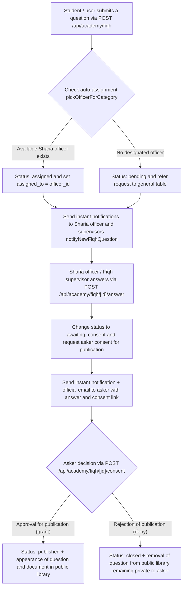
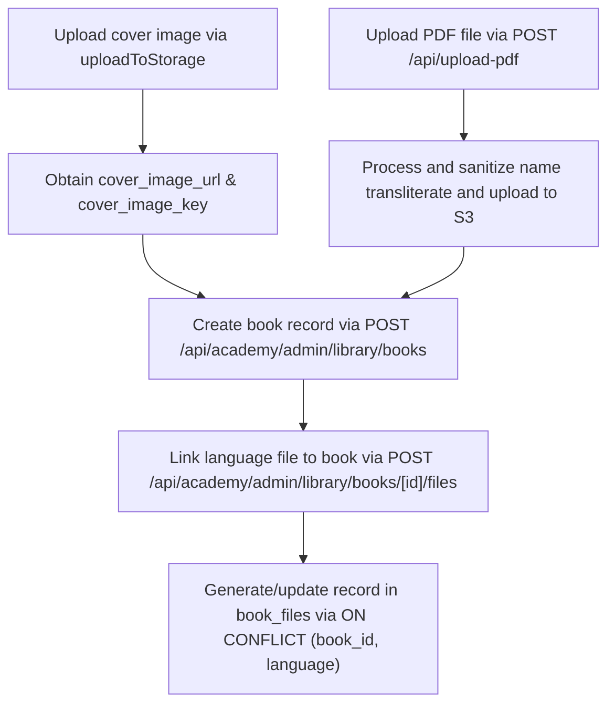
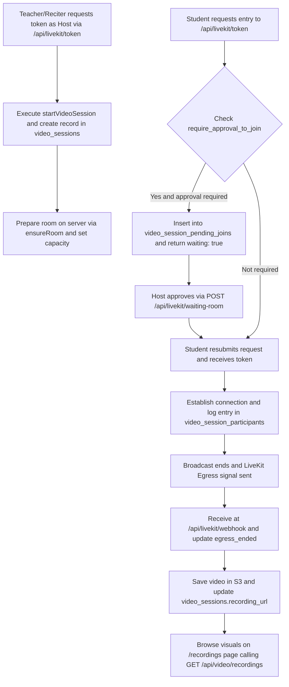
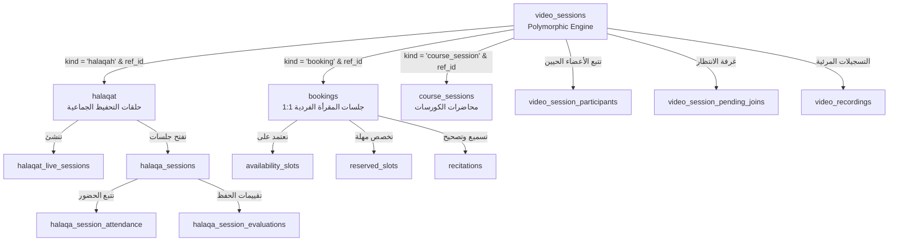
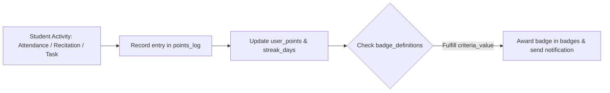
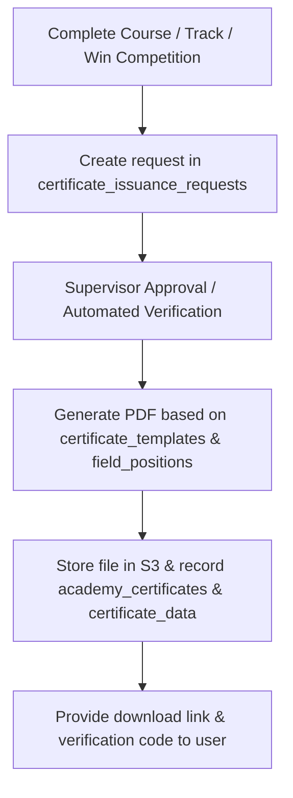

# Itqan Platform Documentation

---

## Table of Contents

1. [Authentication](#authentication)
2. [Public Pages](#public-pages)
3. [Academy Admin](#academy-admin)
4. [Teacher Dashboard](#teacher-dashboard)
5. [Student Dashboard](#student-dashboard)
6. [Parent Dashboard](#parent-dashboard)
7. [Supervisors](#supervisors)
8. [Fiqh System](#fiqh-system)
9. [Digital Library](#digital-library)
10. [Community](#community)
11. [Live Sessions & LiveKit](#live-sessions--livekit)
12. [Platform Admin](#platform-admin)
13. [Cron Jobs](#cron-jobs)
14. [Database — Users & Permissions](#database--users--permissions)
15. [Database — Learning Core](#database--learning-core)
16. [Database — Gamification & Certificates](#database--gamification--certificates)
17. [Database — Communication, Fiqh & System](#database--communication-fiqh--system)

---

# Authentication

This section provides comprehensive and detailed documentation for the Authentication & Authorization System of **Itqan Platform**, covering all Frontend Routes and API Endpoints, including their purposes, allowed roles, request and response fields, error states, and business logic for each route.

---

## 1. Frontend Routes

### 1. `/login` (Login Page)
- **Purpose**:
  Enables previously registered users across all roles (students, parents, teachers, reciters, and supervisors/admins) to log into the platform using email and password.
- **Allowed Roles**:
  Unauthenticated / Guest visitors. When accessed by an already logged-in user, the user's session is automatically verified via `/api/auth/me` and they are immediately redirected to their role's dashboard to prevent duplication.
- **Input Fields & Request State**:
  - `email`: Email address (string, required, format: email, dir: ltr).
  - `password`: Password (string, required, minLength: 1, dir: ltr).
  - Toggle password visibility option (Show/Hide Password).
- **Response & Navigation Logic**:
  Upon successful authentication with `/api/auth/login` and obtaining session data, the user is automatically redirected based on their role and approval status (`approval_status`) as follows:
  - If role is `teacher` and status is `pending_approval` or `rejected` -> Redirect to `/academy/pending`.
  - If role is `reader` and status is `pending_approval` or `rejected` -> Redirect to `/reader/pending`.
  - If role is `admin`, `super_admin`, or `maqraa_admin` -> Redirect to `/admin`.
  - If role is `academy_admin` -> Redirect to `/academy/admin`.
  - If role is `student_supervisor` or `reciter_supervisor` -> Redirect to `/admin`.
  - If role is `fiqh_supervisor` -> Redirect to `/academy/fiqh-supervisor`.
  - If role is `content_supervisor` -> Redirect to `/academy/content-supervisor`.
  - If role is `supervisor` -> Redirect to `/academy/supervisor`.
  - If role is `reader` (approved) -> Redirect to `/reader`.
  - If role is `teacher` (approved) -> Redirect to `/academy/teacher`.
  - If role is `parent` -> Redirect to `/academy/parent`.
  - If role is `student`:
    - If user has academy access only (`has_academy_access: true`, `has_quran_access: false`) -> Redirect to `/academy/student`.
    - If user has Quran access only (`has_quran_access: true`, `has_academy_access: false`) -> Redirect to `/student`.
    - If user has both permissions -> Default redirect to `/academy/student`.
- **Error States & Messages**:
  - Invalid credentials: Returns an error message showing the remaining attempts before account lockout.
  - Locked account (`is_locked = true`): Displays message: `"Account locked due to excessive failed attempts. Please use 'Forgot Password' to reactivate your account."`
  - Disabled account (`is_active = false`): Displays message: `"Account disabled. Please contact support."`
  - Reciter account not approved: Displays a message indicating that the application is under review or rejected.
  - Device or network connection error: Displays a connection error message.

---

### 2. `/register` (Sign Up & Role Selection Page)
- **Purpose**:
  Main page for creating new accounts and selecting the user type (student, parent, academy teacher, Quran reciter).
- **Allowed Roles**:
  All unauthenticated visitors (Guest).
- **Role Selection Component (`RoleSelection.tsx`)**:
  Displays 4 interactive cards to choose account type:
  1. `student`: Register as a student for Quran memorization or academic studies.
  2. `parent`: Register as a parent to track children's performance and manage their accounts.
  3. `teacher`: Register as a teacher to teach academic subjects (Fiqh, Aqidah, etc.).
  4. `reader`: Register as a reciter for Quran recitation testing and pronunciation correction.
- **Sub-forms by Selected Role**:
  - **Student and Parent Form (`StudentForm.tsx`)**:
    - Fields: `name` (Full name), `email` (Email), `password` (Password), `gender` (Gender), `platform` (Platform: Maqraa / Academy / Both - for students only).
    - On success: Redirects to the email verification page `/verify?email=...` and sends a 6-digit activation code.
  - **Teacher Form (`TeacherForm.tsx`)**:
    - Fields: `full_name_triple` (Full triple name), `email` (Email), `password` (Password), `phone` (Phone number), `gender` (Gender), `nationality` (Nationality - searchable dropdown), `qualification` (Educational qualification), `years_of_experience` (Years of experience), `teaching_subjects` (Subjects taught).
    - On success: Displays application submission success screen indicating that the account requires review and approval from academy management.
  - **Reciter Form (`ReaderForm.tsx`)**:
    - Fields: `full_name_triple` (Full triple name), `email` (Email), `password` (Password), `phone` (Phone number), `gender` (Gender), `nationality` (Nationality), `qualification` (Educational qualification), `memorized_parts` (Number of memorized Juz: 0 - 30), `years_of_experience` (Years of experience), and option to attach certificate files.
    - On success: Displays a message indicating receipt of application and forwarding it to management for review and approval.

---

### 3. `/forgot-password` (Forgot Password Page)
- **Purpose**:
  Enables users who forgot their password or had their accounts locked due to incorrect login attempts to request a password recovery code via email.
- **Allowed Roles**:
  All visitors and unauthenticated users (Guest).
- **Input Fields**:
  - `email`: User's email address (string, required, format: email).
- **Response & Navigation**:
  - If email is registered in the platform: Generates a 6-digit recovery code expiring after 1 hour, saves it in the `users` table fields (`reset_code`, `reset_expires_at`), sends an official email containing the code, and redirects the user after 2 seconds to password reset page `/reset-password?email=...`.
- **Error States & Messages**:
  - `not_found`: Email not registered on platform -> Displays a warning message informing user that email doesn't exist, with a direct button to navigate to sign up page `/register`.

---

### 4. `/reset-password` (Reset Password Page)
- **Purpose**:
  Receives the 6-digit recovery code and sets a new password for the account.
- **Allowed Roles**:
  All visitors (Guest).
- **Input Fields**:
  - `email`: Email address (automatically retrieved from URL query or entered manually if absent).
  - `code`: 6-digit verification code across separate inputs (supports paste and automatic box navigation).
  - `newPassword`: New password (string, minLength: 6).
- **Response & Navigation**:
  - On successful verification & match: Updates database (sets `password_hash` to new bcrypt hash, clears `reset_code` and `reset_expires_at` to `NULL`, unlocks account `is_locked = false` and resets `failed_login_count` to 0), then automatically redirects user to `/login` after 2 seconds.
- **Error States & Messages**:
  - Incomplete code entry (fewer than 6 digits).
  - Invalid or expired verification code.
  - Password length less than 6 characters.

---

### 5. `/change-password` (Change Password Page for Authenticated Users)
- **Purpose**:
  Enables currently logged-in users to change their account password for security reasons or personal preference.
- **Allowed Roles**:
  All logged-in users (Authenticated Users).
- **Input Fields**:
  - `currentPassword`: Current password (string, required).
  - `newPassword`: New password (string, required, minLength: 8).
  - `confirmPassword`: Confirm new password (string, required).
- **Response & Navigation**:
  On success: Revokes all current user sessions, removes tokens from cookies and session tables `user_sessions` and `refresh_tokens` for account protection, and redirects user to login page `/login`.
- **Error States & Messages**:
  - Incorrect current password.
  - New password is identical to current password.
  - Mismatch between new password and confirmation.
  - New password length less than 8 characters.

---

### 6. `/verify` (Email Verification Page)
- **Purpose**:
  Confirms and activates the email address for new accounts (students and parents) by entering the 6-digit verification code sent during registration.
- **Allowed Roles**:
  Newly registered users who have not yet verified their accounts.
- **Input Fields**:
  - `email`: Target email address (retrieved from URL query).
  - `code`: 6-digit activation code (supports paste and automatic input navigation).
- **Response & Navigation**:
  - On successful activation: Sets `email_verified = true` in database, sends welcome email, creates JWT token and sets `auth-token` session cookie for 30 days, and directly redirects user to their role-specific dashboard (Academy, Maqraa, or Parent).
  - Ability to request a new code after countdown timer expires (60 seconds).
- **Error States & Messages**:
  - Incorrect or expired code.
  - Email does not exist or account is already verified.

---

## 2. API Endpoints (`app/api/auth/`)

### 1. `POST /api/auth/login`
- **Purpose**:
  Authenticates user via email and password, checks account status (locked, active, approved), generates JWT session token, saves session and activity logs, and sets `auth-token` session cookie.
- **Allowed Roles**:
  Public / Unauthenticated.
- **Request Body Details**:
  ```json
  {
    "email": "string (required, format: email)",
    "password": "string (required)",
    "loginType": "string (optional, e.g. 'admin' for validating admin portal permissions)"
  }
  ```
- **Response Body Details (Success - HTTP 200 OK)**:
  ```json
  {
    "user": {
      "id": "string (UUID)",
      "name": "string",
      "email": "string",
      "role": "string (student | reader | admin | super_admin | maqraa_admin | student_supervisor | reciter_supervisor | parent | teacher | academy_admin | fiqh_supervisor | supervisor)",
      "has_academy_access": "boolean",
      "has_quran_access": "boolean",
      "approval_status": "string | null ('pending_approval' | 'approved' | 'rejected')"
    }
  }
  ```
  *Side Effects*:
  - Sets `auth-token` cookie containing JWT signed token valid for 30 days (`httpOnly: true`, `sameSite: 'lax'`, `maxAge: 30 days`, `path: '/'`).
  - Resets failed attempts (`failed_login_count = 0`) and updates `last_login_at`.
  - Inserts record in `user_sessions` and `activity_logs` (including IP, User Agent, and geo details).
  - Sends notification to admins upon administrative account login.
- **Error Cases**:
  - `400 Bad Request`: Email and password are required.
  - `401 Unauthorized`: 
    - Account with this email does not exist.
    - Invalid password (increments `failed_login_count` by 1; upon reaching 5 attempts, locks account `is_locked = true` and returns lockout alert).
  - `403 Forbidden`:
    - Account locked (`is_locked = true`).
    - Account disabled (`is_active = false`).
    - Reciter account is pending approval (`pending_approval`) or rejected (`rejected`).
    - Login attempt from admin portal (`loginType = 'admin'`) for account lacking admin permissions.
  - `500 Internal Server Error`: Server error occurred (returns `debug` field in development environments).

---

### 2. `POST /api/auth/register`
- **Purpose**:
  Creates a new self-registered account for students and parents, generating an activation code sent via email.
- **Allowed Roles**:
  Public.
- **Request Body Details**:
  ```json
  {
    "name": "string (required)",
    "email": "string (required, format: email)",
    "password": "string (required, minLength: 6)",
    "gender": "string ('male' | 'female', optional)",
    "platform_choice": "string ('both' | 'quran' | 'academy', default: 'both')",
    "register_role": "string ('student' | 'parent', default: 'student')"
  }
  ```
- **Response Body Details (Success - HTTP 201 Created)**:
  ```json
  {
    "user": {
      "id": "string (UUID)",
      "name": "string",
      "email": "string",
      "role": "student | parent"
    },
    "requiresVerification": true,
    "message": "تم إنشاء الحساب، يرجى تفعيل بريدك الإلكتروني"
  }
  ```
- **Error Cases**:
  - `400 Bad Request`: Missing fields, password shorter than 6 characters, or invalid gender value.
  - `409 Conflict`: 
    - Email already registered and verified (`"البريد الإلكتروني مسجل ومفعل مسبقاً، يرجى تسجيل الدخول"`).
    - Email registered but not verified (`requiresVerification: true`).
  - `500 Internal Server Error`: Failed to create account in database.
- **Special Logic**:
  - Route restricted to `student` and `parent` roles only.
  - Parents automatically granted access to `academy` only (`has_academy_access = true`, `has_quran_access = false`).
  - Generates random 6-digit verification code valid for 24 hours, stored in `verification_code` and `verification_expires_at`.

---

### 3. `POST /api/auth/logout`
- **Purpose**:
  Terminates current user session, deletes session record from database, and clears authentication cookie.
- **Allowed Roles**:
  All users.
- **Request Body Details**:
  No Request Body. Token extracted from `auth-token` cookie.
- **Response Body Details (Success - HTTP 200 OK)**:
  ```json
  {
    "success": true
  }
  ```
  *Side Effects*: 
  - Removes session record from `user_sessions` table based on current token.
  - Clears `auth-token` Cookie and sets `maxAge: 0`.

---

### 4. `GET` & `PATCH /api/auth/me`
- **Purpose**:
  - `GET`: Fetches full profile data for current session user (including student status and reciter details if applicable).
  - `PATCH`: Updates profile data (name, avatar, phone, city, preferences, and reciter availability settings).
- **Allowed Roles**:
  Authenticated Users.
- **Response Body Details for GET (Success - HTTP 200 OK)**:
  ```json
  {
    "user": {
      "id": "string (UUID)",
      "name": "string",
      "email": "string",
      "role": "string",
      "avatar_url": "string | null",
      "gender": "string | null",
      "phone": "string | null",
      "city": "string | null",
      "is_accepting_recitations": "boolean",
      "student_status": "string",
      "has_quran_access": "boolean",
      "has_academy_access": "boolean",
      "platform_preference": "string",
      "preferred_language": "string | null",
      "notification_preferences": "object | null",
      "approval_status": "string | null",
      "availability_mode": "string (readers only)",
      "availability_expires_at": "string | null (readers only)",
      "current_reserved_slots": "number (readers only)",
      "max_total_slots": "number (readers only)"
    }
  }
  ```
- **Request Body Details for PATCH**:
  ```json
  {
    "name": "string (optional)",
    "avatar_url": "string (optional)",
    "phone": "string (optional)",
    "gender": "string (optional)",
    "city": "string (optional)",
    "is_accepting_recitations": "boolean (optional)",
    "platform_preference": "string (optional)",
    "preferred_language": "string (optional)",
    "notification_preferences": "object (optional)",
    "availability_mode": "string (optional, reader only)",
    "max_total_slots": "number (optional, reader only)",
    "availability_expires_at": "string (optional, reader only)"
  }
  ```
- **Response Body Details for PATCH (Success - HTTP 200 OK)**:
  ```json
  {
    "user": {
      "id": "string",
      "name": "string",
      "email": "string",
      "avatar_url": "string | null",
      "role": "string",
      "city": "string | null"
    }
  }
  ```
- **Error Cases**:
  - `401 Unauthorized`: Not logged in or invalid token.
  - `404 Not Found`: User does not exist in database.
  - `400 Bad Request`: No fields provided for update in PATCH request.
  - `500 Internal Server Error`: Server error.

---

### 5. `GET /api/auth/status`
- **Purpose**:
  Lightweight and fast query endpoint to check if user is logged in, returning appropriate header link and button text for homepage.
- **Allowed Roles**:
  Public.
- **Response Body Details (Unauthenticated)**:
  ```json
  {
    "authenticated": false
  }
  ```
- **Response Body Details (Authenticated - HTTP 200 OK)**:
  ```json
  {
    "authenticated": true,
    "user": {
      "role": "string",
      "name": "string"
    },
    "dashboardLink": "string (e.g. '/admin' for admins or '/academy/student' for students)",
    "dashboardText": "string ('Dashboard' | 'My Account')"
  }
  ```

---

### 6. `POST /api/auth/verify`
- **Purpose**:
  Verifies the 6-digit email activation code, sets `email_verified = true`, clears code, sends welcome email, generates authentication token, and sets `auth-token` cookie.
- **Allowed Roles**:
  Public.
- **Request Body Details**:
  ```json
  {
    "email": "string (required)",
    "code": "string (required, 6 digits)"
  }
  ```
- **Response Body Details (Success - HTTP 200 OK)**:
  ```json
  {
    "message": "تم تفعيل الحساب بنجاح",
    "user": {
      "id": "string (UUID)",
      "name": "string",
      "email": "string",
      "role": "string",
      "has_academy_access": "boolean",
      "has_quran_access": "boolean"
    }
  }
  ```
- **Error Cases**:
  - `400 Bad Request`: 
    - Missing email or verification code.
    - Account is already verified.
    - Incorrect verification code.
    - Verification code expired.
  - `404 Not Found`: User not found.
- **Special Logic (QA Bypass)**:
  - Route includes QA Bypass Code support via `isQaBypassCode(user.email, code)`, allowing automated testing tools (such as Playwright and TestSprite) to complete activation in test environments without waiting for actual emails.

---

### 7. `POST /api/auth/forgot-password`
- **Purpose**:
  Generates a random 6-digit password recovery code (valid for 1 hour), stores it in database, and sends formatted email.
- **Allowed Roles**:
  Public.
- **Request Body Details**:
  ```json
  {
    "email": "string (required, format: email)"
  }
  ```
- **Response Body Details (Success - HTTP 200 OK)**:
  ```json
  {
    "message": "إذا كان البريد مسجلاً، فسيتم إرسال كود الاستعادة"
  }
  ```
- **Error Cases**:
  - `400 Bad Request`: Email is required.
  - `404 Not Found`: 
    ```json
    {
      "error": "not_found",
      "message": "هذا البريد الإلكتروني غير مسجل لدينا."
    }
    ```

---

### 8. `POST /api/auth/reset-password`
- **Purpose**:
  Verifies password recovery code, updates user password, unlocks account, and resets failed login attempts.
- **Allowed Roles**:
  Public.
- **Request Body Details**:
  ```json
  {
    "email": "string (required)",
    "code": "string (required, 6 digits)",
    "newPassword": "string (required, minLength: 6)"
  }
  ```
- **Response Body Details (Success - HTTP 200 OK)**:
  ```json
  {
    "message": "تم تغيير كلمة المرور بنجاح"
  }
  ```
- **Error Cases**:
  - `400 Bad Request`:
    - All fields are required.
    - Password shorter than 6 characters.
    - Verification code is invalid or incorrect.
    - Verification code expired.
  - `404 Not Found`: User not found.

---

### 9. `POST /api/auth/reader-register`
- **Purpose**:
  Registers a new application for "Quran Reciter" (Reader Profile) and creates an account pending admin approval.
- **Allowed Roles**:
  Public.
- **Request Body Details**:
  ```json
  {
    "full_name_triple": "string (required)",
    "email": "string (required, format: email)",
    "password": "string (required, minLength: 6)",
    "phone": "string (required)",
    "gender": "string ('male' | 'female', required)",
    "nationality": "string (required)",
    "city": "string (optional)",
    "qualification": "string (optional)",
    "memorized_parts": "number (optional, default: 0)",
    "years_of_experience": "number (optional, default: 0)"
  }
  ```
- **Response Body Details (Success - HTTP 201 Created)**:
  ```json
  {
    "message": "تم استلام طلبك، وسيتم مراجعته من قبل الإدارة. سيتم إشعارك عند اعتماد الحساب."
  }
  ```
- **Error Cases**:
  - `400 Bad Request`: Missing mandatory fields, password under 6 characters, or invalid gender.
  - `409 Conflict`: Email already registered (`"البريد الإلكتروني مسجل مسبقاً"`).
  - `500 Internal Server Error`: Error occurred while creating account or profile.
- **Special Logic & Differences from Standard Registration**:
  - **No Automatic Login**: No JWT Token is generated and no authentication cookies are set.
  - Creates user in `users` table with `role = 'reader'` and `approval_status = 'pending_approval'`.
  - Creates corresponding record in `reader_profiles` table to store professional details (full name, phone, city, nationality, qualification, memorized Juz, years of experience).
  - Sends instant system notification to all admins (`createNotificationForAdmins`) including link to review reciter applications (`/admin/reader-applications`).

---

### 10. `POST /api/auth/teacher-register`
- **Purpose**:
  Registers a new application for "Academy Teacher" (Teacher Application) and creates a record pending review and approval by academy management.
- **Allowed Roles**:
  Public.
- **Request Body Details**:
  ```json
  {
    "full_name_triple": "string (required)",
    "email": "string (required, format: email)",
    "password": "string (required, minLength: 6)",
    "phone": "string (required)",
    "gender": "string ('male' | 'female', required)",
    "nationality": "string (optional)",
    "city": "string (optional)",
    "qualification": "string (optional)",
    "teaching_subjects": "string (optional)",
    "years_of_experience": "number (optional)"
  }
  ```
- **Response Body Details (Success - HTTP 201 Created)**:
  ```json
  {
    "message": "تم استلام طلبك، وسيتم مراجعته من قبل إدارة الأكاديمية. سيتم إشعارك عند اعتماد الحساب."
  }
  ```
- **Error Cases**:
  - `400 Bad Request`: Mandatory fields required, password under 6 characters, or invalid gender.
  - `409 Conflict`: Email already registered under active or pending status (`"البريد الإلكتروني مسجل مسبقاً"`).
  - `500 Internal Server Error`: Error occurred while creating server account.
- **Special Logic & Differences from Standard Registration**:
  - **Handling Previously Rejected Teacher Applications (Re-submission for Rejected Teachers)**: If email is already registered and status is rejected (`approval_status === 'rejected'`), the route handles it as a new submission: updates user data and password, resets status to `pending_approval`, increments `rejection_count`, and updates application record in `teacher_applications`.
  - For new teachers: Creates account with role `teacher`, `approval_status = 'pending_approval'`, automatic access to academy (`has_academy_access = true`), and creates a record in `teacher_applications` containing qualifications in JSON format.
  - Sends instant notification to academy management (`createNotificationForAdmins`) with link to review teacher applications (`/academy/admin/teacher-applications`).

---

### 11. `POST /api/auth/reapply`
- **Purpose**:
  Enables rejected applicants (teacher or reciter) to reapply so their account status changes from `rejected` to `pending_approval` for re-review by management.
- **Allowed Roles**:
  Currently logged-in users whose applications were rejected (`approval_status === 'rejected'`).
- **Request Body Details**:
  No Request Body. Relies on current session identity (`session.sub`).
- **Response Body Details (Success - HTTP 200 OK)**:
  ```json
  {
    "success": true,
    "message": "تم إعادة تقديم طلبك بنجاح. سيتم مراجعته من قبل الإدارة."
  }
  ```
- **Error Cases & Special Logic**:
  - `401 Unauthorized`: Not logged in.
  - `404 Not Found`: User not found.
  - `400 Bad Request`: Cannot reapply because account status is not rejected (`approval_status !== 'rejected'`).
  - `403 Forbidden` (Admin Reapplication Block): If admin has set `reapply_blocked = TRUE` in users table, blocks user from reapplying and returns message:
    ```json
    {
      "error": "تم إيقاف إمكانية إعادة التقديم على هذا الحساب من قبل الإدارة. يرجى التواصل مع الإدارة مباشرة.",
      "blocked": true
    }
    ```
  - On success: Updates `approval_status` to `pending_approval` in `users` table and resets application status in `teacher_applications` to `status = 'pending'` if applicant is a teacher.

---

### 12. `POST /api/auth/change-password`
- **Purpose**:
  Changes password for currently logged-in user and revokes all old sessions and tokens for account security.
- **Allowed Roles**:
  Authenticated Users.
- **Request Body Details**:
  ```json
  {
    "currentPassword": "string (required)",
    "newPassword": "string (required, minLength: 8)"
  }
  ```
- **Response Body Details (Success - HTTP 200 OK)**:
  ```json
  {
    "success": true,
    "message": "تم تغيير كلمة المرور بنجاح"
  }
  ```
  *Side Effects*:
  - Updates `password_hash` with new bcrypt hash in `users` table.
  - Sets `must_change_password = false` and updates `password_changed_at = NOW()`.
  - **Session Revocation**: Deletes all previous user sessions from `user_sessions` and `refresh_tokens` tables.
  - Removes session cookies (`auth-token` and `better-auth.session_token`).
- **Error Cases**:
  - `401 Unauthorized`: Not logged in.
  - `400 Bad Request`: 
    - Missing fields (`currentPassword` or `newPassword`).
    - New password under 8 characters.
    - Incorrect current password.
  - `404 Not Found`: User not found.

---

# Public Pages

This section provides comprehensive detailed documentation for public platform pages accessible directly by any visitor or user without requiring authentication, describing each page's purpose, detailed content, forms, and interacted API endpoints.

---

## 1. `/` (Home Page / Landing Page)

- **Purpose**:
  Main landing page and structural entry point for **Itqan Platform**, highlighting the Itqan Al-Fatiha and Islamic Sciences initiative, showcasing the two platform pillars (Islamic Science Academy and Quranic Maqraa), and driving student and reciter registrations.

- **Content Displayed**:
  - **Unified Interactive Header (`HomepageHeader`)**:
    - Platform logo, quick navigation links, language toggle button (Arabic / English), Dark/Light mode toggle button, and smart navigation link to dashboard or login page based on session state.
  - **Hero Section**:
    - Basmala, Quranic verse, main and sub-headings for the initiative, and engaging descriptive text.
    - Call to Action (CTA) buttons: "Start Now" button pointing to registration page `/register`, and "How We Work" button smooth-scrolling to learning workflow section.
    - Interactive Islamic decorative elements including octagrams, arches, and geometric patterns adaptive to dark and light themes.
  - **The Two Pillars**:
    1. **Islamic Science Academy**: Showcases academic tracks (Fiqh, Aqidah, Hadith, Tajweed) with direct navigation to Academy page.
    2. **Quranic Maqraa**: Showcases recitation testing and correction services for Surah Al-Fatiha and Holy Quran with certified reciters and teachers.
  - **Features Section**:
    - Interactive Bento Grid cards explaining learning features (certified teachers, flexible scheduling, child tracking, mastery certificates, performance reports).
  - **Live Stats Counter**:
    - Real-time counter displaying achievement metrics (number of mastered students, completed sessions, courses, and Khatmas).
  - **Testimonials Marquee**:
    - Continuous animated marquee displaying student and parent feedback/ratings with star ratings.
  - **Page Footer (`HomepageFooter`)**:
    - Quick links to all public pages, platform policies, and official contact info.

- **Forms & Called API Endpoints**:
  - **Forms**: No direct form inputs on homepage except navigation buttons and links.
  - **API Endpoints**:
    - `GET /api/homepage`: Fetches dynamic homepage settings and content configured by management (titles, texts, colors, maintenance mode status/banners).
    - `GET /api/public/stats`: Fetches live platform statistics (such as number of mastered students `masteredStudents`).
    - `GET /api/auth/status`: Checks user session status to adjust header action button to role-specific dashboard link.

---

## 2. `/about` (About Us Page)

- **Purpose**:
  Presents the official overview of **Itqan Al-Fatiha and Islamic Sciences Platform**, detailing its vision, mission, noble goals, and foundational educational/religious values.

- **Content Displayed**:
  - Dynamic static pages rely on the reusable component `<StaticPage slug="about" />`.
  - **Page Header**: Displays open book icon, main page title, and last text update indicator.
  - **Content Body**:
    - Text enclosed inside an elegantly styled Islamic card, rendering content using **Markdown / GitHub Flavored Markdown (GFM)**.
    - Topics include: Initiative overview, mission, future vision, educational goals, and Islamic methodology in Quran memorization and Islamic science education.

- **Forms & Called API Endpoints**:
  - **Forms**: No input forms on this page.
  - **API Endpoints**:
    - `GET /api/content-pages/about`: Fetches page title, content, metadata description in Arabic/English, and update date from `content_pages` database table via SWR.

---

## 3. `/contact` (Contact Us Page)

- **Purpose**:
  Enables visitors, students, and parents to directly contact Itqan Platform management, submit inquiries, offer suggestions, or request technical support.

- **Content Displayed**:
  - **Direct Contact Information Section**:
    - Interactive cards displaying: Official email (`email`), direct phone/WhatsApp number (`phone`), and physical address (`address`).
  - **Message Submission Form (`Contact Form`)**:
    - Form containing inputs for name, email, subject, and detailed message body.
  - **Success & Confirmation Interface**:
    - On successful submission, interface updates to show a checkmark and receipt confirmation message, with an option to send another message and an admin-only link (`Admin`) to navigate directly to the notification and message management dashboard (`/admin/notifications`).

- **Forms & Called API Endpoints**:
  - **Contact Form (`handleSubmit`)**:
    - `name`: Sender's name (string, required).
    - `email`: Sender's email address (string, required, format: email, dir: ltr).
    - `subject`: Inquiry subject (string, required).
    - `message`: Detailed message text (string/textarea, required).
  - **API Endpoints**:
    - `POST /api/contact`: Sends message data to server, stores it in `contact_messages` database table, and notifies management.
    - `GET /api/public-settings`: Fetches official platform contact details (email, phone, address) approved by management.
    - `GET /api/auth/me`: Checks current user role to show administrative notifications dashboard button for admins.

---

## 4. `/faq` (Frequently Asked Questions Page)

- **Purpose**:
  Provides a comprehensive interactive reference addressing common visitor and new student queries regarding registration, session booking, academy study, gamification/points system, and Al-Fatiha recitation correction.

- **Content Displayed**:
  - Uses the dynamic component `<StaticPage slug="faq" />`.
  - Page header, title, and last update date.
  - List of carefully formatted Markdown questions and answers (including subheadings, bullet points, and directional links to registration and login pages).

- **Forms & Called API Endpoints**:
  - **Forms**: No input forms on this page.
  - **API Endpoints**:
    - `GET /api/content-pages/faq`: Fetches defined FAQs and answers in Arabic and English along with last update date from `content_pages` table.

---

## 5. `/privacy` (Privacy Policy Page)

- **Purpose**:
  Outlines official Itqan Platform policies regarding user personal data collection, processing, storage, session audio recording protection, and zero third-party data sharing guarantee.

- **Content Displayed**:
  - Uses dynamic component `<StaticPage slug="privacy" />`.
  - Displays Markdown formatted Privacy document covering:
    - Processed data types (name, email, audio recordings, cookies, and IP addresses).
    - Data usage purposes (quality assurance, recitation evaluation, certificate issuance).
    - Confidentiality and security of Quranic recitation recordings and protection of child/parent accounts.
    - User rights to edit or request deletion of personal data.

- **Forms & Called API Endpoints**:
  - **Forms**: No input forms on this page.
  - **API Endpoints**:
    - `GET /api/content-pages/privacy`: Retrieves text and updates of Privacy policy document in selected language from `content_pages` table.

---

## 6. `/terms` (Terms & Conditions Page)

- **Purpose**:
  Defines legal, Islamic, organizational agreements, and terms of service governing the relationship between Itqan Platform and students, teachers, reciters, and parents.

- **Content Displayed**:
  - Uses dynamic component `<StaticPage slug="terms" />`.
  - Displays Markdown formatted agreement terms covering:
    - Attendance ethics and discipline requirements in Quranic and academic sessions.
    - Obligations of teachers, reciters, and students.
    - Intellectual property rights for educational content, curricula, and recorded materials.
    - Account termination policies and actions regarding platform terms violations.

- **Forms & Called API Endpoints**:
  - **Forms**: No input forms on this page.
  - **API Endpoints**:
    - `GET /api/content-pages/terms`: Retrieves terms & conditions text and modification date from `content_pages` database table.

---

## 7. `/sitemap-page` (Sitemap Page)

- **Purpose**:
  Providing a visual guide and a comprehensive organizational path tree for all pages and routes of the Motqn platform to facilitate access and browsing by visitors, students, and administrators.

- **Displayed Content**:
  - **Organized Sitemap Sections**:
    1. **Public Pages (Globe)**: Includes links (`/`, `/about`, `/contact`).
    2. **Authentication Pages (Shield)**: Includes links (`/login`, `/register`, `/reset-password`).
    3. **Student Dashboard (Users)**: Includes links (`/student`, `/student/submit`, `/student/recitations`, `/student/booking`, `/student/sessions`, `/student/notifications`, `/student/profile`).
    4. **Reader Dashboard (BookOpen)**: Includes links (`/reader`, `/reader/recitations`, `/reader/schedule`, `/reader/sessions`, `/reader/chat`, `/reader/profile`).
    5. **Admin Dashboard (Shield)**: Includes links (`/admin`, `/admin/users`, `/admin/recitations`, `/admin/settings`, `/admin/reports`).
  - Each item in the list contains: Page name, short description of its role, direct programming path (`href`), and an icon.
  - **Statistical Summary Card**: Displays total number of platform sections, total number of available pages, and number of main roles.

- **Forms & Called API Endpoints**:
  - **Forms**: No input forms on this page.
  - **API Endpoints**: Does not call external APIs, but interacts locally with the internationalization context `useI18n`.

---

# Academy Admin

This section provides comprehensive and detailed technical documentation for the Educational Academy Admin Dashboard (`/academy/admin`) and its associated API endpoints (`app/api/academy/admin/`).

---

## First: Frontend Main Route

### `/academy/admin`
- **Purpose**: Main centralized control dashboard for managing all academic affairs (courses, teachers, students, paths, halaqat, forums, competitions, points and certificates, and system settings).
- **Allowed Roles**: `academy_admin`, `admin` (with partial permissions for supervisors like `student_supervisor`, `fiqh_supervisor`, `content_supervisor` depending on the section).
- **Content & Interaction**:
  - Display key vital indicators, statistics, geographical analytics, and leaderboard ranking.
  - Tabbed navigation between sub-sections (course management, learning paths, library, fiqh, teachers, applications, sessions, competitions, and settings).

---

## Second: API Endpoints (`app/api/academy/admin/`)

### 1. `GET /api/academy/admin/analytics`
- **Purpose & Who can use it**: Fetch comprehensive academic analytics and statistics (student, teacher, parent, reader, course, session, task counts, issued certificates, attendance, progress, and geographic activity rates). Restricted to `academy_admin` and `admin` roles.
- **Request Fields**: None (Query Params not required).
- **Response Fields (HTTP 200 OK)**:
  - `stats`: Object containing: `totalStudents`, `totalTeachers`, `totalParents`, `totalReaders`, `totalAdmins`, `activeCourses`, `draftCourses`, `archivedCourses`, `totalEnrollments`, `activeEnrollments`, `completedEnrollments`, `totalLessons`, `totalSessions`, `upcomingSessions`, `completedSessions`, `totalTasks`, `completedTasks`, `overdueTasks`, `taskCompletionRate`, `attendancePresent`, `attendanceTotal`, `attendanceRate`, `completionRate`, `totalCertificates`, `weeklyEnrollments`, `monthlyEnrollments`, `dailyActiveStudents`, `weeklyActiveStudents`, `monthlyActiveStudents`, `dailyActivityRate`, `learningPaths`, `memorizationPaths`, `tajweedPaths`, `totalRecitations`, `totalBookings`, `totalBooks`, `totalBookFiles`, `forumPosts`, `communityMembers`.
  - `enrollmentTrend`: Monthly enrollment trends for the last 6 months (`month`, `count`).
  - `genderDistribution`: Student distribution by gender (`gender`, `count`).
  - `topCourses`: Top 10 enrolled courses (`title`, `enrollments`, `avg_progress`).
  - `topTeachers`: Top 10 performing teachers (`teacher_id`, `name`, `courses_count`, `students_count`).
  - `topStudents`: Top 10 students by points and achievements.
  - `studentsByCountry` & `geoHeatmap`: Student geographical distribution by country, city, and region.
  - `dailyActivity`: Daily activity for the last 30 days (`day`, `active_students`, `points`).
  - `topSurahs`: Most recited Surahs in the maqraa for academics.
  - `lastSignups`: Latest 10 registered users on the platform.
- **Error Cases**:
  - `401 Unauthorized`: Not logged in or not an admin.
  - `500 Internal Server Error`: Database error.

---

### 2. `GET /api/academy/admin/analytics/export`
- **Purpose & Who can use it**: Export all academy data and analytics into an interactive Excel file (`.xlsx`) containing 7 worksheets (Summary, Students, Teachers, Courses, Sessions, Enrollments, Countries) supporting Right-to-Left (RTL). Allowed: `academy_admin`, `admin`.
- **Request Fields**: None.
- **Response Fields (HTTP 200 OK)**:
  - Excel file buffer named `academy-analytics-YYYY-MM-DD.xlsx` with download headers (`Content-Type: application/vnd.openxmlformats-officedocument.spreadsheetml.sheet`).
- **Side Effects**: Aggregating large amounts of data and generating an Excel file dynamically.
- **Error Cases**:
  - `401 Unauthorized`: Unauthorized.
  - `500 Internal Server Error`: File generation error.

---

### 3. `GET` & `POST /api/academy/admin/announcements`
- **Purpose & Who can use it**:
  - `GET`: Fetch the list of academic announcements and alerts sorted from newest to oldest.
  - `POST`: Create a new academic announcement, specifying target audience, priority, and publication status.
  - Allowed: `academy_admin`, `admin`.
- **POST Request Body Fields**:
  ```json
  {
    "title_ar": "string (required)",
    "content_ar": "string (required)",
    "target_audience": "string (optional: 'all' | 'students' | 'teachers', default: 'all')",
    "priority": "string (optional: 'low' | 'normal' | 'high' | 'urgent', default: 'normal')",
    "is_published": "boolean (optional, default: false)"
  }
  ```
- **POST Response Body Fields (HTTP 201 Created)**:
  - `data`: Created record automatically populating English fields with Arabic values to bypass legacy NOT NULL constraints.
- **Error Cases**:
  - `401 Unauthorized`: Unauthorized.
  - `400 Bad Request`: Title or content missing (`Title and content required`).
  - `500 Internal Server Error`: Server error.

---

### 4. `GET /api/academy/admin/archive`
- **Purpose & Who can use it**: Display and filter all archive items for the academy (archived courses and halaqat) along with archive reasons, original teacher name, and archived by details. Allowed: `academy_admin`, `admin`.
- **Request Query Params**:
  - `type`: `all` | `courses` | `halaqat` (default: `all`).
  - `search`: Text to search in titles or description.
  - `reason`: Filter by archive reason (e.g., `teacher_deleted`).
- **Response Fields (HTTP 200 OK)**:
  - `data`: Merged course/halaqa array sorted by archive date, plus `counts` (`total`, `courses`, `halaqat`).
- **Error Cases**:
  - `401 Unauthorized`: Unauthorized.
  - `500 Internal Server Error`: Server error.

---

### 5. `GET` & `POST /api/academy/admin/badges`
- **Purpose & Who can use it**: Manage badge and award definitions (Badges Definitions). Allowed: `academy_admin`, `admin`.
- **POST Request Body Fields**:
  ```json
  {
    "badge_type": "string (required, unique primary key)",
    "name": "string (required)",
    "description": "string (optional)",
    "category": "string (optional, default: 'عام')",
    "icon": "string (optional, default: '🏆')",
    "criteria_type": "string (optional, default: 'custom')",
    "criteria_value": "number (optional, default: 0)",
    "points_reward": "number (optional, default: 0)",
    "display_order": "number (optional, default: 0)"
  }
  ```
- **Error Cases**:
  - `401 Unauthorized`: Unauthorized.
  - `400 Bad Request`: Name or `badge_type` missing, or duplicate `badge_type` already exists (`Badge type already exists`).
  - `500 Internal Server Error`: Server error.

---

### 6. `GET` & `POST /api/academy/admin/categories`
- **Purpose & Who can use it**:
  - `GET`: Fetch academic category tree with live usage statistics (course, lesson, and public lesson counts) and parent category. *Exception*: Allowed for all registered users to read the basic list for use in course forms, but heavy counts/statistics are added only for admins.
  - `POST`: Create a new academic category. Allowed: `academy_admin`, `admin`.
- **POST Request Body Fields**:
  ```json
  {
    "name": "string (required)",
    "slug": "string (optional)",
    "description": "string (optional)",
    "short_description": "string (optional)",
    "parent_id": "UUID (optional)",
    "color": "string (optional)",
    "icon": "string (optional)",
    "icon_url": "string (optional)",
    "display_order": "number (optional, default: 0)",
    "is_active": "boolean (optional, default: true)"
  }
  ```
- **Error Cases**:
  - `401 Unauthorized`: Unauthorized.
  - `400 Bad Request`: Name missing (`الاسم مطلوب`).
  - `409 Conflict`: Another category with the same name or slug exists (`يوجد تصنيف آخر بنفس الاسم/الرابط`).

---

### 7. `GET /api/academy/admin/certificates`
- **Purpose & Who can use it**: Display and manage issued academy certificates and requests via two sub-routes:
  - `GET /api/academy/admin/certificates/issued`: Display issued certificates with student data, course, verification code, and issue date.
  - `GET /api/academy/admin/certificates/requests`: Fetch pending certificate issuance requests from students for review and approval.
  - Allowed: `academy_admin`, `admin`.
- **Error Cases**:
  - `401 Unauthorized`: Unauthorized.

---

### 8. `GET` & `POST /api/academy/admin/competitions`
- **Purpose & Who can use it**: Fetch and create academic competitions. Allowed: `academy_admin`, `admin`, as well as student supervisor (`student_supervisor`).
- **POST Request Body Fields**:
  ```json
  {
    "title": "string (required)",
    "start_date": "string (required)",
    "end_date": "string (required)",
    "description": "string (optional)",
    "type": "string ('monthly' | 'ramadan' | 'tajweed' | 'memorization', default: 'monthly')",
    "max_participants": "number (default: 100)",
    "prizes_description": "string (optional)",
    "rules": "string (optional)",
    "tajweed_rules": "array | string (optional)",
    "badge_key": "string (optional)",
    "points_multiplier": "number (optional)",
    "halqa_id": "UUID (optional)",
    "min_verses": "number (optional)",
    "is_featured": "boolean (optional)",
    "certificate_enabled": "boolean (optional)",
    "award_top_n": "number (optional)",
    "certificate_template_id": "UUID (optional)",
    "points_first": "number (default: 500)",
    "points_second": "number (default: 300)",
    "points_third": "number (default: 150)",
    "stages": "array of stage inputs (optional)"
  }
  ```
- **Side Effects**: Automatic creation of competition stages (`competition_stages`) in the database.
- **Error Cases**:
  - `401 Unauthorized`: Unauthorized.
  - `400 Bad Request`: Title or start/end dates missing.

---

### 9. `GET` & `POST /api/academy/admin/competitions/[id]/advance`
- **Purpose & Who can use it**:
  - `GET`: Preview current stage results, student rankings, and qualifying cutoffs without mutating data.
  - `POST`: Execute competition and stage actions:
    - `action = 'advance'`: Advance top students to the next stage (or approve if final stage).
    - `action = 'finalize_now'`: Finalize competition immediately, approve current stage as final result, and distribute prizes.
    - `action = 'cancel'`: Cancel competition (without winners) and notify all participants.
  - Allowed: `academy_admin`, `admin`, `student_supervisor`.
- **Side Effects**: Update stages, send notifications/alerts to students, and distribute points and badges to approved winners.
- **Error Cases**:
  - `401 Unauthorized`: Unauthorized.
  - `404 Not Found`: Competition not found.
  - `400 Bad Request`: Operation failed due to tie-breaker issues or competition status.

---

### 10. `GET`, `POST` & `DELETE /api/academy/admin/competitions/[id]/judges`
- **Purpose & Who can use it**: Display, assign, and unassign judges/arbitrators for a specific academic competition. Allowed: `academy_admin`, `admin`, `student_supervisor`.
- **POST Request Body**: `{"judge_id": "UUID (required)"}`.
- **DELETE Query Param**: `?judge_id=UUID`.
- **Error Cases**:
  - `401 Unauthorized`: Unauthorized.
  - `404 Not Found`: Academic competition not found (`scope = 'academy'`).
  - `400 Bad Request`: `judge_id` missing.

---

### 11. `GET` & `POST /api/academy/admin/courses`
- **Purpose & Who can use it**: Display all academy courses, create a new course, and assign a teacher to it. Allowed: `academy_admin`, `admin`.
- **POST Request Body Fields**:
  ```json
  {
    "title": "string (required)",
    "teacher_id": "UUID (required)",
    "description": "string (optional)",
    "thumbnail_url": "string (optional)",
    "category_id": "UUID (optional)",
    "status": "draft | pending_review | published | archived | rejected (default: 'draft')",
    "level": "beginner | intermediate | advanced (default: 'beginner')"
  }
  ```
- **Side Effects & Special Logic**:
  - Validates assigned teacher via `assertTeacherAssignable(teacher_id)` and rejects assigning courses to any teacher whose status is `pending`, `rejected`, or disabled.
  - Queries teacher's primary specialization from `user_specializations` and records it in the course's `specialization` field automatically.
- **Error Cases**:
  - `401 Unauthorized`: Unauthorized.
  - `400 Bad Request`: Title or teacher missing, or teacher not eligible for assignment.

---

### 12. `GET` & `POST /api/academy/admin/fiqh`
- **Purpose & Who can use it**: Manage, answer, and publish fiqh and fatwa questions in the academy.
  - **Role Exception**: Access allowed for `academy_admin`, `admin`, as well as fiqh supervisor (`fiqh_supervisor`) and general supervisor (`supervisor`).
- **GET Query Params**:
  - `status`: `pending` | `answered` | `published` | `unpublished` | `awaiting_consent` | `closed` | `all`
  - `category`: Filter by fiqh section.
  - `search`: Search in question or answer text.
- **POST Request Body Fields**:
  ```json
  {
    "question": "string (required)",
    "answer": "string (optional)",
    "category": "string (optional, default: 'general')",
    "is_published": "boolean (optional, default: false)"
  }
  ```
- **Response Extra**: GET returns aggregated `counts` for each tab in a single query.
- **Error Cases**:
  - `401 Unauthorized`: Unauthorized.
  - `400 Bad Request`: Question missing.

---

### 13. `GET /api/academy/admin/forum`
- **Purpose & Who can use it**: Browse and monitor all academy forum posts, replies, authors, and pinned items. Allowed: `academy_admin`, `admin`.
- **Query Params**: `?category=all|general|quran|fiqh|...`
- **Error Cases**:
  - `401 Unauthorized`: Unauthorized.
  - `400 Bad Request`: Invalid category (`Invalid category`).

---

### 14. `GET` & `POST /api/academy/admin/halaqat`
- **Purpose & Who can use it**: Manage and establish academy educational halaqat (`platform = 'academy'`). Allowed: `academy_admin`, `admin`.
- **POST Request Body Fields**:
  ```json
  {
    "name": "string (required)",
    "teacher_id": "UUID (optional)",
    "description": "string (optional)",
    "gender": "male | female | both (default: 'both')",
    "max_students": "number (default: 20)",
    "meeting_link": "string (optional)"
  }
  ```
- **Side Effects**: Checks teacher readiness via `assertTeacherAssignable` if `teacher_id` is passed.
- **Error Cases**:
  - `401 Unauthorized`: Unauthorized.
  - `400 Bad Request`: Name missing or teacher ineligible.

---

### 15. `GET` & `POST /api/academy/admin/invitations`
- **Purpose & Who can use it**: Manage and send official academy joining invitations via email. Allowed: `academy_admin`, `admin`.
- **GET Response**: Paginated list of invitations with status filtering, search, and automatic update for expired invitations (`status = 'EXPIRED'`).
- **POST Request Body**:
  - Individual invitation: `{"email": "...", "role": "...", "plan_id": "...", "invited_name": "..."}`
  - Batch invitation: `{"entries": [{...}, {...}]}`
- **Side Effects**: Sends official emails via Nodemailer containing unique link tokens and invitation acceptance link `academy/invite/[token]` with expiration date (7 days).
- **Error Cases**:
  - `401 Unauthorized`: Unauthorized.
  - `400 Bad Request`: Invalid email or existing pending invitation for the same email.

---

### 16. `GET /api/academy/admin/leaderboard`
- **Purpose & Who can use it**: Fetch leaderboard rankings for the entire academy or a specific halaqa and time period (weekly/monthly/all time). Allowed: `academy_admin`, `admin`.
- **Query Params**: `scope=platform|halaqa`, `period=all_time|weekly|monthly`, `halqa_id=UUID`, `limit=100`.
- **Error Cases**:
  - `401 Unauthorized`: Unauthorized.

---

### 17. `GET` & `POST /api/academy/admin/library/books`
- **Purpose & Who can use it**: Manage the digital book library for the academy (`library_domain = 'academy'`). Allowed: `academy_admin`, `admin`.
- **POST Request Body Fields**:
  ```json
  {
    "title": "string (required)",
    "author": "string (optional)",
    "description": "string (optional)",
    "cover_image_url": "string (optional)",
    "cover_image_key": "string (optional)",
    "pages_count": "number (optional)",
    "publish_date": "string (optional)",
    "category": "string (optional)",
    "category_id": "UUID (optional)",
    "is_published": "boolean (optional, default: true)",
    "display_order": "number (optional, default: 0)"
  }
  ```
- **Error Cases**:
  - `401 Unauthorized`: Unauthorized.
  - `400 Bad Request`: Title missing.

---

### 18. `GET` & `POST /api/academy/admin/paths`
- **Purpose & Who can use it**: Manage and create academic learning paths (Learning Paths). Allowed: `academy_admin`, `admin`.
- **POST Request Body Fields**:
  ```json
  {
    "title": "string (required)",
    "description": "string (optional)",
    "subject": "string (optional, default: 'quran')",
    "level": "string (optional, default: 'beginner')",
    "estimated_hours": "number (optional, default: 0)"
  }
  ```
- **Error Cases**:
  - `401 Unauthorized`: Unauthorized.
  - `400 Bad Request`: Title missing.

---

### 19. `GET` & `POST /api/academy/admin/points`
- **Purpose & Who can use it**: Manage the academy points system, browse student logs, and adjust points, streak, and levels. Allowed: `academy_admin`, `admin`.
- **POST Actions Supported**:
  - `update_config`: Update unified points system settings in `system_settings` table and clear `points_config` cache.
  - `reset_streak`: Reset Streak to 0.
  - `set_level`: Set student academic level (`beginner`, `intermediate`, `advanced`, `hafiz`, `master`).
  - `reset_points`: Reset all student points to zero and log action in `points_log`.
  - Manual adjustment of points (addition or deduction) via `adminAdjustPoints`.
- **Side Effects**: Insert records into `points_log`, update `user_points` table, and recalculate academic level.
- **Error Cases**:
  - `401 Unauthorized`: Unauthorized.
  - `400 Bad Request`: Incomplete data or missing fields.

---

### 20. `GET /api/academy/admin/public-lessons`
- **Purpose & Who can use it**: View and review queue of open public lessons submitted by teachers with review statuses and notes.
  - **Role Exception**: Allowed: `admin`, `academy_admin`, `supervisor`, `content_supervisor`.
- **Query Params**: `?review_status=pending_review|approved|rejected`

---

### 21. `GET` & `POST /api/academy/admin/series`
- **Purpose & Who can use it**: Manage and create sequential educational series (Series). Allowed: `academy_admin`, `admin`.
- **POST Request Body Fields**:
  ```json
  {
    "title": "string (required)",
    "description": "string (optional)",
    "subject": "string (optional)",
    "teacher_id": "UUID (optional)",
    "thumbnail_url": "string (optional)"
  }
  ```
- **Side Effects**: Checks assigned teacher via `assertTeacherAssignable`.

---

### 22. `GET`, `PUT`, `POST` /api/academy/admin/settings/*
- **Sub-endpoints & Features**:
  1. `GET` & `PUT /api/academy/admin/settings`:
     - **Purpose**: Exclusively read and update all academy settings prefixed with `academy_*` (such as `academy_courses_`, `academy_sessions_`, `academy_gamification_`).
     - **Allowed**: `academy_admin`.
     - **Side Effects**: Updates `system_settings` table, calls `clearSettingCache(key)`, and ignores or returns non-academy scoped fields.
  2. `GET /api/academy/admin/settings/backup`:
     - **Purpose**: Extract and generate a complete backup (JSON Snapshot) of all academy settings and download the file with a mask protecting SMTP password (`********`).
     - **Allowed**: `admin`, `academy_admin`.
  3. `POST /api/academy/admin/settings/clear-cache`:
     - **Purpose**: Clean and purge memory cache, tag clusters, and layout `revalidatePath("/", "layout")`.
     - **Allowed**: `admin`, `academy_admin`.
  4. `GET /api/academy/admin/settings/storage-status`:
     - **Purpose**: Detect status and availability of storage providers (S3 / Cloudinary / Vercel Blob) with boolean values (`true/false`) without revealing secrets.
     - **Allowed**: `admin`, `super_admin`, `academy_admin`.
  5. `POST /api/academy/admin/settings/test-email`:
     - **Purpose**: Test connection to the SMTP server configured in settings and send a test email to current admin email address.
     - **Allowed**: `admin`, `academy_admin`.

---

### 23. `GET /api/academy/admin/stats`
- **Purpose & Who can use it**: Fetch quick summary of dashboard vital statistics, counts, applications, and registration trends. Allowed: `academy_admin`, `admin`.

---

### 24. `GET /api/academy/admin/students`
- **Purpose & Who can use it**: View and retrieve all registered academy students (`student`, `academy_student`, `dual_student`) with counts of active courses and history. Allowed: `academy_admin`, `admin`.

---

### 25. `GET`, `POST` & `DELETE /api/academy/admin/supervisors`
- **Purpose & Who can use it**: Manage, create, and disable platform supervisor accounts (`supervisor`, `fiqh_supervisor`, `content_supervisor`). Allowed: `academy_admin`, `admin`.
- **POST Body**: `{ "name": "...", "email": "...", "password": "...", "gender": "male|female", "type": "fiqh|content|supervisor" }`.
- **DELETE Body**: `{ "supervisorId": "UUID" }` (disables supervisor account `is_active = false`).

---

### 26. `GET` & `POST /api/academy/admin/teachers`
- **Purpose & Who can use it**: Display and add academy teachers with statistics of their students and courses, plus history of previous application rejections if any. Allowed: `academy_admin`, `admin`.
- **Query Param**: `?assignable=true` to filter approved and active teachers only for assignment in other interfaces.
- **POST Body**: `{ name, email, password, gender, specialization }`.
- **Side Effects**: Creates teacher account with auto-approved status `approval_status = 'approved'` and stores specialization in `user_specializations`.

---

### 27. `GET` & `POST /api/academy/admin/teacher-applications`
- **Purpose & Who can use it**: Fetch all teacher applications and review qualifications and CVs. Allowed: `academy_admin`, `admin`.

---

### 28. `GET /api/academy/admin/users/[id]`
- **Purpose & Who can use it**: Fetch comprehensive and detailed academic profile for a specific user account tailored for the academy (differs from general maqraa profile) adapting to account role (Student: enrollments, lessons, tasks, attendance / Teacher: courses, halaqat, sessions, students / Parent: children and their statuses). Allowed: `academy_admin`, `admin`.
- **Error Cases**:
  - `401 Unauthorized`: Unauthorized.
  - `404 Not Found`: User not found.

---

# Teacher Dashboard

This section provides comprehensive and detailed technical documentation for the Teacher Dashboard (`/academy/teacher`) and its associated API endpoints (`app/api/academy/teacher/`).

---

## First: Frontend Main Route

### `/academy/teacher`
- **Purpose**: Centralized control dashboard for teachers to manage training courses, halaqat, live sessions, track and accept enrollment requests, grade students, add assignments and competitions, and manage personal profile and schedule.
- **Allowed Roles**: `teacher`, `admin`, `academy_admin`.
- **Content & Interaction**:
  - Overview of teacher statistics (total students, published courses, upcoming sessions, and tasks pending grading).
  - Tabbed navigation between sub-sections (course management, join requests, session calendar, live sessions, student tracking & progress, assignments & quizzes, learning paths, competitions, and profile).

---

## Second: API Endpoints (`app/api/academy/teacher/`)

### 1. `GET /api/academy/teacher/calendar`
- **Purpose**: Fetch all events and dates for the teacher in a unified schedule (scheduled live sessions for courses, and assignment/quiz submission deadlines).
- **Request Fields**: `?from=YYYY-MM-DD&to=YYYY-MM-DD` (optional for time filtering).
- **Response Fields (HTTP 200 OK)**:
  - `data`: Array of events formatted as: `id`, `title`, `date`, `time`, `type ('live_session' | 'assignment_deadline')`, `course`, `link`, `meta`.
- **Error Cases**:
  - `401 Unauthorized`: Not logged in as a teacher or admin.
  - `500 Internal Server Error`: Server error.

---

### 2. `GET` & `PATCH /api/academy/teacher/certificates/requests`
- **Purpose**:
  - `GET`: Fetch certificate issuance requests submitted by students for courses assigned to the teacher or paths they manage (`r.scope = 'academy'`).
  - `PATCH`: Approve and auto-generate certificate (`action = 'approve'`) or reject request with reason (`action = 'reject'`).
- **GET Response Fields**:
  - `requests`: Array of requests including student data (`student_name`, `student_email`), course/path name, request date, and status (`submitted`, `approved`, `issued`, `rejected`).
  - `counts`: Aggregated count of requests by status.
- **PATCH Request Body Fields**:
  - `action`: `'approve' | 'reject'` (required).
  - `reason`: Rejection reason (string, optional - on rejection).
- **Error Cases**:
  - `401 Unauthorized`: Unauthorized.
  - `404 Not Found`: Request not found or teacher does not own the course/path.
  - `400 Bad Request`: Invalid action or request status does not allow modification.
  - `500 Internal Server Error`: Failed to generate PDF certificate file due to missing default template.

---

### 3. `GET /api/academy/teacher/competitions`
- **Purpose**: Fetch list of academic competitions where the teacher is assigned as a "judge or evaluator" (`getJudgeAssignments`).
- **Response Fields (HTTP 200 OK)**:
  - `data`: Array of competitions assigned to the teacher including: competition title, type, date, and status of stages and evaluations.
- **Error Cases**:
  - `401 Unauthorized`: Unauthorized.

---

### 4. `GET` & `POST /api/academy/teacher/courses`
- **Purpose**:
  - `GET`: Fetch all training courses belonging to current teacher with enrollment stats, current lessons, and pending join requests.
  - `POST`: Create a new course draft (`status = 'draft'`).
- **POST Request Body Fields**:
  ```json
  {
    "title": "string (required)",
    "level": "string ('beginner' | 'intermediate' | 'advanced', required)",
    "description": "string (optional)",
    "thumbnail_url": "string (optional)",
    "category_id": "UUID (optional)",
    "scope": "string ('public' | 'private', default: 'public')"
  }
  ```
- **Side Effects**: Teacher's primary specialization is automatically assigned from `user_specializations`.
- **Error Cases**:
  - `401 Unauthorized`: Unauthorized.
  - `400 Bad Request`: Title or level missing.

---

### 5. `GET /api/academy/teacher/enrollment-requests`
- **Purpose**: Fetch all pending and active student join requests for courses taught by the teacher or tajweed paths managed by them.
- **Response Fields (HTTP 200 OK)**:
  - `data`: Merged array of course registration and tajweed path requests including: `id`, `status`, `enrolled_at`, `student_name`, `student_email`, `course_title`, `course_id`, `kind`.
- **Error Cases**:
  - `401 Unauthorized`: Unauthorized.

---

### 6. `GET`, `POST` & `PATCH /api/academy/teacher/live-session`
- **Purpose**: Manage teacher's live streaming and instant sessions:
  - `GET`: Fetch currently active live session or upcoming session within 2 hours with live attendees.
  - `POST`: Create and start instant live session for a course (`status = 'in_progress'`).
  - `PATCH`: Change live session status (`action = 'start'` to become `in_progress` or `action = 'end'` to become `completed`).
- **POST Request Body Fields**:
  ```json
  {
    "course_id": "UUID (required)",
    "title": "string (optional, default: 'Live Session')",
    "duration_minutes": "number (default: 60)",
    "meeting_url": "string (optional)"
  }
  ```
- **Error Cases**:
  - `401 Unauthorized`: Unauthorized.
  - `403 Forbidden`: Course does not belong to current teacher.
  - `400 Bad Request`: Required fields missing.

---

### 7. `GET` & `POST /api/academy/teacher/paths`
- **Purpose**: Manage tajweed and learning paths created or managed by the teacher (`manager_id`).
- **POST Request Body Fields**:
  ```json
  {
    "title": "string (required)",
    "description": "string (optional)",
    "subject": "string (optional, default: 'tajweed')",
    "level": "string (optional, default: 'beginner')",
    "estimated_hours": "number (optional, default: 0)",
    "thumbnail_url": "string (optional)",
    "require_audio": "boolean (optional, default: false)",
    "is_published": "boolean (optional, default: false)"
  }
  ```
- **Error Cases**:
  - `401 Unauthorized`: Unauthorized.
  - `400 Bad Request`: Title missing.

---

### 8. `GET` & `PATCH /api/academy/teacher/profile`
- **Purpose**:
  - `GET`: Fetch comprehensive academic profile data for the teacher (bio, specialization, years of experience, certifications, subjects, total courses and enrolled students).
  - `PATCH`: Update or create teacher academic record in `academy_teachers` table.
- **PATCH Request Body Fields**:
  ```json
  {
    "bio": "string (optional)",
    "specialization": "string (optional)",
    "years_of_experience": "number (optional)",
    "certifications": "array of strings (optional)",
    "subjects": "array of strings (optional)",
    "is_accepting_students": "boolean (optional)"
  }
  ```
- **Error Cases**:
  - `401 Unauthorized`: Unauthorized.
  - `404 Not Found`: Profile not found.

---

### 9. `GET` & `POST /api/academy/teacher/public-lessons`
- **Purpose**: Display and create open public lessons targeted at general public and students.
- **POST Request Body Fields**:
  ```json
  {
    "title": "string (required)",
    "scheduled_at": "string (required)",
    "description": "string (optional)",
    "duration_minutes": "number (default: 60)",
    "cover_image_url": "string (optional)",
    "meeting_link": "string (optional)",
    "meeting_provider": "'zoom' | 'google_meet' | 'other' (optional)",
    "meeting_password": "string (optional)",
    "category_id": "UUID (optional)"
  }
  ```
- **Side Effects & Logic**:
  - Dynamically generate a unique `public_slug` for the lesson.
  - For teachers: Lesson created with status `review_status = 'pending_review'` and notification sent to admins/supervisors for review.
  - For admin: Lesson published immediately, notifications sent to all followers, and mailing list subscribers alerted (`sendNewLessonNotificationEmail`).
- **Error Cases**:
  - `401 Unauthorized`: Unauthorized.
  - `400 Bad Request`: Title or scheduled date missing.

---

### 10. `GET` & `POST /api/academy/teacher/sessions`
- **Purpose**: Fetch recorded and live sessions table for teacher's courses, and create or schedule a new session (or start instant session via `start_now`).
- **POST Request Body Fields**:
  ```json
  {
    "course_id": "UUID (required)",
    "title": "string (required)",
    "scheduled_at": "string (required unless start_now is true)",
    "description": "string (optional)",
    "duration_minutes": "number (default: 60)",
    "max_students": "number (default: 20)",
    "is_public": "boolean (optional)",
    "series_title": "string (optional - to create a new lesson series)",
    "announce_to_students": "boolean (optional - creates automatic announcement in announcements table)",
    "start_now": "boolean (optional - sets status to in_progress immediately)"
  }
  ```
- **Error Cases**:
  - `401 Unauthorized`: Unauthorized.
  - `403 Forbidden`: Course does not belong to teacher.
  - `400 Bad Request`: Core data missing.

---

### 11. `GET /api/academy/teacher/students`
- **Purpose**: Retrieve list of all students enrolled in teacher's courses or created halaqat with comprehensive statistical summary for each student (course count, completed & total tasks, total points, last activity date, badge counts, and academic progress rate `progress_percentage`).
- **Error Cases**:
  - `401 Unauthorized`: Unauthorized.

---

### 12. `GET` & `POST /api/academy/teacher/tasks`
- **Purpose**: Display assignments and quizzes created by the teacher, and create new assignments or interactive quizzes.
- **POST Request Body Fields**:
  ```json
  {
    "course_id": "UUID (required)",
    "title": "string (required)",
    "task_type": "string ('assignment' | 'quiz' | 'recitation', required)",
    "due_date": "string (required)",
    "description": "string (optional)",
    "submission_instructions": "string (optional)",
    "max_score": "number (default: 100)",
    "quiz_questions": "array of objects (required when quiz_questions is enabled: contains questions, scores, options, and correct answer)"
  }
  ```
- **Special Logic**: For `quiz` tests, `max_score` is automatically calculated as sum of defined question scores to ensure no score discrepancy.
- **Error Cases**:
  - `401 Unauthorized`: Unauthorized.
  - `403 Forbidden`: Course does not belong to teacher.
  - `400 Bad Request`: Missing fields or quiz without questions.

---

### 13. `POST` & `DELETE /api/teachers/[id]/follow`
- **Purpose**: Enable students and users to follow a specific teacher (`POST`) or unfollow (`DELETE`).
- **Side Effects & Inter-relationship**:
  - Store relationships in `teacher_followers` table.
  - When a teacher publishes a new public lesson via `public-lessons` and it is approved by supervisors, system automatically sends instant alerts and notifications to all followers registered in this table.
- **Error Cases**:
  - `401 Unauthorized`: Not logged in.
  - `404 Not Found`: Teacher not found.

---

## Third: Endpoint Relationships

1. **`enrollment-requests` relationship with `students` and `courses`**:
   - Enrollment requests submitted by students for courses appear to teacher in `enrollment-requests` with `pending` status.
   - Upon request approval, enrollment status changes to `active` and student is automatically added to approved student list retrieved by `GET /api/academy/teacher/students`.
   - Changes reflect in `GET /api/academy/teacher/courses` by increasing `total_enrolled` counter and decreasing `pending_requests`.

2. **`courses` relationship with `sessions`, `live-session`, and `calendar`**:
   - Training course is created first via `/courses`.
   - Teacher schedules course sessions via `/sessions` or opens fast live stream via `/live-session`.
   - All scheduled sessions automatically appear in teacher and student calendar via `/calendar`.
   - Currently active live session appears in `/live-session` allowing real-time attendance tracking.

3. **`courses` relationship with `tasks` and `students`**:
   - Teacher adds assigned course tasks and quizzes via `/tasks`.
   - Student answers and achievements in these tasks are computed and accumulated to update `progress_percentage` and total completed tasks `tasks_completed` shown in `students` list.

4. **`courses` and `paths` relationship with `certificates/requests`**:
   - Upon student completion of course or path, a certificate request is submitted, appearing to teacher in `/certificates/requests`.
   - Once request is approved, server generates certificate file and sends notification to student.

5. **`public-lessons` relationship with `teachers/[id]/follow`**:
   - `teachers/[id]/follow` allows students to follow a teacher.
   - Upon approving and publishing a new public lesson for the teacher via `public-lessons`, system sends instant notifications and emails to all followers in `teacher_followers`.

---

# Student Dashboard

This section provides comprehensive and detailed technical documentation for the Student Dashboard (`/academy/student`) and its associated API endpoints (`app/api/academy/student/`).

---

## First: Frontend Main Route

### `/academy/student`
- **Purpose**: Centralized interface for the student to track their educational plan, enrolled courses, academic progress, attendance and live sessions, complete assignments and quizzes, view badges and points, and request certificates.
- **Allowed Roles**: `student`, `academy_student`, `dual_student`, `admin`, `academy_admin`.
- **Content & Interaction**:
  - Quick statistics cards (course count, completed paths, points earned, current Streak, and pending assignments).
  - Tabbed navigation between sub-sections (My Courses, Academic Calendar, Learning Paths, Competitions, Fiqh Questions, Assignments, Badges & Points, and Certificates).

---

## Second: API Endpoints (`app/api/academy/student/`)

### 1. `GET /api/academy/student/badges`
- **Purpose**: Fetch complete catalog and array of academic badges and awards categorized by groups, indicating current student status for each badge (`is_earned` status and earned date).
- **Response Fields (HTTP 200 OK)**:
  - `categories`: Array of categories, each category containing list of badges (`id`, `name`, `description`, `criteria_type`, `criteria_value`, `points_required`, `icon`, `is_earned`).
  - `stats`: Statistics object (`total`, `earned`).
- **Error Cases**:
  - `401 Unauthorized`: Not logged in.
  - `500 Internal Server Error`: Server error.

---

### 2. `GET /api/academy/student/calendar`
- **Purpose**: Fetch student's unified academic calendar, aggregating events from scheduled live sessions of enrolled courses and assignment/quiz submission deadlines.
- **Request Query Params**: `?from=YYYY-MM-DD&to=YYYY-MM-DD` (optional).
- **Response Fields (HTTP 200 OK)**:
  - `data`: Array of events (`id`, `title`, `date`, `time`, `type`, `course`, `link`, `meta`).
- **Error Cases**:
  - `401 Unauthorized`: Not logged in.

---

### 3. `GET /api/academy/student/certificates`
- **Purpose**: Fetch list of issued academic certificates for current student available for download in academy scope (`makeStudentCertificatesGet`).
- **Response Fields (HTTP 200 OK)**:
  - `data`: Array of issued certificates including unique certificate code, course name, issue date, and download link.
- **Error Cases**:
  - `401 Unauthorized`: Not logged in.

---

### 4. `GET /api/academy/student/competitions`
- **Purpose**: Display and explore available academic competitions for the student or display competitions previously entered by the student.
- **Request Query Params**:
  - `view`: `'browse' | 'my_entries'` (default: `'browse'`).
  - `status`: Filter by competition status (`active`, `upcoming`, `completed`).
  - `type`: Filter by type (`monthly`, `ramadan`, `tajweed`, `memorization`).
- **Response Fields (HTTP 200 OK)**:
  - `data`: Array of competitions with student participation status, ranking, and stages.
- **Error Cases**:
  - `401 Unauthorized`: Not logged in.

---

### 5. `GET`, `POST` & `DELETE /api/academy/student/courses/*`
- **Sub-endpoints & Features**:
  1. `GET /api/academy/student/courses`:
     - **Purpose**: Fetch all enrolled courses for the student with progress percentage, completed lesson count, and status.
  2. `GET /api/academy/student/courses/archive`:
     - **Purpose**: Fetch archived courses completed by the student (`status = 'completed'` or `progress_percentage >= 100`) with search capability (`?search=...`).
  3. `GET /api/academy/student/courses/[id]`:
     - **Purpose**: Fetch details of a specific course, list of completed and uncompleted lessons, and current enrollment status (`none`, `pending`, `active`, `rejected`).
  4. `POST /api/academy/student/courses/[id]/enroll`:
     - **Purpose**: Submit course join request (`status = 'pending'`).
     - **Side Effects**: Checks parent restrictions via `isTargetAllowedForStudent` and sends instant notification to teacher regarding new request.
  5. `DELETE /api/academy/student/courses/[id]/enroll`:
     - **Purpose**: Cancel registration or withdraw from course.
     - **Side Effects**: Deletes `lesson_progress` records, deletes `enrollments` registration record, and sends withdrawal notification to teacher.
- **Error Cases**:
  - `401 Unauthorized`: Not logged in.
  - `403 Forbidden`: Course restricted by parent.
  - `409 Conflict`: Existing prior enrollment request for the same course.
  - `404 Not Found`: Course not found.

---

### 6. `GET` & `POST /api/academy/student/fiqh`
- **Purpose**:
  - `GET`: Fetch list of fiqh questions asked by the student along with supervisor answers, author, and answer date.
  - `POST`: Submit a new fiqh question in a specific category (`question`, `category`).
- **Side Effects**: Upon submitting a new question, instant notifications are sent to relevant platform fiqh supervisors.
- **Error Cases**:
  - `401 Unauthorized`: Not logged in as a student or reader.
  - `400 Bad Request`: Question or category missing.

---

### 7. `POST /api/academy/student/lessons/[lessonId]/complete`
- **Purpose**: Mark lesson as completed by student, calculate and update student course progress percentage, and automatically generate certificates and points.
- **Response Fields (HTTP 200 OK)**:
  - `{ "success": true, "message": "Lesson marked as complete", "courseCompleted": boolean, "progress": number }`.
- **Side Effects & Inter-relationship**:
  - Update `lesson_progress` table and set `is_completed = true`.
  - Recalculate course `progress_percentage`; if it reaches 100%, status changes to `completed` and an automatic certificate issuance request is created in `academy_certificates` and `certificate_issuance_requests`.
  - Awards student lesson points (`awardLessonPoints`) and course completion points (`awardCourseCompletePoints`), checks eligibility for new badges, and triggers badge alerts.
- **Error Cases**:
  - `401 Unauthorized`: Unauthorized.
  - `403 Forbidden`: Teacher/Admin cannot complete lesson on student's behalf here, or student is not enrolled in the course.
  - `404 Not Found`: Lesson not found.

---

### 8. `GET /api/academy/student/paths`
- **Purpose**: Fetch enrolled tajweed and learning paths for the student and track progress across stages.
- **Error Cases**:
  - `401 Unauthorized`: Not logged in.

---

### 9. `GET /api/academy/student/points`
- **Purpose**: Retrieve summary of points system, level, Streak, earned badges, and last 20 operations in `points_log`.
- **Response Fields (HTTP 200 OK)**:
  - `total_points`, `level`, `level_label`, `streak_days`, `longest_streak`, `next_level`, `points_to_next_level`, `total_verses_memorized`, `log`, `badges`.
- **Error Cases**:
  - `401 Unauthorized`: Not logged in.

---

### 10. `GET /api/academy/student/progress`
- **Purpose**: Fetch aggregated academic analytics for student progress page (enrolled and completed courses, completed and total tasks, executed lessons, live session attendance rate, and numerical level).
- **Side Effects**: Awards daily login points (`awardDailyLoginIfNew`) to student when opening the page.
- **Error Cases**:
  - `401 Unauthorized`: Not logged in.

---

### 11. `GET /api/academy/student/series`
- **Purpose**: Browse published educational series available to students.
- **Error Cases**:
  - `401 Unauthorized`: Not logged in.

---

### 12. `GET /api/academy/student/sessions`
- **Purpose**: Fetch all live and scheduled sessions belonging to courses in which student is enrolled, providing registration link if permitted by teacher.
- **Error Cases**:
  - `401 Unauthorized`: Not logged in.

---

### 13. `GET /api/academy/student/stats`
- **Purpose**: Fetch quick statistics for student dashboard (enrolled courses, completed courses, pending tasks, total points, current level, Streak, average grade `avg_grade` for badges and activities).
- **Side Effects**: Awards automatic daily login points `awardDailyLoginIfNew`.
- **Error Cases**:
  - `401 Unauthorized`: Not logged in.

---

### 14. `GET /api/academy/student/tasks`
- **Purpose**: Fetch all assignments and quizzes assigned to the student (whether individual tasks or general course assignments) merged with student's latest submission to check status, grade, and feedback.
- **Request Query Params**: `?pending=true` (to return only pending and overdue submissions), `?limit=N`.
- **Response Fields (HTTP 200 OK)**:
  - `data`: Array of tasks (`id`, `title`, `description`, `course_title`, `type`, `due_date`, `points_value`, `submission_status`, `grade`, `feedback`, `status ('pending' | 'submitted' | 'graded' | 'late')`).
- **Error Cases**:
  - `401 Unauthorized`: Not logged in.

---

## Third: Gamification & Stats Interconnection

Points, badges, and statistics in the academy interact through an integrated cascade of programmatic events:

1. **Trigger Event**:
   - When a student completes a lesson via `/lessons/[lessonId]/complete`, completes a course 100%, submits and gets an assignment graded via `/tasks`, or logs in daily via `/stats` or `/progress`.

2. **Points & Streak Calculation**:
   - Incentive functions are called (`awardLessonPoints`, `awardCourseCompletePoints`, `awardDailyLoginIfNew`).
   - Operation is recorded in `points_log` table with points earned and reward reason.
   - `user_points` table is updated to increase `total_points` and adjust `streak_days` and `longest_streak`.

3. **Level Progression**:
   - Total points `total_points` are compared against academy level tables (`beginner: 0`, `intermediate: 500`, `advanced: 2000`, `hafiz: 5000`, `master`).
   - Level changes automatically and remaining points to reach next level `points_to_next_level` are computed.

4. **Badges Unlocking**:
   - Explicit academic achievements (completed courses count from `enrollments` + graded tasks count from `task_submissions` + total points from `user_points`) are compared against criteria in unified catalog `BADGE_CATALOGUE`.
   - Upon meeting condition (`criteria_type: 'courses' | 'tasks' | 'points'`), badge is granted, stored in `badges` table, and instant notification is sent to student.

5. **Stats Aggregation**:
   - When `/stats`, `/progress`, or `/points` is called, server aggregates results from `user_points` and `badges` tables and compares them with learning records `enrollments` and `task_submissions` to return a unified, comprehensive picture of student's level and achievements.

---

# Parent Dashboard

This section provides comprehensive and detailed technical documentation for the Parent Dashboard (`/academy/parent`) and its associated API endpoints (`app/api/academy/parent/`).

---

## First: Frontend Main Route

### `/academy/parent`
- **Purpose**: Dedicated dashboard for parents to track the educational level of children linked to the account, view attendance, recitation, and assignment reports, send new child linking requests, and communicate directly with teachers of their children's current courses.
- **Allowed Roles**: `parent` (parents exclusively).
- **Content & Interaction**:
  - List of linked children accompanied by progress percentage, badges, and academic indicators for each child.
  - Unified events and activities calendar for all children.
  - Forms to add and link children via email.
  - Messaging and communication center with children's teachers.

---

## Second: Child Linking Mechanism (`link-child`)

The system follows a two-step protection mechanism to link a parent with a student, ensuring privacy and explicit consent:

1. **Step One (Search Phase)**:
   - Parent sends a search request using student's email (`action: 'search', email`).
   - System checks existence of an account with role `student` for this email and verifies no prior pending request or existing link exists.

2. **Step Two (Link Request Phase)**:
   - Parent specifies relationship (`father`, `mother`, `guardian`, `other`) and submits request (`action: 'link', child_id, relation`).
   - Server creates a record in `parent_children` table with pending status `status = 'pending'`.

3. **Explicit Student Approval**:
   - Instant notification reaches student account regarding new linking request.
   - Student reviews request from their dashboard (`/academy/student/parent-requests`) and approves or rejects it.
   - Upon student approval, status changes to `active` / `approved`, making student data and reports visible to parent.

---

## Third: Permissions & Strict Scoping

- **Can the parent only see their own children?**: **Yes, with strict enforcement and absolute programmatic scoping**.
- No academic data, reports, or appointments are retrieved without first verifying an active and complete record in `parent_children` table linking `session.sub` (parent ID) with `child_id` (target child ID):
  - In `calendar/events`: Events fetched only for `child_id IN (SELECT child_id FROM parent_children WHERE parent_id = session.sub AND status = 'active')`.
  - In `children/[id]/activity`: `getActiveParentChildLink(session.sub, childId)` is called; if child is not linked to parent, server immediately rejects request with `403 Forbidden`.
  - In `children/[id]/reports`: Queries check child-parent link matching `pc.status IN ('active', 'approved')` and return `403 Forbidden` if not linked.
  - In `conversations`: Parent is prohibited from messaging any teacher unless that teacher actually teaches a course in which one of their linked children is enrolled.

---

## Fourth: API Endpoints (`app/api/academy/parent/`)

### 1. `GET /api/academy/parent/calendar/events`
- **Purpose**: Fetch a unified calendar aggregating events for all children linked to the parent (course live sessions, assignment and quiz deadlines, and recitation bookings with readers).
- **Request Query Params**:
  - `month`: Filter by month and year in `YYYY-MM` format (optional).
  - `child`: Filter events for a specific child using their UUID (optional).
- **Response Fields (HTTP 200 OK)**:
  - `events`: Array of events (`id`, `title`, `date`, `time`, `type ('live_session' | 'assignment_deadline' | 'booking')`, `course`, `course_id`, `child_id`, `child_name`, `link`, `status`, `scheduled_at`).
  - `children`: List of linked children included in calendar (`id`, `name`).
- **Error Cases**:
  - `401 Unauthorized`: Not logged in as a parent.
  - `500 Internal Server Error`: System error.

---

### 2. `GET /api/academy/parent/children/[id]/activity`
- **Purpose**: Fetch detailed daily activity log for a specific child (submitted recitations and reader evaluations, sessions and bookings, and earned badges and awards).
- **Permissions**: Server checks child-parent link via `getActiveParentChildLink(session.sub, childId)`.
- **Response Fields (HTTP 200 OK)**:
  - `recitations`: List of recitations (`surah_name`, `ayah_from`, `ayah_to`, `status`, `overall_score`, `verdict`, `detailed_feedback`, `reader_name`).
  - `sessions`: List of bookings and sessions (`status`, `scheduled_at`, `duration_minutes`, `session_summary`, `reader_notes`, `teacher_name`).
  - `badges`: Earned badges (`badge_name`, `badge_description`, `badge_icon_url`, `points_awarded`, `earned_at`).
- **Error Cases**:
  - `401 Unauthorized`: Not logged in as a parent.
  - `403 Forbidden`: Child not linked to parent account.
  - `500 Internal Server Error`: Unexpected error.

---

### 3. `GET /api/academy/parent/children/[id]/reports`
- **Purpose**: Fetch comprehensive weekly academic report for child's performance, including enrolled courses, lesson completion rate, submitted assignments with grades and teacher feedback, average grade `avg_grade`, and aggregated statistics.
- **Request Query Params**: `?weekStart=YYYY-MM-DD&weekEnd=YYYY-MM-DD` (optional).
- **Response Fields (HTTP 200 OK)**:
  - `courses`: List of enrolled courses for child with total/completed lesson counts and teacher.
  - `submissions`: List of last 20 submitted assignments from child with grade and teacher comment `teacher_comment`.
  - `stats`: Statistics object (`total_courses`, `total_submissions`, `graded_tasks`, `avg_grade`, `recitations_count`, `sessions_attended`, `badges_earned`, `current_level`).
  - `weekly`: Weekly report summary generated via `buildParentWeeklyReport`.
- **Error Cases**:
  - `401 Unauthorized`: Not logged in as a parent.
  - `403 Forbidden`: Unauthorized - Child does not belong to current parent (`Unauthorized: Not your child`).

---

### 4. `GET` & `POST /api/academy/parent/conversations`
- **Purpose**:
  - `GET`: Display list of existing conversations between parent and their children's teachers with unread message counter.
  - `POST`: Start a new conversation with a teacher teaching one of their children with optional initial message attachment.
- **POST Request Body Fields**:
  ```json
  {
    "teacher_id": "UUID (required)",
    "child_id": "UUID (required)",
    "subject": "string (optional)",
    "content": "string (optional - initial message)"
  }
  ```
- **Permissions & Validation**:
  - Server first verifies child is linked to parent account (`getActiveParentChild`).
  - Server verifies teacher actually teaches in a course where this child is actively enrolled (`enrollments.status IN ('active', 'accepted', 'completed')`).
- **Side Effects**: Sending a message updates and increments `unread_count_teacher` and sends instant notification to teacher.
- **Error Cases**:
  - `401 Unauthorized`: Not logged in.
  - `400 Bad Request`: Incomplete data (teacher or child missing).
  - `403 Forbidden`: Student not linked to account or teacher does not teach this student.

---

### 5. `POST /api/academy/parent/link-child`
- **Purpose**: Search for a student account using their email address, and send a account link request as a parent.
- **Request Body Fields**:
  - **Search Phase**:
    ```json
    {
      "action": "search",
      "email": "student@example.com"
    }
    ```
  - **Send Request (Link Request Phase)**:
    ```json
    {
      "action": "link",
      "child_id": "UUID",
      "relation": "father | mother | guardian | other"
    }
    ```
- **Side Effects**:
  - Creates a record in `parent_children` with status `pending`.
  - Sends an instant high-priority notification to the student's account containing a direct link to review and approve the request (`/academy/student/parent-requests`).
- **Error Cases**:
  - `401 Unauthorized`: Unauthorized.
  - `400 Bad Request`: Missing data or invalid relation type.
  - `404 Not Found`: No student found with this email.
  - `409 Conflict`: The student is already linked to the account, or a previous link request is under review or rejected.

---

# Supervisors

This section provides comprehensive and detailed technical documentation for the control panels dedicated to authorized supervisors across 3 different specializations (`/academy/supervisor`, `/academy/content-supervisor`, `/academy/fiqh-supervisor`) and their associated API endpoints (`app/api/academy/supervisor/`).

---

## First: Differences Between Supervisor Roles & Permissions

Supervisory responsibilities in the Academy are distributed across three main independent roles ensuring specialization and quality:

### 1. General Supervisor (`/academy/supervisor`)
- **Purpose**: The central control panel for general administrative and academic oversight of the educational process on the platform, tracking teacher performance and verification, monitoring discussion forums and reports, and managing notifications and inquiries.
- **Allowed Roles for Access**: `supervisor`, `student_supervisor`, `reciter_supervisor`, `admin`, `academy_admin`.
- **Permissions & Functions**:
  - Inspecting and verifying teacher accounts (`is_verified`).
  - Supervising student forums, reviewing and deleting reports, and resolving complaints.
  - Tracking student inquiries and general notification messages.

---

### 2. Content Supervisor (`/academy/content-supervisor`)
- **Purpose**: A specialized control panel for auditing and checking the academic and technical quality of all educational materials uploaded by teachers before approval and publication to the public and students.
- **Allowed Roles for Access**: `content_supervisor`, `admin`, `academy_admin`.
- **Permissions & Functions**:
  - Reviewing and approving/rejecting entire educational course drafts (`courses`).
  - Reviewing individual lessons and visual explanatory files (`content`).
  - Reviewing and testing academic learning paths, Tajweed paths, and memorization paths (`academy-paths`, `paths`).
  - Reviewing and approving sequential lesson series (`series`).

---

### 3. Fiqh Supervisor (`/academy/fiqh-supervisor`)
- **Purpose**: A dedicated Sharia control panel for receiving jurisprudence (Fiqh) questions and inquiries submitted by students and reciters, preparing and auditing approved answers, and managing them prior to publication.
- **Allowed Roles for Access**: `fiqh_supervisor`, `admin`, `academy_admin` (in addition to `supervisor` in certain answering and viewing functions).
- **Permissions & Functions**:
  - Reviewing unanswered Fiqh questions from students (`pending`).
  - Drafting and auditing Sharia answers and publishing approved ones to the public (`published`).
  - Sending Sharia notifications and guidance alerts to students and reciters.

---

## Second: Supervisor API Endpoints (`app/api/academy/supervisor/`)

### 1. `GET /api/academy/supervisor/academy-paths`
- **Purpose**: Fetch a list of academic learning paths (`learning_paths`) awaiting content supervisor review, or approved/rejected.
- **Allowed Roles**: `content_supervisor`, `academy_admin`, `admin`.
- **Request Query Params**:
  - `status`: `'pending' | 'approved' | 'rejected' | 'all'` (default: `'pending'`).
  - `search`: Search by path title or creator name (optional).
- **Response Fields (HTTP 200 OK)**:
  - `data`: Array of academic paths (`id`, `title`, `description`, `subject`, `level`, `estimated_hours`, `status`, `rejection_reason`, `creator_name`, `reviewer_name`, `created_at`).
  - `counts`: Count aggregations per status (`pending`, `approved`, `rejected`, `all`).
- **Error Cases**:
  - `401 Unauthorized`: Unauthorized.
  - `503 Service Unavailable`: Migration script not executed (`migration_not_applied`).
  - `500 Internal Server Error`: Server error.

---

### 2. `GET /api/academy/supervisor/content`
- **Purpose**: Fetch individual lessons (`lessons`) belonging to courses uploaded and awaiting content review and technical audit prior to publication.
- **Allowed Roles**: `content_supervisor`, `supervisor`, `academy_admin`, `admin`.
- **Request Query Params**:
  - `status`: `'pending' | 'approved' | 'rejected' | 'all'` (default: `'pending'`).
  - `search`: Filter by lesson name, course name, or teacher name (optional).
- **Response Fields (HTTP 200 OK)**:
  - `data`: Array of lessons (`id`, `title`, `description`, `video_url`, `duration_minutes`, `status`, `review_notes`, `course_title`, `teacher_name`, `reviewer_name`).
  - `counts`: Status statistics (`pending`, `approved`, `rejected`, `all`).
- **Error Cases**:
  - `401 Unauthorized`: Unauthorized.
  - `500 Internal Server Error`: Server error.

---

### 3. `GET /api/academy/supervisor/courses`
- **Purpose**: Fetch the complete list of training courses awaiting content supervisor review and approval, unrestricted by specialization, to inspect structure and general objectives.
- **Allowed Roles**: `content_supervisor`, `supervisor`, `academy_admin`, `admin`.
- **Request Query Params**: `?status=pending|approved|rejected|all&search=`.
- **Response Fields (HTTP 200 OK)**:
  - `data`: Array of courses (`id`, `title`, `description`, `thumbnail_url`, `status`, `level`, `rejection_reason`, `teacher_name`, `reviewer_name`, `total_lessons`).
  - `counts`: Aggregation of status counts.
- **Error Cases**:
  - `401 Unauthorized`: Unauthorized.
  - `500 Internal Server Error`: Server error.

---

### 4. `GET /api/academy/supervisor/fiqh`
- **Purpose**: Fetch Fiqh questions submitted by users, divided by review tabs (`pending`: pending, `answered`: answered, `published`: published).
- **Allowed Roles**: `supervisor`, `student_supervisor`, `reciter_supervisor`, `fiqh_supervisor`, `admin`.
- **Request Query Params**:
  - `tab`: `'all' | 'pending' | 'answered' | 'published'` (default: `'all'`).
  - `search`: Search within question text or category (optional).
- **Response Fields (HTTP 200 OK)**:
  - `questions`: List of questions (`id`, `question`, `category`, `answer`, `answered_by`, `is_published`, `asker_name`, `created_at`).
  - `counts`: Question counts per status (`pending`, `answered`, `published`).
- **Error Cases**:
  - `401 Unauthorized`: Unauthorized.
  - `500 Internal Server Error`: Server error.

---

### 5. `GET` & `PATCH /api/academy/supervisor/forum`
- **Purpose**:
  - `GET`: Fetch Academy forum posts with support for displaying reported posts (`tab = 'reported'`) or resolved ones (`resolved`).
  - `PATCH`: Manage forum posts (resolve report `action = 'resolve'`, add new report `action = 'report'`, or delete violating post `action = 'delete'`).
- **PATCH Request Body Fields**: `{ "postId": "UUID", "action": "resolve | report | delete", "reason": "string (optional)" }`.
- **Error Cases**:
  - `401 Unauthorized`: Unauthorized.
  - `500 Internal Server Error`: Server error.

---

### 6. `GET` & `PATCH /api/academy/supervisor/notifications`
- **Purpose**:
  - `GET`: Retrieve the list of notifications for the current supervisor account along with unread message counter `unreadCount`.
  - `PATCH`: Read a specific notification or mark all notifications as read in bulk.
- **PATCH Request Body Fields**: `{ "notificationId": "UUID (optional)", "isRead": true, "markAllAsRead": boolean (optional) }`.
- **Error Cases**:
  - `401 Unauthorized`: Unauthorized.
  - `500 Internal Server Error`: Server error.

---

### 7. `GET /api/academy/supervisor/paths`
- **Purpose**: Fetch a unified array merging Tajweed paths (`tajweed_paths`) and memorization paths (`memorization_paths`) uploaded awaiting content supervisor review, specifying the path type `path_type` in each record.
- **Allowed Roles**: `content_supervisor`, `supervisor`, `academy_admin`, `admin`.
- **Request Query Params**: `?status=pending|approved|rejected|all&search=`.
- **Response Fields (HTTP 200 OK)**:
  - `data`: Merged paths array (`id`, `title`, `description`, `thumbnail_url`, `level`, `status`, `path_type ('tajweed' | 'memorization')`, `creator_name`, `reviewer_name`).
  - `counts`: Combined status statistics for both path types.
- **Error Cases**:
  - `401 Unauthorized`: Unauthorized.
  - `503 Service Unavailable`: Script `scripts/030-content-review-workflow.sql` not executed.
  - `500 Internal Server Error`: System error.

---

### 8. `GET /api/academy/supervisor/series`
- **Purpose**: Fetch all created lesson series and academic learning series awaiting review and approval.
- **Allowed Roles**: `content_supervisor`, `supervisor`, `academy_admin`, `admin`.
- **Request Query Params**: `?status=pending|approved|rejected|all&search=`.
- **Response Fields (HTTP 200 OK)**:
  - `data`: Array of educational series (`id`, `title`, `description`, `subject`, `status`, `teacher_name`, `reviewer_name`, `total_items`).
  - `counts`: Counts of series per status.
- **Error Cases**:
  - `401 Unauthorized`: Unauthorized.
  - `503 Service Unavailable`: Script 030 not executed.
  - `500 Internal Server Error`: Server error.

---

### 9. `GET /api/academy/supervisor/teachers`
- **Purpose**: Fetch a list of female and male Academy teachers along with verification and safety status (`is_verified`) to enable inspecting, verifying, and revoking verification of teachers.
- **Allowed Roles**: All authorized supervisor roles (`SUPERVISOR_ROLES`).
- **Request Query Params**: `?status=pending|verified|all` (default: `'all'`).
- **Response Fields (HTTP 200 OK)**:
  - `data`: Array of teachers (`id`, `name`, `email`, `phone`, `bio`, `specialization`, `years_of_experience`, `rating`, `is_verified`, `is_accepting_students`, `courses_count`, `students_count`).
  - `counts`: `{ pending, verified, all }`.
- **Error Cases**:
  - `401 Unauthorized`: Unauthorized.
  - `500 Internal Server Error`: System error.

---

# Fiqh System

This section provides comprehensive architectural and field technical documentation for the Fiqh advisory and Fatwa system in the Academy (`/academy/fiqh`), detailing the question and answer lifecycle, permissions of Sharia officers and supervisors, and the mechanism for public publishing in the Fiqh library.

---

## First: Main Route for Public Interface and Students (`/academy/fiqh`)

- **Purpose**: The unified center for browsing the public Fiqh library open to the public, tracking private student questions, and submitting new Fiqh inquiries.
- **Allowed Roles for Access**:
  - **Browsing & Public Library**: Available to all visitors and the public without requiring login (`Unauthenticated Users`).
  - **Asking a Question & Tracking Personal Questions**: Available to all registered users on the platform (`student`, `reader`, `parent`, `teacher`, `admin`).
- **Main Interface Tabs (`Tabs`)**:
  1. `library` (Public Fiqh Library): Displays approved published Fatwas and questions, with filtering capabilities by Sharia category (`category`) and text search (`q`).
  2. `mine` (My Fiqh Questions): Browsing all private questions of the student and reading them across various statuses (`pending`, `assigned`, `in_progress`, `answered`, `awaiting_consent`, `published`, `closed`).
  3. `ask` (Submit Fiqh Question): Form for submitting a new inquiry, allowing selection of Sharia category and enabling privacy/anonymity (`isAnonymous`).

---

## Second: End-to-End Question & Answer Lifecycle

The Fiqh questions system is managed from the moment a question is written until publication through 4 sequential and controlled stages:



### 1. Question Submission & Auto-Assignment Phase
- The user submits the question via `POST /api/academy/fiqh` (or `POST /api/academy/student/fiqh`).
- The system automatically selects the appropriate Sharia officer via `pickOfficerForCategory(categoryId)` by picking the officer with the lowest count of pending questions in this category.
- If a Sharia officer is found, the status changes to `assigned`; if not, the status changes to `pending` and appears in the general inbox for Fiqh supervisors and admins.
- Real-time notifications are sent via `notifyNewFiqhQuestion` to the assigned officer, Fiqh supervisor, and admins.

### 2. Review & Answering Phase
- The Sharia officer or Fiqh supervisor accesses their personal inbox dashboard (`GET /api/academy/fiqh?view=inbox` or `GET /api/academy/supervisor/fiqh`).
- The officer reviews the question, writes the approved Sharia answer (at least 10 characters), and submits it via `POST /api/academy/fiqh/[id]/answer`.
- The system sets `answered_by = session.sub`, updates the question status to `status = 'awaiting_consent'`, and sets the publish consent request status to `publish_consent = 'requested'`.

### 3. Notification & Consent Request Phase
- The system immediately sends an in-platform notification and an officially designed HTML email to the asker's email.
- The message allows the asker to read the private answer immediately and asks them to give approval or rejection for publishing the question and answer in the open public library, with an option for anonymous publishing without a name.

### 4. Asker Decision & Public Publishing Phase
- The asker makes their decision via `POST /api/academy/fiqh/[id]/consent`:
  - **In case of approval (`decision = 'grant'`)**: The system updates the record to `status = 'published'`, `is_published = TRUE`, `published_at = NOW()`. The question immediately appears in the open public library (`GET /api/academy/fiqh?view=library`) for all platform visitors, concealing the asker's name if they selected anonymous publishing `is_anonymous = true`.
  - **In case of rejection (`decision = 'deny'`)**: The system updates the record to `status = 'closed'`, `is_published = FALSE`. The question and answer remain exclusively private to the asker's account and never appear in the public library.

---

## Third: Interconnected Fiqh Endpoints

All Fiqh API endpoints documented previously integrate and interconnect across various roles:

1. **Student & Public Endpoints**:
   - `GET /api/academy/fiqh?view=library`: Retrieves only approved open public library entries without displaying names of anonymous askers.
   - `GET /api/academy/fiqh?view=mine` (and `GET /api/academy/student/fiqh`): Retrieves the student's private questions across all statuses and reads their private answers.
   - `POST /api/academy/fiqh` (and `POST /api/academy/student/fiqh`): Submits a new Fiqh question, specifying category and anonymity.
   - `POST /api/academy/fiqh/[id]/consent`: Accepts or rejects public publication of the Fatwa and agrees to anonymous publishing.

2. **Supervisor & Officer Endpoints**:
   - `GET /api/academy/fiqh?view=inbox`: Sharia officer's inbox for reviewing assigned questions.
   - `GET /api/academy/supervisor/fiqh`: Fiqh supervisor dashboard for tracking and filtering questions (`pending`, `answered`, `published`) and reassigning them.
   - `POST /api/academy/fiqh/[id]/answer`: Submits the final Sharia answer and requests asker consent.

3. **Admin Audit Endpoints**:
   - `GET /api/academy/fiqh?view=admin` (and `GET /api/academy/admin/fiqh`): Comprehensive administrative oversight over all questions (open, awaiting approval, published, and closed with answer) to audit Sharia officer performance even when the asker rejects publication.

---

# Digital Library

This section provides comprehensive architectural and field technical documentation for the Academy's digital library system (`/academy/library`), detailing book addition mechanisms and categories, uploading and storing PDF files and covers, multi-language book management, and permissions and search controls.

---

## First: Routes & Access Permissions

### 1. Public Library & Student Interface (`/academy/library`)
- **Purpose**: Display and explore approved and published digital references and books, enabling reading and downloading translated versions in different languages.
- **Allowed Roles for Access**: All registered platform users (`student`, `reader`, `parent`, `teacher`, `admin`).
- **Data Retrieval Mechanism**: Calls `GET /api/library/books?domain=academy` and returns only active books set as published (`is_published = TRUE`).

### 2. Library Administrative Control Panel (`/academy/admin/library`)
- **Purpose**: Special interface for platform administrators to add new references, edit book data, upload PDF versions and translations, and set display order.
- **Allowed Roles for Access**: Exclusively Academy and System Administrators (`admin`, `academy_admin`).

---

## Second: How Books Are Managed

Books are managed in the `books` table with `library_domain = 'academy'` via the following API endpoints:

### 1. Create New Book (`POST /api/academy/admin/library/books`)
- **Request Body Fields**:
  ```json
  {
    "title": "string (required - book title)",
    "author": "string (optional - author name)",
    "description": "string (optional - about the book)",
    "cover_image_url": "string (optional - book cover URL)",
    "cover_image_key": "string (optional - storage key in S3)",
    "pages_count": "number (optional - page count)",
    "publish_date": "string (optional - original publication date)",
    "category_id": "UUID (optional - category ID)",
    "category": "string (optional - category name)",
    "is_published": "boolean (optional, default: true)",
    "display_order": "number (optional, default: 0)"
  }
  ```
- **Response (HTTP 201 Created)**: `{ "id": "UUID" }`.

### 2. Update Book Data (`PATCH /api/academy/admin/library/books/[id]`)
- Allows modifying one or more allowed fields (`ALLOWED_FIELDS`: title, author, description, cover, pages, publication, order).

### 3. Delete Book with Automated Cleanup (`DELETE /api/academy/admin/library/books/[id]`)
- When a book is deleted, the server deletes the book record in the `books` table and all associated records in `book_files`.
- **Storage Cleanup**: The server extracts PDF keys and the book cover key from AWS S3 and automatically deletes them via `deleteFromStorage`.

---

## Third: File & Cover Upload Flow

The Academy follows an advanced upload mechanism supporting **multi-language book files for the same reference**:



1. **Cover Image Upload**:
   - The cover is uploaded to be stored in AWS S3 and generates a `cover_image_url` and `cover_image_key` passed to the book form.

2. **Upload PDF Files (`POST /api/upload-pdf`)**:
   - Receives the PDF file via `multipart/form-data`.
   - Ensures the file type is `application/pdf` and size does not exceed 20 MB.
   - Sanitizes the filename into English via `transliterate` to avoid system conflicts, uploads it to S3, returning `url` and `key`.

3. **Link Language Versions to Book (`POST /api/academy/admin/library/books/[id]/files`)**:
   - **Request Body Fields**:
     ```json
     {
       "language": "string (required - language code like 'ar', 'en', 'fr')",
       "language_label": "string (optional - label like 'Arabic', 'English')",
       "pdf_url": "string (required - PDF file URL)",
       "pdf_key": "string (optional - storage key)",
       "file_size_bytes": "number (optional - file size)"
     }
     ```
   - **Multi-Language Upsert Logic**: The file is saved in the `book_files` table. If a previous file exists for the same book in the same language, the URL and key are automatically updated via `ON CONFLICT (book_id, language) DO UPDATE`.

---

## Fourth: Categories & Search Features

### 1. Categories
- The list of book categories is fetched via `GET /api/library/categories?domain=academy`.
- The system adopts subcategories linked to the root book category (`root.slug = 'book'`) in the `categories` table dedicated to the Academy.

### 2. Search & Filter Capabilities
The endpoint `GET /api/library/books` provides flexible filtering capabilities including:
- **Text Search (`search`)**: Case-insensitive search querying book title and author name (`title ILIKE %q% OR author ILIKE %q%`).
- **Filter by Category (`category`)**: Accepts either the category UUID `category_id` or the `slug`.
- **Filter by Language (`language`)**: Returns books possessing an attached PDF file in the requested language via an existence query: `EXISTS (SELECT 1 FROM book_files bf2 WHERE bf2.book_id = b.id AND bf2.language = $language)`.

---

# Community

This section provides comprehensive architectural and field technical documentation for the platform's interactive community system (`/community`), detailing the articles system, interactive forum (discussions and Q&A), reports and administrative moderation, member banning, and direct messaging system.

---

## First: Routes & Community Scopes

### `/community` (`/community/academy` & `/community/maqraa`)
- **Purpose**: The central gateway for community and knowledge interaction between students, teachers, and reciters, sharing articles and experiences, and Fiqh and educational discussions.
- **Multi-Community System**:
  - `academy`: Academy community (includes students, teachers, parents, supervisors, and admins).
  - `maqraa`: Maqraa community (includes reciters, students, recitation Maqraa supervisors, and admins).
- **Access & Permissions**: Strict verification of user membership in the requested community via `canAccessCommunity(session, community)`.

---

## Second: Articles System

The articles system allows teachers, supervisors, and content creators to publish rich, useful articles with a complete review lifecycle.

### 1. `GET` & `POST /api/community/articles`
- **Purpose**:
  - `GET`: Fetch published articles (`status = 'published'`) in a specified community, with support for category filtering, text search, and pagination.
  - `POST`: Create a new article draft (`status = 'draft'`).
- **POST Request Body Fields**:
  ```json
  {
    "community": "'academy' | 'maqraa' (required)",
    "title": "string (required)",
    "content": "string (required)",
    "category": "string (required)",
    "excerpt": "string (optional - summary)",
    "tags": "array of strings (optional - tags)",
    "cover_image_url": "string (optional - article cover URL)"
  }
  ```
- **Special Logic**: Automatically generates a unique `slug` and calculates estimated reading time `reading_minutes`.
- **Error Cases**: `401 Unauthorized`, `403 Forbidden` (lacking permission to author article `canAuthorArticle`), `400 Bad Request`.

---

### 2. `GET` & `POST /api/community/articles/[id]/comments`
- **Purpose**:
  - `GET`: Fetch non-hidden comments (`is_hidden = FALSE`) of a published article.
  - `POST`: Add a new comment to the article.
- **POST Body**: `{ "content": "string (required)" }`.
- **Error Cases**: `401 Unauthorized`, `404 Not Found` (article does not exist or is not published), `400 Bad Request`.

---

### 3. `POST /api/community/articles/[id]/like`
- **Purpose**: Like an article or automatically cancel a like (Toggle Like) and modify the `article_likes` table.
- **Response Fields (HTTP 200 OK)**: `{ "liked": boolean }`.
- **Error Cases**: `401 Unauthorized`, `404 Not Found`.

---

## Third: Forum System

The interactive forum provides an environment for initiating discussions (`discussion`) and questions and answers (`qna`).

### 1. `GET` & `POST /api/community/forum`
- **Purpose**:
  - `GET`: Fetch forum posts with advanced sorting support (`hot` trending, `new` latest, `top` top rated, `unanswered` unanswered), and filtering by `post_type`, `category`, and search.
  - `POST`: Add a new post to the community after checking ban restrictions `isUserBanned`.
- **POST Request Body Fields**:
  ```json
  {
    "community": "'academy' | 'maqraa' (required)",
    "post_type": "'discussion' | 'qna' (required)",
    "title": "string (required, max 255 chars)",
    "content": "string (required)",
    "category": "string (required)",
    "tags": "array of strings (optional)"
  }
  ```
- **Error Cases**: `401 Unauthorized`, `403 Forbidden` (you are banned from posting `isUserBanned`), `400 Bad Request`.

---

### 2. `POST /api/community/forum/[id]/replies`
- **Purpose**: Add a reply to an existing forum post, with the capability to reply to a previous reply (`parent_reply_id` for nested replies).
- **Request Body Fields**: `{ "content": "string (required)", "parent_reply_id": "UUID (optional)" }`.
- **Side Effects**: Sends real-time notifications to the post owner and original comment owner upon reply.
- **Error Cases**: `401 Unauthorized`, `403 Forbidden` (post is locked `is_locked` or user is banned), `404 Not Found`.

---

### 3. `GET` & `POST /api/community/forum/reports`
- **Purpose**:
  - `GET`: Supervisors only (`canModerate`) to review reports filed with status `open`.
  - `POST`: Available to all members to report a post or reply violating community rules.
- **POST Request Body Fields**:
  ```json
  {
    "target_type": "'post' | 'reply' (required)",
    "target_id": "UUID (required)",
    "reason": "string (required - report reason)",
    "details": "string (optional - additional details)"
  }
  ```
- **Error Cases**: `401 Unauthorized`, `404 Not Found` (item does not exist), `400 Bad Request`.

---

## Fourth: Moderation & Bans

The system guarantees the safety of the community environment via strict moderation tools defined at the endpoint `app/api/community/admin/members`:

1. **Banning Members (`POST /api/community/admin/members`)**:
   - Allows community administrators (`isCommunityAdmin`) to ban any violating member (`action = 'ban'`), specifying ban reason `reason` and expiration date `expires_at` (or permanent ban), or unban (`action = 'unban'`).
   - When a member is banned, they are immediately prohibited from adding articles, posts, or replies across all community endpoints via `isUserBanned` check.
   - **Self-Ban Prevention Rule**: A supervisor or admin is prevented from banning themselves (`user_id === session.sub`).

2. **Moderation Actions**:
   - Supervisors possess authority to pin featured posts `is_pinned = TRUE`.
   - Lock posts `is_locked = TRUE` to prevent adding new replies.
   - Hide violating posts and comments `is_hidden = TRUE` making them visible only to supervisors and admins.

---

## Fifth: Conversations & Messaging System (`app/api/conversations/[id]/messages`)

Management of individual and interactive messages and support tickets between Academy and Maqraa users:

### 1. `GET /api/conversations/[id]/messages`
- **Purpose**: Fetch a complete conversation and its messages ordered chronologically, automatically setting messages as read.
- **Side Effects**:
  - Updates `is_read = true` and sets `read_at = NOW()`.
  - Resets counter `unread_count_student` or `unread_count_reader` based on user role.
  - Clears notifications associated with `new_message` type to remove badge from notification bell.
- **Error Cases**: `401 Unauthorized`, `500 Internal Server Error`.

---

### 2. `POST /api/conversations/[id]/messages`
- **Purpose**: Send a text message or attachment within an existing conversation or support ticket.
- **Request Body Fields**:
  ```json
  {
    "text": "string (required - message text)",
    "type": "'text' | 'image' | 'file' | 'audio' (default: 'text')",
    "attachmentUrl": "string (optional - attachment URL)"
  }
  ```
- **Special Ticket & Permission Logic**:
  - In tech support tickets (`is_ticket = true`): If the ticket is closed `ticket_status IN ('closed', 'resolved')`, the student is prevented from sending new messages with status `403 Forbidden`.
  - Recipient `recipientId` is automatically identified based on conversation parties (student, reciter, admin).
- **Side Effects**:
  - Updates last message preview `last_message_preview` and date in `conversations` table.
  - Increments recipient unread messages counter.
  - Sends an instant notification of type `new_message` to recipient.
- **Error Cases**:
  - `401 Unauthorized`: Not logged in.
  - `404 Not Found`: Conversation does not exist.
  - `403 Forbidden`: Unauthorized to send or ticket is closed.

---

# Live Sessions & LiveKit

This section provides comprehensive architectural and field technical documentation for the live streaming and interactive halaqat system based on LiveKit Cloud/Self-Hosted platform, detailing token creation mechanisms, waiting room management, Webhook events, and storage and retrieval of recordings.

---

## First: Routes Linked to Live Streaming

1. `/lessons`: Interactive lesson page for the educational course with a direct join button for the live broadcast lesson.
2. `/recordings`: Archive of recordings and recorded video content for previous sessions and halaqat with instant playback capability.
3. `/maqraah`: Live Maqraa interface, live recitation sessions, and 1:1 individual bookings.
4. `/reader`: Reciter/Teacher dashboard to control live sessions, accept students, and manage the waiting room.

---

## Second: LiveKit API Endpoints (`app/api/livekit/`)

### 1. `POST /api/livekit/token`
- **Purpose**: Main endpoint to issue an encrypted JWT token (`mintLiveKitToken`) to join live streams.
- **Permission Rules by Session Type (`kind`)**:
  - `halaqa`: Host (`host`) is the halaqa teacher (`teacher_id`). Participant (`participant`) is the student registered in `halaqat_students` table. Admins and supervisors enter as hosts or stealth observers (`stealth`).
  - `booking`: Individual 1:1 recitation session. Host is the reciter (`reader_id`). Participant is the student in `bookings` table.
  - `course_session`: Course lesson. Host is the course instructor. Participant is the enrolled student in `enrollments` table.
- **Waiting Room Check**: If system option `require_approval_to_join` is enabled, non-host requests are registered in `video_session_pending_joins` and the server returns `HTTP 202 Accepted` with `{ "waiting": true }` until host approval.
- **Response Fields (HTTP 200 OK)**:
  ```json
  {
    "token": "string (JWT LiveKit Token)",
    "url": "string (LiveKit Server WS URL)",
    "roomName": "string",
    "role": "'host' | 'participant' | 'stealth'",
    "identity": "string (userId)",
    "videoSessionId": "UUID",
    "settings": {
      "recording_enabled": boolean,
      "allow_chat": boolean,
      "allow_screen_share": boolean,
      "allow_student_unmute": boolean,
      "allow_student_video": boolean,
      "max_participants": number
    }
  }
  ```

---

### 2. `POST /api/livekit/public-token`
- **Purpose**: Issue a listen/view only token (`viewer` subscribe-only token) for unregistered visitors in open public lessons (`is_public = TRUE` in `course_sessions`).
- **Request Body Fields**: `{ "token": "string (public_join_token)", "name": "string (optional - guest name)" }`.
- **Controls & Restrictions**:
  - Grants token without broadcast permissions for video, audio, or screen share (`allow_screen_share: false`, `allow_student_unmute: false`).
  - Allows joining only 15 minutes prior to session time or during live stream (`status = 'in_progress'`).
  - Increments total participant counter in `video_sessions` table without creating a user record in `video_session_participants`.

---

### 3. `GET` & `POST /api/livekit/waiting-room`
- **Purpose**: Manage student waiting queue prior to joining live streams.
- **`GET /api/livekit/waiting-room?kind=...&id=...`**: Retrieve pending request list with status `pending` associated with session (exclusive to host via `isHostOf`).
- **`POST /api/livekit/waiting-room`**:
  - **Request Body Fields**:
    ```json
    {
      "kind": "'halaqa' | 'booking' | 'course_session'",
      "id": "UUID",
      "userId": "UUID",
      "action": "'approve' | 'deny'"
    }
    ```
  - Upon approval (`approve`), record is updated to `status = 'approved'`. The student then re-requests `/api/livekit/token` and receives token immediately.

---

### 4. `POST /api/livekit/webhook`
- **Purpose**: Receive real-time events from LiveKit server and automatically update database (secured via `Authorization` signature with `LIVEKIT_API_SECRET` key).
- **Handled Events**:
  - `participant_left`: Update departure date `left_at = NOW()` and compute duration in seconds in `video_session_participants` table.
  - `room_finished`: Close live session in `video_sessions` table by setting `ended_at = NOW()` and terminate any pending participant subscriptions.
  - `egress_ended`: Upon receiving live recording completion signal, update `recording_status` in `video_sessions` table to `completed` or `failed`.

---

## Third: Lifecycle & Recording Architecture



---

## Fourth: Database Tables Interconnection

The LiveKit system integrates with the following core database tables:

1. **`video_sessions`**: Central record for live streaming session (includes `kind`, `ref_id`, `platform`, `started_by`, `room_name`, `recording_url`, `recording_status`, `egress_id`, `duration_seconds`).
2. **`video_session_participants`**: Attendance record and user entry/exit timestamps, tracking listen duration in seconds (`joined_at`, `left_at`, `duration_seconds`).
3. **`video_session_pending_joins`**: Queue of join requests and host approvals (`status = 'pending' | 'approved' | 'denied'`).
4. **`video_recordings`**: Archive of completed recordings associated with session for playback in `/recordings`.
5. **Source Reference Tables**: `halaqat` (memorization halaqat), `bookings` (individual Maqraa sessions), `course_sessions` (educational course lectures).

---

# Platform Admin

This section provides comprehensive architectural and field technical documentation for the Super Platform Administration and Overall Supervision Control Panel (`/admin`), highlighting the fundamental distinction between it and the sub-Academy Administration (`/academy/admin`), and documenting the 26 system API endpoints alongside security warnings and sensitive permissions.

---

## First: Architectural Distinction & Permissions (Platform Admin vs Academy Admin)

- **Academy Admin Control Panel (`/academy/admin`)**: A specialized sub-panel confined to the educational Academy scope, limited to recorded courses and lessons, academic paths, and Academy student grades and instructors.
- **Super Platform Admin Control Panel (`/admin`)**: The executive governing panel for the entire project (`Site-Wide Super Admin`). It supervises all sectors (Academy + Public Maqraa) and controls infrastructure, security and encryption, streaming and storage servers, backups, financial affairs, general policies, and the comprehensive role matrix.

---

## Second: Super Admin API Endpoints (`app/api/admin/`)

### 1. `/api/admin/activity-logs`
- **Purpose**: Retrieve and monitor user and admin activity and action logs on the platform.
- **Scope**: Platform-Wide (`Platform-Wide`).
- **Request / Response**:
  - `GET /api/admin/activity-logs?user_id=&action=&page=&limit=`: Returns array of activities (`id`, `user_id`, `action`, `entity_type`, `description`, `ip_address`, `created_at`).
- **Error Cases**: `401 Unauthorized`, `403 Forbidden` (not a platform admin).

---

### 2. `/api/admin/audit-log`
- **Purpose**: Highest supervisory and security audit log to track administrator decisions and sensitive modifications to permissions and settings.
- **Scope**: Platform-Wide (`Platform-Wide`).
- **Request / Response**:
  - `GET /api/admin/audit-log`: Returns list of audit operations (`actor_id`, `action`, `platform`, `entity_type`, `new_value`, `created_at`).
- **Error Cases**: `401 Unauthorized`, `403 Forbidden` (requires `super_admin`).

---

### 3. `/api/admin/backup`
- **Purpose**: Secure export and restoration of platform databases and performing periodic cleanup operations for legacy data.
- **Scope**: Platform-Wide (`Platform-Wide`).
- **Request / Response**:
  - `POST /api/admin/backup` with `{ "action": "export" }`: Returns a signed JSON file containing all main tables.
  - `POST /api/admin/backup` with `{ "action": "restore", "raw": "..." }`: Executes a safe merge (`Safe Merge`) via `ON CONFLICT DO NOTHING`.
  - `POST /api/admin/backup` with `{ "action": "clear_old_logs" | "clear_cache" | "stats" }`.
- > [!WARNING]
  > **Critical Security Warning**: The restore operation (`restore`) directly modifies live platform data via transactions (`Transactions`). It must never be executed without taking an instantaneously generated backup.

---

### 4. `/api/admin/badges`
- **Purpose**: Manage honor badges and commendation badges available to students and reciters across platform sectors.
- **Scope**: Platform-Wide (`Platform-Wide`).
- **Request / Response**: `GET`, `POST`, `PATCH`, `DELETE` to manage badge (`name`, `description`, `icon`, `points_required`, `category`).

---

### 5. `/api/admin/bookings`
- **Purpose**: Comprehensive oversight over Maqraa bookings and 1:1 individual sessions between students and reciters, tracking their statuses (`confirmed`, `completed`, `cancelled`).
- **Scope**: Public Maqraa and Academy.
- **Request / Response**: `GET /api/admin/bookings?status=&reader_id=&student_id=`.

---

### 6. `/api/admin/branding`
- **Purpose**: Control the visual identity of the platform (official logos, Favicon icon, primary colors, and styles).
- **Scope**: Platform-Wide (`Platform-Wide`).
- **Request / Response**: `GET`, `PUT /api/admin/branding` with `{ logo_url, favicon_url, primary_color, app_title }`.

---

### 7. `/api/admin/certificates-center`
- **Purpose**: Unified center for issuing, authenticating, and managing templates for official accredited certificates issued to students and reciters.
- **Scope**: Platform-Wide (`Platform-Wide`).
- **Request / Response**: `GET`, `POST /api/admin/certificates-center` to manage certificate templates and signatures.

---

### 8. `/api/admin/competitions`
- **Purpose**: Manage and launch public Quranic and Fiqh competitions, specifying prizes, judges, and start/end dates.
- **Scope**: Platform-Wide (`Platform-Wide`).
- **Request / Response**: `GET`, `POST`, `PATCH /api/admin/competitions`.

---

### 9. `/api/admin/content-pages`
- **Purpose**: Manage static and regulatory content pages of the platform (privacy policy, terms & conditions, about us, FAQs).
- **Scope**: Platform-Wide (`Platform-Wide`).
- **Request / Response**: `GET`, `PUT /api/admin/content-pages` with `{ slug, title_ar, content_ar, is_published }`.

---

### 10. `/api/admin/email-templates`
- **Purpose**: Manage and modify automated email templates (welcome, activation, fatwa approval, session notification).
- **Scope**: Platform-Wide (`Platform-Wide`).
- **Request / Response**: `GET`, `PUT /api/admin/email-templates`.

---

### 11. `/api/admin/homepage`
- **Purpose**: Configure and layout components and elements of the public homepage (animated banners, featured statistics, appreciation certificates, visible sections).
- **Scope**: Public project interface.
- **Request / Response**: `GET`, `PUT /api/admin/homepage`.

---

### 12. `/api/admin/integrations`
- **Purpose**: Configure settings and integration keys with external services (LiveKit Video, AWS S3 Storage, Resend Email API).
- **Scope**: Platform servers.
- > [!IMPORTANT]
  > **Sensitive Warning**: Settings contain secret keys (`API Secrets`). Secret values are automatically masked and encrypted in `GET` responses.

---

### 13. `/api/admin/invitations`
- **Purpose**: Generate and send official joining invitations with custom paths for admins, supervisors, and teachers to join the staff.
- **Scope**: Platform-Wide (`Platform-Wide`).
- **Request / Response**: `POST /api/admin/invitations` with `{ email, role, custom_note }`.

---

### 14. `/api/admin/library`
- **Purpose**: Super administrative oversight over the public digital library and reviewing books uploaded via Academy and Maqraa.
- **Scope**: Platform-Wide (`Platform-Wide`).
- **Request / Response**: `GET /api/admin/library/books`.

---

### 15. `/api/admin/maintenance`
- **Purpose**: Enable and manage maintenance mode for the system, clear global project cache, and revalidate page paths via `revalidatePath`.
- **Scope**: Platform-Wide (`Platform-Wide`).
- **Request Body**: `{ "action": "clear-cache" | "backup" }`.

---

### 16. `/api/admin/memorization-paths`
- **Purpose**: Design and manage public Quran memorization paths and scheduled spatio-temporal plans on the platform.
- **Scope**: Maqraa and Academy.
- **Request / Response**: `GET`, `POST`, `PATCH /api/admin/memorization-paths`.

---

### 17. `/api/admin/recitations`
- **Purpose**: Comprehensive supervision of audio recitations submitted by students for recitation testing, distributing reviews to reciters.
- **Scope**: Public Maqraa.
- **Request / Response**: `GET /api/admin/recitations?status=&reader_id=`.

---

### 18. `/api/admin/roles`
- **Purpose**: Browse the comprehensive role matrix and code distribution (`ROLE_CATALOG`) and count users per role.
- **Scope**: Platform-Wide (`Platform-Wide`).
- > [!CAUTION]
  > **High Security Warning**: Access to this endpoint is restricted exclusively to the Super Platform Administrator (`super_admin`). It allows viewing the complete organizational structure and administrative accounts.

---

### 19. `/api/admin/security`
- **Purpose**: Monitor security attacks, failed login attempts (`login_failed`), and automatically locked accounts (`is_locked = true`), and manually lock or unlock accounts.
- **Scope**: Platform-Wide (`Platform-Wide`).
- **Request / Response**:
  - `GET /api/admin/security`: Returns `failedLogins`, `lockedAccounts`, `recentLogins`, and `stats`.
  - `PATCH /api/admin/security`: with `{ "userId": "UUID", "action": "unlock" | "lock" }`.

---

### 20. `/api/admin/seo`
- **Purpose**: Configure Search Engine Optimization (SEO) settings, keywords, OpenGraph files, and link Google Analytics IDs.
- **Scope**: Public project interface.
- **Request / Response**: `GET`, `PUT /api/admin/seo`.

---

### 21. `/api/admin/settings`
- **Purpose**: Control structural project settings (`system_settings`) including `app_url`, `smtp_config`, `storage_config`, and reciter distribution strategy.
- **Scope**: Platform-Wide (`Platform-Wide`).
- > [!IMPORTANT]
  > **Protection Measures**: Mail server password (`smtp_config.password`) is masked as `********` in `GET` responses and stored securely via `PUT`.

---

### 22. `/api/admin/students`
- **Purpose**: Comprehensive supervisory management over all registered students on the platform and tracking their progress across Academy and Maqraa.
- **Scope**: Platform-Wide (`Platform-Wide`).
- **Request / Response**: `GET /api/admin/students?search=&platform=`.

---

### 23. `/api/admin/supervisor-tasks`
- **Purpose**: Assign and track supervisory and monitoring tasks for supervisors across different specializations (content, Fiqh, students, quality).
- **Scope**: Platform-Wide (`Platform-Wide`).
- **Request / Response**: `GET`, `POST`, `PATCH /api/admin/supervisor-tasks`.

---

### 24. `/api/admin/tajweed-paths`
- **Purpose**: Build and edit Tajweed science paths, recitation rules, and Quranic Qira'at (narrations).
- **Scope**: Maqraa and Academy.
- **Request / Response**: `GET`, `POST`, `PATCH /api/admin/tajweed-paths`.

---

### 25. `/api/admin/theme`
- **Purpose**: Controls the general visual theme system for users (Theme), enabling light, dark, and custom styles.
- **Scope**: Platform-wide (`Platform-Wide`).
- **Request / Response**: `GET`, `PUT /api/admin/theme`.

---

### 26. `/api/admin/users`
- **Purpose**: Full centralized management of all system users and accounts (adding, editing data, changing roles, disabling, and enabling).
- **Scope**: Platform-wide (`Platform-Wide`).
- **Request / Response**:
  - `GET /api/admin/users?role=&platform=&search=&page=&limit=`: Fetch user list with platform, status, and activity log filtering.
  - `POST /api/admin/users`: Create a new user account and set a password hashed with `bcrypt`.
  - `PATCH /api/admin/users`: Modify account or suspend it (`isActive = false`).
- > [!CAUTION]
  > **Critical side effect on disable (`A-5 Security Logic`)**: When an account is disabled (`isActive = false`), the server synchronizes the field `is_disabled = true` and **immediately purges and revokes all live sessions** from `user_sessions` table and `refresh_tokens` table to force-logout the disabled member from the system instantly upon executing the action.

---

# Cron Jobs

This section provides comprehensive technical documentation for all periodically scheduled tasks (`Cron Jobs`) dedicated to system administration, live stream protection, smart reminders, and audit reports under the path `app/api/cron/`.

---

## First: Cron Authorization & Security Framework

All endpoints in this section rely on strict authorization verified via `isCronAuthorized(req)`:
- Allows direct execution via Vercel Cron automatically.
- Requires passing the secret key via URL `?secret=$CRON_SECRET` or via the header `x-cron-secret: $CRON_SECRET`.

---

## Second: Detailed Cron Jobs Catalog

### 1. `GET` / `POST /api/cron/academy-reminders`
- **Execution Schedule**: Periodically every 5 to 15 minutes.
- **Detailed Operation**: Comprehensive, idempotent reminder feature processing 5 main vectors across the platform:
  1. `session_60min`: Reminds students 60 minutes before an interactive session begins.
  2. `session_10min`: Urgent reminder 10 minutes before session start.
  3. `task_morning`: Morning summary aggregating tasks due today for each student.
  4. `task_overdue`: Alert for overdue tasks past deadline without submission.
  5. `streak_break_warning`: Warning to protect continuous daily streak before day end.
- **Recipient**: Students enrolled in courses and majalis via instant platform notifications (`notifications`).
- **Affected Tables**: `reminder_runs`, `notifications`, `course_sessions`, `courses`, `enrollments`, `tasks`, `task_submissions`, `user_points`, `points_log`.

---

### 2. `GET` / `POST /api/cron/admin-activity-reports`
- **Execution Schedule**: Weekly or monthly (based on parameter `period=weekly|monthly`).
- **Detailed Operation**: Aggregates and analyzes executive data, admin activities, and general statistics, sending a comprehensive audit summary.
- **Recipient**: Top platform administrators (`admin`, `super_admin`) via official email.
- **Affected Tables**: `activity_logs`, `audit_log`, `users`, `system_settings`.

---

### 3. `GET /api/cron/auto-end-sessions`
- **Execution Schedule**: Periodically every 5 minutes.
- **Detailed Operation**: Automatically terminates pending or abandoned live streaming sessions based on:
  1. Exceeding the maximum allowed session duration `max_duration_minutes`.
  2. Empty live connection room on LiveKit Server (`listRoomParticipants`) exceeding inactivity timeout `inactivity_timeout_minutes`.
- **Recipient**: Local session control system to free up streaming servers.
- **Affected Tables**: `video_sessions`, `video_session_participants`.

---

### 4. `GET /api/cron/check-expirations`
- **Execution Schedule**: Periodically every hour or daily.
- **Detailed Operation**: Handles expiration of the 3-day time slot selection window for 1:1 individual sessions:
  1. Search for expired bookings in `reserved_slots` table (`status = 'pending'` and `expires_at < NOW()`).
  2. Update booking status to `expired`.
  3. Decrement the reader's pending booking counter in `reader_profiles` table.
  4. **Automatically suspend student account**: Update `student_status = 'suspended'` and insert `suspension_reason = '3-day deadline for selecting session time expired'`.
  5. Send a notification to the suspended student explaining how to request a new slot.
- **Recipient**: The suspended student and the relevant reader (in-platform notification + account status update).
- **Affected Tables**: `reserved_slots`, `reader_profiles`, `users`, `notifications`.

---

### 5. `GET` / `POST /api/cron/parent-weekly-reports`
- **Execution Schedule**: Weekly (every Sunday/Monday evening).
- **Detailed Operation**: Calculates and compiles weekly achievement reports for linked students (educational performance, attendance, points, tasks) and sends them to parents.
- **Recipient**: Parents linked to accounts (`parent_children`) via email and platform notifications.
- **Affected Tables**: `parent_children`, `student_reports`, `enrollments`, `task_submissions`, `user_points`.

---

### 6. `GET /api/cron/recover-multipart`
- **Execution Schedule**: Periodically every 10 to 15 minutes.
- **Detailed Operation**: Automatic crash recovery for video and audio recordings interrupted due to browser closure:
  1. Search for pending recordings in `video_recordings` table (`status = 'uploading'`).
  2. Re-query parts actually uploaded to AWS S3 via `listMultipartParts`.
  3. Assemble parts and complete file (`completeMultipart`), update status to `completed`, and set `recording_url`.
  4. If no uploaded parts exist, cancel the process (`abortMultipart`) to free up storage space.
- **Recipient**: System recording archive (`video_recordings` & `video_sessions`).
- **Affected Tables**: `video_recordings`, `video_sessions`.

---

### 7. `GET /api/cron/reminders`
- **Execution Schedule**: Hourly (`0 * * * *`).
- **Detailed Operation**: Reminder for 1:1 individual Maqraa sessions 24 hours prior to scheduled time:
  1. Fetch `confirmed` bookings starting within 24 hours that have not been sent reminders (`reminder_sent_at IS NULL`).
  2. Send detailed email to student including session date/time and meeting link `meeting_link`.
  3. Add interactive notification to `notifications` table and set `reminder_sent_at = NOW()`.
- **Recipient**: Student assigned to the booking (official email + platform notification).
- **Affected Tables**: `bookings`, `users`, `notifications`.

---

### 8. `GET /api/cron/session-reminders`
- **Execution Schedule**: Periodically every 10 to 15 minutes.
- **Detailed Operation**: Phased reminders for Academy majalis and lessons:
  1. **1-Hour Reminder**: Send notification to enrolled students 1 hour before lesson.
  2. **10-Minute Reminder**: Send urgent notification to students for immediate lesson join.
- **Recipient**: Students enrolled in the educational course (`enrollments`).
- **Affected Tables**: `course_sessions`, `courses`, `enrollments`, `session_meeting_invites`, `notifications`.

---

### 9. `GET /api/cron/streak-reminders`
- **Execution Schedule**: Daily before end of day (11:00 PM).
- **Detailed Operation**: Protect continuous student daily streak (`Streak Protection`):
  - Track students with active streaks (`streak_days >= 1`) who haven't completed any recitation or educational activity today, sending an urgent alert to prompt logging activity to prevent streak reset to zero.
- **Recipient**: Students at risk of breaking their daily streak today.
- **Affected Tables**: `user_points`, `users`, `notifications`.

---

# Database — Users & Permissions

This section provides comprehensive technical documentation for database tables dedicated to user management, authentication, tokens, roles & permissions, applications, and supervision in the Academy and Maqraa project (`Supabase Postgres Database`).

---

## 1. `account`
- **Purpose**: Store account details linked with external authentication providers (NextAuth / OAuth Providers like Google and GitHub).
- **Key Columns & Types**:
  - `id` (`varchar`, Primary Key): Unique identifier for the account record.
  - `userId` (`uuid`, Foreign Key): User ID linked to `users` table.
  - `type` (`varchar`): Account type (`oauth`, `credentials`).
  - `provider` (`varchar`): Provider name (`google`, `github`).
  - `providerAccountId` (`varchar`): Unique ID at the external service provider.
  - `refreshToken` (`text`): Provider's refresh token.
  - `accessToken` (`text`): Provider's access token.
  - `expiresAt` (`bigint`): Token expiration timestamp.
- **Relationships (Foreign Keys)**:
  - `userId` -> [users.id](file:///c:/Users/ASUS/Desktop/Motqn-academy/Codebase/Motqn-academy-codebase/DOCS.md#2-users)
- **Linked API Endpoints**: `/api/auth/login`, `/api/auth/me`.

---

## 2. `users`
- **Purpose**: Main central registry for all platform users across various roles (students, teachers, readers, parents, supervisors, admins).
- **Key Columns & Types**:
  - `id` (`uuid`, Primary Key): Unique user identifier.
  - `name` (`varchar`): Full name of the user.
  - `email` (`varchar`, Unique): Email address.
  - `password_hash` (`varchar`): Password hashed with `bcrypt` algorithm.
  - `role` (`varchar`): Primary role (`student`, `teacher`, `reader`, `parent`, `supervisor`, `admin`, `academy_admin`, `super_admin`).
  - `academy_roles` (`ARRAY`): List of secondary assigned roles on the platform.
  - `is_active` (`boolean`): Account activation state on the platform.
  - `is_disabled` (`boolean`): Immediate account ban synchronized with Middleware.
  - `is_locked` (`boolean`): Automatic account lock after failed login attempts.
  - `failed_login_count` (`integer`): Failed login attempt counter (max 5).
  - `student_status` (`text`): Student status (`active`, `suspended`).
  - `notification_preferences` (`jsonb`): Personal notification preferences.
- **Relationships (Foreign Keys)**:
  - Linked to `reader_profiles`, `user_sessions`, `refresh_tokens`, `enrollments`, `bookings`, `messages`.
- **Linked API Endpoints**: `/api/auth/*`, `/api/admin/users`, `/api/admin/security`, `/api/academy/admin/users`.

---

## 3. `session`
- **Purpose**: Management of temporary NextAuth sessions registered in the system.
- **Key Columns & Types**:
  - `id` (`varchar`, Primary Key): Session ID.
  - `userId` (`uuid`, Foreign Key): User ID owning the session.
  - `token` (`varchar`): Encrypted session token.
  - `expiresAt` (`timestamp`): Session expiration date.
- **Relationships (Foreign Keys)**:
  - `userId` -> [users.id](file:///c:/Users/ASUS/Desktop/Motqn-academy/Codebase/Motqn-academy-codebase/DOCS.md#2-users)
- **Linked API Endpoints**: `/api/auth/*`.

---

## 4. `user_sessions`
- **Purpose**: Live registry of active sessions for tracking IP address and browser type, securing immediate logout for disabled accounts (`Security A-5`).
- **Key Columns & Types**:
  - `id` (`uuid`, Primary Key): Session record ID.
  - `user_id` (`uuid`, Foreign Key): User ID.
  - `token` (`text`): Encrypted local session token.
  - `ip_address` (`inet`): Device IP address.
  - `user_agent` (`text`): User browser and device identifier.
  - `last_active_at` (`timestamp`): Last activity timestamp on the platform.
- **Relationships (Foreign Keys)**:
  - `user_id` -> [users.id](file:///c:/Users/ASUS/Desktop/Motqn-academy/Codebase/Motqn-academy-codebase/DOCS.md#2-users)
- **Linked API Endpoints**: `/api/auth/login`, `/api/auth/logout`, `/api/admin/users`.

---

## 5. `refresh_tokens`
- **Purpose**: Store refresh tokens for renewing sessions and issuing new tokens upon expiration.
- **Key Columns & Types**:
  - `id` (`uuid`/`bigint`, Primary Key): Token ID.
  - `user_id` (`uuid`, Foreign Key): User ID.
  - `token` (`text`): Refresh token string.
  - `expires_at` (`timestamp`): Expiration date.
  - `revoked` (`boolean`): Token revocation and invalidation status.
- **Relationships (Foreign Keys)**:
  - `user_id` -> [users.id](file:///c:/Users/ASUS/Desktop/Motqn-academy/Codebase/Motqn-academy-codebase/DOCS.md#2-users)
- **Linked API Endpoints**: `/api/auth/login`, `/api/auth/logout`, `/api/admin/users`.

---

## 6. `verificationToken`
- **Purpose**: Verification tokens and codes for email verification and identity check.
- **Key Columns & Types**:
  - `token` (`varchar`, Primary Key): Verification token.
  - `email` (`varchar`): Target email address.
  - `expiresAt` (`timestamp`): Token expiration date.
- **Relationships (Foreign Keys)**: Referenced by `users.email`.
- **Linked API Endpoints**: `/api/auth/verify`, `/api/auth/register`.

---

## 7. `role_permissions`
- **Purpose**: Define and restrict administrative and executive roles available on the platform.
- **Key Columns & Types**:
  - `id` (`uuid`, Primary Key): Role record ID.
  - `role` (`varchar`, Unique): Role code name.
  - `description` (`text`): Description and organizational details of the role.
- **Relationships (Foreign Keys)**: Linked to `permission_mappings.role`.
- **Linked API Endpoints**: `/api/admin/roles`.

---

## 8. `permission_mappings`
- **Purpose**: Assign granular permissions to each role at the system resource and action level (`resource`, `action`, `can_access`).
- **Key Columns & Types**:
  - `id` (`uuid`, Primary Key): Permission ID.
  - `role` (`varchar`): Role code.
  - `resource` (`varchar`): Resource name (e.g., `courses`, `users`, `fiqh`).
  - `action` (`varchar`): Allowed action (`create`, `read`, `update`, `delete`).
  - `can_access` (`boolean`): Allow or deny access.
- **Relationships (Foreign Keys)**: `role` -> `role_permissions.role`.
- **Linked API Endpoints**: `/api/admin/roles`.

---

## 9. `permission_invalidations`
- **Purpose**: Immediate permission invalidation log notifying Middleware to update member permissions upon role change.
- **Key Columns & Types**:
  - `id` (`bigint`, Primary Key): Chronological sequence ID.
  - `user_id` (`uuid`, Foreign Key): Target member for invalidation.
  - `invalidated_at` (`timestamp`): Invalidation timestamp.
  - `admin_id` (`uuid`, Foreign Key): Admin executing the action.
- **Relationships (Foreign Keys)**:
  - `user_id` -> [users.id](file:///c:/Users/ASUS/Desktop/Motqn-academy/Codebase/Motqn-academy-codebase/DOCS.md#2-users)
  - `admin_id` -> [users.id](file:///c:/Users/ASUS/Desktop/Motqn-academy/Codebase/Motqn-academy-codebase/DOCS.md#2-users)
- **Linked API Endpoints**: `/api/admin/roles`, `/api/admin/users`.

---

## 10. `supervisor_assignments`
- **Purpose**: Define supervision scope for supervisors over student, teacher, or course sectors.
- **Key Columns & Types**:
  - `id` (`uuid`, Primary Key): Assignment ID.
  - `supervisor_id` (`uuid`, Foreign Key): Supervisor ID.
  - `scope_type` (`text`): Scope type (`student`, `reader`, `course`, `all`).
  - `scope_value` (`text`): Scope value or identifiers.
  - `is_active` (`boolean`): Assignment active state.
- **Relationships (Foreign Keys)**:
  - `supervisor_id` -> [users.id](file:///c:/Users/ASUS/Desktop/Motqn-academy/Codebase/Motqn-academy-codebase/DOCS.md#2-users)
- **Linked API Endpoints**: `/api/academy/admin/supervisors`, `/api/admin/supervisor-tasks`.

---

## 11. `user_specializations`
- **Purpose**: Document academic and Sharia specializations assigned to teachers, readers, and supervisors.
- **Key Columns & Types**:
  - `id` (`uuid`, Primary Key): Specialization ID.
  - `user_id` (`uuid`, Foreign Key): Member owning the specialization.
  - `specialization` (`text`): Specialization track.
  - `set_by` (`text`): Assignment method.
- **Relationships (Foreign Keys)**:
  - `user_id` -> [users.id](file:///c:/Users/ASUS/Desktop/Motqn-academy/Codebase/Motqn-academy-codebase/DOCS.md#2-users)
- **Linked API Endpoints**: `/api/academy/admin/teachers`, `/api/admin/users`.

---

## 12. `teacher_applications`
- **Purpose**: Applications submitted by teachers to join the academy, with CV and audio attachments.
- **Key Columns & Types**:
  - `id` (`uuid`, Primary Key): Application ID.
  - `user_id` (`uuid`, Foreign Key): Applicant account in `users`.
  - `full_name`, `email`, `phone`: Applicant details.
  - `qualification` (`text`), `specialization` (`text`): Qualification and specialization.
  - `years_of_experience` (`integer`), `memorized_parts` (`integer`).
  - `cv_url` (`text`), `certificate_file_url` (`text`), `audio_url` (`text`).
  - `status` (`varchar`): Application status (`pending`, `approved`, `rejected`).
  - `rejection_reason` (`text`): Rejection reason if applicable.
- **Relationships (Foreign Keys)**:
  - `user_id` -> [users.id](file:///c:/Users/ASUS/Desktop/Motqn-academy/Codebase/Motqn-academy-codebase/DOCS.md#2-users)
  - `reviewed_by` -> [users.id](file:///c:/Users/ASUS/Desktop/Motqn-academy/Codebase/Motqn-academy-codebase/DOCS.md#2-users)
- **Linked API Endpoints**: `/api/auth/teacher-register`, `/api/academy/admin/teacher-applications`, `/api/auth/reapply`.

---

## 13. `teacher_verifications`
- **Purpose**: Verification and accreditation log for Academy teachers and trust scores (`trust_score`).
- **Key Columns & Types**:
  - `id` (`uuid`, Primary Key): Verification ID.
  - `teacher_id` (`uuid`, Foreign Key): Target teacher.
  - `supervisor_id` (`uuid`, Foreign Key): Accrediting supervisor.
  - `trust_score` (`integer`): Trust and credibility score.
  - `notes` (`text`): Verification notes.
- **Relationships (Foreign Keys)**:
  - `teacher_id` -> [users.id](file:///c:/Users/ASUS/Desktop/Motqn-academy/Codebase/Motqn-academy-codebase/DOCS.md#2-users)
  - `supervisor_id` -> [users.id](file:///c:/Users/ASUS/Desktop/Motqn-academy/Codebase/Motqn-academy-codebase/DOCS.md#2-users)
- **Linked API Endpoints**: `/api/academy/admin/teachers`, `/api/academy/supervisor/teachers`.

---

## 14. `teacher_followers`
- **Purpose**: Track students following Academy teachers to send public lesson notifications.
- **Key Columns & Types**:
  - `id` (`uuid`, Primary Key): Follow record ID.
  - `user_id` (`uuid`, Foreign Key): Following student.
  - `teacher_id` (`uuid`, Foreign Key): Followed teacher.
  - `followed_at` (`timestamp`): Follow timestamp.
- **Relationships (Foreign Keys)**:
  - `user_id` -> [users.id](file:///c:/Users/ASUS/Desktop/Motqn-academy/Codebase/Motqn-academy-codebase/DOCS.md#2-users)
  - `teacher_id` -> [users.id](file:///c:/Users/ASUS/Desktop/Motqn-academy/Codebase/Motqn-academy-codebase/DOCS.md#2-users)
- **Linked API Endpoints**: `/api/academy/teacher/teachers/[id]/follow`.

---

## 15. `reader_applications`
- **Purpose**: Applications for "Reader/Reciter" status in the public Maqraa including recitation recording and review evaluations.
- **Key Columns & Types**:
  - `id` (`uuid`, Primary Key): Application ID.
  - `user_id` (`uuid`, Foreign Key): Applicant in `users` table.
  - `audio_url` (`text`): Audio recitation sample URL.
  - `status` (`varchar`): Application status (`pending`, `approved`, `rejected`).
  - `reviewer_notes` (`text`), `review_scores` (`jsonb`): Examination committee evaluation.
- **Relationships (Foreign Keys)**:
  - `user_id` -> [users.id](file:///c:/Users/ASUS/Desktop/Motqn-academy/Codebase/Motqn-academy-codebase/DOCS.md#2-users)
  - `reviewer_id` -> [users.id](file:///c:/Users/ASUS/Desktop/Motqn-academy/Codebase/Motqn-academy-codebase/DOCS.md#2-users)
- **Linked API Endpoints**: `/api/auth/reader-register`, `/api/admin/reader-applications`, `/api/auth/reapply`.

---

## 16. `reader_profiles`
- **Purpose**: Personal and professional profile for Maqraa reciter/teacher (Ijazahs, capacity, schedules).
- **Key Columns & Types**:
  - `id` (`uuid`, Primary Key): Profile ID.
  - `user_id` (`uuid`, Foreign Key): Reader in `users` table.
  - `full_name_triple` (`varchar`): Official triple full name.
  - `specialization` (`varchar`), `ijazah_details` (`text`): Riwayats and Ijazahs.
  - `rating` (`numeric`), `total_reviews` (`integer`): Average ratings.
  - `is_accepting_students` (`boolean`): Accepting new students.
  - `current_reserved_slots` (`integer`), `max_total_slots` (`integer`).
- **Relationships (Foreign Keys)**:
  - `user_id` -> [users.id](file:///c:/Users/ASUS/Desktop/Motqn-academy/Codebase/Motqn-academy-codebase/DOCS.md#2-users)
- **Linked API Endpoints**: `/api/academy/teacher/profile`, `/api/admin/readers`, `/api/cron/check-expirations`.

---

## 17. `reader_stats`
- **Purpose**: Cumulative statistics and field performance for the reader on the platform.
- **Key Columns & Types**:
  - `id` (`uuid`, Primary Key): Record ID.
  - `reader_id` (`uuid`, Foreign Key): Reader.
  - `total_reviews_completed` (`integer`), `total_sessions_completed` (`integer`).
  - `average_review_time_minutes` (`numeric`), `approval_rate` (`numeric`).
- **Relationships (Foreign Keys)**:
  - `reader_id` -> [users.id](file:///c:/Users/ASUS/Desktop/Motqn-academy/Codebase/Motqn-academy-codebase/DOCS.md#2-users)
- **Linked API Endpoints**: `/api/admin/readers`, `/api/academy/teacher/profile`.

---

## 18. `reader_ratings`
- **Purpose**: Ratings and feedback received from students after concluding individual recitation sessions.
- **Key Columns & Types**:
  - `id` (`uuid`, Primary Key): Rating ID.
  - `booking_id` (`uuid`, Foreign Key): Session linked to `bookings`.
  - `student_id` (`uuid`, Foreign Key): Rating student.
  - `reader_id` (`uuid`, Foreign Key): Rated reader.
  - `rating` (`integer`): Overall rating (1-5).
  - `feedback_text` (`text`): Feedback text and notes.
- **Relationships (Foreign Keys)**:
  - `booking_id` -> `bookings.id`
  - `student_id` -> [users.id](file:///c:/Users/ASUS/Desktop/Motqn-academy/Codebase/Motqn-academy-codebase/DOCS.md#2-users)
  - `reader_id` -> [users.id](file:///c:/Users/ASUS/Desktop/Motqn-academy/Codebase/Motqn-academy-codebase/DOCS.md#2-users)
- **Linked API Endpoints**: `/api/academy/student/sessions`, `/api/admin/readers`.

---

## 19. `reader_time_off`
- **Purpose**: Reader leave log and blocked time slots to prevent booking in Maqraa.
- **Key Columns & Types**:
  - `id` (`uuid`, Primary Key): Leave ID.
  - `reader_id` (`uuid`, Foreign Key): Reader.
  - `start_date` (`date`), `end_date` (`date`): Time period.
  - `reason` (`varchar`): Reason for leave.
- **Relationships (Foreign Keys)**:
  - `reader_id` -> [users.id](file:///c:/Users/ASUS/Desktop/Motqn-academy/Codebase/Motqn-academy-codebase/DOCS.md#2-users)
- **Linked API Endpoints**: `/api/academy/teacher/calendar`, `/api/admin/readers`.

---

## 20. `universities`
- **Purpose**: Registry of accredited universities and Sharia academic institutions for selecting qualifications.
- **Key Columns & Types**:
  - `id` (`uuid`, Primary Key): University ID.
  - `name` (`varchar`): Official university name.
- **Relationships (Foreign Keys)**: Referenced by `teacher_applications.qualification`.
- **Linked API Endpoints**: `/api/auth/teacher-register`, `/api/admin/settings`.

---

## 21. `invitation_codes`
- **Purpose**: Academic and promotional codes for student enrollment in courses.
- **Key Columns & Types**:
  - `id` (`uuid`, Primary Key): Code ID.
  - `code` (`varchar`, Unique): Secret code for usage.
  - `created_by` (`uuid`, Foreign Key): Code creator.
  - `course_id` (`uuid`, Foreign Key): Linked educational course.
  - `max_uses` (`integer`), `used_count` (`integer`): Counter and usage cap.
- **Relationships (Foreign Keys)**:
  - `created_by` -> [users.id](file:///c:/Users/ASUS/Desktop/Motqn-academy/Codebase/Motqn-academy-codebase/DOCS.md#2-users)
  - `course_id` -> `courses.id`
- **Linked API Endpoints**: `/api/academy/admin/invitations`, `/api/academy/student/courses/enroll`.

---

## 22. `invitation_history`
- **Purpose**: Track status changes of official invitations and review acceptance/cancellation actions.
- **Key Columns & Types**:
  - `id` (`uuid`, Primary Key): Record ID.
  - `invitation_id` (`uuid`, Foreign Key): Original invitation.
  - `previous_status` (`varchar`), `new_status` (`varchar`).
  - `changed_by` (`uuid`, Foreign Key): Modifier coordinator.
- **Relationships (Foreign Keys)**:
  - `invitation_id` -> `invitations.id`
  - `changed_by` -> [users.id](file:///c:/Users/ASUS/Desktop/Motqn-academy/Codebase/Motqn-academy-codebase/DOCS.md#2-users)
- **Linked API Endpoints**: `/api/admin/invitations`, `/api/academy/admin/invitations`.

---

## 23. `invitations`
- **Purpose**: Official invitations sent via email for placing positions, managers, and members on the platform.
- **Key Columns & Types**:
  - `id` (`uuid`, Primary Key): Invitation ID.
  - `email` (`varchar`): Target email.
  - `token` (`varchar`): Unique invitation token.
  - `role_to_assign` (`varchar`), `roles_to_assign` (`ARRAY`): Roles assigned upon acceptance.
  - `status` (`varchar`): Invitation status (`pending`, `accepted`, `cancelled`, `expired`).
  - `invited_by` (`uuid`, Foreign Key): Invitation creator.
  - `accepted_by_user_id` (`uuid`, Foreign Key): Account linked upon acceptance.
- **Relationships (Foreign Keys)**:
  - `invited_by` -> [users.id](file:///c:/Users/ASUS/Desktop/Motqn-academy/Codebase/Motqn-academy-codebase/DOCS.md#2-users)
  - `accepted_by_user_id` -> [users.id](file:///c:/Users/ASUS/Desktop/Motqn-academy/Codebase/Motqn-academy-codebase/DOCS.md#2-users)
- **Linked API Endpoints**: `/api/admin/invitations`, `/api/academy/admin/invitations`, `/api/auth/register`.

---

## 24. `application_questions`
- **Purpose**: Dynamic questions and fields for teacher and reader application forms on the platform.
- **Key Columns & Types**:
  - `id` (`uuid`, Primary Key): Question ID.
  - `role_target` (`varchar`): Target role (`teacher`, `reader`).
  - `label` (`text`): Displayed question text.
  - `type` (`varchar`): Input type (`text`, `select`, `file`, `audio`).
  - `options` (`jsonb`): Multiple choice options.
  - `is_required` (`boolean`): Mandatory field flag.
- **Relationships (Foreign Keys)**: Referenced by target role `users.role`.
- **Linked API Endpoints**: `/api/admin/application-questions`, `/api/auth/teacher-register`, `/api/auth/reader-register`.

---

## 25. `authorized_entities`
- **Purpose**: Associations, organizations, and institutions authorized to authenticate and issue certificates and seals on the platform.
- **Key Columns & Types**:
  - `id` (`uuid`, Primary Key): Entity ID.
  - `name` (`varchar`): Official organization or association name.
  - `seal_url` (`text`): Authorized seal URL.
- **Relationships (Foreign Keys)**: Referenced in `certificate_templates` and `academy_certificates` tables.
- **Linked API Endpoints**: `/api/admin/certificates-center`, `/api/academy/admin/certificates`.

---

# Database — Learning Core

This section provides complete architectural and field technical documentation for the educational and interactive tables umbrella in the system (`Supabase Postgres Database`), specifically courses, educational paths and academic papers, tasks and assignments, memorization and Tajweed paths, group Quranic Halaqat, 1:1 individual Maqraa sessions, and live stream room engine & recordings (`LiveKit Video Engine`).

---

## First: Architectural and Field Interconnection Between `halaqat`, `video_sessions`, and `bookings`

The infrastructure for live streaming and audio/video lessons in the platform relies on a polymorphic design (`Polymorphic Session Architecture`) linking three main pillars:



1. **`video_sessions` (Core Live Stream Engine)**:
   - Functions as the unified engine for all LiveKit rooms on the platform.
   - Accepts two pivotal fields: `kind` (`'halaqah'`, `'booking'`, `'course_session'`) and `ref_id` (Unique ID in `halaqat`, `bookings`, or `course_sessions` table).
   - Manages actual stream status (`started_at`, `ended_at`, `peak_participants`) and links recording to `video_recordings`.

2. **`halaqat` (Interactive Group Halaqat)**:
   - Represents group Quranic Halaqat scheduled with teacher-student timetable links.
   - When a live Halaqah starts, the server creates a row in `video_sessions` with `kind = 'halaqah'` and `ref_id = halaqat.id`, generating LiveKit rooms under `livekit_room_name`.
   - Detailed links to `halaqa_sessions` (individual Halaqah sessions), `halaqat_live_sessions`, and `halaqa_session_evaluations` for evaluating memorization and Tajweed for each student.

3. **`bookings` (1:1 Individual Maqraa Sessions)**:
   - Represents individually booked slots between a student and a specific reader for Quran recitation and correction.
   - Upon launch, the server creates a row in `video_sessions` with `kind = 'booking'` and `ref_id = bookings.id`, restricting entry strictly to the specified student and reader via `livekit_room_name`.
   - Linked to initial reservation table `reserved_slots`, available time slots `availability_slots`, and attached audio recitation `recitations`.

---

## Second: Complete Database Tables Reference

### 1. `categories`
- **Purpose**: Categorization of courses, books, and educational materials by field (Fiqh, Tajweed, Tafseer, Hadith).
- **Key Columns & Types**: `id` (`uuid`, PK), `name` (`varchar`), `slug` (`varchar`), `library_domain` (`varchar`), `parent_id` (`uuid`), `is_active` (`boolean`).
- **Relationships (Foreign Keys)**: `parent_id` -> `categories.id`. Linked to `courses.category_id` and `books.category_id`.
- **Linked API Endpoints**: `/api/academy/admin/categories`, `/api/library/categories`.

---

### 2. `courses`
- **Purpose**: Educational courses and programs in the Academy.
- **Key Columns & Types**: `id` (`uuid`, PK), `title` (`varchar`), `slug` (`varchar`), `teacher_id` (`uuid`), `category_id` (`uuid`), `status` (`varchar`), `is_published` (`boolean`), `certificate_enabled` (`boolean`).
- **Relationships (Foreign Keys)**: `teacher_id` -> `users.id`, `category_id` -> `categories.id`.
- **Linked API Endpoints**: `/api/academy/admin/courses`, `/api/academy/student/courses`, `/api/academy/teacher/courses`.

---

### 3. `course_sessions`
- **Purpose**: Lectures and interactive sessions belonging to a specific educational course.
- **Key Columns & Types**: `id` (`uuid`, PK), `course_id` (`uuid`), `title` (`varchar`), `scheduled_at` (`timestamp`), `duration_minutes` (`integer`), `meeting_link` (`text`), `livekit_room_name` (`varchar`), `status` (`varchar`).
- **Relationships (Foreign Keys)**: `course_id` -> `courses.id`, `teacher_id` -> `users.id`.
- **Linked API Endpoints**: `/api/academy/teacher/sessions`, `/api/academy/student/sessions`, `/api/cron/session-reminders`.

---

### 4. `lessons`
- **Purpose**: Recorded or text lessons designated within a course.
- **Key Columns & Types**: `id` (`uuid`, PK), `course_id` (`uuid`), `title` (`varchar`), `video_url` (`varchar`), `audio_url` (`varchar`), `lesson_order` (`integer`), `is_published` (`boolean`).
- **Relationships (Foreign Keys)**: `course_id` -> `courses.id`.
- **Linked API Endpoints**: `/api/academy/student/lessons`, `/api/academy/teacher/courses`.

---

### 5. `lesson_attachments`
- **Purpose**: Attachments and additional files (PDF, images, summaries) associated with a specific lesson.
- **Key Columns & Types**: `id` (`uuid`, PK), `lesson_id` (`uuid`), `file_url` (`varchar`), `file_type` (`varchar`), `file_name` (`varchar`), `file_size_bytes` (`bigint`).
- **Relationships (Foreign Keys)**: `lesson_id` -> `lessons.id`.
- **Linked API Endpoints**: `/api/academy/student/lessons`.

---

### 6. `lesson_progress`
- **Purpose**: Track student completion rates and watch duration for each course lesson.
- **Key Columns & Types**: `id` (`uuid`, PK), `enrollment_id` (`uuid`), `lesson_id` (`uuid`), `is_completed` (`boolean`), `watched_duration_seconds` (`integer`), `completed_at` (`timestamp`).
- **Relationships (Foreign Keys)**: `enrollment_id` -> `enrollments.id`, `lesson_id` -> `lessons.id`.
- **Linked API Endpoints**: `/api/academy/student/progress`, `/api/academy/student/lessons`.

---

### 7. `enrollments`
- **Purpose**: Registry of student enrollment and registration in Academy educational courses.
- **Key Columns & Types**: `id` (`uuid`, PK), `student_id` (`uuid`), `course_id` (`uuid`), `status` (`varchar` - `'active'`, `'completed'`, `'rejected'`), `progress_percentage` (`numeric`), `enrolled_at` (`timestamp`).
- **Relationships (Foreign Keys)**: `student_id` -> `users.id`, `course_id` -> `courses.id`.
- **Linked API Endpoints**: `/api/academy/student/courses/enroll`, `/api/academy/teacher/enrollment-requests`.

---

### 8. `series`
- **Purpose**: Series and sequential lessons (e.g., Tafseer Surah Al-Baqarah series).
- **Key Columns & Types**: `id` (`uuid`, PK), `title` (`varchar`), `teacher_id` (`uuid`), `is_published` (`boolean`), `certificate_enabled` (`boolean`).
- **Relationships (Foreign Keys)**: `teacher_id` -> `users.id`.
- **Linked API Endpoints**: `/api/academy/admin/series`, `/api/academy/student/series`.

---

### 9. `series_items`
- **Purpose**: Link materials, courses, and lessons composing a series in a specified order.
- **Key Columns & Types**: `id` (`uuid`, PK), `series_id` (`uuid`), `item_type` (`varchar`), `course_id` (`uuid`), `path_id` (`uuid`), `order_index` (`integer`).
- **Relationships (Foreign Keys)**: `series_id` -> `series.id`, `course_id` -> `courses.id`.
- **Linked API Endpoints**: `/api/academy/admin/series`.

---

### 10. `lesson_series`
- **Purpose**: Independent open public lesson series designated for teachers.
- **Key Columns & Types**: `id` (`uuid`, PK), `teacher_id` (`uuid`), `title` (`varchar`), `is_public` (`boolean`), `public_slug` (`varchar`).
- **Relationships (Foreign Keys)**: `teacher_id` -> `users.id`.
- **Linked API Endpoints**: `/api/academy/teacher/public-lessons`.

---

### 11. `learning_paths`
- **Purpose**: Educational and academic paths grouping multiple consecutive courses.
- **Key Columns & Types**: `id` (`uuid`, PK), `title` (`varchar`), `subject` (`varchar`), `level` (`varchar`), `total_courses` (`integer`), `is_published` (`boolean`).
- **Relationships (Foreign Keys)**: `created_by` -> `users.id`.
- **Linked API Endpoints**: `/api/academy/admin/paths`, `/api/academy/student/paths`.

---

### 12. `learning_path_courses`
- **Purpose**: Define designated courses inside each educational path in order.
- **Key Columns & Types**: `id` (`uuid`, PK), `path_id` (`uuid`), `course_id` (`uuid`), `order_index` (`integer`), `is_required` (`boolean`).
- **Relationships (Foreign Keys)**: `path_id` -> `learning_paths.id`, `course_id` -> `courses.id`.
- **Linked API Endpoints**: `/api/academy/admin/paths`.

---

### 13. `student_path_progress`
- **Purpose**: Track student field progress through educational path and completed courses.
- **Key Columns & Types**: `id` (`uuid`, PK), `student_id` (`uuid`), `path_id` (`uuid`), `current_course_id` (`uuid`), `progress_percentage` (`numeric`), `completed_courses` (`ARRAY`).
- **Relationships (Foreign Keys)**: `student_id` -> `users.id`, `path_id` -> `learning_paths.id`.
- **Linked API Endpoints**: `/api/academy/student/paths`.

---

### 14. `tasks`
- **Purpose**: Tasks, assignments, and research projects assigned to students by teachers.
- **Key Columns & Types**: `id` (`uuid`, PK), `assigned_by` (`uuid`), `assigned_to` (`uuid`), `course_id` (`uuid`), `title` (`varchar`), `due_date` (`timestamp`), `max_score` (`integer`), `points_reward` (`integer`).
- **Relationships (Foreign Keys)**: `assigned_by` -> `users.id`, `assigned_to` -> `users.id`, `course_id` -> `courses.id`.
- **Linked API Endpoints**: `/api/academy/teacher/tasks`, `/api/academy/student/tasks`, `/api/cron/academy-reminders`.

---

### 15. `task_submissions`
- **Purpose**: Student answers and task submissions attached with files or audio recordings and recorded scores.
- **Key Columns & Types**: `id` (`uuid`, PK), `task_id` (`uuid`), `student_id` (`uuid`), `content` (`text`), `file_url` (`text`), `audio_url` (`text`), `score` (`integer`), `status` (`varchar`).
- **Relationships (Foreign Keys)**: `task_id` -> `tasks.id`, `student_id` -> `users.id`.
- **Linked API Endpoints**: `/api/academy/student/tasks`, `/api/academy/teacher/tasks`.

---

### 16. `memorization_paths`
- **Purpose**: Holy Quran memorization plans and paths (by Juz, Hizb, or pages).
- **Key Columns & Types**: `id` (`uuid`, PK), `title` (`varchar`), `unit_type` (`varchar`), `total_units` (`integer`), `require_audio` (`boolean`), `is_published` (`boolean`).
- **Relationships (Foreign Keys)**: `created_by` -> `users.id`.
- **Linked API Endpoints**: `/api/admin/memorization-paths`, `/api/academy/student/paths`.

---

### 17. `memorization_path_units`
- **Purpose**: Divide memorization plan into detailed units (Surah, Juz, page from-to).
- **Key Columns & Types**: `id` (`uuid`, PK), `path_id` (`uuid`), `position` (`integer`), `unit_type` (`varchar`), `juz_number` (`integer`), `surah_number` (`integer`), `page_from` (`integer`), `page_to` (`integer`).
- **Relationships (Foreign Keys)**: `path_id` -> `memorization_paths.id`.
- **Linked API Endpoints**: `/api/admin/memorization-paths`.

---

### 18. `memorization_path_enrollments`
- **Purpose**: Enrolling students in Quranic memorization paths.
- **Key Columns & Types**: `id` (`uuid`, PK), `path_id` (`uuid`), `student_id` (`uuid`), `status` (`varchar`), `current_unit_id` (`uuid`), `units_completed` (`integer`).
- **Relationships (Foreign Keys)**: `path_id` -> `memorization_paths.id`, `student_id` -> `users.id`.
- **Linked API Endpoints**: `/api/academy/student/paths`.

---

### 19. `memorization_path_progress`
- **Purpose**: Record audio recitation submitted by student for each memorization unit and review it.
- **Key Columns & Types**: `id` (`uuid`, PK), `enrollment_id` (`uuid`), `unit_id` (`uuid`), `status` (`varchar`), `recitation_id` (`uuid`), `audio_url` (`text`).
- **Relationships (Foreign Keys)**: `enrollment_id` -> `memorization_path_enrollments.id`, `unit_id` -> `memorization_path_units.id`.
- **Linked API Endpoints**: `/api/academy/student/paths`.

---

### 20. `memorization_goals`
- **Purpose**: Weekly and personal goals set for student for Ayah memorization and verification.
- **Key Columns & Types**: `id` (`uuid`, PK), `student_id` (`uuid`), `week_start` (`date`), `target_verses` (`integer`), `status` (`varchar`).
- **Relationships (Foreign Keys)**: `student_id` -> `users.id`.
- **Linked API Endpoints**: `/api/academy/student/stats`.

---

### 21. `memorization_log`
- **Purpose**: Daily memorization and review tracking log logged by student with recitation hours.
- **Key Columns & Types**: `id` (`uuid`, PK), `student_id` (`uuid`), `log_date` (`date`), `new_verses` (`integer`), `revised_verses` (`integer`), `quality_rating` (`integer`).
- **Relationships (Foreign Keys)**: `student_id` -> `users.id`.
- **Linked API Endpoints**: `/api/academy/student/stats`.

---

### 22. `tajweed_paths`
- **Purpose**: Tajweed rules and Riwayats study paths.
- **Key Columns & Types**: `id` (`uuid`, PK), `title` (`varchar`), `total_stages` (`integer`), `subject` (`varchar`), `is_published` (`boolean`).
- **Relationships (Foreign Keys)**: `created_by` -> `users.id`.
- **Linked API Endpoints**: `/api/admin/tajweed-paths`, `/api/academy/student/paths`.

---

### 23. `tajweed_path_stages`
- **Purpose**: Stages and lessons of Tajweed paths and explained rules.
- **Key Columns & Types**: `id` (`uuid`, PK), `path_id` (`uuid`), `position` (`integer`), `title` (`varchar`), `video_url` (`text`), `passage_text` (`text`), `require_audio` (`boolean`).
- **Relationships (Foreign Keys)**: `path_id` -> `tajweed_paths.id`.
- **Linked API Endpoints**: `/api/admin/tajweed-paths`.

---

### 24. `tajweed_path_enrollments`
- **Purpose**: Student subscription and enrollment in Tajweed paths.
- **Key Columns & Types**: `id` (`uuid`, PK), `path_id` (`uuid`), `student_id` (`uuid`), `status` (`varchar`), `stages_completed` (`integer`).
- **Relationships (Foreign Keys)**: `path_id` -> `tajweed_paths.id`, `student_id` -> `users.id`.
- **Linked API Endpoints**: `/api/academy/student/paths`.

---

### 25. `tajweed_path_progress`
- **Purpose**: Track student performance and audio or text recitations for each Tajweed stage.
- **Key Columns & Types**: `id` (`uuid`, PK), `enrollment_id` (`uuid`), `stage_id` (`uuid`), `status` (`varchar`), `audio_url` (`text`), `reviewer_feedback` (`text`).
- **Relationships (Foreign Keys)**: `enrollment_id` -> `tajweed_path_enrollments.id`, `stage_id` -> `tajweed_path_stages.id`.
- **Linked API Endpoints**: `/api/academy/student/paths`.

---

### 26. `student_werd_settings`
- **Purpose**: Automatic Quranic Wird settings and Fajr/Maghrib reminders for student.
- **Key Columns & Types**: `id` (`uuid`, PK), `student_id` (`uuid`), `fajr_reminder_enabled` (`boolean`), `maghrib_reminder_enabled` (`boolean`), `wird_items` (`jsonb`).
- **Relationships (Foreign Keys)**: `student_id` -> `users.id`.
- **Linked API Endpoints**: `/api/academy/student/calendar`.

---

### 27. `halaqat`
- **Purpose**: Interactive group Quranic memorization Halaqat.
- **Key Columns & Types**: `id` (`uuid`, PK), `name` (`varchar`), `teacher_id` (`uuid`), `gender` (`varchar`), `max_students` (`integer`), `current_students` (`integer`), `livekit_room_name` (`varchar`), `is_active` (`boolean`).
- **Relationships (Foreign Keys)**: `teacher_id` -> `users.id`. Linked directly with `video_sessions` via `ref_id` when `kind = 'halaqah'`.
- **Linked API Endpoints**: `/api/academy/admin/halaqat`, `/api/academy/teacher/sessions`, `/api/livekit/token`.

---

### 28. `halaqat_students`
- **Purpose**: Enrollment of students assigned to each Quranic Halaqah.
- **Key Columns & Types**: `id` (`uuid`, PK), `halaqah_id` (`uuid`), `student_id` (`uuid`), `joined_at` (`timestamp`), `is_active` (`boolean`).
- **Relationships (Foreign Keys)**: `halaqah_id` -> `halaqat.id`, `student_id` -> `users.id`.
- **Linked API Endpoints**: `/api/academy/admin/halaqat`, `/api/academy/teacher/students`.

---

### 29. `halaqat_attendance`
- **Purpose**: Student attendance and absence log in group Halaqat.
- **Key Columns & Types**: `id` (`uuid`, PK), `halaqah_id` (`uuid`), `student_id` (`uuid`), `session_date` (`date`), `status` (`varchar` - `'present'`, `'absent'`, `'late'`).
- **Relationships (Foreign Keys)**: `halaqah_id` -> `halaqat.id`, `student_id` -> `users.id`.
- **Linked API Endpoints**: `/api/academy/teacher/sessions`.

---

### 30. `halaqat_live_sessions`
- **Purpose**: Track live stream opening and closing events for Halaqah.
- **Key Columns & Types**: `id` (`uuid`, PK), `halaqah_id` (`uuid`), `started_by` (`uuid`), `livekit_room_name` (`varchar`), `started_at` (`timestamp`), `ended_at` (`timestamp`), `participants_count` (`integer`).
- **Relationships (Foreign Keys)**: `halaqah_id` -> `halaqat.id`, `started_by` -> `users.id`.
- **Linked API Endpoints**: `/api/livekit/token`, `/api/livekit/webhook`.

---

### 31. `halaqa_sessions`
- **Purpose**: Sessions and periodic appointments scheduled for Quranic Halaqah and tracking designated Wird.
- **Key Columns & Types**: `id` (`uuid`, PK), `halaqah_id` (`uuid`), `title` (`varchar`), `surah_number` (`integer`), `ayah_from` (`integer`), `ayah_to` (`integer`), `scheduled_at` (`timestamp`), `video_session_id` (`uuid`), `recording_url` (`text`).
- **Relationships (Foreign Keys)**: `halaqah_id` -> `halaqat.id`, `video_session_id` -> `video_sessions.id`.
- **Linked API Endpoints**: `/api/academy/teacher/sessions`, `/api/academy/student/sessions`.

---

### 32. `halaqa_session_attendance`
- **Purpose**: Track precise join and leave times of student in live Halaqah session and calculate open minutes.
- **Key Columns & Types**: `id` (`uuid`, PK), `session_id` (`uuid`), `student_id` (`uuid`), `status` (`varchar`), `joined_at` (`timestamp`), `left_at` (`timestamp`), `duration_minutes` (`integer`).
- **Relationships (Foreign Keys)**: `session_id` -> `halaqa_sessions.id`, `student_id` -> `users.id`.
- **Linked API Endpoints**: `/api/livekit/webhook`.

---

### 33. `halaqa_session_evaluations`
- **Purpose**: Detailed scientific evaluation of student at end of Halaqah session (memorization, Tajweed, fluency scores, and next designated Wird).
- **Key Columns & Types**: `id` (`uuid`, PK), `session_id` (`uuid`), `student_id` (`uuid`), `memorization_score` (`integer`), `tajweed_score` (`integer`), `fluency_score` (`integer`), `verdict` (`varchar`), `next_surah_name` (`varchar`).
- **Relationships (Foreign Keys)**: `session_id` -> `halaqa_sessions.id`, `student_id` -> `users.id`, `evaluated_by` -> `users.id`.
- **Linked API Endpoints**: `/api/academy/teacher/sessions`.

---

### 34. `session_attendance`
- **Purpose**: Student attendance log for course lectures and lessons.
- **Key Columns & Types**: `id` (`uuid`, PK), `session_id` (`uuid`), `student_id` (`uuid`), `joined_at` (`timestamp`), `left_at` (`timestamp`), `attendance_status` (`varchar`).
- **Relationships (Foreign Keys)**: `session_id` -> `course_sessions.id`, `student_id` -> `users.id`.
- **Linked API Endpoints**: `/api/livekit/webhook`.

---

### 35. `session_meeting_invites`
- **Purpose**: Custom invitations with dedicated meeting links for specific students in lesson.
- **Key Columns & Types**: `id` (`uuid`, PK), `session_id` (`uuid`), `student_id` (`uuid`), `meeting_link` (`text`), `meeting_password` (`varchar`).
- **Relationships (Foreign Keys)**: `session_id` -> `course_sessions.id`, `student_id` -> `users.id`.
- **Linked API Endpoints**: `/api/cron/session-reminders`.

---

### 36. `video_sessions`
- **Purpose**: Unique unified aggregated registry for all live streaming rooms across the platform (`Polymorphic Live Engine`).
- **Key Columns & Types**: `id` (`uuid`, PK), `kind` (`varchar` - `'halaqah'`, `'booking'`, `'course_session'`), `ref_id` (`uuid`), `platform` (`varchar`), `room_name` (`varchar`), `started_at` (`timestamp`), `ended_at` (`timestamp`), `peak_participants` (`integer`), `recording_status` (`varchar`), `recording_url` (`text`).
- **Relationships (Foreign Keys)**: `started_by` -> `users.id`. Linked via `ref_id` conditional ID to tables `halaqat`, `bookings`, `course_sessions`.
- **Linked API Endpoints**: `/api/livekit/token`, `/api/livekit/webhook`, `/api/cron/auto-end-sessions`.

---

### 37. `video_session_participants`
- **Purpose**: Live sequential tracking of entry and exit for each participant in streaming room with detailed timing calculation.
- **Key Columns & Types**: `id` (`uuid`, PK), `session_id` (`uuid`), `user_id` (`uuid`), `role` (`varchar`), `joined_at` (`timestamp`), `left_at` (`timestamp`), `duration_seconds` (`integer`), `device_info` (`jsonb`).
- **Relationships (Foreign Keys)**: `session_id` -> `video_sessions.id`, `user_id` -> `users.id`.
- **Linked API Endpoints**: `/api/livekit/webhook`, `/api/cron/auto-end-sessions`.

---

### 38. `video_session_pending_joins`
- **Purpose**: Management of waiting rooms (`Waiting Room`) and manual approval from instructor for joining participants.
- **Key Columns & Types**: `id` (`uuid`, PK), `kind` (`varchar`), `ref_id` (`uuid`), `user_id` (`uuid`), `status` (`varchar` - `'pending'`, `'approved'`, `'rejected'`), `approved_by` (`uuid`).
- **Relationships (Foreign Keys)**: `user_id` -> `users.id`, `approved_by` -> `users.id`.
- **Linked API Endpoints**: `/api/livekit/waiting-room`.

---

### 39. `video_session_ratings`
- **Purpose**: Audio/video quality and instructor ratings after participant exits stream session.
- **Key Columns & Types**: `id` (`uuid`, PK), `session_id` (`uuid`), `user_id` (`uuid`), `rating` (`integer`), `audio_quality` (`integer`), `video_quality` (`integer`), `comment` (`text`).
- **Relationships (Foreign Keys)**: `session_id` -> `video_sessions.id`, `user_id` -> `users.id`.
- **Linked API Endpoints**: `/api/livekit/webhook`.

---

### 40. `video_settings`
- **Purpose**: Configure live streaming settings and policies per sector (`academy` or `maqraa`).
- **Key Columns & Types**: `platform` (`varchar`, PK), `max_participants` (`integer`), `recording_enabled` (`boolean`), `require_approval_to_join` (`boolean`), `max_duration_minutes` (`integer`), `inactivity_timeout_minutes` (`integer`).
- **Relationships (Foreign Keys)**: `updated_by` -> `users.id`.
- **Linked API Endpoints**: `/api/admin/integrations`, `/api/cron/auto-end-sessions`.

---

### 41. `video_recordings`
- **Purpose**: Track and save live stream video files uploaded to AWS S3 servers via multipart upload (`Multipart Upload`).
- **Key Columns & Types**: `id` (`uuid`, PK), `session_id` (`uuid`), `s3_key` (`text`), `upload_id` (`text`), `status` (`varchar` - `'uploading'`, `'completed'`, `'failed'`, `'aborted'`), `recording_url` (`text`), `bytes_uploaded` (`bigint`), `duration_seconds` (`integer`).
- **Relationships (Foreign Keys)**: `session_id` -> `video_sessions.id`, `uploader_id` -> `users.id`.
- **Linked API Endpoints**: `/api/livekit/webhook`, `/api/cron/recover-multipart`, `/api/video/recordings`.

---

### 42. `video_recording_parts`
- **Purpose**: Track chunked video upload parts recorded in browser for replacing and assembling broken parts.
- **Key Columns & Types**: `id` (`bigint`, PK), `recording_id` (`uuid`), `part_number` (`integer`), `etag` (`text`), `size_bytes` (`bigint`).
- **Relationships (Foreign Keys)**: `recording_id` -> `video_recordings.id`.
- **Linked API Endpoints**: `/api/cron/recover-multipart`.

---

### 43. `bookings`
- **Purpose**: 1:1 individual Maqraa sessions designated for recitation between student and reader.
- **Key Columns & Types**: `id` (`uuid`, PK), `student_id` (`uuid`), `reader_id` (`uuid`), `recitation_id` (`uuid`), `scheduled_at` (`timestamp`), `duration_minutes` (`integer`), `status` (`varchar` - `'confirmed'`, `'completed'`, `'cancelled'`), `meeting_link` (`text`), `livekit_room_name` (`varchar`).
- **Relationships (Foreign Keys)**: `student_id` -> `users.id`, `reader_id` -> `users.id`, `recitation_id` -> `recitations.id`. Linked directly to `video_sessions` via `ref_id` when `kind = 'booking'`.
- **Linked API Endpoints**: `/api/admin/bookings`, `/api/cron/reminders`, `/api/livekit/token`.

---

### 44. `booking_comments`
- **Purpose**: Comments and feedback exchanged between student and reader regarding booking appointment.
- **Key Columns & Types**: `id` (`uuid`, PK), `booking_id` (`uuid`), `user_id` (`uuid`), `comment_text` (`text`).
- **Relationships (Foreign Keys)**: `booking_id` -> `bookings.id`, `user_id` -> `users.id`.
- **Linked API Endpoints**: `/api/admin/bookings`.

---

### 45. `booking_reschedule_requests`
- **Purpose**: Requests to change or reschedule individual session time submitted by student or reader.
- **Key Columns & Types**: `id` (`uuid`, PK), `booking_id` (`uuid`), `requested_by` (`uuid`), `requested_by_role` (`varchar`), `proposed_slot_start` (`timestamp`), `status` (`varchar`).
- **Relationships (Foreign Keys)**: `booking_id` -> `bookings.id`, `requested_by` -> `users.id`.
- **Linked API Endpoints**: `/api/admin/bookings`.

---

### 46. `reserved_slots`
- **Purpose**: Reserve initial pending slots for 3 days awaiting session time selection.
- **Key Columns & Types**: `id` (`uuid`, PK), `student_id` (`uuid`), `reader_id` (`uuid`), `recitation_id` (`uuid`), `expires_at` (`timestamp`), `status` (`text` - `'pending'`, `'expired'`, `'confirmed'`).
- **Relationships (Foreign Keys)**: `student_id` -> `users.id`, `reader_id` -> `users.id`, `recitation_id` -> `recitations.id`.
- **Linked API Endpoints**: `/api/cron/check-expirations`.

---

### 47. `availability_slots`
- **Purpose**: Table of available time slots and quotas set by readers for receiving individual bookings.
- **Key Columns & Types**: `id` (`uuid`, PK), `reader_id` (`uuid`), `day_of_week` (`integer`), `start_time` (`time`), `end_time` (`time`), `is_recurring` (`boolean`), `is_available` (`boolean`).
- **Relationships (Foreign Keys)**: `reader_id` -> `users.id`.
- **Linked API Endpoints**: `/api/academy/teacher/calendar`, `/api/admin/bookings`.

---

### 48. `recitations`
- **Purpose**: Audio recitations submitted for recitation by students in Maqraa.
- **Main Columns & Types**: `id` (`uuid`, PK), `student_id` (`uuid`), `assigned_reader_id` (`uuid`), `surah_name` (`varchar`), `surah_number` (`integer`), `ayah_from` (`integer`), `ayah_to` (`integer`), `audio_url` (`text`), `status` (`varchar` - `'pending'`, `'assigned'`, `'reviewed'`).
- **Relationships (Foreign Keys)**: `student_id` -> `users.id`, `assigned_reader_id` -> `users.id`.
- **Linked API Endpoints**: `/api/admin/recitations`, `/api/academy/student/progress`.

---

### 49. `recitation_feedback`
- **Purpose**: Reciter evaluation and feedback on audio recitation, specifying errors and guidance.
- **Main Columns & Types**: `id` (`uuid`, PK), `recitation_id` (`uuid`), `reader_id` (`uuid`), `verdict` (`varchar`), `feedback` (`text`), `mistake_words` (`jsonb`).
- **Relationships (Foreign Keys)**: `recitation_id` -> `recitations.id`, `reader_id` -> `users.id`.
- **Linked API Endpoints**: `/api/admin/recitations`.

---

### 50. `word_mistakes`
- **Purpose**: Documenting specific words where the student made mistakes during audio recitation for review.
- **Main Columns & Types**: `id` (`uuid`, PK), `recitation_id` (`uuid`), `student_id` (`uuid`), `reader_id` (`uuid`), `word` (`varchar`).
- **Relationships (Foreign Keys)**: `recitation_id` -> `recitations.id`, `student_id` -> `users.id`, `reader_id` -> `users.id`.
- **Linked API Endpoints**: `/api/admin/recitations`.

---

# Database — Gamification & Certificates

This section presents comprehensive technical documentation for Quranic competition tables, gamification and points system, badges and honors, cumulative student statistics, and the digital certificate generation and verification engine on the platform (`Supabase Postgres Database`).

---

## 1. Gamification, Badges & Certificate Issuance Workflows (Core Engines)

### 1. Points & Activities to Badges Transformation (`Points & Badges Engine`)
1. **Points Acquisition**: Students earn interactive points recorded in the `user_points` table, with detailed logs recorded in `points_log` for each action (completing daily assigned portion, submitting a task, live session attendance, maintaining daily `streak_days`, or winning competitions via `points_first` and `points_second`).
2. **Badge Condition Check**: The system provides an automated watcher that evaluates the reference table `badge_definitions`, comparing student values against `criteria_type` (`'points'`, `'streak'`, `'recitations'`, `'tasks'`) and required thresholds in `criteria_value` or `points_required`.
3. **Badge Awarding**: Upon fulfilling criteria, the system creates an ownership record in the `badges` table linking `user_id` to `badge_definition_id` with `awarded_at` timestamp and sends a congratulatory notification to the student.



---

### 2. Digital Certificate Lifecycle & Issuance (`Certificates Issuance Flow`)
1. **Template Setup**: The admin defines settings in `certificate_settings` and designs the certificate template in `certificate_templates`, including text coordinates `field_positions` and official seal via `authorized_entities`.
2. **Issuance Request**: Upon course completion (`enrollments.status = 'completed'`), track completion, or winning a competition, an issuance request is created in `certificate_issuance_requests` with `pending` status.
3. **Approval & Export**: Following request approval by supervisor (`approved_by`), the server generates unique `certificate_number` and secret `serial_code`, prints and stores the PDF file on AWS S3, and records it in `academy_certificates` and `certificate_data`.
4. **Verification & Download**: The student receives a direct PDF download link, and third-party entities can query official verification via the serial number.



---

## 2. Detailed Database Tables Reference

### 1. `competitions`
- **Purpose**: Managing general Quranic and Fiqh competitions, setting schedules, awards, and committees.
- **Main Columns & Types**: `id` (`uuid`, PK), `title` (`varchar`), `type` (`varchar`), `start_date` (`timestamp`), `end_date` (`timestamp`), `points_first` (`integer`), `points_second` (`integer`), `points_third` (`integer`), `badge_key` (`varchar`), `certificate_enabled` (`boolean`), `certificate_template_id` (`uuid`).
- **Relationships (Foreign Keys)**: `created_by` -> `users.id`, `winner_id` -> `users.id`, `certificate_template_id` -> `certificate_templates.id`.
- **Linked API Endpoints**: `/api/admin/competitions`, `/api/academy/admin/competitions`, `/api/academy/student/competitions`.

---

### 2. `competition_entries`
- **Purpose**: Student entries and submissions for competitions, documenting submitted recitations and scores.
- **Main Columns & Types**: `id` (`uuid`, PK), `competition_id` (`uuid`), `student_id` (`uuid`), `recitation_id` (`uuid`), `submission_url` (`text`), `score` (`numeric`), `rank` (`integer`), `status` (`varchar`).
- **Relationships (Foreign Keys)**: `competition_id` -> `competitions.id`, `student_id` -> `users.id`, `recitation_id` -> `recitations.id`.
- **Linked API Endpoints**: `/api/academy/student/competitions`, `/api/academy/admin/competitions`.

---

### 3. `competition_judges`
- **Purpose**: Listing and assigning judging panel members for the competition.
- **Main Columns & Types**: `id` (`uuid`, PK), `competition_id` (`uuid`), `judge_id` (`uuid`), `assigned_at` (`timestamp`).
- **Relationships (Foreign Keys)**: `competition_id` -> `competitions.id`, `judge_id` -> `users.id`.
- **Linked API Endpoints**: `/api/academy/admin/competitions/[id]/judges`.

---

### 4. `competition_judge_scores`
- **Purpose**: Individual evaluations and scores issued by each judge for student entries in the competition.
- **Main Columns & Types**: `id` (`uuid`, PK), `entry_id` (`uuid`), `judge_id` (`uuid`), `score` (`numeric`), `tajweed_scores` (`jsonb`), `feedback` (`text`).
- **Relationships (Foreign Keys)**: `entry_id` -> `competition_entries.id`, `judge_id` -> `users.id`.
- **Linked API Endpoints**: `/api/academy/admin/competitions`.

---

### 5. `competition_stages`
- **Purpose**: Qualification stages for multi-stage competitions (`is_multi_stage = true`).
- **Main Columns & Types**: `id` (`uuid`, PK), `competition_id` (`uuid`), `order_index` (`integer`), `name` (`text`), `advance_count` (`integer`), `status` (`text`).
- **Relationships (Foreign Keys)**: `competition_id` -> `competitions.id`.
- **Linked API Endpoints**: `/api/academy/admin/competitions/[id]/advance`.

---

### 6. `badge_definitions`
- **Purpose**: Reference guide and specific criteria for earning system badges and honors.
- **Main Columns & Types**: `id` (`uuid`, PK), `badge_key` (`varchar`), `name` (`varchar`), `description` (`text`), `badge_icon` (`varchar`), `criteria_type` (`varchar`), `criteria_value` (`integer`), `points_required` (`integer`), `points_awarded` (`integer`).
- **Relationships (Foreign Keys)**: Linked to `badges.badge_definition_id`.
- **Linked API Endpoints**: `/api/admin/badges`, `/api/academy/admin/badges`.

---

### 7. `badges`
- **Purpose**: Badges and honors actively owned and earned by platform users.
- **Main Columns & Types**: `id` (`uuid`, PK), `user_id` (`uuid`), `badge_definition_id` (`uuid`), `badge_name` (`varchar`), `points_awarded` (`integer`), `awarded_at` (`timestamp`).
- **Relationships (Foreign Keys)**: `user_id` -> `users.id`, `badge_definition_id` -> `badge_definitions.id`.
- **Linked API Endpoints**: `/api/academy/student/badges`, `/api/admin/badges`.

---

### 8. `points_log`
- **Purpose**: Detailed audit log of all activities and actions that granted points to the user.
- **Main Columns & Types**: `id` (`uuid`, PK), `user_id` (`uuid`), `points` (`integer`), `reason` (`varchar`), `description` (`text`), `related_entity_type` (`varchar`), `related_entity_id` (`uuid`).
- **Relationships (Foreign Keys)**: `user_id` -> `users.id`.
- **Linked API Endpoints**: `/api/academy/student/points`, `/api/academy/admin/points`.

---

### 9. `user_points`
- **Purpose**: Total cumulative user points balance and daily presence streak (`streak_days`).
- **Main Columns & Types**: `id` (`uuid`, PK), `user_id` (`uuid`), `total_points` (`integer`), `level` (`varchar`), `streak_days` (`integer`), `longest_streak` (`integer`), `last_activity_date` (`date`).
- **Relationships (Foreign Keys)**: `user_id` -> `users.id`.
- **Linked API Endpoints**: `/api/academy/student/points`, `/api/cron/streak-reminders`.

---

### 10. `student_stats`
- **Purpose**: Precise cumulative statistics for student performance (recitation count, completed sessions, average Tajweed score, study hours).
- **Main Columns & Types**: `id` (`uuid`, PK), `student_id` (`uuid`), `total_recitations` (`integer`), `approved_recitations` (`integer`), `completed_sessions` (`integer`), `total_hours_studied` (`numeric`), `average_tajweed_score` (`numeric`).
- **Relationships (Foreign Keys)**: `student_id` -> `users.id`.
- **Linked API Endpoints**: `/api/academy/student/stats`, `/api/academy/admin/stats`.

---

### 11. `academy_certificates` / `certificates`
- **Purpose**: Final approved record of certificates issued to students after completing courses or tracks.
- **Main Columns & Types**: `id` (`uuid`, PK), `student_id` (`uuid`), `course_id` (`uuid`), `certificate_number` (`varchar`), `pdf_url` (`text`), `issued_at` (`timestamp`), `template_id` (`uuid`).
- **Relationships (Foreign Keys)**: `student_id` -> `users.id`, `course_id` -> `courses.id`, `template_id` -> `certificate_templates.id`.
- **Linked API Endpoints**: `/api/academy/student/certificates`, `/api/admin/certificates-center`.

---

### 12. `certificate_data`
- **Purpose**: Official demographic and academic data printed inside the certificate (English name, college, serial number, seal).
- **Main Columns & Types**: `id` (`uuid`, PK), `student_id` (`uuid`), `name_en` (`varchar`), `university` (`varchar`), `college` (`varchar`), `serial_code` (`varchar`), `pdf_file_url` (`text`).
- **Relationships (Foreign Keys)**: `student_id` -> `users.id`, `entity_id` -> `authorized_entities.id`.
- **Linked API Endpoints**: `/api/admin/certificates-center`.

---

### 13. `certificate_issuance_requests`
- **Purpose**: Managing and tracking certificate issuance requests (pending, approved, or rejected).
- **Main Columns & Types**: `id` (`uuid`, PK), `student_id` (`uuid`), `scope` (`varchar`), `kind` (`varchar`), `status` (`varchar` - `'pending'`, `'approved'`, `'rejected'`), `certificate_number` (`varchar`), `serial_code` (`varchar`), `pdf_url` (`text`).
- **Relationships (Foreign Keys)**: `student_id` -> `users.id`, `approved_by` -> `users.id`, `template_id` -> `certificate_templates.id`.
- **Linked API Endpoints**: `/api/academy/teacher/certificates/requests`, `/api/admin/certificates-center`.

---

### 14. `certificate_settings`
- **Purpose**: Platform organizational settings and policies governing certificate issuance rules and parameters.
- **Main Columns & Types**: `id` (`uuid`, PK), `scope` (`varchar`), `key` (`varchar`), `value` (`jsonb`).
- **Relationships (Foreign Keys)**: `updated_by` -> `users.id`.
- **Linked API Endpoints**: `/api/admin/certificates-center`.

---

### 15. `certificate_templates`
- **Purpose**: Design and layout templates for official certificates, specifying coordinates for text and seals (`field_positions`).
- **Main Columns & Types**: `id` (`uuid`, PK), `scope` (`varchar`), `kind` (`varchar`), `language` (`varchar`), `name` (`varchar`), `template_url` (`text`), `field_positions` (`jsonb`), `is_active` (`boolean`).
- **Relationships (Foreign Keys)**: `created_by` -> `users.id`.
- **Linked API Endpoints**: `/api/admin/certificates-center`.

---

# Database — Communication, Fiqh & System

This section provides comprehensive technical documentation for messaging and direct chat tables, parent portal system, Fiqh & Fatwa section, community forums and articles, digital library, and administrative control and audit logs across the entire system (`Supabase Postgres Database`).

---

## 1. Detailed Database Tables Catalog

### 1. `conversations`
- **Purpose**: Conversations, support tickets, and direct messages in the general Maqra'ah sector.
- **Main Columns & Types**: `id` (`uuid`, PK), `student_id` (`uuid`), `reader_id` (`uuid`), `recitation_id` (`uuid`), `booking_id` (`uuid`), `last_message_preview` (`text`), `unread_count_student` (`integer`), `unread_count_reader` (`integer`), `is_ticket` (`boolean`), `ticket_status` (`text`), `assigned_supervisor_id` (`uuid`).
- **Relationships (Foreign Keys)**: `student_id` -> `users.id`, `reader_id` -> `users.id`, `recitation_id` -> `recitations.id`, `booking_id` -> `bookings.id`, `assigned_supervisor_id` -> `users.id`.
- **Linked API Endpoints**: `/api/conversations/[id]/messages`, `/api/academy/parent/conversations`.

---

### 2. `messages`
- **Purpose**: Individual messages recorded within Maqra'ah chats and support tickets.
- **Main Columns & Types**: `id` (`uuid`, PK), `conversation_id` (`uuid`), `sender_id` (`uuid`), `recipient_id` (`uuid`), `message_text` (`text`), `attachment_url` (`text`), `is_read` (`boolean`), `inserted_at` (`timestamp`).
- **Relationships (Foreign Keys)**: `conversation_id` -> `conversations.id`, `sender_id` -> `users.id`, `recipient_id` -> `users.id`.
- **Linked API Endpoints**: `/api/conversations/[id]/messages`.

---

### 3. `academy_conversations`
- **Purpose**: Academy sector direct chats and tickets between students, teachers, and supervisors.
- **Main Columns & Types**: `id` (`uuid`, PK), `student_id` (`uuid`), `teacher_id` (`uuid`), `admin_id` (`uuid`), `parent_id` (`uuid`), `last_message` (`text`), `is_ticket` (`boolean`), `ticket_status` (`text`), `unread_count_student` (`integer`), `unread_count_teacher` (`integer`).
- **Relationships (Foreign Keys)**: `student_id` -> `users.id`, `teacher_id` -> `users.id`, `parent_id` -> `users.id`, `assigned_supervisor_id` -> `users.id`.
- **Linked API Endpoints**: `/api/conversations/[id]/messages`, `/api/academy/teacher/profile`.

---

### 4. `academy_messages`
- **Purpose**: Messages and responses recorded within Academy conversations.
- **Main Columns & Types**: `id` (`uuid`, PK), `conversation_id` (`uuid`), `sender_id` (`uuid`), `content` (`text`), `is_read` (`boolean`), `created_at` (`timestamp`).
- **Relationships (Foreign Keys)**: `conversation_id` -> `academy_conversations.id`, `sender_id` -> `users.id`.
- **Linked API Endpoints**: `/api/conversations/[id]/messages`.

---

### 5. `parent_reader_conversations`
- **Purpose**: Coordination chats between parents and Maqra'ah reciters to monitor children's progress.
- **Main Columns & Types**: `id` (`uuid`, PK), `parent_id` (`uuid`), `reader_id` (`uuid`), `child_id` (`uuid`), `subject` (`varchar`), `last_message` (`text`), `unread_count_parent` (`integer`).
- **Relationships (Foreign Keys)**: `parent_id` -> `users.id`, `reader_id` -> `users.id`, `child_id` -> `users.id`.
- **Linked API Endpoints**: `/api/academy/parent/conversations`.

---

### 6. `parent_reader_messages`
- **Purpose**: Individual messages exchanged in parent-reciter chats.
- **Main Columns & Types**: `id` (`uuid`, PK), `conversation_id` (`uuid`), `sender_id` (`uuid`), `content` (`text`), `is_read` (`boolean`).
- **Relationships (Foreign Keys)**: `conversation_id` -> `parent_reader_conversations.id`, `sender_id` -> `users.id`.
- **Linked API Endpoints**: `/api/academy/parent/conversations`.

---

### 7. `parent_teacher_conversations`
- **Purpose**: Direct conversations between parents and Academy teachers.
- **Main Columns & Types**: `id` (`uuid`, PK), `parent_id` (`uuid`), `teacher_id` (`uuid`), `child_id` (`uuid`), `subject` (`varchar`), `last_message` (`text`), `unread_count_parent` (`integer`).
- **Relationships (Foreign Keys)**: `parent_id` -> `users.id`, `teacher_id` -> `users.id`, `child_id` -> `users.id`.
- **Linked API Endpoints**: `/api/academy/parent/conversations`.

---

### 8. `parent_teacher_messages`
- **Purpose**: Messages recorded in parent-teacher conversations.
- **Main Columns & Types**: `id` (`uuid`, PK), `conversation_id` (`uuid`), `sender_id` (`uuid`), `content` (`text`), `is_read` (`boolean`).
- **Relationships (Foreign Keys)**: `conversation_id` -> `parent_teacher_conversations.id`, `sender_id` -> `users.id`.
- **Linked API Endpoints**: `/api/academy/parent/conversations`.

---

### 9. `parent_child_links`
- **Purpose**: Reference table for legacy parent-child linkage and verification records.
- **Main Columns & Types**: `id` (`uuid`, PK), `parent_id` (`uuid`), `child_id` (`uuid`), `relation` (`text`), `status` (`text`).
- **Relationships (Foreign Keys)**: `parent_id` -> `users.id`, `child_id` -> `users.id`.
- **Linked API Endpoints**: `/api/academy/parent/link-child`.

---

### 10. `parent_children`
- **Purpose**: Active approved registry linking parents to student children via link codes with status tracking (`pending`, `confirmed`, `rejected`).
- **Main Columns & Types**: `id` (`uuid`, PK), `parent_id` (`uuid`), `child_id` (`uuid`), `relation` (`text`), `status` (`text`), `link_code` (`varchar`), `link_code_expires_at` (`timestamp`), `confirmed_at` (`timestamp`).
- **Relationships (Foreign Keys)**: `parent_id` -> `users.id`, `child_id` -> `users.id`.
- **Linked API Endpoints**: `/api/academy/parent/link-child`, `/api/academy/parent/children/[id]/activity`.

---

### 11. `parent_content_restrictions`
- **Purpose**: Parental controls and content restrictions imposed by parents on child accounts.
- **Main Columns & Types**: `id` (`uuid`, PK), `parent_id` (`uuid`), `child_id` (`uuid`), `restriction_type` (`varchar`), `target_id` (`varchar`).
- **Relationships (Foreign Keys)**: `parent_id` -> `users.id`, `child_id` -> `users.id`.
- **Linked API Endpoints**: `/api/academy/parent/children/[id]/reports`.

---

### 12. `parent_weekly_reports`
- **Purpose**: Archive of weekly progress reports generated regarding children's performance and dispatched to parents.
- **Main Columns & Types**: `id` (`uuid`, PK), `parent_id` (`uuid`), `child_id` (`uuid`), `week_start` (`date`), `week_end` (`date`), `recitations_count` (`integer`), `sessions_attended` (`integer`), `badges_earned` (`integer`), `summary` (`jsonb`), `email_sent` (`boolean`).
- **Relationships (Foreign Keys)**: `parent_id` -> `users.id`, `child_id` -> `users.id`.
- **Linked API Endpoints**: `/api/cron/parent-weekly-reports`, `/api/academy/parent/children/[id]/reports`.

---

### 13. `notifications`
- **Purpose**: Instant and interactive notifications issued to all platform users.
- **Main Columns & Types**: `id` (`uuid`, PK), `user_id` (`uuid`), `type` (`varchar`), `title` (`varchar`), `message` (`text`), `link` (`text`), `category` (`varchar`), `is_read` (`boolean`), `dedup_key` (`varchar`).
- **Relationships (Foreign Keys)**: `user_id` -> `users.id`.
- **Linked API Endpoints**: `/api/academy/supervisor/notifications`, `lib/notifications.ts`.

---

### 14. `contact_messages`
- **Purpose**: Contact form messages submitted by visitors on the public site.
- **Main Columns & Types**: `id` (`uuid`, PK), `name` (`varchar`), `email` (`varchar`), `subject` (`varchar`), `message` (`text`), `status` (`varchar`).
- **Relationships (Foreign Keys)**: Unlinked general sensor record.
- **Linked API Endpoints**: `app/contact/page.tsx`, `/api/admin/content-pages`.

---

### 15. `fiqh_questions`
- **Purpose**: Fiqh questions and inquiries submitted by students, managed through answer issuance and publishing.
- **Main Columns & Types**: `id` (`uuid`, PK), `asked_by` (`uuid`), `title` (`varchar`), `question` (`text`), `answer` (`text`), `answered_by` (`uuid`), `assigned_to` (`uuid`), `category` (`varchar`), `status` (`varchar` - `'pending'`, `'answered'`, `'closed'`), `publish_consent` (`varchar`), `is_published` (`boolean`).
- **Relationships (Foreign Keys)**: `asked_by` -> `users.id`, `answered_by` -> `users.id`, `assigned_to` -> `users.id`.
- **Linked API Endpoints**: `/api/academy/student/fiqh`, `/api/academy/supervisor/fiqh`, `/api/academy/admin/fiqh`, `/api/academy/fiqh/[id]/answer`, `/api/academy/fiqh/[id]/consent`.

---

### 16. `fiqh_messages`
- **Purpose**: Follow-up messages and inquiries exchanged between student and Fiqh scholar regarding a question.
- **Main Columns & Types**: `id` (`uuid`, PK), `question_id` (`uuid`), `sender_id` (`uuid`), `sender_role` (`varchar`), `content` (`text`), `is_read` (`boolean`).
- **Relationships (Foreign Keys)**: `question_id` -> `fiqh_questions.id`, `sender_id` -> `users.id`.
- **Linked API Endpoints**: `/api/academy/supervisor/fiqh`.

---

### 17. `fiqh_form_fields`
- **Purpose**: Custom dynamic fields configured for the Fiqh question submission form.
- **Main Columns & Types**: `id` (`uuid`, PK), `name` (`varchar`), `label_ar` (`varchar`), `type` (`varchar`), `options` (`jsonb`), `is_required` (`boolean`), `sort_order` (`integer`).
- **Relationships (Foreign Keys)**: Reference configuration for the Fatwa form engine.
- **Linked API Endpoints**: `/api/academy/admin/fiqh`.

---

### 18. `fiqh_officers`
- **Purpose**: Roster and assignments for certified Fiqh scholars and Muftis.
- **Main Columns & Types**: `id` (`uuid`, PK), `user_id` (`uuid`), `bio` (`text`), `is_active` (`boolean`).
- **Relationships (Foreign Keys)**: `user_id` -> `users.id`.
- **Linked API Endpoints**: `/api/academy/admin/fiqh`, `/api/academy/supervisor/fiqh`.

---

### 19. `fiqh_officer_categories`
- **Purpose**: Mapping Fiqh scholars to specific Fatwa categories for automated question distribution.
- **Main Columns & Types**: `officer_id` (`uuid`), `category_id` (`uuid`).
- **Relationships (Foreign Keys)**: `officer_id` -> `fiqh_officers.id`, `category_id` -> `categories.id`.
- **Linked API Endpoints**: `/api/academy/admin/fiqh`.

---

### 20. `articles`
- **Purpose**: Educational and Islamic articles published in the platform community section.
- **Main Columns & Types**: `id` (`uuid`, PK), `author_id` (`uuid`), `community` (`varchar`), `title` (`varchar`), `slug` (`varchar`), `content` (`text`), `cover_image_url` (`text`), `status` (`varchar` - `'published'`, `'draft'`), `views_count` (`integer`), `likes_count` (`integer`), `comments_count` (`integer`).
- **Relationships (Foreign Keys)**: `author_id` -> `users.id`, `reviewed_by` -> `users.id`.
- **Linked API Endpoints**: `/api/community/articles`.

---

### 21. `article_comments`
- **Purpose**: Comments submitted by members on published articles.
- **Main Columns & Types**: `id` (`uuid`, PK), `article_id` (`uuid`), `author_id` (`uuid`), `content` (`text`), `is_hidden` (`boolean`).
- **Relationships (Foreign Keys)**: `article_id` -> `articles.id`, `author_id` -> `users.id`.
- **Linked API Endpoints**: `/api/community/articles/[id]/comments`.

---

### 22. `article_likes`
- **Purpose**: Recording likes on articles.
- **Main Columns & Types**: `article_id` (`uuid`), `user_id` (`uuid`), `created_at` (`timestamp`).
- **Relationships (Foreign Keys)**: `article_id` -> `articles.id`, `user_id` -> `users.id`.
- **Linked API Endpoints**: `/api/community/articles/[id]/like`.

---

### 23. `forum_posts`
- **Purpose**: Posts and discussion topics in the interactive community forum.
- **Main Columns & Types**: `id` (`uuid`, PK), `author_id` (`uuid`), `title` (`varchar`), `content` (`text`), `category` (`varchar`), `is_pinned` (`boolean`), `is_locked` (`boolean`), `is_hidden` (`boolean`), `views_count` (`integer`), `replies_count` (`integer`).
- **Relationships (Foreign Keys)**: `author_id` -> `users.id`, `best_reply_id` -> `forum_replies.id`.
- **Linked API Endpoints**: `/api/community/forum`.

---

### 24. `forum_replies`
- **Purpose**: Nested replies, contributions, and comments in forum threads.
- **Main Columns & Types**: `id` (`uuid`, PK), `post_id` (`uuid`), `author_id` (`uuid`), `content` (`text`), `parent_reply_id` (`uuid`), `is_best_answer` (`boolean`), `likes_count` (`integer`).
- **Relationships (Foreign Keys)**: `post_id` -> `forum_posts.id`, `author_id` -> `users.id`, `parent_reply_id` -> `forum_replies.id`.
- **Linked API Endpoints**: `/api/community/forum/[id]/replies`.

---

### 25. `forum_post_likes`
- **Purpose**: Recording likes on forum topics.
- **Main Columns & Types**: `post_id` (`uuid`), `user_id` (`uuid`), `created_at` (`timestamp`).
- **Relationships (Foreign Keys)**: `post_id` -> `forum_posts.id`, `user_id` -> `users.id`.
- **Linked API Endpoints**: `/api/community/forum`.

---

### 26. `forum_reply_likes`
- **Purpose**: Recording likes on forum replies.
- **Main Columns & Types**: `reply_id` (`uuid`), `user_id` (`uuid`), `created_at` (`timestamp`).
- **Relationships (Foreign Keys)**: `reply_id` -> `forum_replies.id`, `user_id` -> `users.id`.
- **Linked API Endpoints**: `/api/community/forum`.

---

### 27. `forum_reports`
- **Purpose**: Member and supervisor reports/complaints regarding inappropriate forum posts or replies.
- **Main Columns & Types**: `id` (`uuid`, PK), `target_type` (`varchar`), `target_id` (`uuid`), `reporter_id` (`uuid`), `reason` (`varchar`), `details` (`text`), `status` (`varchar` - `'pending'`, `'reviewed'`, `'dismissed'`).
- **Relationships (Foreign Keys)**: `reporter_id` -> `users.id`, `reviewed_by` -> `users.id`.
- **Linked API Endpoints**: `/api/community/forum/reports`.

---

### 28. `community_bans`
- **Purpose**: Banning violating members from participating and commenting across community sectors.
- **Main Columns & Types**: `id` (`uuid`, PK), `community` (`varchar`), `user_id` (`uuid`), `banned_by` (`uuid`), `reason` (`text`), `expires_at` (`timestamp`).
- **Relationships (Foreign Keys)**: `user_id` -> `users.id`, `banned_by` -> `users.id`.
- **Linked API Endpoints**: `/api/community/admin/members`.

---

### 29. `community_rules`
- **Purpose**: General guidelines and organizational rules for community forum members and discussions.
- **Main Columns & Types**: `id` (`uuid`, PK), `community` (`varchar`), `position` (`integer`), `title` (`varchar`), `body` (`text`).
- **Relationships (Foreign Keys)**: `created_by` -> `users.id`.
- **Linked API Endpoints**: `/api/community/forum`.

---

### 30. `page_views`
- **Purpose**: Tracking visitors, page traffic metrics, traffic sources, and devices (`Analytics`).
- **Main Columns & Types**: `id` (`uuid`, PK), `path` (`varchar`), `country` (`varchar`), `device_type` (`varchar`), `user_agent` (`text`), `ip_hash` (`varchar`), `user_id` (`uuid`).
- **Relationships (Foreign Keys)**: `user_id` -> `users.id`.
- **Linked API Endpoints**: `/api/academy/admin/analytics`, `/api/admin/activity-logs`.

---

### 31. `books`
- **Purpose**: Digital books and reference materials available in the Academy and Maqra'ah library.
- **Main Columns & Types**: `id` (`uuid`, PK), `title` (`varchar`), `author` (`varchar`), `description` (`text`), `cover_image_url` (`text`), `pages_count` (`integer`), `category_id` (`uuid`), `library_domain` (`varchar`), `is_published` (`boolean`).
- **Relationships (Foreign Keys)**: `category_id` -> `categories.id`, `created_by` -> `users.id`.
- **Linked API Endpoints**: `/api/academy/admin/library/books`, `/api/library/books`.

---

### 32. `book_files`
- **Purpose**: Multilingual PDF files attached to each book in the library.
- **Main Columns & Types**: `id` (`uuid`, PK), `book_id` (`uuid`), `language` (`varchar`), `language_label` (`varchar`), `pdf_url` (`text`), `file_size_bytes` (`bigint`).
- **Relationships (Foreign Keys)**: `book_id` -> `books.id`.
- **Linked API Endpoints**: `/api/academy/admin/library/books/[id]/files`, `/api/upload-pdf`.

---

### 33. `content_pages`
- **Purpose**: Static and regulatory content pages for the platform (Privacy Policy, Terms, About Us, FAQ).
- **Main Columns & Types**: `id` (`uuid`, PK), `slug` (`text`), `title_ar` (`text`), `title_en` (`text`), `content_ar` (`text`), `content_en` (`text`), `is_published` (`boolean`).
- **Relationships (Foreign Keys)**: `updated_by` -> `users.id`.
- **Linked API Endpoints**: `/api/admin/content-pages`.

---

### 34. `system_settings`
- **Purpose**: Managing core system configuration settings across the entire application.
- **Main Columns & Types**: `id` (`uuid`, PK), `setting_key` (`varchar`), `setting_value` (`jsonb`), `setting_type` (`varchar`), `is_public` (`boolean`), `is_editable` (`boolean`).
- **Relationships (Foreign Keys)**: `updated_by` -> `users.id`.
- **Linked API Endpoints**: `/api/admin/settings`, `/api/admin/backup`.

---

### 35. `system_settings_backup_067`
- **Purpose**: Historical reference backup table for system settings.
- **Main Columns & Types**: `id` (`uuid`), `setting_key` (`varchar`), `setting_value` (`jsonb`), `setting_type` (`varchar`).
- **Relationships (Foreign Keys)**: Unlinked historical backup table.
- **Linked API Endpoints**: `/api/admin/backup`.

---

### 36. `activity_logs`
- **Purpose**: Tracking daily activity logs, actions, and operations performed by users and admins.
- **Main Columns & Types**: `id` (`uuid`, PK), `user_id` (`uuid`), `action` (`varchar`), `entity_type` (`varchar`), `description` (`text`), `ip_address` (`inet`), `status` (`varchar`).
- **Relationships (Foreign Keys)**: `user_id` -> `users.id`.
- **Linked API Endpoints**: `/api/admin/activity-logs`.

---

### 37. `audit_log`
- **Purpose**: High-level security and administrative audit log for sensitive system modifications and management decisions.
- **Main Columns & Types**: `id` (`uuid`, PK), `actor_id` (`uuid`), `action` (`text`), `platform` (`text`), `entity_type` (`text`), `old_value` (`jsonb`), `new_value` (`jsonb`), `ip_address` (`inet`).
- **Relationships (Foreign Keys)**: `actor_id` -> `users.id`.
- **Linked API Endpoints**: `/api/admin/audit-log`.

---

### 38. `admin_reports`
- **Purpose**: Automatically generated executive and analytical reports for administrators.
- **Main Columns & Types**: `id` (`uuid`, PK), `report_type` (`varchar`), `period_start` (`date`), `period_end` (`date`), `report_data` (`jsonb`), `recipient_email` (`text`), `email_sent` (`boolean`).
- **Relationships (Foreign Keys)**: `recipient_user_id` -> `users.id`.
- **Linked API Endpoints**: `/api/cron/admin-activity-reports`.

---

### 39. `announcements`
- **Purpose**: Public announcements, general alerts, and news ticker displayed to users.
- **Main Columns & Types**: `id` (`uuid`, PK), `title_ar` (`varchar`), `content_ar` (`text`), `target_audience` (`varchar`), `priority` (`varchar`), `is_published` (`boolean`), `course_session_id` (`uuid`).
- **Relationships (Foreign Keys)**: `created_by` -> `users.id`, `course_session_id` -> `course_sessions.id`.
- **Linked API Endpoints**: `/api/academy/admin/announcements`.

---

### 40. `email_templates`
- **Purpose**: Automated email templates and messages in Arabic and English.
- **Main Columns & Types**: `id` (`uuid`, PK), `template_key` (`varchar`), `subject_ar` (`varchar`), `body_ar` (`text`), `variables` (`jsonb`), `is_active` (`boolean`), `scope` (`text`).
- **Relationships (Foreign Keys)**: Referenced by email services (Resend / SMTP).
- **Linked API Endpoints**: `/api/admin/email-templates`.

---

### 41. `report_exports`
- **Purpose**: Tracking and generating export files for reports and statistics in CSV/Excel formats.
- **Main Columns & Types**: `id` (`uuid`, PK), `user_id` (`uuid`), `report_type` (`varchar`), `filters` (`jsonb`), `status` (`varchar`), `file_url` (`text`), `row_count` (`integer`).
- **Relationships (Foreign Keys)**: `user_id` -> `users.id`.
- **Linked API Endpoints**: `/api/academy/admin/analytics/export`.

---

### 42. `reminder_runs`
- **Purpose**: Execution audit log for scheduled reminder cron tasks (`Cron Runs Audit`).
- **Main Columns & Types**: `id` (`uuid`, PK), `kind` (`varchar`), `ran_at` (`timestamp`), `notifications_created` (`integer`), `errors` (`integer`), `meta` (`jsonb`).
- **Relationships (Foreign Keys)**: Automated system execution log.
- **Linked API Endpoints**: `/api/cron/academy-reminders`.

---

### 43. `academy_teachers`
- **Purpose**: Professional profile registry for Academy teachers, tracking specialties, experience, teaching hours, and credibility.
- **Main Columns & Types**: `id` (`uuid`, PK), `user_id` (`uuid`), `bio` (`text`), `specialties` (`ARRAY`), `trust_score` (`integer`), `rating` (`numeric`), `is_verified` (`boolean`), `is_active` (`boolean`).
- **Relationships (Foreign Keys)**: `user_id` -> `users.id`, `verified_by` -> `users.id`.
- **Linked API Endpoints**: `/api/academy/admin/teachers`, `/api/academy/supervisor/teachers`.

---

### 44. `public_lessons`
- **Purpose**: Open public lessons and scheduled free lectures for the general public.
- **Main Columns & Types**: `id` (`uuid`, PK), `teacher_id` (`uuid`), `title` (`varchar`), `public_slug` (`varchar`), `scheduled_at` (`timestamp`), `meeting_link` (`text`), `is_published` (`boolean`), `view_count` (`integer`), `signup_count` (`integer`).
- **Relationships (Foreign Keys)**: `teacher_id` -> `users.id`, `category_id` -> `categories.id`.
- **Linked API Endpoints**: `/api/academy/teacher/public-lessons`, `/api/academy/admin/public-lessons`.

---

### 45. `public_lesson_signup_referrals`
- **Purpose**: Tracking referrals and conversion of public lesson visitors into permanent platform user accounts.
- **Main Columns & Types**: `id` (`uuid`, PK), `lesson_id` (`uuid`), `visitor_token` (`varchar`), `converted_user_id` (`uuid`), `converted_at` (`timestamp`).
- **Relationships (Foreign Keys)**: `lesson_id` -> `public_lessons.id`, `converted_user_id` -> `users.id`.
- **Linked API Endpoints**: `/api/academy/teacher/public-lessons`.

---

### 46. `public_lesson_subscribers`
- **Purpose**: Email notification and subscriber list for open public lessons.
- **Main Columns & Types**: `id` (`uuid`, PK), `email` (`varchar`), `teacher_id` (`uuid`), `course_id` (`uuid`), `lesson_id` (`uuid`), `is_verified` (`boolean`), `reminder_enabled` (`boolean`).
- **Relationships (Foreign Keys)**: `teacher_id` -> `users.id`, `lesson_id` -> `public_lessons.id`, `user_id` -> `users.id`.
- **Linked API Endpoints**: `/api/academy/teacher/public-lessons`.

---

### 47. `public_lesson_views`
- **Purpose**: View tracking and visitor analytics log for open public lessons.
- **Main Columns & Types**: `id` (`uuid`, PK), `lesson_id` (`uuid`), `visitor_token` (`varchar`), `user_agent` (`text`), `joined_at` (`timestamp`), `left_at` (`timestamp`).
- **Relationships (Foreign Keys)**: `lesson_id` -> `public_lessons.id`.
- **Linked API Endpoints**: `/api/academy/teacher/public-lessons`.
